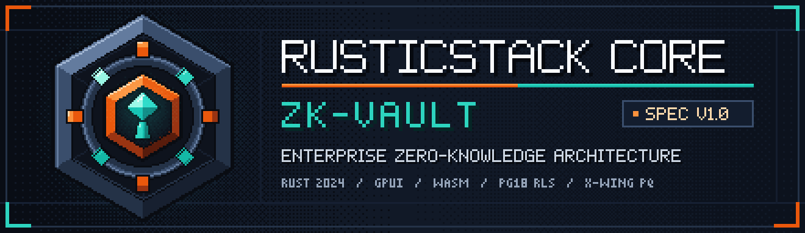
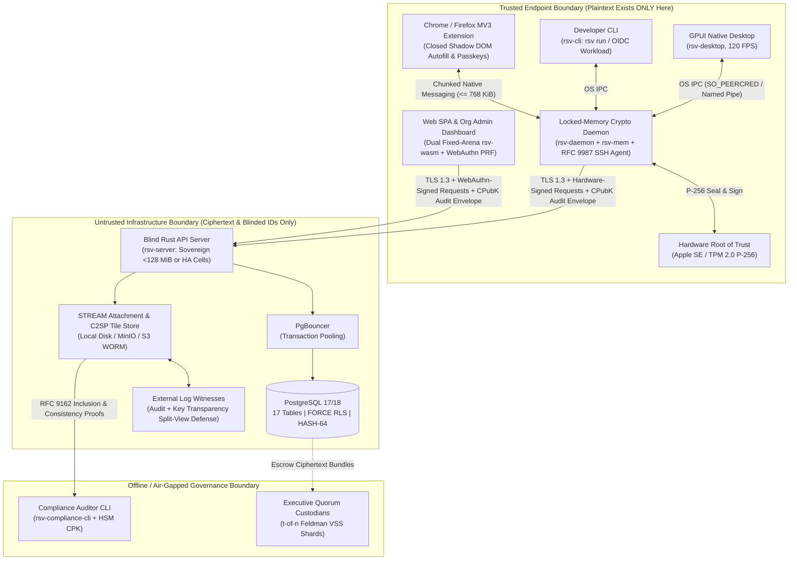

<p align="center">
  
</p>

<p align="center">
  <a href="specs/00-INDEX.md"></a>
  <a href="agents/CRATE-CONTRACTS.md"></a>
  <a href="specs/05-MULTI-TENANT-DATABASE.md"></a>
  <a href="specs/02-CRYPTOGRAPHY-AND-KEY-HIERARCHY.md"></a>
  <a href="specs/14-SELF-HOSTED-OPERATIONS-AND-OBSERVABILITY.md"></a>
  <a href="AGENTS.md"></a>
  <a href="LICENSE-MIT"></a>
</p>

---

## Executive Summary

**RusticStack Core** (`ZK-Vault`) is an open-source, enterprise-grade **zero-knowledge password, passkey, SSH, and secrets management architecture** built to deliver **Vaultwarden-class single-binary self-hosting simplicity (`< 128 MiB` RAM)** alongside **10,000+ seat enterprise cryptographic isolation**—out-engineering Bitwarden Enterprise, Vaultwarden, and 1Password across post-quantum agility, verifiable recovery, Key Transparency, hostile-OS memory hardening, and native GPU-accelerated desktop performance.

This repository is the **complete, normative, implementation-ready architectural specification (`v1.0-spec`)**. It intentionally contains **zero application source code yet**—every subsystem is rigorously defined via 16 RFC-2119 specifications (`SPEC-00`–`SPEC-15`), 12 Architecture Decision Records (`ADR-0001`–`ADR-0012`), 36 formal security invariants (`INV-001`–`INV-036`), machine-readable schemas (PostgreSQL 17/18 DDL, OpenAPI 3.1, Draft 2020-12 JSON Schema), deterministic verification harnesses, and **10 domain-scoped Devin autonomous engineering playbooks**.

---

## Architectural Pillars

| Pillar | Engineering Approach | Normative Spec & ADRs |
| :--- | :--- | :--- |
| **Hybrid Escrow + Feldman VSS Quorum** | Rejects the false dichotomy between Escrowed Keys and Shamir's Secret Sharing. Every item `DEK` is dual-wrapped under the Collection Key (`CK`) and Organization Recovery Public Key (`ORPubK`, plus scoped Delegated Recovery `DRPubK` on `standard` tier). The root `ORPK_SEED` never exists in plaintext—fragmented via **Feldman VSS (`vsss-rs` 6.0)** over Ristretto255 with **124-bit scalar padding** (defeating $2^{64}$ Pollard Kangaroo attacks) and Herzberg zero-polynomial proactive share refresh. | [`SPEC-02`](specs/02-CRYPTOGRAPHY-AND-KEY-HIERARCHY.md), [`ADR-0001`](adrs/ADR-0001-hybrid-escrow-and-feldman-vss.md) |
| **Post-Quantum Crypto Agility (`X-Wing`)** | Canonical `RSV1` binary/CBOR envelopes support mandatory baseline `CS-01` (`AES-256-GCM`, RFC 9180 HPKE `X25519`, `Ed25519`, `Argon2id`) alongside post-quantum hybrid `CS-02` (**X-Wing** `X25519 + ML-KEM-768` with exact `SHA3-256` combiner + `Ed25519 + ML-DSA-65`). | [`SPEC-02`](specs/02-CRYPTOGRAPHY-AND-KEY-HIERARCHY.md), [`ADR-0007`](adrs/ADR-0007-crypto-agility-xwing-post-quantum-hybrid.md) |
| **Hostile OS Memory & Hardware Silicon Trust** | Native Rust GPUI desktop eliminates Electron/Chromium RAM bloat. Keys live in guard-paged `LockedSecretBox<T>` arenas pinned via `mlock`/`VirtualLock`, excluded from dumps via `MADV_DONTDUMP`/`PR_SET_DUMPABLE`/`CryptProtectMemory` + Windows DACL hardening, and zeroed on `Drop` (`secrecy`, `zeroize`). Two-Tier Hardware Trust delegates non-exportable **NIST P-256** identity & sealing to **Apple Secure Enclave** and **TPM 2.0** (`tss-esapi` / Windows CNG). | [`SPEC-03`](specs/03-MEMORY-SAFETY-AND-HARDWARE-TRUST.md), [`ADR-0003`](adrs/ADR-0003-gpui-native-desktop-over-electron.md), [`ADR-0004`](adrs/ADR-0004-two-tier-hardware-enclave-p256-delegation.md) |
| **Blind RBAC Cryptographic Access Graph** | Decouples logical routing from cryptographic enforcement via an epoch-versioned DAG (`User / Machine -> Team -> Collection -> Item`, bounded `MAX_GRAPH_DEPTH = 4`). Collection names, tags, and payloads remain opaque ciphertext; revocations execute atomic epoch rotations with `lazy_forward` or `eager` re-encryption. | [`SPEC-04`](specs/04-BLIND-RBAC-ACCESS-GRAPH.md) |
| **Multi-Tenant PostgreSQL 17/18 (`FORCE RLS`)** | Avoids schema-per-tenant catalog bloat and migration lock storms. Shared `vault` schema (17 tables) with **Dual-Enforced RLS**: explicit `WHERE tenant_id = $1` (preserving O(1) `HASH(tenant_id)` 64-partition pruning and composite B-tree index scans) paired with transaction-local `set_config('app.current_tenant_id', $1, true)` (PgBouncer-safe) and InitPlan-cached `LEAKPROOF` policies under `NOBYPASSRLS` roles. | [`SPEC-05`](specs/05-MULTI-TENANT-DATABASE.md), [`postgresql-schema.sql`](schemas/postgresql-schema.sql), [`ADR-0002`](adrs/ADR-0002-shared-schema-rls-over-schema-per-tenant.md) |
| **Zero-Knowledge Audit Ledger (`tlog-tiles`)** | Strict separation of duties between DevOps/DBAs and Compliance. Middleware blinds resource IDs via `HMAC-SHA256(TBK, ...)` defeating DB frequency analysis; clients seal context under offline `CPubK` and attach hardware `HDIK` signatures. Entries commit into an **RFC 9162 + C2SP `tlog-tiles`** immutable Merkle log cosigned by independent Witnesses. | [`SPEC-06`](specs/06-ZERO-KNOWLEDGE-AUDIT-LEDGER.md), [`ADR-0005`](adrs/ADR-0005-rfc9162-c2sp-tiled-merkle-audit-log.md) |
| **Key Transparency, Zero-Knowledge SSO & Blind SCIM** | Closes Bitwarden/Vaultwarden's rogue-server key-substitution gap via an IETF `keytrans`-inspired witnessed public-key Merkle directory (`vault.key_transparency_log`) + 6-word SAS verification. Enforces `Authentication != Decryption` for OIDC/SAML 2.0 (WebAuthn PRF + Trusted Device cross-signing) and **Blind SCIM 2.0** pending lifecycle queues. | [`SPEC-11`](specs/11-KEY-TRANSPARENCY-SSO-AND-SCIM.md), [`ADR-0009`](adrs/ADR-0009-key-transparency-and-blind-scim-sso.md) |
| **Developer Secrets: SSH Agent, Synced Passkeys & CLI** | Built-in **RFC 9987 SSH Agent** inside `rsv-daemon` (zero `~/.ssh` plaintext files, native GPUI Touch ID/Windows Hello/TPM approval + Merkle audit), **Synced Enterprise Passkeys** (shared team passkeys with per-human non-repudiation), zero-disk `rsv run` secret injection (`rsv://` URIs), and **OIDC Workload Identity** for CI/CD runners. | [`SPEC-12`](specs/12-DEVELOPER-SECRETS-SSH-PASSKEYS-AND-CLI.md), [`ADR-0010`](adrs/ADR-0010-native-ssh-agent-and-synced-passkeys.md) |
| **STREAM Attachments, Offline-First Sync & FIDO CXF** | Constant-memory **STREAM (`AES-256-GCM`)** 64 KiB chunked attachments with BLAKE3 root binding, `HDSK`-sealed offline-first encrypted local cache with 3-way conflict merge, lossless **FIDO Alliance CXF/CXP v1.0** + Bitwarden / 1Password `.1pux` / KeePassXC `.kdbx` v4 migration, and local SLIP-0039/Bech32m PDF Emergency Kits. | [`SPEC-13`](specs/13-STREAMING-ATTACHMENTS-OFFLINE-SYNC-AND-MIGRATION.md), [`ADR-0011`](adrs/ADR-0011-stream-chunked-aead-and-fido-cxf.md) |
| **Dual-Profile Sovereign Self-Hosting & 4-Client UX** | Single static distroless `rsv-server` binary scales cleanly from **Self-Hosted Sovereign Mode** (`< 128 MiB` RAM, 1 PostgreSQL, zero phone-home) to **Enterprise HA Cells** (`10,000+` seats). Full screen-by-screen UI/UX contracts for **GPUI Native Desktop** (120 FPS / 100k items), **Chrome/Firefox MV3 Extension** (`<= 768 KiB` chunked Native Messaging), **Zero-Install Web SPA** (Dual Fixed-Memory WASM Worker Split), and **10,000-Seat Thick-Client Org Admin Dashboard**. | [`SPEC-07`](specs/07-OMNI-CLIENT-ARCHITECTURE.md), [`SPEC-14`](specs/14-SELF-HOSTED-OPERATIONS-AND-OBSERVABILITY.md), [`SPEC-15`](specs/15-CLIENT-UI-UX-AND-ORG-DASHBOARD.md), [`ADR-0006`](adrs/ADR-0006-native-messaging-daemon-offload-for-extension.md), [`ADR-0008`](adrs/ADR-0008-wasm-fixed-arena-zeroization-strategy.md), [`ADR-0012`](adrs/ADR-0012-dual-profile-sovereign-self-hosting.md) |

---

## System Topology



---

## For Autonomous AI Agents (Devin / Coding Agents)

> **STOP AND READ [`AGENTS.md`](AGENTS.md) ON TURN 0.**  
> [`AGENTS.md`](AGENTS.md) is deliberately sized below Devin's **16 KiB** automatic session injection ceiling so 100% of hard invariants, toolchain locks, and forbidden actions load without truncation.

This repository is engineered for **parallelized multi-agent implementation** across **13 Rust workspace crates** (`rsv-types` through `rsv-cli`) and 2 TypeScript frontends without integration drift:

1. **Read [`AGENTS.md`](AGENTS.md)** for all non-negotiable guardrails, Rust 2024 / MSRV `1.94.0` pinned versions, and verification gates.
2. **Follow [`agents/BUILD-DAG.md`](agents/BUILD-DAG.md)** to execute milestones `M0` → `M7` along parallelizable tracks.
3. **Lock to [`agents/CRATE-CONTRACTS.md`](agents/CRATE-CONTRACTS.md)** to preserve the `#![forbid(unsafe_code)]` and `no_std`/WASM dependency firewall.
4. **Execute your scoped playbook** under [`agents/playbooks/`](agents/playbooks/):
   - [`01-crypto-core-agent.md`](agents/playbooks/01-crypto-core-agent.md) — `rsv-types`, `rsv-crypto`, `rsv-vss`, `rsv-graph`
   - [`02-os-enclave-mem-agent.md`](agents/playbooks/02-os-enclave-mem-agent.md) — `rsv-mem`, `rsv-enclave`
   - [`03-backend-rls-agent.md`](agents/playbooks/03-backend-rls-agent.md) — `rsv-server`, PostgreSQL 17/18 migrations & `FORCE RLS`
   - [`04-audit-merkle-agent.md`](agents/playbooks/04-audit-merkle-agent.md) — `rsv-audit`, air-gapped `rsv-compliance-cli`
   - [`05-gpui-desktop-agent.md`](agents/playbooks/05-gpui-desktop-agent.md) — `rsv-daemon`, `rsv-nm-host`, `rsv-desktop`
   - [`06-wasm-web-ext-agent.md`](agents/playbooks/06-wasm-web-ext-agent.md) — `rsv-wasm`, Web SPA core, Chrome MV3 Extension core
   - [`07-qa-redteam-agent.md`](agents/playbooks/07-qa-redteam-agent.md) — KAT vectors, RLS chaos, memory-dump, Merkle tamper & 7 fuzz targets
   - [`08-sso-keytrans-devsecrets-agent.md`](agents/playbooks/08-sso-keytrans-devsecrets-agent.md) — Key Transparency, OIDC/SAML, Blind SCIM 2.0, RFC 9987 SSH Agent, Synced Passkeys, `rsv-cli`
   - [`09-attachments-sync-selfhost-agent.md`](agents/playbooks/09-attachments-sync-selfhost-agent.md) — STREAM attachments, offline encrypted cache, FIDO CXF/CXP migration, Sovereign Docker/systemd ops
   - [`10-ui-ux-dashboard-agent.md`](agents/playbooks/10-ui-ux-dashboard-agent.md) — GPUI views/modals, MV3 Shadow DOM autofill/passkey UX, Web SPA, 10,000-seat Thick-Client Org Dashboard
5. **Validate against machine-readable schemas** in [`schemas/`](schemas/README.md) (`postgresql-schema.sql`, `openapi-v1.yaml`, `ipc-native-messaging.schema.json`) and verify all **36 formal invariants (`INV-001`–`INV-036`)**.

---

## Complete Repository Map

```text
ZK-Vault/
├── README.md                             # Public showcase, system topology & agent entry point
├── AGENTS.md                             # Compact (< 16 KiB) Devin & autonomous agent root manual
├── SECURITY.md                           # Cryptographic review scope & responsible disclosure
├── CONTRIBUTING.md                       # Specification governance, RFC rules & commit format
├── CODE_OF_CONDUCT.md                    # Contributor Covenant v2.1
├── LICENSE-MIT / LICENSE-APACHE          # Dual MIT / Apache-2.0 licenses
├── assets/
│   ├── banner.png                        # Official RusticStack Core (ZK-Vault) README hero banner
│   └── logo.png                          # Official 512x512 application emblem
├── specs/                                # 16 Normative RFC-2119 Engineering Specifications
│   ├── 00-INDEX.md                       # Master spec map, dependency graph & canonical glossary
│   ├── 01-SYSTEM-ARCHITECTURE.md         # Trust boundaries, 13-crate workspace & E2E data flows
│   ├── 02-CRYPTOGRAPHY-AND-KEY-HIERARCHY.md
│   ├── 03-MEMORY-SAFETY-AND-HARDWARE-TRUST.md
│   ├── 04-BLIND-RBAC-ACCESS-GRAPH.md
│   ├── 05-MULTI-TENANT-DATABASE.md
│   ├── 06-ZERO-KNOWLEDGE-AUDIT-LEDGER.md
│   ├── 07-OMNI-CLIENT-ARCHITECTURE.md
│   ├── 08-API-AND-WIRE-PROTOCOLS.md
│   ├── 09-THREAT-MODEL-AND-FORMAL-INVARIANTS.md
│   ├── 10-TEST-VECTORS-AND-VERIFICATION.md
│   ├── 11-KEY-TRANSPARENCY-SSO-AND-SCIM.md
│   ├── 12-DEVELOPER-SECRETS-SSH-PASSKEYS-AND-CLI.md
│   ├── 13-STREAMING-ATTACHMENTS-OFFLINE-SYNC-AND-MIGRATION.md
│   ├── 14-SELF-HOSTED-OPERATIONS-AND-OBSERVABILITY.md
│   └── 15-CLIENT-UI-UX-AND-ORG-DASHBOARD.md
├── adrs/                                 # 12 Architecture Decision Records (MADR format)
│   ├── README.md
│   ├── ADR-0001-hybrid-escrow-and-feldman-vss.md
│   ├── ADR-0002-shared-schema-rls-over-schema-per-tenant.md
│   ├── ADR-0003-gpui-native-desktop-over-electron.md
│   ├── ADR-0004-two-tier-hardware-enclave-p256-delegation.md
│   ├── ADR-0005-rfc9162-c2sp-tiled-merkle-audit-log.md
│   ├── ADR-0006-native-messaging-daemon-offload-for-extension.md
│   ├── ADR-0007-crypto-agility-xwing-post-quantum-hybrid.md
│   ├── ADR-0008-wasm-fixed-arena-zeroization-strategy.md
│   ├── ADR-0009-key-transparency-and-blind-scim-sso.md
│   ├── ADR-0010-native-ssh-agent-and-synced-passkeys.md
│   ├── ADR-0011-stream-chunked-aead-and-fido-cxf.md
│   └── ADR-0012-dual-profile-sovereign-self-hosting.md
├── agents/                               # Autonomous Multi-Agent Orchestration Blueprints
│   ├── README.md
│   ├── BUILD-DAG.md
│   ├── CRATE-CONTRACTS.md
│   └── playbooks/                        # 10 domain-scoped Devin playbooks (01..10)
└── schemas/                              # Machine-Readable Normative Schemas
    ├── README.md
    ├── postgresql-schema.sql             # Complete 17-table PostgreSQL 17/18 DDL + HASH-64 + FORCE RLS
    ├── openapi-v1.yaml                   # OpenAPI 3.1.0 Blind Backend API specification
    └── ipc-native-messaging.schema.json  # Draft 2020-12 JSON Schema for chunked Native Messaging IPC
```

---

## Brand Assets

<p align="center">
  
</p>

The official hexagonal tungsten vault shield, Rust-copper locking core, and zero-knowledge cyan crystal keyhole emblem live in [`assets/logo.png`](assets/logo.png) (`512×512`) and [`assets/banner.png`](assets/banner.png) (`1320×384`), aligning with the **Obsidian & Tungsten** design language defined in [`SPEC-15`](specs/15-CLIENT-UI-UX-AND-ORG-DASHBOARD.md).

---

## Contributing & License

See [`CONTRIBUTING.md`](CONTRIBUTING.md) for RFC/ADR governance and [`SECURITY.md`](SECURITY.md) for responsible disclosure.

RusticStack Core (`ZK-Vault`) is dual-licensed under either the **MIT License** ([`LICENSE-MIT`](LICENSE-MIT)) or the **Apache License, Version 2.0** ([`LICENSE-APACHE`](LICENSE-APACHE)), at your option.
