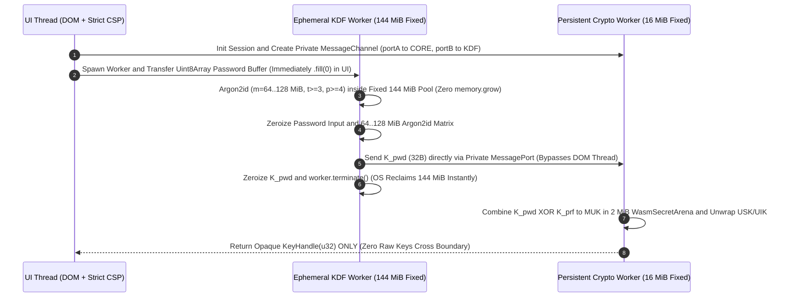

# ADR-0008: WebAssembly Fixed-Arena Memory Pool and Zeroization Strategy

| Metadata | Value |
| :--- | :--- |
| **ADR ID** | `ADR-0008` |
| **Status** | Accepted |
| **Date** | 2026-11-19 |
| **Deciders** | RusticStack Core Architecture Group |
| **Project** | RusticStack Core (`ZK-Vault`) — `https://github.com/KelpHect/ZK-Vault` |
| **Normative Specs** | [SPEC-03: Memory Safety and Hardware Trust](../specs/03-MEMORY-SAFETY-AND-HARDWARE-TRUST.md) |
| **Target Crates** | `rsv-wasm`, `rsv-crypto`, `rsv-types` |

---

## 1. Context and Problem Statement

RusticStack Core compiles its canonical pure-Rust cryptography (`rsv-crypto`) to `wasm32-unknown-unknown` (`rsv-wasm`) so browser clients execute the exact same `AES-256-GCM`, RFC 9180 HPKE (`CS-01` X25519 and `CS-02` X-Wing), `Ed25519` / `ML-DSA-65`, and `Argon2id` code as native desktop clients.

However, standard Rust-to-WASM compilation (`wasm-bindgen` + default `dlmalloc` dynamic heap) introduces **three silent, catastrophic memory-safety failures** for zero-knowledge secret management inside browsers:

1. **The `memory.grow()` Copy Leak Bug**:
   Whenever a dynamic WASM allocator needs more heap pages (e.g., during decryption of a large item, X-Wing decapsulation, or Argon2id allocation), it emits the WebAssembly `memory.grow` instruction. On major browser engines (V8, SpiderMonkey, JavaScriptCore), growing a non-shared `WebAssembly.Memory` frequently allocates a **brand-new larger backing `ArrayBuffer`**, `memcpy`s the entire previous linear memory (including live `MUK`, `USK`, `UIK`, `CK`, and `DEK` bytes!) into the new buffer, and detaches/frees the old buffer **WITHOUT zeroizing the old memory**. Every `ZeroizeOnDrop` guarantee is silently defeated as plaintext keys remain stranded in freed browser renderer RAM indefinitely.
2. **The Argon2id Memory Footprint Dilemma**:
   `CS-01` and `CS-02` enforce a normative `Argon2id` floor of `m >= 65536 KiB` (`64 MiB`), with enterprise tenants allowed to configure `m = 131072 KiB` (`128 MiB`). Hard-capping a single monolithic WASM instance to `16 MiB` would crash Argon2id with `OutOfMemory`, while holding a permanent `144 MiB` fixed linear memory open in every idle browser tab wastes excessive RAM and bloats browser memory pressure.
3. **JavaScript GC String Immutability & Raw Key Exposure**:
   Standard `wasm-bindgen` bindings pass keys and secrets across FFI as JavaScript `Uint8Array` copies or immutable UTF-16 JS `string` values. JS `string` objects are interned, relocated by generational garbage collectors (V8 Scavenger / Mark-Compact), and **impossible to zeroize** from application code.
4. **Absence of OS Hardening Primitives**:
   Browsers intentionally forbid `mlock()`, `mprotect(PROT_NONE)`, `MADV_DONTDUMP`, and direct TPM/Secure Enclave access. Pretending WASM achieves native `rsv-mem` parity creates dangerous false assurance.

How should `rsv-wasm` eliminate `memory.grow()` copy leaks, satisfy `Argon2id` (`64–128 MiB`), keep raw keys out of JavaScript GC memory, and articulate honest browser security boundaries?

---

## 2. Decision Drivers

- **Zero `memory.grow()` Copy Leaks**: Compiled `.wasm` modules MUST NEVER invoke `memory.grow` at runtime—enforced statically at build/CI time.
- **Full `Argon2id` Compliance Without Persistent RAM Bloat**: MUST support `Argon2id` from `m = 65536 KiB` (`64 MiB`) up to `m = 131072 KiB` (`128 MiB`) while keeping idle unlocked browser session RAM at `<= 16 MiB`.
- **Zero Raw Keys in JavaScript Heap**: Raw `MUK`, `USK`, `UIK`, `TK`, `CK`, and `DEK` bytes MUST NEVER cross the WASM-to-JS FFI boundary.
- **Deterministic Panic / Lock / Unload Zeroization**: Locking the vault, hitting idle timeout, or closing the tab MUST overwrite all active secret memory in `< 1 ms` with compiler-barrier volatile writes (`zeroize` `1.9`).
- **No COOP/COEP SSO Breakage**: MUST NOT depend on `SharedArrayBuffer` / Cross-Origin Isolation headers (`COOP: same-origin`, `COEP: require-corp`) that break third-party enterprise OIDC/SAML SSO popup authentication flows.
- **Honest Threat Modeling**: Explicitly cap browser client trust at `L2_WEBAUTHN_ROAMING` / `L1_SOFTWARE_LOCKED_MEM` so tenants requiring `L3_HARDWARE_ENCLAVE` mandate native `rsv-desktop` / `rsv-daemon`.

---

## 3. Considered Options

### Option A: Native Browser WebCrypto (`SubtleCrypto`) Only (Drop WASM)
- Implement client cryptography directly in TypeScript via `window.crypto.subtle`.
- *Pros*: `CryptoKey` objects with `extractable: false` stay inside browser C++ memory outside JS GC.
- *Cons*: **Incomplete primitive set and protocol divergence.** `SubtleCrypto` lacks `Argon2id`, lacks RFC 9180 HPKE Base Mode, lacks post-quantum `X-Wing` (`ML-KEM-768`) and `ML-DSA-65`, lacks Ristretto255 Feldman VSS, and would require maintaining a second error-prone TypeScript re-implementation of `rsv-crypto`.

### Option B: Standard `wasm-bindgen` Dynamic Heap (`dlmalloc`) + `ZeroizeOnDrop`
- Compile `rsv-crypto` to `wasm32` with default Rust allocator and pass wrapped byte slices to JS.
- *Pros*: Minimal engineering effort; automatically scales memory for Argon2id.
- *Cons*: **Silently leaks plaintext keys on every `memory.grow()` reallocation.** Even if `rsv-crypto` calls `ZeroizeOnDrop`, the detached pre-growth backing `ArrayBuffer` retains unzeroized copies of `MUK`/`USK`/`CK` inside renderer heap memory.

### Option C: `SharedArrayBuffer` Fixed Linear Memory (`+atomics,+bulk-memory`)
- Pre-allocate a fixed `SharedArrayBuffer`-backed `WebAssembly.Memory` (`initial == max`).
- *Pros*: Guarantees stable backing buffer pointer without reallocation.
- *Cons*: Requires global `Cross-Origin-Opener-Policy: same-origin` and `Cross-Origin-Embedder-Policy: require-corp` HTTP headers on the web origin, which **breaks enterprise SAML/OIDC IdP popup windows** and third-party SSO redirects; also unnecessary when `initial == max` on standard non-shared `WebAssembly.Memory` ALREADY forbids `memory.grow` completely!

### Option D (CHOSEN): Dual Fixed-Memory Worker Split (`16 MiB` Core + `144 MiB` Ephemeral KDF) + `2 MiB` `WasmSecretArena` + Opaque `KeyHandle(u32)` FFI
- **Compile BOTH WASM modules with static `initial == max` linear memory and ZERO `memory.grow` instructions**:
  1. **Persistent Core Crypto Worker (`rsv-wasm` / `rsv_wasm.wasm`)**:
     - Fixed `--initial-memory=16777216 --max-memory=16777216` (`16 MiB` = `256` pages).
     - Dedicated `2 MiB` `WasmSecretArena` static slab allocator inside linear memory managing all session keys (`MUK`, `USK`, `UIK`, `TK`, `CK`, `DEK`, `CS-02` X-Wing expanded keys) and transient item buffers.
     - Custom panic hook and `rsv_wasm_wipe_all()` export overwriting the entire `2 MiB` arena via `zeroize::Zeroize` (`write_volatile` + `SeqCst` fence) in `< 1 ms`.
  2. **Ephemeral Argon2id KDF Worker (`rsv-wasm-kdf` / `rsv_wasm_kdf.wasm`)**:
     - Fixed `--initial-memory=150994944 --max-memory=150994944` (`144 MiB` = `2304` pages), cleanly accommodating `Argon2id` up to `m = 131072 KiB` (`128 MiB`) with zero heap growth.
     - Spawned ONLY during unlock/enrollment; zeroes password buffer and full `64–128 MiB` Argon2id matrix upon completion; transfers 32-byte `K_pwd` directly to the persistent Core Worker over a private Worker-to-Worker `MessageChannel` (never touching DOM main thread); zeroes transfer buffer and terminates (`self.close()` / `worker.terminate()`) so the OS reclaims all `144 MiB` immediately.
- **Generation-Indexed Opaque `KeyHandle(u32)` FFI**:
  - Bit layout: `(generation: u16) << 16 | (slot_index: u16)`.
  - JS NEVER receives raw key bytes. Destroying a handle increments `generation` (skipping `0`) and zeroizes the slot immediately, rejecting stale/use-after-free handle replays with `WasmCryptoError::StaleKeyHandle`.
- **Zero-JS-String Policy & Dedicated Worker Isolation**:
  - Passwords are read via `TextEncoder.encodeInto()` into a reusable `Uint8Array`, sent straight to `rsv-wasm-kdf`, and wiped via `.fill(0)` immediately; `<input>.value` is cleared synchronously.
  - Both workers execute with zero DOM access under strict CSP (`script-src 'self' 'wasm-unsafe-eval'`, `worker-src 'self'`) and SRI hash verification.

---

## 4. Decision Outcome

**Chosen Option: Option D** — Dual Fixed-Memory Worker Split (`16 MiB` persistent core + `144 MiB` ephemeral KDF) with `WasmSecretArena`, generation-indexed opaque `KeyHandle(u32)` FFI, zero-JS-string discipline, and Dedicated Web Worker isolation.

---

## 5. Cryptographic and Engineering Consequences

### Positive Consequences
- **100% Elimination of `memory.grow()` Copy Leaks**: With `initial == max` statically baked into the WASM module memory section and verified in CI, no browser engine can ever allocate-and-copy linear memory behind `rsv-wasm`'s back.
- **Sleek Idle RAM With Full Argon2id Strength**: Idle unlocked sessions consume only `16 MiB`, yet unlock supports full enterprise `m = 128 MiB` Argon2id without OOM or `memory.grow()`.
- **Complete Separation of Password/KDF Scratch From Session Keys**: The Argon2id worker is destroyed completely milliseconds after login, leaving zero KDF residue in the persistent session worker's linear memory.
- **Enterprise SSO Compatibility Preserved**: Works cleanly on standard HTTPS origins without requiring COOP/COEP headers that break SAML/OIDC popups.
- **Use-After-Free Protection Across FFI**: Generation-tagged `KeyHandle(u32)` prevents confused-handle bugs when JavaScript UI components hold stale references after vault lock/re-unlock.

### Negative Consequences & Mitigations
- **Fixed Memory Exhaustion on Very Large Attachments**: A `16 MiB` core worker cannot decrypt a monolithic `64 MiB` file attachment in a single contiguous buffer.
  - *Mitigation*: Per `SPEC-02` Section 5.1, binary attachments larger than `4 MiB` MUST be encrypted in `<= 4 MiB` streaming chunks with per-chunk HKDF-derived keys, fitting comfortably inside the `16 MiB` fixed pool (`2 MiB` secret arena + streaming `4 MiB` ciphertext/plaintext IO ring buffer).
- **Custom Non-Growing Allocator Discipline**: Rust dependencies pulled into `rsv-wasm` MUST NOT perform unbounded heap allocations.
  - *Mitigation*: Implement a deterministic bounded bump/slab `#[global_allocator]` backed by the fixed linear memory region that returns `null` (controlled allocation error) instead of calling `core::arch::wasm32::memory_grow`, reinforced by CI static binary opcode auditing.
- **Browser Residual Threat Boundary**: Same-origin XSS or malicious browser extensions with host permissions can still invoke exported Worker RPC operations while unlocked, and browser OS processes can still swap memory to disk.
  - *Mitigation*: Documented transparently in `SPEC-03` Section 6.3; strict CSP + SRI minimizes XSS risk; browser sessions enforce aggressive idle auto-lock (`5–15 min`) invoking `rsv_wasm_wipe_all()`; enterprise tenants protecting crown jewels enforce `min_device_attestation_level = 3` (`rsv-desktop` / `rsv-daemon`).

---

## 6. Verification and Compliance Criteria

An implementation of `rsv-wasm` SHALL NOT merge unless CI passes all verification checks below:

1. **Static Zero-`memory.grow` Binary Gate**:
   - Inspect both `rsv_wasm.wasm` and `rsv_wasm_kdf.wasm` with `wasmparser` / `wasm-tools dump`:
     - Assert **ZERO** `Operator::MemoryGrow` instructions exist anywhere in the code section.
     - Assert `rsv_wasm.wasm` memory section declares `initial == 256 && maximum == Some(256)` (`16 MiB`).
     - Assert `rsv_wasm_kdf.wasm` memory section declares `initial == 2304 && maximum == Some(2304)` (`144 MiB`).
2. **Argon2id Headroom Test**:
   - Run `rsv_wasm_kdf.wasm` inside headless Chromium/Playwright AND `wasmtime` with both `m = 65536 KiB` and `m = 131072 KiB` (`t = 3, p = 4`), verifying bit-exact RFC 9106 KAT output, zero OOM traps, and zero remaining non-zero bytes in the KDF scratch memory after derivation.
3. **Opaque Handle & Zero-Key-Export Audit**:
   - Inspect generated TypeScript `.d.ts` / WASM export table confirming NO export returns raw key bytes (`MUK`, `USK`, `UIK`, `TK`, `CK`, `DEK`).
   - Verify calling any cryptographic method with a dropped or forged `KeyHandle(u32)` fails immediately with `WasmCryptoError::StaleKeyHandle`.
4. **Full Arena Wipe Verification**:
   - Load `MUK`, `USK`, `CK`, and `DEK` into `WasmSecretArena`, record arena linear-memory byte bounds, invoke `rsv_wasm_wipe_all()`, and inspect the raw `WebAssembly.Memory.buffer` `Uint8Array` view from test harness asserting **100% of bytes in the `2 MiB` `WasmSecretArena` equal `0x00`**.
5. **Streaming Chunk Test Within `16 MiB` Cap**:
   - Encrypt and decrypt a `32 MiB` multi-chunk (`4 MiB` chunks) payload sequentially through `rsv_wasm.wasm` verifying peak arena usage stays strictly below the `16 MiB` ceiling with zero allocation failures.
