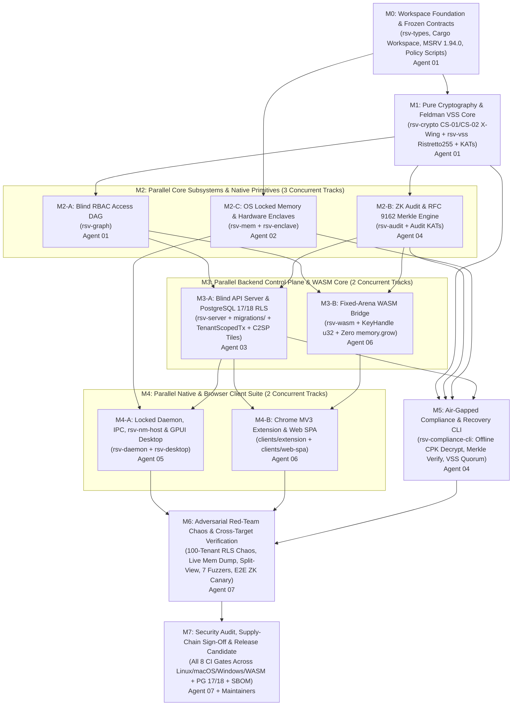

# Milestone Build Dependency DAG (`M0` – `M7`)

> **Document ID**: `RSV-AGENT-DAG`
> **Project**: RusticStack Core (`ZK-Vault` — `https://github.com/KelpHect/ZK-Vault`)
> **Status**: Normative Orchestration Schedule
> **Target Toolchain**: Rust 2024 Edition (MSRV `1.94.0`)

---

## 1. Visual Execution DAG & Parallel Execution Fan-Out

Milestones `M0` and `M1` form the deterministic foundation. Immediately after `M1`, execution fans out into **up to three concurrent autonomous Devin tracks** across `M2`, `M3`, and `M4` with zero overlapping crate ownership, reconverging cleanly for air-gapped CLI integration (`M5`), adversarial red-team chaos verification (`M6`), and Release Candidate hardening (`M7`).

---

## 2. Parallelism & Synchronization Summary

| Milestone | Sync Tag | Parallel Tracks | Active Agents | Critical Path Bottleneck |
|---|---|---|---|---|
| **M0** | `m0-contracts-frozen` | 1 (Serial) | Agent 01 | `rsv-types` CBOR/AAD/DTO & workspace freeze |
| **M1** | `m1-crypto-vss-green` | 1 (Serial) | Agent 01 | X-Wing (`CS-02`) & Feldman VSS 2×128-bit KAT parity |
| **M2** | `m2-subsystems-green` | **3 Parallel** (`2A`, `2B`, `2C`) | Agents 01, 04, 02 | `rsv-mem`/`rsv-enclave` cross-OS memory & `swtpm` tests |
| **M3** | `m3-backend-wasm-green` | **2 Parallel** (`3A`, `3B`) | Agents 03, 06 | `rsv-server` PG 17/18 RLS & `rsv-wasm` zero-`memory.grow` |
| **M4** | `m4-clients-green` | **2 Parallel** (`4A`, `4B`) | Agents 05, 06 | `rsv-desktop` GPUI + `rsv-nm-host` sub-1MiB chunk handshake |
| **M5** | `m5-compliance-cli-green` | 1 (Can overlap tail of `M4`) | Agent 04 | Air-gapped offline bundle verification (`unshare -rn`) |
| **M6** | `m6-redteam-chaos-green` | 1 (Cross-Workspace) | Agent 07 | 100-tenant chaos + 7 `cargo-fuzz` targets + live mem dump |
| **M7** | `v1.0.0-rc.1` | 1 (Release Gate) | Agent 07 + Maintainers | Full 8-gate CI matrix green across OS/DB targets |

> **Scheduling Tip (`M2-C` Early Start)**: Because `rsv-mem` and `rsv-enclave` depend **only** on `rsv-types` (and NOT on `rsv-crypto` or `rsv-vss`), the orchestrator MAY launch **Agent 02 (`M2-C`)** immediately after `m0-contracts-frozen` in parallel with `M1`, compressing total wall-clock build time significantly!

---

## 3. Detailed Milestone Specifications (Entry & Exit Criteria)

### Milestone `M0`: Workspace Skeleton & Frozen Type Contracts
- **Owner**: Agent 01 (`01-crypto-core-agent.md`)
- **Entry Criteria**: Normative specs (`specs/00`–`10`), ADRs (`adrs/ADR-0001`–`0008`), and schemas (`schemas/*`) committed on `main`.
- **Deliverables**:
  - Root `Cargo.toml` declaring all 12 workspace crates with pinned dependency versions (`rust-version = "1.94.0"`, `edition = "2024"`).
  - `rust-toolchain.toml` pinning `1.94.0` + `wasm32-unknown-unknown` target + `clippy` + `rustfmt`.
  - `deny.toml` enforcing dual `MIT OR Apache-2.0` compatibility, advisory bans, and dependency firewall rules.
  - `crates/rsv-types/` implementing all strongly-typed UUIDv7 IDs (`TenantId`, `UserId`, `DeviceId`, `TeamId`, `CollectionId`, `ItemId`, `RevisionId`), `CipherSuiteId` (`CS-01 = 0x0001`, `CS-02 = 0x0002`), canonical RFC 8949 CBOR `AadContext`, `Envelope`, canonical API error enum, and frozen trait definitions from `agents/CRATE-CONTRACTS.md`.
  - Stub `Cargo.toml` + `src/lib.rs` (with `#![forbid(unsafe_code)]` on the 10 safe crates) for all remaining 11 crates so the entire workspace compiles cleanly from Day 1.
- **Exit Criteria (ALL MUST exit `0`)**:
  - `cargo +1.94.0 check --workspace --all-targets`
  - `cargo +1.94.0 check -p rsv-types --no-default-features --target wasm32-unknown-unknown`
  - `cargo +1.94.0 clippy --workspace --all-targets -- -D warnings`
  - `cargo test -p rsv-types` (canonical CBOR determinism & origin parser tests pass)
  - Tag `m0-contracts-frozen` published.

---

### Milestone `M1`: Pure Cryptography (`CS-01`/`CS-02`) & Feldman VSS
- **Owner**: Agent 01 (`01-crypto-core-agent.md`)
- **Entry Criteria**: Tag `m0-contracts-frozen`.
- **Deliverables**:
  - `crates/rsv-crypto/`: `AES-256-GCM` (`0.11`) with mandatory `AadContext`, RFC 9180 HPKE (`0.15`), X-Wing (`X25519 + ML-KEM-768` SHA3-256 combiner with exact `0x5c2e2f2f5e5c` label), `Ed25519` (`verify_strict`) + `ML-DSA-65` hybrid signatures, `Argon2id` (`0.6`) + WebAuthn PRF XOR `MUK` derivation, `secrecy` `0.10` + `zeroize` `1.9` wrappers.
  - `crates/rsv-vss/`: `vsss-rs` `6.0` Feldman VSS over Ristretto255 with 2×128-bit chunking for 256-bit `ORPK_SEED`, independent share verification, exact quorum reconstruction, and proactive share refresh.
  - Canonical KAT fixtures under `test-vectors/v1/` (`cs01_hpke_aesgcm.*`, `cs02_xwing_mldsa.*`, `kdf_argon2id_muk.kat.json`, `vss_feldman_ristretto255.*`).
- **Exit Criteria (ALL MUST exit `0`)**:
  - `cargo test -p rsv-crypto -p rsv-vss --features kat-deterministic`
  - `cargo check -p rsv-crypto -p rsv-vss --no-default-features --target wasm32-unknown-unknown`
  - `PROPTEST_CASES=2048 cargo test -p rsv-crypto -p rsv-vss`
  - All `INV-001`–`INV-004`, `INV-010`, `INV-015`, `INV-016` unit/KAT checks green.
  - Tag `m1-crypto-vss-green` published.

---

### Milestone `M2`: Parallel Core Subsystems & Native Security Primitives (3 Tracks)

#### Track `M2-A`: Blind RBAC Access DAG (`rsv-graph`)
- **Owner**: Agent 01 (`01-crypto-core-agent.md`)
- **Entry Criteria**: Tag `m1-crypto-vss-green`.
- **Deliverables**: `crates/rsv-graph/` DAG traversal (`User -> Team -> Collection -> Item`), cycle rejection (`GRAPH_CYCLE_REJECTED`), `UIK` edge signature verification, epoch rotation planner (`INV-009`), and `root_quorum_only` escrow policy enforcement (`ESCROW_POLICY_VIOLATION`, `INV-005`).
- **Exit Criteria**: `cargo test -p rsv-graph` + `cargo check -p rsv-graph --no-default-features --target wasm32-unknown-unknown` + `proptest` DAG suite exit `0`.

#### Track `M2-B`: Zero-Knowledge Audit & RFC 9162 Merkle Engine (`rsv-audit`)
- **Owner**: Agent 04 (`04-audit-merkle-agent.md`)
- **Entry Criteria**: Tag `m1-crypto-vss-green`.
- **Deliverables**: `crates/rsv-audit/` blinded HMAC-SHA256 (`TBK`, domain `"rsv:audit:blind:v1"`), `CPubK` compliance envelope sealer/unsealer, RFC 9162 domain-separated Merkle tree (`0x00`/`0x01`), inclusion & consistency proof generation/verification, C2SP `tlog-tiles` (height 8) encoder/decoder, witness checkpoint verifier, and `test-vectors/v1/audit_*` KATs.
- **Exit Criteria**: `cargo test -p rsv-audit --features kat-deterministic` + `cargo check -p rsv-audit --no-default-features --target wasm32-unknown-unknown` exit `0`.

#### Track `M2-C`: Hostile-OS Locked Memory & Two-Tier Hardware Enclaves (`rsv-mem`, `rsv-enclave`)
- **Owner**: Agent 02 (`02-os-enclave-mem-agent.md`)
- **Entry Criteria**: Tag `m0-contracts-frozen` (may execute concurrently with `M1`!).
- **Deliverables**:
  - `crates/rsv-mem/`: `LockedSecretBox<T>`, page-aligned allocator with leading/trailing `PROT_NONE`/`PAGE_NOACCESS` guard pages, `mlock`/`MADV_DONTDUMP`/`PR_SET_DUMPABLE(0)` (Linux), `RLIMIT_CORE=0` (macOS), `VirtualLock`/`CryptProtectMemory`/process DACL (Windows), volatile zeroize on `Drop`.
  - `crates/rsv-enclave/`: `HardwareKeyProvider` trait implementations for Apple SE P-256 (`security-framework`), Linux TPM 2.0 (`tss-esapi`), Windows CNG/PCPKSP (`windows`), and audited `SoftwareFallbackProvider` explicitly advertising `HardwareTrustTier::SoftwareFallback`.
- **Exit Criteria**: `rsv-mem` locked-memory negative test (`/proc/self/smaps` `VmLck` + `dd`, guard page `SIGSEGV`, post-`Drop` zero scan) + `rsv-enclave` `swtpm`/platform tests + every `unsafe` block audited with `// SAFETY:` comment exit `0`.
- **Sync Checkpoint**: Merge `M2-A`, `M2-B`, `M2-C` -> tag `m2-subsystems-green`.

---

### Milestone `M3`: Parallel Backend Control Plane & WASM Core (2 Tracks)

#### Track `M3-A`: Blind API Server & PostgreSQL 17/18 RLS (`rsv-server`)
- **Owner**: Agent 03 (`03-backend-rls-agent.md`)
- **Entry Criteria**: Tag `m2-subsystems-green`.
- **Deliverables**:
  - `migrations/` implementing exact 12 tables in `vault` schema from `schemas/postgresql-schema.sql`, `FORCE ROW LEVEL SECURITY`, `rsv_app` (`NOBYPASSRLS`) grants, and 64-way `HASH (tenant_id)` partitioning (`p00`..`p63`).
  - `crates/rsv-server/`: `axum` 0.8 + `tokio` + `sqlx` 0.9, type-safe `TenantScopedTx` (`set_config('app.current_tenant_id', $1::text, true)` + explicit `WHERE tenant_id = $1`), all `/api/v1` endpoints from `schemas/openapi-v1.yaml`, `HDIK` request signature & `Idempotency-Key` middleware, KMS/RAM `TBK` blinding service, C2SP `tlog-tiles` writer & witness checkpoint broadcaster.
- **Exit Criteria**: Migrations + `rsv-server` unit/integration tests + `request_auth_security` + baseline `rls_chaos_harness` (PG 17 & 18) + `EXPLAIN ANALYZE` (`Subplans Removed: 63` & `Index Cond`) exit `0`.

#### Track `M3-B`: Fixed-Arena WASM Bridge (`rsv-wasm`)
- **Owner**: Agent 06 (`06-wasm-web-ext-agent.md`)
- **Entry Criteria**: Tag `m2-subsystems-green`.
- **Deliverables**: `crates/rsv-wasm/` compiling cleanly to `wasm32-unknown-unknown` with fixed linear memory arena (`initial == maximum`, zero `memory.grow` opcodes), opaque `KeyHandle(u32)` slab table with generation counters & TTL eviction, TypeScript bindings (`pkg/`), and `wasm_arena_gate` binary inspection test.
- **Exit Criteria**: `cargo build -p rsv-wasm --target wasm32-unknown-unknown --release` + `cargo test -p rsv-wasm --test wasm_arena_gate` (`MemoryGrow == 0`) + `wasm-pack test --headless --chrome crates/rsv-wasm` exit `0`.
- **Sync Checkpoint**: Merge `M3-A`, `M3-B` -> tag `m3-backend-wasm-green`.

---

### Milestone `M4`: Parallel Native Desktop/Daemon & Browser Clients (2 Tracks)

#### Track `M4-A`: Locked Daemon, OS IPC, `rsv-nm-host` & GPUI Desktop (`rsv-daemon`, `rsv-desktop`)
- **Owner**: Agent 05 (`05-gpui-desktop-agent.md`)
- **Entry Criteria**: Tags `m2-subsystems-green` and `m3-backend-wasm-green`.
- **Deliverables**:
  - `crates/rsv-daemon/`: Locked-memory vault daemon (`rsv-mem` + `rsv-enclave`), OS peer-authenticated IPC (`SO_PEERCRED` / Windows Named Pipe SID), `rsv-nm-host` Chrome Native Messaging proxy with `<= 768 KiB` (`786,432` B) chunking/reassembly, and `test-vectors/v1/nm_host_chunk_framing.kat.json`.
  - `crates/rsv-desktop/`: Native GPUI GPU-accelerated enterprise desktop vault UI (unlock with Argon2id/biometric/enclave, blind RBAC vault browser, item editor, VSS trustee ceremony wizard, zero plaintext secret persistence on disk).
- **Exit Criteria**: `cargo test -p rsv-daemon -p rsv-desktop` + `ipc_peercred` test + `nm_host_chunk_framing` KATs (`frame <= 786,432` B) exit `0`.

#### Track `M4-B`: Chrome MV3 Extension & Web SPA (`clients/extension`, `clients/web-spa`)
- **Owner**: Agent 06 (`06-wasm-web-ext-agent.md`)
- **Entry Criteria**: Tag `m3-backend-wasm-green` (uses `schemas/ipc-native-messaging.schema.json` to build extension framing concurrently with `M4-A`).
- **Deliverables**:
  - `clients/extension/`: Manifest V3 Chrome/Chromium extension with chunked Native Messaging client (`<= 768 KiB`), strict origin/Punycode/same-origin-frame/user-gesture autofill engine (`INV-023`), fallback to `rsv-wasm` opaque handles.
  - `clients/web-spa/`: Zero-knowledge Web SPA + Org RBAC Dashboard consuming `rsv-wasm` strictly via `KeyHandle(u32)` + WebAuthn PRF unlock + strict CSP/SRI manifest.
- **Exit Criteria**: TypeScript strict `tsc --noEmit`, extension origin-autofill matrix tests, chunked NM mock tests, and Web SPA build + CSP check exit `0`.
- **Sync Checkpoint**: Merge `M4-A`, `M4-B` -> tag `m4-clients-green`.

---

### Milestone `M5`: Air-Gapped Compliance & Recovery CLI (`rsv-compliance-cli`)
- **Owner**: Agent 04 (`04-audit-merkle-agent.md`)
- **Entry Criteria**: Tags `m2-subsystems-green` and `m3-backend-wasm-green` (may run concurrently with `M4`!).
- **Deliverables**: `crates/rsv-compliance-cli/` standalone offline binary (ZERO HTTP/network crates in `Cargo.toml`!) supporting:
  - Offline RFC 9162 Merkle inclusion/consistency verification & C2SP `tlog-tiles` + witness checkpoint split-view detection;
  - Offline decryption of `X-RSV-Audit-Envelope` streams using `CPK` inside `LockedSecretBox`;
  - Air-gapped `t`-of-`n` Feldman VSS share verification and `ORPK_SEED` -> `ORPK` recovery ceremony.
- **Exit Criteria**: `unshare -rn cargo test -p rsv-compliance-cli` + dependency check proving zero network crates (`reqwest`, `hyper`, `tokio-net`) + `merkle_tamper_chaos` exit `0`.
- **Sync Checkpoint**: Tag `m5-compliance-cli-green`.

---

### Milestone `M6`: Adversarial Red-Team Chaos & Cross-Target Parity
- **Owner**: Agent 07 (`07-qa-redteam-agent.md`)
- **Entry Criteria**: Tags `m4-clients-green` and `m5-compliance-cli-green`.
- **Deliverables**:
  - Cross-target Native vs WASM KAT parity runner validating 100% of `test-vectors/v1/*`.
  - Full 100-tenant concurrent RLS Chaos Harness (`postgres:17` & `postgres:18`), Live Memory Dump & Swap Negative Test, Merkle Tamper & Split-View Chaos Harness, E2E Wire/DB Zero-Knowledge Canary (`tests/e2e_zk_canary.rs`), and Telemetry Redaction Audit (`tests/telemetry_redaction.rs`).
  - All 7 `cargo-fuzz` targets (`fuzz/fuzz_targets/*.rs`) with seed corpora and ASAN/UBSAN clean 60s smoke + nightly workflows.
  - Workspace CI scripts (`scripts/ci/check-unsafe-policy.sh`, `scripts/ci/check-dep-firewall.sh`) and `.github/workflows/`.
- **Exit Criteria**: Every single test across `INV-001` through `INV-024` in `specs/10` §5 passes with exit code `0`. Tag `m6-redteam-chaos-green`.

---

### Milestone `M7`: Security Audit & Release Candidate Sign-Off
- **Owner**: Agent 07 + Principal Security Maintainers
- **Entry Criteria**: Tag `m6-redteam-chaos-green`.
- **Deliverables**:
  - Full 8-gate CI matrix execution across Linux (`x86_64`), macOS (`aarch64` Apple Silicon), Windows (`x86_64`), `wasm32-unknown-unknown`, PostgreSQL 17, and PostgreSQL 18.
  - Generated CycloneDX SBOM, `cargo audit` & `cargo deny` clean report, `cargo geiger` report confirming `0` `unsafe` items in the 10 safe crates and audited line-by-line review of `rsv-mem`/`rsv-enclave`.
  - Release Candidate binary hashes and signed attestations.
- **Exit Criteria**: All 8 CI Hard Release Gates (`specs/10` §6) green -> tag `v1.0.0-rc.1`.
