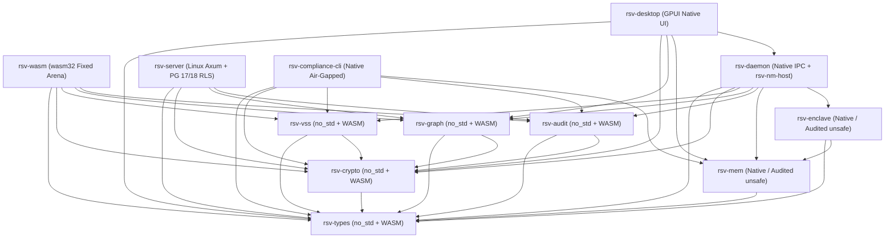

# Workspace Topology, Dependency Firewall & Public Crate Contracts

> **Document ID**: `RSV-AGENT-CONTRACTS`
> **Project**: RusticStack Core (`ZK-Vault` — `https://github.com/KelpHect/ZK-Vault`)
> **Status**: Normative Frozen Interface Contract (`M0` Baseline)
> **Target Toolchain**: Rust 2024 Edition (MSRV `1.94.0`)

---

## 1. Exact 12-Crate Cargo Workspace Layout

No autonomous agent may create a 13th workspace crate or rename any of the 12 canonical crates below without a human-approved superseding ADR.

```text
ZK-Vault/
├── Cargo.toml                         # Workspace root (edition = "2024", rust-version = "1.94.0")
├── rust-toolchain.toml                # Pinned Rust 1.94.0 + wasm32-unknown-unknown
├── deny.toml                          # License (MIT OR Apache-2.0), advisory, & dep firewall bans
├── crates/
│   ├── rsv-types/                     # [1]  no_std+alloc, WASM, #![forbid(unsafe_code)]
│   ├── rsv-crypto/                    # [2]  no_std+alloc, WASM, #![forbid(unsafe_code)]
│   ├── rsv-vss/                       # [3]  no_std+alloc, WASM, #![forbid(unsafe_code)]
│   ├── rsv-graph/                     # [4]  no_std+alloc, WASM, #![forbid(unsafe_code)]
│   ├── rsv-audit/                     # [5]  no_std+alloc, WASM, #![forbid(unsafe_code)]
│   ├── rsv-mem/                       # [6]  Native only, audited unsafe permitted
│   ├── rsv-enclave/                   # [7]  Native only, audited unsafe permitted
│   ├── rsv-wasm/                      # [8]  wasm32-unknown-unknown, #![forbid(unsafe_code)]
│   ├── rsv-daemon/                    # [9]  Native only (daemon + rsv-nm-host), #![forbid(unsafe_code)]
│   ├── rsv-desktop/                   # [10] Native only (GPUI UI), #![forbid(unsafe_code)]
│   ├── rsv-server/                    # [11] Native Linux (Axum 0.8 + sqlx 0.9), #![forbid(unsafe_code)]
│   └── rsv-compliance-cli/            # [12] Native air-gapped CLI (ZERO network crates), #![forbid(unsafe_code)]
├── migrations/                        # PostgreSQL 17/18 SQLx migrations matching schemas/postgresql-schema.sql
├── clients/
│   ├── extension/                     # Chrome/Chromium MV3 extension (TypeScript)
│   └── web-spa/                       # Zero-knowledge Web SPA & Org Dashboard (TypeScript)
├── test-vectors/v1/                   # Canonical JSON + RFC 8949 CBOR KAT fixtures
├── fuzz/                              # cargo-fuzz (libFuzzer) harnesses (excluded from default workspace members)
├── tests/                             # Cross-crate E2E ZK canary & telemetry redaction harnesses
└── scripts/ci/                        # Unsafe firewall, dep firewall, and WASM binary gate scripts
```

---

## 2. Crate Dependency Graph & Dependency Firewall Rules

### 2.1 Directed Acyclic Crate Graph



### 2.2 Mandatory Dependency Firewall Matrix

Violating any row in the **Strictly Forbidden Dependencies** column is a hard CI failure (`Gate 2` in `specs/10` §6).

| Crate Tier | Crates | Target Support | Allowed Internal Deps | Pinned External Ecosystem Deps | Strictly Forbidden Dependencies |
|---|---|---|---|---|---|
| **Tier 0: Pure Portable Core** | `rsv-types`, `rsv-crypto`, `rsv-vss`, `rsv-graph`, `rsv-audit` | `no_std` + `alloc`, Native, `wasm32-unknown-unknown` | Strictly downward within Tier 0 only | `aes-gcm` 0.11, `hpke` 0.15, `ml-kem`, `x25519-dalek` 3.0, `ed25519-dalek` 3.0, `argon2` 0.6, `hkdf`, `hmac`, `sha2`, `sha3`, `blake3`, `vsss-rs` 6.0, `curve25519-dalek`, `secrecy` 0.10, `zeroize` 1.9, `ciborium`, `serde`, `uuid` | `tokio`, `sqlx`, `axum`, `gpui`, `libc`, `windows`, `security-framework`, `tss-esapi`, `reqwest`, `hyper`, `std::fs`, `std::net`, `rsv-mem`, `rsv-enclave` |
| **Tier 1: Native OS Security** | `rsv-mem`, `rsv-enclave` | Native Linux, macOS, Windows | `rsv-types` (`rsv-enclave` -> `rsv-mem`) | `libc` (Unix), `windows` (Win32 `VirtualLock`/`CryptProtectMemory`/CNG), `security-framework` (Apple SE), `tss-esapi` (TPM 2.0), `p256`, `zeroize` 1.9 | `tokio`, `sqlx`, `axum`, `gpui`, `reqwest`, `hyper`, `wasm-bindgen`, `rsv-server` |
| **Tier 2: WASM Sandbox** | `rsv-wasm` | `wasm32-unknown-unknown` | Tier 0 crates only | `wasm-bindgen`, `js-sys`, `getrandom` (js), fixed-arena allocator | `rsv-mem`, `rsv-enclave`, `tokio`, `sqlx`, `axum`, `gpui`, `libc`, `windows`, `std::fs`, `std::net` |
| **Tier 3A: Native Daemon & UI** | `rsv-daemon`, `rsv-desktop` | Native Linux, macOS, Windows | Tier 0 + Tier 1 (`rsv-desktop` -> `rsv-daemon`) | `tokio` (daemon async IPC/HTTP), `reqwest` (rustls TLS 1.3), `gpui` / `gpui-ce` (`rsv-desktop` only) | `sqlx`, `axum`, `rsv-server`, `rsv-wasm` |
| **Tier 3B: Blind Server** | `rsv-server` | Native Linux (`x86_64` / `aarch64`) | `rsv-types`, `rsv-crypto` (verify/seal helpers only), `rsv-graph` (DAG validation only), `rsv-audit` | `axum` 0.8, `tokio` 1.x, `sqlx` 0.9 (`postgres`), `webauthn-rs`, `tower`, `tracing` | `rsv-mem` (optional KMS locked-RAM wrapper allowed via feature only), `rsv-enclave`, `rsv-desktop`, `rsv-wasm`, `gpui`, `rsv-vss` (server MUST NEVER reconstruct VSS shares!) |
| **Tier 3C: Air-Gapped CLI** | `rsv-compliance-cli` | Native Linux, macOS, Windows | `rsv-types`, `rsv-crypto`, `rsv-vss`, `rsv-audit`, `rsv-mem` | `clap`, `serde_json`, `hex`, `rpassword` | **ALL NETWORK CRATES FORBIDDEN**: `tokio`, `reqwest`, `hyper`, `axum`, `sqlx`, `h2`, `rustls`, `socket2`, `mio` (verifies `INV-019` air-gap by construction!) |

---

## 3. Public Cross-Crate Rust Trait & Type Contracts

All parallel agents MUST code strictly against these exact public signatures. Signatures below are frozen at tag `m0-contracts-frozen`.

### 3.1 `rsv-types` — Canonical Identifiers, AAD, Envelopes & Errors

```rust
#![no_std]
#![forbid(unsafe_code)]
extern crate alloc;

use alloc::vec::Vec;
use uuid::Uuid;

// Strongly typed UUIDv7 identifiers (never interchangeable raw Uuids)
#[derive(Debug, Clone, Copy, PartialEq, Eq, Hash, PartialOrd, Ord)]
pub struct TenantId(pub Uuid);
#[derive(Debug, Clone, Copy, PartialEq, Eq, Hash)]
pub struct UserId(pub Uuid);
#[derive(Debug, Clone, Copy, PartialEq, Eq, Hash)]
pub struct DeviceId(pub Uuid);
#[derive(Debug, Clone, Copy, PartialEq, Eq, Hash)]
pub struct TeamId(pub Uuid);
#[derive(Debug, Clone, Copy, PartialEq, Eq, Hash)]
pub struct CollectionId(pub Uuid);
#[derive(Debug, Clone, Copy, PartialEq, Eq, Hash)]
pub struct ItemId(pub Uuid);
#[derive(Debug, Clone, Copy, PartialEq, Eq, Hash)]
pub struct RevisionId(pub Uuid);

/// Versioned cipher suite discriminator (ADR-0007, INV-004).
#[repr(u16)]
#[derive(Debug, Clone, Copy, PartialEq, Eq, Hash)]
pub enum CipherSuiteId {
    /// Classical baseline: X25519 / HPKE / AES-256-GCM / Ed25519 / ECDSA-P256
    Cs01Classical = 0x0001,
    /// Post-quantum hybrid: X-Wing (X25519 + ML-KEM-768 SHA3-256) / Ed25519+ML-DSA-65 / AES-256-GCM
    Cs02PqHybridXWing = 0x0002,
}

/// Mandatory non-empty AEAD / HPKE context tuple (INV-002).
/// Serialized deterministically via RFC 8949 Core Deterministic CBOR.
#[derive(Debug, Clone, PartialEq, Eq)]
pub struct AadContext {
    pub domain: &'static str,           // e.g., "rsv.env.v1", "rsv.edge.v1", "rsv.audit.v1"
    pub tenant_id: TenantId,
    pub object_id: Uuid,
    pub parent_id: Uuid,
    pub epoch_or_version: u64,
    pub cipher_suite_id: CipherSuiteId,
}

impl AadContext {
    /// Encodes deterministically per RFC 8949; guaranteed non-empty.
    pub fn to_canonical_cbor(&self) -> Result<Vec<u8>, TypesError> { /* ... */ }
}

/// Collection recovery escrow policy tier (INV-005, ADR-0001).
#[derive(Debug, Clone, Copy, PartialEq, Eq)]
pub enum EscrowTier {
    /// Permits both ORPubK and policy-scoped DRPubK wrappers.
    Standard,
    /// Strictly ORPubK (Feldman VSS quorum) only; DRPubK & admin wrappers forbidden.
    RootQuorumOnly,
}

/// Hardware security trust tier advertised by device attestation (INV-013, ADR-0004).
#[derive(Debug, Clone, Copy, PartialEq, Eq)]
pub enum HardwareTrustTier {
    Tier1AppleSecureEnclave,
    Tier1LinuxTpm2,
    Tier1WindowsCngPcpksp,
    Tier2SoftwareFallback,
}

/// Canonical machine-readable API error codes matching schemas/openapi-v1.yaml.
#[derive(Debug, Clone, Copy, PartialEq, Eq)]
pub enum ApiErrorCode {
    TenantMismatch,
    InvalidSignature,
    MissingAuditEnvelope,
    StaleKeyEpoch,
    VersionConflict,
    GraphCycleRejected,
    EscrowPolicyViolation,
    UnsupportedCipherSuite,
    DeviceAttestationFailed,
    RateLimited,
    QuorumThresholdUnmet,
    AuditCommitmentInvalid,
}
```

### 3.2 `rsv-crypto` — Cipher Suite, AEAD, X-Wing KEM & Hybrid Signatures

```rust
#![no_std]
#![forbid(unsafe_code)]
extern crate alloc;

use alloc::vec::Vec;
use rsv_types::{AadContext, CipherSuiteId, TenantId};
use secrecy::SecretBox;

pub type KeyBytes32 = SecretBox<[u8; 32]>;

/// Unified symmetric AEAD & asymmetric envelope engine enforcing INV-002, INV-003, INV-004.
pub trait CipherSuiteProvider {
    fn suite_id(&self) -> CipherSuiteId;

    /// AES-256-GCM seal with fresh CSPRNG 96-bit nonce and mandatory canonical AAD.
    fn aead_seal(
        &self,
        key: &KeyBytes32,
        aad: &AadContext,
        plaintext: &[u8],
    ) -> Result<AeadCiphertext, CryptoError>;

    /// AES-256-GCM open; fails with CryptoError::AeadAuthenticationFailed on any AAD/tag tamper.
    fn aead_open(
        &self,
        key: &KeyBytes32,
        aad: &AadContext,
        ciphertext: &AeadCiphertext,
    ) -> Result<SecretBox<Vec<u8>>, CryptoError>;

    /// Asymmetric envelope seal: HPKE X25519 (CS-01) or X-Wing X25519+ML-KEM-768 (CS-02).
    fn kem_seal(
        &self,
        recipient_pk: &RecipientPublicKey,
        aad: &AadContext,
        plaintext: &[u8],
    ) -> Result<AsymmetricEnvelope, CryptoError>;

    /// Asymmetric envelope open.
    fn kem_open(
        &self,
        recipient_sk: &RecipientSecretKey,
        aad: &AadContext,
        envelope: &AsymmetricEnvelope,
    ) -> Result<SecretBox<Vec<u8>>, CryptoError>;

    /// Signs domain-separated payload (Ed25519 under CS-01; Ed25519 + ML-DSA-65 under CS-02).
    fn sign_detached(
        &self,
        signing_key: &SigningSecretKey,
        domain: &'static str,
        payload: &[u8],
    ) -> Result<DetachedSignature, CryptoError>;

    /// Verifies detached signature; CS-02 requires BOTH Ed25519 (verify_strict) AND ML-DSA-65.
    fn verify_detached(
        &self,
        verifying_key: &VerifyingPublicKey,
        domain: &'static str,
        payload: &[u8],
        signature: &DetachedSignature,
    ) -> Result<(), CryptoError>;
}

/// Derives 256-bit Master Unlock Key (MUK): Argon2id(password, domain_salt) XOR HKDF(WebAuthn PRF).
pub fn derive_muk(
    passphrase: &SecretBox<Vec<u8>>,
    tenant_id: TenantId,
    user_salt: &[u8; 16],
    params: Argon2PolicyParams, // enforces m >= 65536 KiB, t >= 3, p >= 1
    webauthn_prf: Option<&KeyBytes32>,
) -> Result<KeyBytes32, CryptoError> { /* ... */ }
```

### 3.3 `rsv-vss` — Feldman VSS over Ristretto255 (`2×128-bit` `ORPK_SEED`)

```rust
#![no_std]
#![forbid(unsafe_code)]
extern crate alloc;

use alloc::vec::Vec;
use rsv_crypto::KeyBytes32;

/// Feldman VSS threshold policy (default 3-of-5, bounds: 2 <= threshold <= total <= 32).
#[derive(Debug, Clone, Copy, PartialEq, Eq)]
pub struct VssParams {
    pub threshold: u8,
    pub total_shares: u8,
}

/// Public Ristretto255 polynomial commitments for both 128-bit chunks of ORPK_SEED (INV-015).
#[derive(Debug, Clone, PartialEq, Eq)]
pub struct FeldmanCommitments {
    pub params: VssParams,
    pub commitments_lo: Vec<[u8; 32]>, // length == threshold
    pub commitments_hi: Vec<[u8; 32]>, // length == threshold
}

/// Single trustee share (sensitive; redacted Debug, ZeroizeOnDrop).
pub struct TrusteeShare {
    pub index: u8, // 1..=total_shares
    pub y_lo: rsv_crypto::KeyBytes32,
    pub y_hi: rsv_crypto::KeyBytes32,
}

pub trait FeldmanVssEngine {
    /// Splits 256-bit ORPK_SEED into 2x128-bit Ristretto255 Feldman shares + public commitments.
    fn split_orpk_seed(
        orpk_seed: &KeyBytes32,
        params: VssParams,
    ) -> Result<(FeldmanCommitments, Vec<TrusteeShare>), VssError>;

    /// Independently verifies one trustee share against public commitments WITHOUT reconstructing.
    fn verify_share(
        commitments: &FeldmanCommitments,
        share: &TrusteeShare,
    ) -> Result<(), VssError>;

    /// Verifies every share against commitments, rejects duplicates or < threshold (INV-016),
    /// and reconstructs exact 256-bit ORPK_SEED.
    fn reconstruct_orpk_seed(
        commitments: &FeldmanCommitments,
        shares: &[TrusteeShare],
    ) -> Result<KeyBytes32, VssError>;
}
```

### 3.4 `rsv-graph` — Blind RBAC DAG Resolver & Epoch Rotation Planner

```rust
#![no_std]
#![forbid(unsafe_code)]
extern crate alloc;

use alloc::vec::Vec;
use rsv_crypto::{KeyBytes32, RecipientSecretKey, VerifyingPublicKey};
use rsv_types::{CollectionId, EscrowTier, ItemId, TeamId, TenantId, UserId};

pub trait BlindKeyGraph {
    /// Validates strict stratification (User->Team->Collection->Item), rejects cycles
    /// (GraphError::CycleDetected -> GRAPH_CYCLE_REJECTED), and verifies UIK signatures (INV-008).
    fn validate_and_load(
        tenant_id: TenantId,
        edges: &[SignedGraphEdge],
        directory: &dyn VerifyingKeyDirectory,
    ) -> Result<ValidatedGraph, GraphError>;

    /// Unwraps target Collection Key (CK) for an authorized user from USK along verified DAG path.
    fn derive_collection_key(
        graph: &ValidatedGraph,
        user_id: UserId,
        user_sk: &RecipientSecretKey,
        collection_id: CollectionId,
    ) -> Result<(u64 /* key_epoch */, KeyBytes32), GraphError>;

    /// Validates escrow policy before publishing recovery edges (INV-005 -> ESCROW_POLICY_VIOLATION).
    fn validate_escrow_edge(
        collection_tier: EscrowTier,
        escrow_target: EscrowKeyKind,
    ) -> Result<(), GraphError>;

    /// Computes epoch+1 rotated symmetric key and freshly re-wrapped signed edges excluding revoked_users (INV-009).
    fn plan_revocation_rotation(
        &self,
        scope: RotationScope,
        current_epoch: u64,
        remaining_members: &[AuthorizedRecipient],
        granter_uik: &rsv_crypto::SigningSecretKey,
    ) -> Result<RotationPlan, GraphError>;
}
```

### 3.5 `rsv-audit` — Blinded HMAC (`TBK`), `CPubK` Envelopes & RFC 9162 / C2SP `tlog-tiles`

```rust
#![no_std]
#![forbid(unsafe_code)]
extern crate alloc;

use alloc::vec::Vec;
use rsv_crypto::{AsymmetricEnvelope, KeyBytes32, RecipientPublicKey, RecipientSecretKey};
use rsv_types::{AadContext, TenantId};

pub const AUDIT_BLIND_DOMAIN: &str = "rsv:audit:blind:v1";
pub const RFC9162_LEAF_PREFIX: u8 = 0x00;
pub const RFC9162_NODE_PREFIX: u8 = 0x01;
pub const TLOG_TILE_HEIGHT: u8 = 8; // 256 leaves per full tile

/// Domain-separated HMAC-SHA256 tag computation (INV-017).
pub fn compute_blinded_tag(
    tbk: &KeyBytes32,
    tenant_id: TenantId,
    field_domain: BlindFieldDomain, // ActorBlindId | TargetBlindId | ActionBlindTag
    canonical_value: &str,
) -> [u8; 32] { /* ... */ }

/// Seals audit event payload client-side to standalone Compliance Public Key (CPubK) (INV-019).
pub fn seal_compliance_envelope(
    cpubk: &RecipientPublicKey,
    aad: &AadContext,
    canonical_audit_cbor: &[u8],
) -> Result<AsymmetricEnvelope, AuditError> { /* ... */ }

/// Offline air-gapped decryption using Compliance Private Key (CPK) (INV-019).
pub fn open_compliance_envelope(
    cpk: &RecipientSecretKey,
    aad: &AadContext,
    envelope: &AsymmetricEnvelope,
) -> Result<secrecy::SecretBox<Vec<u8>>, AuditError> { /* ... */ }

/// RFC 9162 Merkle verifier & C2SP tlog-tiles codec (INV-018).
pub trait TransparencyLogVerifier {
    fn hash_leaf(canonical_leaf_cbor: &[u8]) -> [u8; 32];
    fn hash_node(left: &[u8; 32], right: &[u8; 32]) -> [u8; 32];

    fn verify_inclusion_proof(
        leaf_hash: &[u8; 32],
        leaf_index: u64,
        tree_size: u64,
        root_hash: &[u8; 32],
        audit_path: &[[u8; 32]],
    ) -> Result<(), AuditError>;

    fn verify_consistency_proof(
        first_size: u64,
        second_size: u64,
        first_root: &[u8; 32],
        second_root: &[u8; 32],
        proof: &[[u8; 32]],
    ) -> Result<(), AuditError>;

    /// Detects split-view forks and verifies checkpoint + witness cosignatures.
    fn verify_witnessed_checkpoint(
        checkpoint: &SignedCheckpoint,
        trusted_log_vk: &rsv_crypto::VerifyingPublicKey,
        witness_vks: &[rsv_crypto::VerifyingPublicKey],
        min_witnesses: usize,
    ) -> Result<(), AuditError>;
}
```

### 3.6 `rsv-mem` & `rsv-enclave` — Locked Memory & Two-Tier Hardware Trust (Audited `unsafe`)

```rust
// crates/rsv-mem/src/lib.rs — #![deny(unsafe_op_in_unsafe_fn)]
use zeroize::Zeroize;

/// Hardens current native process against dumps & ptrace/VM inspection (INV-011).
/// Linux: prctl(PR_SET_DUMPABLE, 0) + RLIMIT_CORE=0
/// macOS: setrlimit(RLIMIT_CORE, 0) + PT_DENY_ATTACH (release)
/// Windows: SetProcessMitigationPolicy + owner-only process DACL
pub fn harden_process() -> Result<ProcessHardeningReport, MemError> { /* ... */ }

/// Page-aligned, mlock/VirtualLock-pinned, guard-page-flanked container (INV-011).
/// Never implements Display, Clone, or transparent Debug (prints "[REDACTED]").
pub struct LockedSecretBox<T: Zeroize> { /* private OS allocation pointer */ }

impl<T: Zeroize> LockedSecretBox<T> {
    pub fn try_new(init: impl FnOnce(&mut T)) -> Result<Self, MemError> { /* ... */ }
    pub fn expose(&self) -> &T { /* ... */ }
    pub fn expose_mut(&mut self) -> &mut T { /* ... */ }
}
// impl<T: Zeroize> Drop for LockedSecretBox<T>: volatile zeroize -> munlock/VirtualUnlock -> free
```

```rust
// crates/rsv-enclave/src/lib.rs — #![deny(unsafe_op_in_unsafe_fn)]
use rsv_types::HardwareTrustTier;

/// Two-Tier Hardware Trust contract (ADR-0004, INV-013).
/// Tier-1 keys are strictly non-exportable NIST P-256 keys inside silicon.
pub trait HardwareKeyProvider: Send + Sync {
    fn trust_tier(&self) -> HardwareTrustTier;

    /// Generates or opens non-exportable NIST P-256 HDIK (signing) & HDSK (sealing).
    fn ensure_device_keys(&self, label_prefix: &str) -> Result<HardwareDevicePublicBundle, EnclaveError>;

    /// Signs canonical /api/v1 request digest using non-exportable P-256 HDIK (INV-020).
    fn sign_with_hdik(&self, message: &[u8]) -> Result<Vec<u8>, EnclaveError>;

    /// Seals local vault wrap secret to silicon HDSK (ECIES P-256 / TPM2_Create / CNG).
    fn seal_local_secret(&self, plaintext_32: &rsv_mem::LockedSecretBox<[u8; 32]>) -> Result<Vec<u8>, EnclaveError>;

    /// Unseals local vault wrap secret directly into LockedSecretBox<[u8; 32]>.
    fn unseal_local_secret(&self, sealed_blob: &[u8]) -> Result<rsv_mem::LockedSecretBox<[u8; 32]>, EnclaveError>;
}
```

### 3.7 `rsv-server` — Type-State `TenantScopedTx` (`INV-006`, `INV-007`)

```rust
// crates/rsv-server/src/db/tenant_tx.rs — #![forbid(unsafe_code)]
use rsv_types::TenantId;
use sqlx::{PgPool, Postgres, Transaction};

/// The ONLY permitted database handle for tenant-scoped repositories (INV-006).
/// Raw PgPool access is private to DbLayer; repositories MUST take &mut TenantScopedTx<'_>.
pub struct TenantScopedTx<'a> {
    tenant_id: TenantId,
    tx: Transaction<'a, Postgres>,
}

impl<'a> TenantScopedTx<'a> {
    /// Begins PostgreSQL transaction and immediately executes:
    /// `SELECT set_config('app.current_tenant_id', $1::text, true)` (transaction-local for PgBouncer).
    pub async fn begin(pool: &'a PgPool, tenant_id: TenantId) -> Result<Self, DbError> { /* ... */ }

    pub fn tenant_id(&self) -> TenantId { self.tenant_id }
    pub async fn commit(self) -> Result<(), DbError> { /* ... */ }
}
```

### 3.8 `rsv-wasm` & `rsv-daemon` (`rsv-nm-host`) Contracts (`INV-021`, `INV-022`, `INV-024`)

```rust
// crates/rsv-wasm/src/lib.rs — #![forbid(unsafe_code)]
/// Opaque handle exposed to JavaScript: lower 16 bits = slot index, upper 16 bits = generation.
/// Raw key bytes NEVER cross wasm-bindgen (INV-022).
#[wasm_bindgen::prelude::wasm_bindgen]
#[derive(Debug, Clone, Copy, PartialEq, Eq)]
pub struct KeyHandle(u32);
```

```rust
// crates/rsv-daemon/src/nm_framing.rs — #![forbid(unsafe_code)]
/// Strictly <= 768 KiB payload per wire frame (safely below Chrome's 1 MiB = 1,048,576 B hard kill cap).
pub const MAX_NM_FRAME_PAYLOAD_BYTES: usize = 786_432;
pub const MAX_NM_REASSEMBLY_BYTES: usize = 16 * 1024 * 1024;
pub const MAX_CONCURRENT_NM_STREAMS: usize = 8;

pub trait NativeMessagingFramer {
    /// Splits arbitrary logical JSON/CBOR payload into frames each <= MAX_NM_FRAME_PAYLOAD_BYTES.
    fn encode_chunked(&self, msg_id: u64, payload: &[u8]) -> Result<Vec<Vec<u8>>, FramingError>;
    /// Reassembles incoming 4-byte LE framed chunks with strict cap enforcement.
    fn push_frame(&mut self, wire_frame: &[u8]) -> Result<Option<(u64, Vec<u8>)>, FramingError>;
}
```

---

## 4. Workspace Feature Flag Matrix

| Feature Flag | Crates Supporting It | Default | Purpose & Constraints |
|---|---|---|---|
| `std` | `rsv-types`, `rsv-crypto`, `rsv-vss`, `rsv-graph`, `rsv-audit` | Off in Tier 0 (`default-features = false` verified in CI) | Enables `std::error::Error` and OS RNG convenience; NEVER required for WASM. |
| `alloc` | All Tier 0 crates | **On** | Required for `Vec` / CBOR / graph / tile encoding in `no_std`. |
| `wasm` | `rsv-types`, `rsv-crypto`, `rsv-vss`, `rsv-graph`, `rsv-audit`, `rsv-wasm` | On in `rsv-wasm` | Activates `getrandom` JS entropy bridge and `wasm-bindgen` glue. |
| `pq-xwing` | `rsv-crypto`, `rsv-graph`, `rsv-audit`, `rsv-wasm`, `rsv-daemon`, `rsv-desktop`, `rsv-server`, `rsv-compliance-cli` | **On** | Enables `CS-02` (`0x0002`) X-Wing (`X25519 + ML-KEM-768`) + `ML-DSA-65`. |
| `kat-deterministic` | `rsv-crypto`, `rsv-vss`, `rsv-audit` | **Off (Test Only)** | Exposes deterministic seeded KEM/VSS APIs strictly for `test-vectors/v1/` KAT runners. MUST NEVER be enabled in release binaries (`Gate 2` checks this!). |
| `tpm2` | `rsv-enclave`, `rsv-daemon` | On on Linux | Enables Linux TPM 2.0 backend via `tss-esapi`. |
| `apple-se` | `rsv-enclave`, `rsv-daemon` | On on macOS | Enables Apple Secure Enclave P-256 backend via `security-framework`. |
| `win-cng` | `rsv-enclave`, `rsv-daemon` | On on Windows | Enables Windows CNG / PCPKSP P-256 backend via `windows`. |
| `software-fallback` | `rsv-enclave`, `rsv-daemon` | On (Explicitly Tagged) | Enables `Tier2SoftwareFallback` explicitly marked in attestation metadata (`INV-013`). |

---

## 5. `unsafe` Code Containment Policy (`INV-010`)

1. **Zero-Unsafe Default (10 of 12 Crates)**: The crate root (`src/lib.rs` and `src/main.rs`) of `rsv-types`, `rsv-crypto`, `rsv-vss`, `rsv-graph`, `rsv-audit`, `rsv-wasm`, `rsv-daemon`, `rsv-desktop`, `rsv-server`, and `rsv-compliance-cli` MUST declare `#![forbid(unsafe_code)]` on line 1 (or immediately after `#![no_std]`).
2. **Quarantined FFI Crates (`rsv-mem`, `rsv-enclave` ONLY)**:
   - MUST declare `#![deny(unsafe_op_in_unsafe_fn)]` at crate root.
   - MUST isolate all `unsafe` syscalls/FFI inside dedicated `src/platform/{linux,macos,windows}.rs` modules; public safe wrappers MUST live outside the platform module.
   - Every single `unsafe { ... }` block MUST be preceded by a structured justification comment:
     ```rust
     // SAFETY: `ptr` was returned page-aligned by `mmap(MAP_PRIVATE | MAP_ANONYMOUS)`
     // with total size `3 * page_size`. The usable middle page `[ptr + page_size .. ptr + 2*page_size]`
     // is exclusively owned by this `LockedSecretBox`, validly initialized, and live until `Drop`.
     ```
3. **CI Gate Enforcement**: `./scripts/ci/check-unsafe-policy.sh` + `cargo geiger` verifies both the `#![forbid(unsafe_code)]` invariant on all 10 safe crates and `// SAFETY:` coverage in `rsv-mem`/`rsv-enclave` on every PR (`specs/10` §6 Gate 2).
