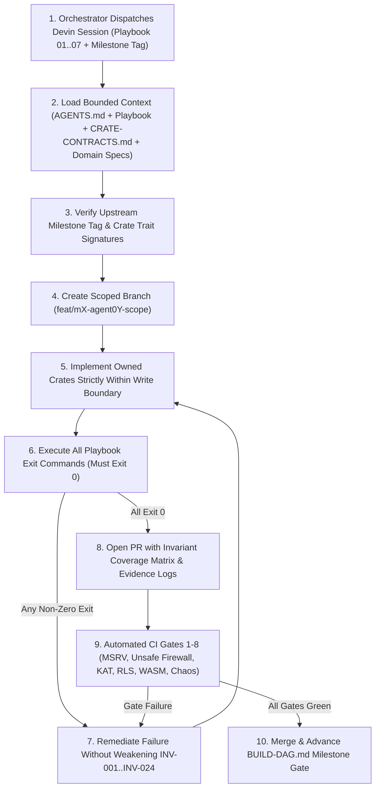

# RusticStack Core — Autonomous Multi-Agent (Devin) Engineering Strategy

> **Document ID**: `RSV-AGENT-README`
> **Project**: RusticStack Core (`ZK-Vault` — `https://github.com/KelpHect/ZK-Vault`)
> **Audience**: Autonomous Coding Agents (Devin Sessions), Orchestrators & Principal Maintainers
> **Target Toolchain**: Rust 2024 Edition (MSRV `1.94.0`)

---

## 1. Mission: Zero-Drift Parallel Implementation

Implementing a 12-crate, zero-knowledge, post-quantum hybrid, multi-tenant enterprise vault with hardware enclave offloading, PostgreSQL RLS, RFC 9162 transparency logging, GPUI desktop UI, and a fixed-arena WASM/Chrome MV3 client requires strict architectural discipline.

When multiple autonomous coding agent sessions (Devin bots) execute concurrently across a single monorepo, naive parallelism fails in four predictable ways:
1. **Interface Drift**: Backend and client agents invent diverging CBOR field names, AAD tuples, or HTTP headers.
2. **Dependency Pollution**: A server or desktop agent accidentally pulls `tokio`, `sqlx`, or `libc` into a `no_std` WASM-shared core crate.
3. **Silent Security Degradation**: An agent disables `FORCE ROW LEVEL SECURITY`, adds `unsafe`, skips AAD binding, or allows WASM `memory.grow()` just to make a test compile.
4. **Merge Contention**: Concurrent sessions edit overlapping files, triggering cascading rebase conflicts.

RusticStack Core eliminates all four failure modes via **Contract-First Parallelism**, **Strict Ownership Partitioning**, **Context-Bounded Playbooks**, and **Deterministic Verification Gates**.

---

## 2. Six Orchestration Pillars

### Pillar 1: Bounded Turn-0 Context Loading
Root [`AGENTS.md`](../AGENTS.md) is intentionally capped under `14 KiB` so every Devin session loads 100% of non-negotiable security guardrails on Turn 0 without truncation. Beyond `AGENTS.md`, each session loads **strictly** its assigned playbook's **Required Reading List** (`1–3` subsystem specs + governing ADRs + `agents/CRATE-CONTRACTS.md`) rather than saturating its context window with unrelated domains.

### Pillar 2: Immutable Specification Precedence
Autonomous agents treat the normative specification suite as a **frozen contract** governed by the precedence hierarchy in [`specs/00-INDEX.md`](../specs/00-INDEX.md):
1. Formal Security Invariants ([`specs/09-THREAT-MODEL-AND-FORMAL-INVARIANTS.md`](../specs/09-THREAT-MODEL-AND-FORMAL-INVARIANTS.md) — `INV-001`..`INV-024`)
2. Machine-Readable Schemas (`schemas/postgresql-schema.sql`, `schemas/openapi-v1.yaml`, `schemas/ipc-native-messaging.schema.json`)
3. Normative Subsystem Specs (`specs/01` through `specs/10`)
4. Accepted ADRs (`adrs/ADR-0001` through `adrs/ADR-0008`)
5. Agent Blueprints & Playbooks (`AGENTS.md`, `agents/`)

If an agent discovers a genuine contradiction or impossible platform constraint, it **MUST STOP** and open an escalation issue referencing the exact document section—it **MUST NEVER** silently deviate from an ADR or weaken a security invariant.

### Pillar 3: Trait-First Freeze at Milestone `M0`
No parallel feature workstreams begin until Milestone `M0` merges the workspace skeleton (`Cargo.toml`, pinned dependency versions, `rust-toolchain.toml` at `1.94.0`, `deny.toml`) and the immutable public types/traits in `rsv-types` per [`CRATE-CONTRACTS.md`](CRATE-CONTRACTS.md). Once `M0` is tagged, downstream agents build against frozen trait signatures in parallel without blocking one another.

### Pillar 4: Disjoint Crate & Directory Write Locks
Every playbook assigns **exclusive write ownership** over specific crates and directories. No two concurrently scheduled agents ever own the same source file. Shared workspace root files (`Cargo.toml` workspace members, `Cargo.lock`) are updated only at explicit milestone merge boundaries.

### Pillar 5: Deterministic Local Exit Gates Before PR
A Devin session **MUST NOT** open a Pull Request until every command in its playbook's **Verification Commands & Exit Criteria** section exits with code `0`. PR descriptions MUST include machine-verifiable evidence (invariant coverage tags `INV-XXX`, test counts, `EXPLAIN ANALYZE` or `wasmparser` logs where applicable).

### Pillar 6: Independent Adversarial Red-Team Verification (`Agent 07`)
Builder agents (`01` through `06`) author unit tests and KAT conformance checks for their own crates. **Agent 07 (`07-qa-redteam-agent.md`)** runs independently after integration milestones to write cross-crate chaos suites, fuzz targets, live memory/swap dump probes, 100-tenant RLS bypass attempts, and Merkle split-view attacks.

---

## 3. Autonomous Agent Session Lifecycle

---

## 4. Agent Roster & Disjoint Ownership Matrix

| Playbook | Agent Role | Exclusive Write Ownership | Active Milestones | Primary Invariants Owned |
|---|---|---|---|---|
| **[01-crypto-core-agent.md](playbooks/01-crypto-core-agent.md)** | Core Cryptography, VSS & Blind RBAC Engine | `crates/rsv-types/`, `crates/rsv-crypto/`, `crates/rsv-vss/`, `crates/rsv-graph/`, `test-vectors/v1/cs01*`, `cs02*`, `kdf*`, `vss*` | `M0`, `M1`, `M2` | `INV-001`–`INV-005`, `INV-008`–`INV-010`, `INV-015`, `INV-016` |
| **[02-os-enclave-mem-agent.md](playbooks/02-os-enclave-mem-agent.md)** | Hostile-OS Memory Hardening & Hardware Enclaves | `crates/rsv-mem/`, `crates/rsv-enclave/` | `M2` | `INV-010`, `INV-011`, `INV-012`, `INV-013` |
| **[03-backend-rls-agent.md](playbooks/03-backend-rls-agent.md)** | Blind API Server & PostgreSQL 17/18 RLS Engine | `crates/rsv-server/`, `migrations/` | `M3` | `INV-001`, `INV-005`–`INV-007`, `INV-017`, `INV-020` |
| **[04-audit-merkle-agent.md](playbooks/04-audit-merkle-agent.md)** | Zero-Knowledge Audit Ledger & Air-Gapped Compliance CLI | `crates/rsv-audit/`, `crates/rsv-compliance-cli/`, `test-vectors/v1/audit*` | `M2`, `M5` | `INV-015`–`INV-019` |
| **[05-gpui-desktop-agent.md](playbooks/05-gpui-desktop-agent.md)** | Locked Daemon, OS IPC, `rsv-nm-host` & GPUI Desktop UI | `crates/rsv-daemon/`, `crates/rsv-desktop/`, `test-vectors/v1/nm_host*` | `M4` | `INV-011`, `INV-012`, `INV-014`, `INV-021`, `INV-023` |
| **[06-wasm-web-ext-agent.md](playbooks/06-wasm-web-ext-agent.md)** | Fixed-Arena WASM Bridge, MV3 Chrome Extension & Web SPA | `crates/rsv-wasm/`, `clients/extension/`, `clients/web-spa/` | `M3`, `M4` | `INV-021`, `INV-022`, `INV-023`, `INV-024` |
| **[07-qa-redteam-agent.md](playbooks/07-qa-redteam-agent.md)** | Adversarial Chaos Harnesses, Fuzzing & CI Release Gates | `fuzz/`, `tests/`, `scripts/ci/`, `.github/workflows/` | `M6`, `M7` | All `INV-001`–`INV-024` (Independent Verification) |

---

## 5. Escalation & Stop Conditions

Every Devin session MUST halt immediately and escalate to the orchestrator/human lead if any of the following conditions occur:
1. **Invariant Conflict**: Passing a test appears to require violating any of `INV-001` through `INV-024` (e.g., adding `unsafe` outside `rsv-mem`/`rsv-enclave`, removing `FORCE ROW LEVEL SECURITY`, passing empty AAD, or emitting `memory.grow` in `rsv-wasm`).
2. **Contract Signature Mismatch**: An upstream trait in `agents/CRATE-CONTRACTS.md` lacks a method or error variant required by a downstream crate. Never unilaterally change a frozen trait without opening a Contract Amendment PR approved across affected tracks.
3. **Cross-Target KAT Divergence**: Native Rust (`x86_64`/`aarch64`) and `wasm32-unknown-unknown` produce differing bytes on any `test-vectors/v1/` fixture.
4. **MSRV or Supply-Chain Failure**: A required crate version fails to compile under Rust `1.94.0` or triggers a `RUSTSEC` advisory in `cargo audit` / license violation in `cargo deny`.
5. **Scope Creep**: Completing a task requires modifying files outside the playbook's **Exclusive Write Ownership** list.

---

## 6. Navigation Index

- **[BUILD-DAG.md](BUILD-DAG.md)** — Complete milestone dependency graph (`M0` through `M7`), parallel execution tracks, entry/exit criteria, and integration checkpoints.
- **[CRATE-CONTRACTS.md](CRATE-CONTRACTS.md)** — Exact 12-crate workspace layout, Dependency Firewall matrix, public Rust trait contracts, feature flag matrix, and `unsafe` containment policy.
- **[playbooks/](playbooks/)** — Self-contained, execution-ready briefs for Devin Agents `01` through `07`.
