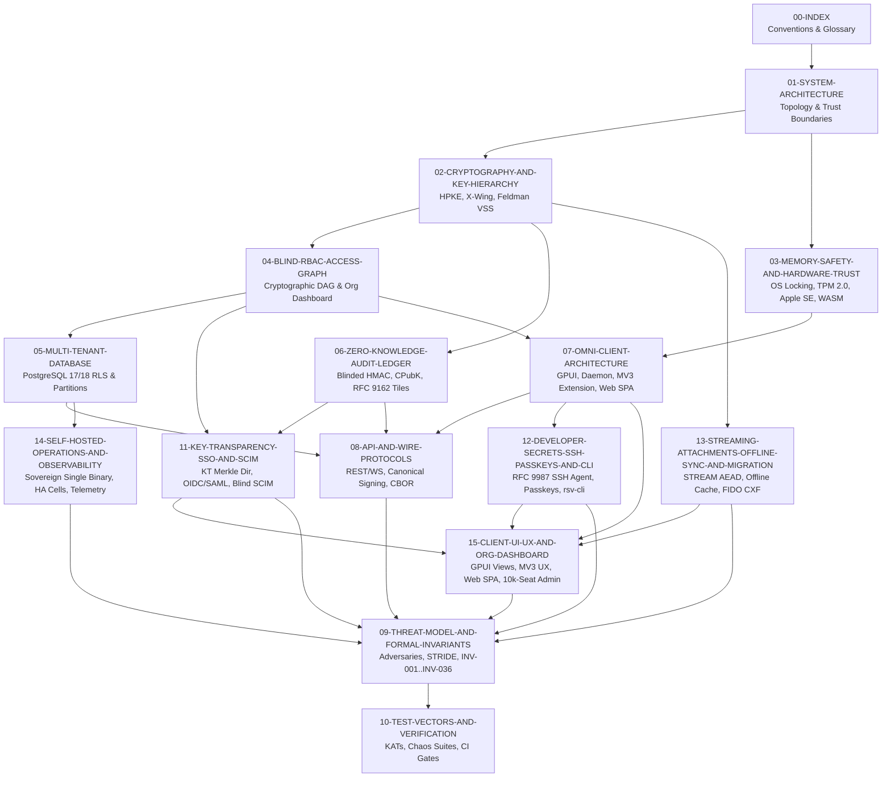

# Master Specification Index (`00-INDEX`)

**Project:** RusticStack Core (`ZK-Vault`)  
**Specification Version:** `1.0.0-normative`  
**Repository:** `https://github.com/KelpHect/ZK-Vault`  
**Status:** Active Normative Architecture Baseline

---

## 1. Normative Language Convention (RFC 2119 / RFC 8174)

The key words **"MUST"**, **"MUST NOT"**, **"REQUIRED"**, **"SHALL"**, **"SHALL NOT"**, **"SHOULD"**, **"SHOULD NOT"**, **"RECOMMENDED"**, **"NOT RECOMMENDED"**, **"MAY"**, and **"OPTIONAL"** in all documents under `specs/`, `adrs/`, `schemas/`, and `agents/` are to be interpreted as described in BCP 14 ([RFC 2119](https://www.rfc-editor.org/rfc/rfc2119), [RFC 8174](https://www.rfc-editor.org/rfc/rfc8174)) when, and only when, they appear in all capitals.

Where any prose summary conflicts with a normative specification or machine-readable schema, precedence resolves in this strict order:

1. **Formal Security Invariants** (`INV-001`–`INV-024` in `SPEC-09`, `INV-025`–`INV-029` in `SPEC-11`/`12`, `INV-030`–`INV-032` in `SPEC-13`/`14`, `INV-033`–`INV-036` in `SPEC-15`)
2. **Machine-Readable Normative Schemas** (`schemas/postgresql-schema.sql`, `schemas/openapi-v1.yaml`, `schemas/ipc-native-messaging.schema.json`)
3. **Normative Subsystem Specifications** (`specs/01` through `specs/15`)
4. **Architecture Decision Records** (`adrs/ADR-0001` through `adrs/ADR-0012`)
5. **Agent Playbooks & Root Manuals** (`AGENTS.md`, `agents/`)

---

## 2. Specification Dependency Graph

---

## 3. Complete Specification Catalog

| Doc ID | File | Primary Audience / Agent | Summary |
| :--- | :--- | :--- | :--- |
| **SPEC-00** | [`00-INDEX.md`](00-INDEX.md) | All engineers & agents | Normative rules, precedence hierarchy, reading order, canonical glossary |
| **SPEC-01** | [`01-SYSTEM-ARCHITECTURE.md`](01-SYSTEM-ARCHITECTURE.md) | All engineers & agents | End-to-end topology, trust boundaries, 13-crate workspace, scaling envelope, E2E data flows |
| **SPEC-02** | [`02-CRYPTOGRAPHY-AND-KEY-HIERARCHY.md`](02-CRYPTOGRAPHY-AND-KEY-HIERARCHY.md) | Crypto Agent (`01`) | `CS-01` & `CS-02` (X-Wing), canonical `RSV1` envelopes, AAD rules, Hybrid Escrow (`ORPubK`/`DRPubK`), 124-bit padded Feldman VSS over Ristretto255 |
| **SPEC-03** | [`03-MEMORY-SAFETY-AND-HARDWARE-TRUST.md`](03-MEMORY-SAFETY-AND-HARDWARE-TRUST.md) | OS/Enclave (`02`), WASM (`06`) | Hostile OS memory locking, guard pages, platform dump prevention, Two-Tier Apple SE / TPM 2.0 offloading, Dual Fixed-Memory WASM Worker Split |
| **SPEC-04** | [`04-BLIND-RBAC-ACCESS-GRAPH.md`](04-BLIND-RBAC-ACCESS-GRAPH.md) | Crypto (`01`), Backend (`03`), Clients (`05`, `06`) | Cryptographic access DAG (`User -> Team -> Collection -> Item`), epoch rotation, cycle rejection, thick-client graph resolution |
| **SPEC-05** | [`05-MULTI-TENANT-DATABASE.md`](05-MULTI-TENANT-DATABASE.md) | Backend RLS Agent (`03`) | PostgreSQL 17/18 shared schema, dual-enforced RLS + explicit `tenant_id` pruning, 64-way HASH partitioning, PgBouncer transaction pooling |
| **SPEC-06** | [`06-ZERO-KNOWLEDGE-AUDIT-LEDGER.md`](06-ZERO-KNOWLEDGE-AUDIT-LEDGER.md) | Audit (`04`), Backend (`03`) | Separation of duties, `TBK` blinded identifiers, `CPubK` asymmetric envelopes, hardware non-repudiation, RFC 9162 + C2SP `tlog-tiles` |
| **SPEC-07** | [`07-OMNI-CLIENT-ARCHITECTURE.md`](07-OMNI-CLIENT-ARCHITECTURE.md) | GPUI (`05`), WASM/Ext (`06`) | GPUI native desktop, `rsv-daemon` OS peer-cred IPC, Chrome MV3 Native Messaging chunking (`<= 768 KiB`), Web SPA + WebAuthn PRF, autofill security |
| **SPEC-08** | [`08-API-AND-WIRE-PROTOCOLS.md`](08-API-AND-WIRE-PROTOCOLS.md) | Backend (`03`), Clients (`05`, `06`) | Complete `/api/v1` REST + WebSocket contract, `RSV-REQ-SIG-V1` canonical request signing, RFC 8949 CBOR encoding, optimistic concurrency, error registry |
| **SPEC-09** | [`09-THREAT-MODEL-AND-FORMAL-INVARIANTS.md`](09-THREAT-MODEL-AND-FORMAL-INVARIANTS.md) | All agents & QA (`07`) | 7 adversary profiles, STRIDE analysis, core formal invariants (`INV-001`..`INV-024`, cross-referencing `INV-025`..`INV-036`), explicit non-goals |
| **SPEC-10** | [`10-TEST-VECTORS-AND-VERIFICATION.md`](10-TEST-VECTORS-AND-VERIFICATION.md) | QA / Red-Team Agent (`07`) | Deterministic KAT schemas, 100-tenant RLS chaos suite, live memory-dump & swap negative tests, Merkle tamper suite, 7 fuzz targets, CI release gates |
| **SPEC-11** | [`11-KEY-TRANSPARENCY-SSO-AND-SCIM.md`](11-KEY-TRANSPARENCY-SSO-AND-SCIM.md) | Identity Agent (`08`), Backend (`03`) | IETF `keytrans`-inspired witnessed KT directory (`INV-025`), OIDC/SAML `Auth != Decrypt` + Trusted Device SAS (`INV-026`), Blind SCIM 2.0 pending queue (`INV-027`) |
| **SPEC-12** | [`12-DEVELOPER-SECRETS-SSH-PASSKEYS-AND-CLI.md`](12-DEVELOPER-SECRETS-SSH-PASSKEYS-AND-CLI.md) | DevSecrets Agent (`08`), GPUI (`05`) | RFC 9987 hardware-gated SSH Agent in `rsv-daemon` (`INV-028`), Synced Enterprise Passkeys, `rsv-cli` zero-disk `rsv run` injection (`INV-029`), OIDC Machine Identities |
| **SPEC-13** | [`13-STREAMING-ATTACHMENTS-OFFLINE-SYNC-AND-MIGRATION.md`](13-STREAMING-ATTACHMENTS-OFFLINE-SYNC-AND-MIGRATION.md) | Storage/Ops Agent (`09`), Clients (`05`, `06`) | STREAM 64 KiB chunked `AES-256-GCM` attachments + BLAKE3 root (`INV-030`), `HDSK`-sealed offline cache + 3-way conflict merge (`INV-031`), FIDO CXF/CXP v1.0 & Emergency Kits |
| **SPEC-14** | [`14-SELF-HOSTED-OPERATIONS-AND-OBSERVABILITY.md`](14-SELF-HOSTED-OPERATIONS-AND-OBSERVABILITY.md) | Storage/Ops Agent (`09`), SRE | Dual-profile single-binary Sovereign Mode (`< 128 MiB` RAM) vs. Enterprise HA Cells, PITR + Merkle rollback check, GDPR crypto-shredding, zero-secret observability (`INV-032`), 15-axis competitive matrix |
| **SPEC-15** | [`15-CLIENT-UI-UX-AND-ORG-DASHBOARD.md`](15-CLIENT-UI-UX-AND-ORG-DASHBOARD.md) | UI/UX Agent (`10`), GPUI (`05`), Web/Ext (`06`) | "Obsidian & Tungsten" design tokens, GPUI 120 FPS / 100k-item views & modals (`INV-033`, `INV-034`), MV3 Shadow DOM autofill/passkey UX (`INV-035`), Web SPA Worker RPC, 10,000-seat Thick-Client Org Dashboard (`INV-036`) |

---

## 4. Canonical Glossary & Symbol Table

All specifications, schemas, ADRs, and future code MUST use these exact terms and abbreviations:

| Symbol / Term | Expansion | Formal Definition |
| :--- | :--- | :--- |
| **`AAD`** | Additional Authenticated Data | Canonical RFC 8949 CBOR metadata bound into AES-256-GCM authentication tags without encryption; prevents ciphertext relocation. |
| **`AEK`** | Attachment Encryption Key | Fresh 256-bit random key per binary attachment driving 64 KiB STREAM chunked `AES-256-GCM` encryption (`SPEC-13`). |
| **`CK`** | Collection Key | 256-bit epoch-versioned symmetric key encrypting a collection's metadata and wrapping its items' `DEK`s. |
| **`CPK` / `CPubK`** | Compliance Private / Public Key | Standalone asymmetric HPKE keypair held exclusively by Compliance (offline/HSM). Encrypts sensitive audit payloads. |
| **`CS-01`** | Cipher Suite 01 (`0x0001`) | Mandatory classical baseline: `AES-256-GCM`, RFC 9180 HPKE (`DHKEM(X25519, HKDF-SHA256)`), `Ed25519`, `ECDSA-P256`, `Argon2id`, `SHA-256`. |
| **`CS-02`** | Cipher Suite 02 (`0x0002`) | Post-quantum hybrid suite: **X-Wing** (`X25519 + ML-KEM-768` SHA3-256 combiner), hybrid `Ed25519 + ML-DSA-65`, `AES-256-GCM`. |
| **`CXF` / `CXP`** | FIDO Credential Exchange Format / Protocol | FIDO Alliance v1.0 encrypted portable JSON + PKCS#8 + HPKE standard for lossless migration of passkeys, passwords, TOTP, and SSH keys (`SPEC-13`). |
| **`DEK`** | Data Encryption Key | Per-item, per-version 256-bit random symmetric key encrypting an individual vault item's secret payload. |
| **`DRPK` / `DRPubK`** | Delegated Recovery Private / Public Key | Policy-scoped recovery keypair authorized by Org Root for routine single-user lockouts on `standard` tier vaults; prohibited on `enterprise_escrow` (root-quorum-only) and `strict_zk` vaults. |
| **`HDIK` / `HDSK`** | Hardware Device Identity / Sealing Key | Non-exportable **NIST P-256** keypairs generated and isolated inside Apple Secure Enclave or TPM 2.0 silicon. |
| **`KAT`** | Known Answer Test | Deterministic fixed-seed cryptographic test vector verified identically across native Rust and WASM builds. |
| **`KT`** | Key Transparency | Witnessed RFC 9162 / C2SP `tlog-tiles` append-only public-key directory (`vault.key_transparency_log`) defeating silent server key-substitution attacks (`SPEC-11`). |
| **`MIK` / `MPK`** | Machine Identity Signing / KEM Key | Workload keypair bound to OIDC federated claims (`vault.machine_identities`) receiving read-only (`permission_mask = 1`) `machine_to_collection` graph edges (`SPEC-12`). |
| **`MUK`** | Master Unlock Key | 256-bit user root unlock secret derived from `Argon2id(password, salt) XOR HKDF(WebAuthn PRF)` (or pure PRF + Recovery Kit). |
| **`ORPK` / `ORPubK`** | Organization Root Recovery Private / Public Key | Tenant-wide root escrow KEM keypair. `ORPK` is expanded deterministically from `ORPK_SEED`, split via padded Feldman VSS (`t-of-n`). |
| **`ORPK_SEED`** | Organization Recovery Root Seed | 256-bit uniform entropy seed split into two 128-bit chunks + 124-bit CSPRNG padding over Ristretto255 via Feldman VSS; never stored in plaintext at rest. |
| **`RLS`** | Row-Level Security | PostgreSQL row-level access predicate enforcement (`FORCE ROW LEVEL SECURITY` + `NOBYPASSRLS` application role + InitPlan `LEAKPROOF` equality). |
| **`SAS`** | Short Authentication String | Out-of-band human-verifiable 6-word EFF / 60-digit safety fingerprint verifying key authenticity across devices or users (`SPEC-07`, `SPEC-11`). |
| **`STREAM`** | Online Chunked AEAD Construction | Hoang–Reyhanitabar–Rogaway–Vizár chunked `AES-256-GCM` scheme (`7B nonce_prefix || u32 counter || 1B final_flag`) defeating truncation and reordering (`SPEC-13`). |
| **`TBK`** | Tenant Blinding Key | 256-bit per-tenant HMAC key held strictly in backend KMS/locked RAM (never in PostgreSQL) used to blind logged resource IDs. |
| **`TK`** | Team Key | 256-bit epoch-versioned symmetric key mediating group membership between `User` and `Collection` nodes in the Blind RBAC graph. |
| **`UIK`** | User Identity Key | User's `Ed25519` (or `CS-02` hybrid) protocol signing keypair verifying graph grants and key ownership. |
| **`UPK` / `USK`** | User Public / Secret KEM Key | User's asymmetric KEM keypair (`X25519` / `X-Wing`) receiving wrapped `TK` and `CK` edges. |
| **`VSS`** | Verifiable Secret Sharing | Feldman Verifiable Secret Sharing (`vsss-rs` 6.0) allowing custodians to verify shard validity against curve commitments without reconstructing the secret. |
