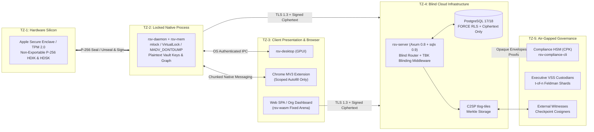
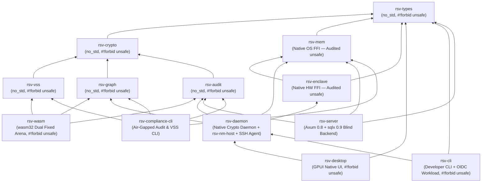
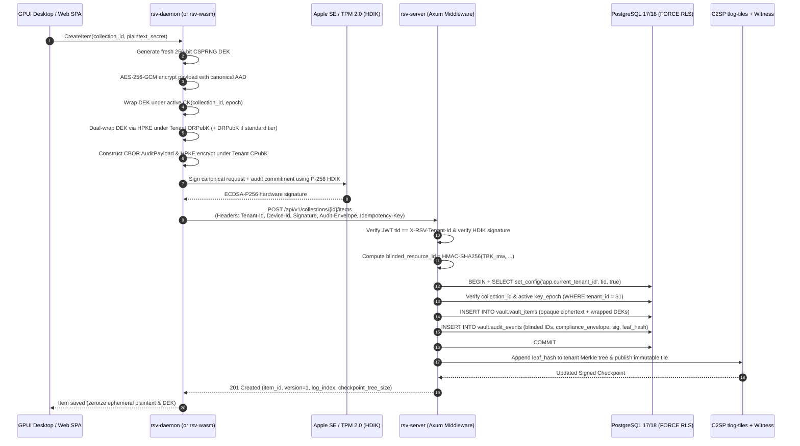

# System Architecture Specification (`01-SYSTEM-ARCHITECTURE`)

**Spec ID:** `SPEC-01`  
**Status:** Normative  
**Related ADRs:** [`ADR-0001`](../adrs/ADR-0001-hybrid-escrow-and-feldman-vss.md), [`ADR-0002`](../adrs/ADR-0002-shared-schema-rls-over-schema-per-tenant.md), [`ADR-0003`](../adrs/ADR-0003-gpui-native-desktop-over-electron.md), [`ADR-0004`](../adrs/ADR-0004-two-tier-hardware-enclave-p256-delegation.md), [`ADR-0005`](../adrs/ADR-0005-rfc9162-c2sp-tiled-merkle-audit-log.md), [`ADR-0006`](../adrs/ADR-0006-native-messaging-daemon-offload-for-extension.md)

---

## 1. Architectural Philosophy & Design Goals

RusticStack Core (`ZK-Vault`) is architected from first principles around a single unifying axiom:

> **The server routes opaque ciphertext and enforces structural invariants; endpoint cryptography governs confidentiality, integrity, and access control.**

### 1.1 Enterprise Engineering Targets

| Dimension | Normative Target | Architectural Mechanism |
| :--- | :--- | :--- |
| **Tenant Scale** | 10,000+ active seats per tenant; 1,000+ tenants per cluster | Shared schema `vault`, 64-way `HASH(tenant_id)` partitions, composite PKs `(tenant_id, id)` |
| **Read Latency (API)** | p50 `< 5 ms`, p99 `< 15 ms` (metadata & ciphertext fetch) | Partition pruning via explicit `WHERE tenant_id = $1`, leading-column B-tree index scans |
| **Desktop Unlock Latency** | `< 50 ms` post-KDF/biometric release to full vault availability | Native Rust GPUI + in-RAM `rsv-daemon` graph cache inside locked pages |
| **Desktop Memory Footprint** | `< 80 MiB` RSS idle (vs. `400–900 MiB` for Electron vaults) | Zero Chromium/V8 runtime; GPU-accelerated Rust GPUI (`Metal` / `Vulkan` / `DX12`) |
| **Cryptographic Isolation** | Zero plaintext decryption capability on any server or DBA host | End-to-end `AES-256-GCM` + RFC 9180 HPKE (`CS-01`) / X-Wing (`CS-02`) |
| **Audit Tamper Detection** | Mathematical detection of any 1-byte mutation, deletion, or log fork | RFC 9162 Merkle Tree + C2SP `tlog-tiles` + independent Witness cosigning |
| **Recovery Resilience** | Single-user daily lockout recovery + catastrophic org root recovery | Dual-wrapped DEKs (`ORPubK` + optional `DRPubK`) + `t-of-n` Feldman VSS (`ORPK_SEED`) |

---

## 2. Security Trust Boundaries

The architecture partitions execution into **five strictly isolated trust zones**. Crossing a trust boundary requires explicit cryptographic transformation, hardware authentication, or OS privilege verification.

### Trust Zone Guarantees

- **TZ-1 (Hardware Silicon):** Private key bytes of `HDIK` (ECDSA P-256) and `HDSK` (ECDH P-256 / TPM Storage Key) NEVER leave silicon. Survives userland memory dumps and offline disk imaging.
- **TZ-2 (Locked Native Process):** Holds unwrapped `USK`, `TK`, `CK`, and ephemeral `DEK`s ONLY inside page-aligned, guard-paged, swap-locked, dump-excluded memory (`rsv-mem`). Zeroizes immediately on drop, idle timeout, OS sleep, or screen lock.
- **TZ-3 (Client Presentation & Browser):**
  - `rsv-desktop` renders UI frames directly via GPU and receives decrypted item fields transiently on demand; it never persists plaintext to disk.
  - Chrome MV3 Extension holds ZERO master keys when daemon-backed; it requests strictly origin-scoped credentials via Native Messaging only upon explicit user gesture.
  - Web SPA isolates all cryptographic state inside a Dedicated Web Worker running `rsv-wasm` over a fixed-size, non-growing WASM linear memory arena.
- **TZ-4 (Blind Cloud Infrastructure):** Treated as **honest-but-curious for confidentiality and actively malicious for integrity**. Cannot decrypt vault contents, cannot forge user hardware signatures, cannot decrypt `CPubK` compliance envelopes, and cannot rewrite history without breaking RFC 9162 consistency proofs pinned by TZ-5 witnesses.
- **TZ-5 (Air-Gapped Governance):** Enforces separation of duties. Compliance holds `CPK` offline to audit logs without touching vault secrets; Executive Custodians hold Feldman VSS shards of `ORPK_SEED` without holding day-to-day DB access; External Witnesses cosign Merkle Checkpoints independently of the backend operator.

---

## 3. Thirteen-Crate Rust Workspace Architecture

All components compile from a single Cargo workspace targeting **Rust 2024 Edition (MSRV `1.94.0`)**. Dependency flow is strictly acyclic and enforces a **Compile-Time Safety Firewall**:

### Architectural Layer Rules

1. **Layer 0 — Pure Cryptographic Core (`rsv-types`, `rsv-crypto`, `rsv-vss`, `rsv-graph`, `rsv-audit`):**
   - MUST compile with `--no-default-features` (`no_std` + `alloc`) and target `wasm32-unknown-unknown`.
   - MUST enforce `#![forbid(unsafe_code)]`.
   - MUST execute identically on x86_64, ARM64, and WebAssembly (verified by shared KAT suites in `SPEC-10`).
2. **Layer 1 — Audited Platform Security Adapters (`rsv-mem`, `rsv-enclave`, `rsv-wasm`):**
   - `rsv-mem` and `rsv-enclave` are the **only** crates permitted to use `unsafe` Rust, strictly confined to documented OS/hardware FFI boundaries.
   - `rsv-wasm` enforces `#![forbid(unsafe_code)]` and exposes an opaque handle-based API (`KeyHandle(u32)`) preventing raw key bytes from crossing into JS garbage-collected memory.
3. **Layer 2 — Runtime Binaries (`rsv-daemon`, `rsv-desktop`, `rsv-cli`, `rsv-server`, `rsv-compliance-cli`):**
   - `rsv-desktop` remains strictly a thin UI client (`#![forbid(unsafe_code)]`, zero direct `rsv-crypto`/`rsv-vss`/`rsv-mem` dependencies) delegating all key handling to `rsv-daemon` over authenticated OS IPC. `rsv-cli` (`#![forbid(unsafe_code)]`) delegates all workstation operations to `rsv-daemon` IPC and enables feature-gated `rsv-crypto`/`rsv-graph`/`rsv-audit`/`rsv-mem` solely for headless CI/CD OIDC workload execution (`rsv ci run`).
   - `rsv-server` does NOT depend on `rsv-vss` or `rsv-graph`'s decryption engine—only `rsv-types`, `rsv-audit` (for blind leaf hashing, HMAC blinding, and Merkle tile construction), `rsv-mem` (for protecting `TBK` and server checkpoint signing keys in locked RAM), and optionally feature-gated `rsv-enclave` (`sovereign-tpm-tbk` for TPM-sealed `TBK` in Sovereign Mode). This makes server-side decryption structurally impossible by dependency graph!

---

## 4. End-to-End Core Data Flows

### 4.1 Authenticated Vault Item Write (Zero-Knowledge + Non-Repudiation + Merkle Audit)

### 4.2 Zero-Knowledge User Provisioning (Org Admin Dashboard)

1. Admin authenticates via **WebAuthn + PRF** (or desktop hardware enclave) and fetches the opaque org graph (`GET /api/v1/graph/org`) plus the target user's signed public key record (`GET /api/v1/users/directory`).
2. Admin's local client verifies the new user's `UPK` signature against the Tenant Root Manifest and local trust chain (defeating rogue-server public key substitution).
3. Admin's local client unwraps the relevant Team Key `TK(team_id, epoch)` inside `rsv-wasm` / `rsv-daemon`, wraps `TK` to the new user's `UPK` via HPKE (`CS-01` or `CS-02`), and signs the new graph edge with the admin's `UIK`.
4. Admin submits `POST /api/v1/graph/edges` with a `CPubK`-encrypted compliance envelope and hardware signature.
5. `rsv-server` verifies the admin's `UIK` signature, checks for graph cycles via recursive CTE (`MAX_GRAPH_DEPTH = 4`), persists the opaque edge row inside a `TenantScopedTx`, and appends a blinded audit event.

### 4.3 Member Revocation & Atomic Epoch Rotation

Because a removed user previously held plaintext `TK(team_id, epoch)` in memory while authorized, merely deleting their `key_graph_edges` row does NOT achieve forward secrecy against a compromised server or cached ciphertexts. Therefore:

1. Revoking a user from a Team triggers an **atomic epoch rotation** (`PATCH /api/v1/teams/{team_id}/rotate`) executed inside the Admin's client:
   - Generates fresh `TK(team_id, epoch + 1)` and rotates impacted downstream `CK(collection_id, epoch + 1)`.
   - Re-wraps `TK(epoch + 1)` for all *remaining* team members' `UPK`s and `ORPubK`.
   - Submits the deletion + new epoch edge bundle atomically in a single PostgreSQL transaction.
2. **Lazy vs. Eager Item Re-Encryption:**
   - All newly written or updated vault items MUST use `CK(collection_id, epoch + 1)` (enforced by server `STALE_KEY_EPOCH` check).
   - Historical items remain readable to authorized users via historical `CK` chain wrapping for standard collections (`lazy_forward` mode), OR trigger an automated client-side background re-wrap job creating new `DEK`s for `enterprise_escrow` (root-quorum-only) / high-sensitivity collections (`eager_background` / `eager_blocking` modes) alongside credential rotation alerts.

---

## 5. Multi-Tenant Operational & Scaling Envelope

Designed for **10,000+ seats per enterprise tenant** and **1,000+ tenants per deployment cell**:

- **Stateless API Tier (`rsv-server`):** Horizontally scalable behind TLS 1.3 load balancers (preferring hybrid post-quantum `X25519MLKEM768` TLS handshakes). Holds zero persistent tenant state; caches verified Tenant Root Manifests and KMS-fetched `TBK` handles in locked memory with bounded TTL.
- **Database Tier (PostgreSQL 17/18 + PgBouncer):**
  - Single shared `vault` schema (17 canonical tables) prevents `pg_class` catalog bloat across thousands of tenants and keeps DDL migrations atomic and sub-second (using expand-and-contract patterns).
  - High-volume tables (7 of 17: `key_graph_edges`, `vault_items`, `vault_item_revisions`, `audit_events`, `audit_merkle_tiles`, `key_transparency_log`, `vault_attachments`) use `PARTITION BY HASH (tenant_id)` into **64 physical partitions** each (448 total child partitions per deployment cell), bounding individual B-tree index sizes and vacuum work.
  - Enterprises requiring physical sovereignty or >100,000 seats deploy dedicated **Cells** (isolated PostgreSQL clusters running the identical schema) routed at the edge via tenant directory lookup.
- **Transparency Log Tier (C2SP `tlog-tiles`):** Completed 256-leaf tiles are strictly immutable binary objects cacheable indefinitely on object storage (S3/GCS/R2) or CDN, eliminating dynamic proof-generation load from PostgreSQL during compliance audits.

---

## 6. Cross-Cutting Invariant Traceability

Every subsystem specified in `SPEC-02` through `SPEC-15` maps directly to machine-verifiable security invariants (`INV-001`–`INV-036`) indexed in [`SPEC-09`](09-THREAT-MODEL-AND-FORMAL-INVARIANTS.md) and deterministic tests in [`SPEC-10`](10-TEST-VECTORS-AND-VERIFICATION.md):

| Architectural Concern | Governing Spec | Primary Invariants |
| :--- | :--- | :--- |
| Key Hierarchy, AAD, X-Wing, Feldman VSS | `SPEC-02` | `INV-001` – `INV-005`, `INV-015`, `INV-016` |
| OS Memory Locking, Hardware Enclaves, WASM Arena | `SPEC-03` | `INV-010` – `INV-014`, `INV-024` |
| Blind RBAC Graph, Cycles, Epochs | `SPEC-04` | `INV-008`, `INV-009` |
| PostgreSQL Shared Schema, RLS, Partition Pruning | `SPEC-05` | `INV-006`, `INV-007` |
| Blinded Audit, `CPubK`, RFC 9162 Tiles & Witnesses | `SPEC-06` | `INV-017` – `INV-020` |
| GPUI Desktop, Chrome Native Messaging, Autofill | `SPEC-07` | `INV-021` – `INV-023` |
| API Auth, Request Signing, Concurrency | `SPEC-08` | `INV-006`, `INV-017`, `INV-020` |
| Key Transparency, OIDC/SAML `Auth != Decrypt`, Blind SCIM 2.0 | `SPEC-11` | `INV-025` – `INV-027` |
| RFC 9987 SSH Agent, Synced Passkeys, `rsv-cli` & OIDC Workloads | `SPEC-12` | `INV-028`, `INV-029` |
| STREAM 64 KiB Attachments, Offline Encrypted Cache, FIDO CXF | `SPEC-13` | `INV-030`, `INV-031` |
| Dual-Profile Sovereign Self-Hosting, GDPR Shredding, Telemetry | `SPEC-14` | `INV-032` |
| GPUI Views, MV3 Autofill UX, Web SPA & 10,000-Seat Org Dashboard | `SPEC-15` | `INV-033` – `INV-036` |
