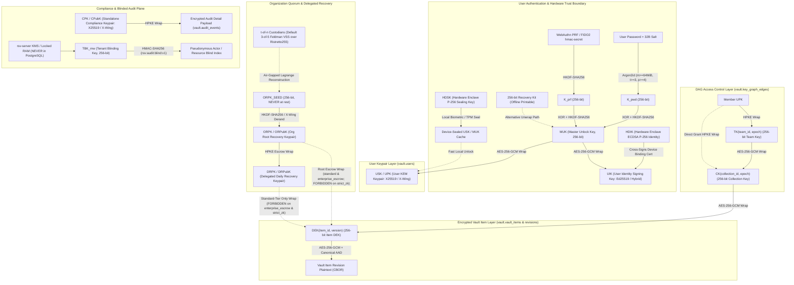
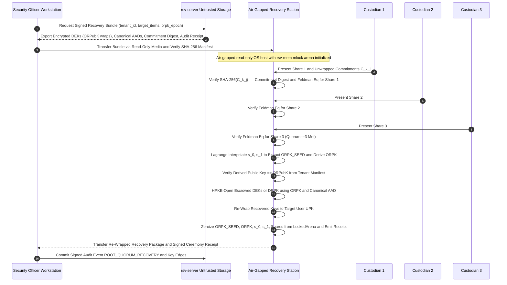

# Specification 02: Cryptography and Key Hierarchy

| Metadata | Value |
| :--- | :--- |
| **Document ID** | `RSV-SPEC-02` |
| **Project** | RusticStack Core (`ZK-Vault`) — `https://github.com/KelpHect/ZK-Vault` |
| **License** | Dual MIT / Apache-2.0 |
| **Status** | Normative — Target Baseline `v1.0` (`CS-01`) & Evolution `v2.0` (`CS-02`) |
| **Target Toolchain** | Rust 2024 Edition, MSRV `1.94.0` |
| **Normative Crates** | `rsv-crypto`, `rsv-vss`, `rsv-types` |
| **Related ADRs** | [ADR-0001](../adrs/ADR-0001-hybrid-escrow-and-feldman-vss.md), [ADR-0004](../adrs/ADR-0004-two-tier-hardware-enclave-p256-delegation.md), [ADR-0007](../adrs/ADR-0007-crypto-agility-xwing-post-quantum-hybrid.md) |

---

## 1. Conformance & Normative Language

The key words **MUST**, **MUST NOT**, **REQUIRED**, **SHALL**, **SHALL NOT**, **SHOULD**, **SHOULD NOT**, **RECOMMENDED**, **MAY**, and **OPTIONAL** in this document are to be interpreted as described in RFC 2119 and RFC 8174.

Every cryptographic primitive, domain separation string, wire format offset, Associated Authenticated Data (AAD) construction, and trait signature defined in this specification is **NORMATIVE**. Autonomous implementation agents and human engineers building `rsv-crypto` and `rsv-vss` SHALL NOT substitute algorithms, truncate tags, omit AAD fields, reuse nonces, or introduce undocumented cipher combiners.

---

## 2. Cryptographic Dependencies & Cipher Suite Registry

### 2.1 Normative Rust Crate Pinning (Rust 2024, MSRV `1.94.0`)

Implementations of `rsv-crypto` and `rsv-vss` MUST depend on the following vetted pure-Rust / constant-time cryptographic crates:

| Primitive / Role | Normative Crate | Version | Security Notes |
| :--- | :--- | :--- | :--- |
| Authenticated Encryption | `aes-gcm` | `0.11` | Hardware AES-NI / ARMv8-CE accelerated; constant-time fallback |
| Hybrid Public Key Encryption | `hpke` | `0.15` | RFC 9180 Base Mode; zero-copy `open_in_place_detached` |
| Classical Key Agreement | `x25519-dalek` | `3.0` | RFC 7748; MUST reject all-zero shared secrets (`was_contributory()`) |
| Post-Quantum KEM | `ml-kem` | FIPS 203 | ML-KEM-768 (`CS-02` X-Wing component); constant-time NTT |
| Classical Protocol Signatures | `ed25519-dalek` | `3.0` | RFC 8032; MUST use `verify_strict()` to reject malleable/small-order sigs |
| Post-Quantum Signatures | `ml-dsa` | FIPS 204 | ML-DSA-65 (`CS-02` hybrid signature component) |
| Hardware Enclave P-256 | `p256` | `0.13`+ | ECDSA-P256-SHA256 verification (low-S normalized) & ECDH-P256 |
| Password KDF | `argon2` | `0.6` | Argon2id v1.3 (`0x13`); memory-hard key stretching |
| Verifiable Secret Sharing | `vsss-rs` | `6.0` | Feldman VSS over Ristretto255 prime-order scalar field |
| Secret Handling & Zeroization | `secrecy` / `zeroize` | `0.10` / `1.9` | `SecretBox`, `ExposeSecret`, `Zeroize`, `ZeroizeOnDrop` |
| Hashing / KDF / MAC | `sha2`, `sha3`, `hkdf`, `hmac` | Latest stable | SHA-256, SHA3-256, SHAKE256, HKDF-SHA256, HMAC-SHA256 |

### 2.2 Cipher Suite Registry

Every cryptographic envelope, key record, and tenant policy carries an explicit 16-bit `CipherSuiteId`. Unrecognized suite identifiers MUST cause immediate fail-closed rejection.

| Suite Code | Wire ID | Status | Symmetric AEAD | Asymmetric KEM / HPKE | Protocol Signatures | Enclave Anchor | KDF / Hash / MAC |
| :--- | :--- | :--- | :--- | :--- | :--- | :--- | :--- |
| **`CS-01`** | `0x0001` | **Mandatory v1 Baseline** | `AES-256-GCM` (96-bit CSPRNG nonce, 128-bit tag) | RFC 9180 HPKE Base: `DHKEM(X25519, HKDF-SHA256)` (`0x0020`), `HKDF-SHA256` (`0x0001`), `AES-256-GCM` (`0x0002`) | `Ed25519` (strict) | `ECDSA-P256-SHA256` / `ECDH-P256` | `Argon2id` (`m>=65536 KiB`, `t>=3`, `p>=4`, 32B salt), `HKDF-SHA256`, `HMAC-SHA256`, `SHA-256` |
| **`CS-02`** | `0x0002` | **v2 Post-Quantum Hybrid** | `AES-256-GCM` (96-bit CSPRNG nonce, 128-bit tag) | RFC 9180 HPKE Base with **X-Wing** (`draft-connolly-cfrg-xwing-kem`: `X25519 + ML-KEM-768`, KEM ID `0x647a`), `HKDF-SHA256` (`0x0001`), `AES-256-GCM` (`0x0002`) | Hybrid `Ed25519 + ML-DSA-65` (FIPS 204) | `ECDSA-P256-SHA256` / `ECDH-P256` (local trust anchor only; never exposed on wire) | `Argon2id` (`m>=65536 KiB`, `t>=3`, `p>=4`, 32B salt), `HKDF-SHA256`, `SHA3-256`, `SHAKE256`, `HMAC-SHA256`, `SHA-256` |

### 2.3 Strict Cryptographic Invariants

1. **Zero Server-Side Plaintext (`INV-001`)**: The untrusted RusticStack server (`rsv-server`) and PostgreSQL SHALL NEVER receive, derive, cache, or log `MUK`, `USK`, `UIK` private key, `ORPK`, `DRPK`, `TK`, `CK`, `DEK`, `AEK`, `CPK`, or plaintext item/attachment contents. The sole server-side MAC key is `TBK_mw` (Tenant Blinding Key, `SPEC-06`), which is held exclusively in `rsv-server` KMS / `rsv-mem` locked RAM, NEVER stored in PostgreSQL, and confers zero decryption capability over any vault payload or compliance audit envelope (`CPubK`).
2. **CSPRNG Exclusivity**: All nonces, salts, ephemeral scalars, symmetric keys, and polynomial coefficients MUST be sourced exclusively from the operating system CSPRNG (`getrandom` / `OsRng`). Deterministic RNGs are STRICTLY FORBIDDEN outside unit test harnesses behind `#[cfg(test)]`.
3. **Constant-Time Verification**: All MAC comparisons, tag checks, scalar canonicality checks, and key equality checks MUST execute in constant time (`subtle::ConstantTimeEq`).
4. **Contributory X25519 Check**: Every `x25519-dalek` Diffie-Hellman output MUST verify `shared_secret.was_contributory() == true` to defeat small-subgroup / low-order point attacks.
5. **Strict Ed25519 Verification**: All `Ed25519` signature verifications MUST invoke `VerifyingKey::verify_strict()` (`ed25519-dalek` 3.0), rejecting non-canonical $S \ge \ell$, small-order public keys, and cofactored malleability.
6. **Low-S ECDSA-P256 Normalization**: All hardware enclave `ECDSA-P256-SHA256` signatures MUST be normalized to low-S ($s \le n/2$) prior to persistence in `vault.user_devices` or protocol transcripts, and verifiers MUST reject high-S malleable signatures.

---

## 3. Complete Key Hierarchy Architecture

RusticStack Core enforces a strict Directed Acyclic Graph (DAG) of cryptographic keys anchored at two independent roots of trust: (1) per-user authentication and hardware-bound device trust, and (2) organization-scoped threshold quorum escrow (`ORPubK` / `ORPK`).

### 3.1 Key Hierarchy Diagram



### 3.2 Complete Key Inventory & Lifecycle Table

| Symbol | Full Name | Algorithm (`CS-01` / `CS-02`) | Bit Length | Storage Location (Encrypted Form) | Rotation / Epoch Policy |
| :--- | :--- | :--- | :--- | :--- | :--- |
| **`HDIK`** | Hardware Device Identity Key | `ECDSA-P256-SHA256` (both suites) | 256-bit | Hardware Enclave ONLY (non-exportable); public key in `vault.user_devices` | Bound to device lifetime; revoked on device decommission |
| **`HDSK`** | Hardware Device Sealing Key | `ECDH-P256` / TPM2 SRK child | 256-bit | Hardware Enclave ONLY (non-exportable) | Bound to device lifetime |
| **`MUK`** | Master Unlock Key | Derived (`Argon2id` + `HKDF-SHA256`) | 256-bit | Never stored raw; optionally sealed locally by `HDSK` | Rotated on password/WebAuthn change (re-wraps `USK` & `UIK`) |
| **`UIK`** | User Identity Key | `Ed25519` / `Ed25519 + ML-DSA-65` | 256-bit seed / Hybrid | Private key wrapped by `MUK` in `vault.users`; public key plaintext | Epoch increment on compromise or suite upgrade |
| **`UPK` / `USK`** | User Encryption Keypair | `X25519` / `X-Wing` | 256-bit seed | `USK` wrapped by `MUK` in `vault.users` + locally sealed by `HDSK` | Epoch increment on compromise or suite upgrade |
| **`ORPK_SEED`** | Org Root Recovery Seed | CSPRNG raw entropy | 256-bit | **NEVER AT REST**. Split via Feldman VSS into $n$ shares (`vault.tenant_vss_ceremonies`) | Proactive refresh (same seed, new polynomial) every 90–180d; full epoch rotation on custodian compromise or `CS-02` upgrade |
| **`ORPubK` / `ORPK`** | Org Root Recovery Keypair | `X25519` / `X-Wing` | 256-bit seed | `ORPubK` in `vault.tenants`; `ORPK` reconstructed ONLY in air-gapped RAM | Epoch increment triggers lazy + background re-escrow of `DEK`s |
| **`DRPubK` / `DRPK`** | Delegated Recovery Keypair | `X25519` / `X-Wing` | 256-bit seed | `DRPubK` in `vault.tenants`; `DRPK` escrowed under `ORPubK` + wrapped to authorized Security Officer `UPK`s or HSM | Rotated quarterly or upon Security Officer departure |
| **`TK(team_id, epoch)`** | Team Key | `AES-256-GCM` key | 256-bit | Wrapped per member `UPK` in `vault.key_graph_edges` | Epoch incremented immediately on member revocation |
| **`CK(collection_id, epoch)`** | Collection Key | `AES-256-GCM` key | 256-bit | Wrapped under `TK` (or direct `UPK`) in `vault.key_graph_edges` | Epoch incremented on team/member removal from collection |
| **`DEK(item_id, version)`** | Item Data Encryption Key | `AES-256-GCM` key | 256-bit | Wrapped under `CK`; additionally escrowed under `ORPubK` (`standard` & `enterprise_escrow`) and `DRPubK` (`standard` only) in `vault.vault_item_revisions`; `CK`-only on `strict_zk` | Fresh CSPRNG 256-bit `DEK` minted on **every** item creation and mutation (`version += 1`) |
| **`AEK(attachment_id)`** | Attachment Encryption Key | `AES-256-GCM` STREAM key (`SPEC-13`) | 256-bit | Stored inside encrypted item revision payload (protected by `DEK`) | Fresh CSPRNG 256-bit `AEK` per uploaded binary attachment |
| **`CPubK` / `CPK`** | Compliance Asymmetric Keypair | `X25519` / `X-Wing` | 256-bit seed | `CPubK` in `vault.tenants`; `CPK` held offline/HSM by Compliance Officer | Rotated annually; historical `audit_events` tagged with `compliance_key_epoch` |
| **`TBK_mw`** | Tenant Blinding Key (Audit Middleware) | `HMAC-SHA256` key | 256-bit | Held exclusively in `rsv-server` KMS / `rsv-mem` locked RAM (**NEVER** stored in PostgreSQL; `SPEC-06`) | Rotated via KMS `blind_epoch` rotation ceremony |

### 3.3 Normative Key Derivation & Domain Separation Registry

Every HKDF-SHA256 extraction/expansion and HMAC-SHA256 call in RusticStack Core MUST use the exact ASCII domain separation labels specified below. Lengths are unambiguous and prefix-free via fixed separators (`:`) and explicit version tags (`v1` / `v2`).

| Derivation Purpose | Primitive | Input Keying Material (`IKM`) | Salt | `info` / Domain Separation Label | Output |
| :--- | :--- | :--- | :--- | :--- | :--- |
| Password Stretch | `Argon2id` v1.3 | UTF-8 NFC-normalized password bytes | 32B CSPRNG `user_kdf_salt` (stored in `vault.users`) | N/A (`m>=65536 KiB`, `t>=3`, `p>=4`) | `K_pwd` (32B) |
| WebAuthn PRF Input | `HKDF-SHA256` | 32B FIDO2 `prf.results.first` output | `tenant_id (16B) \|\| user_id (16B)` | `"rsv:muk:webauthn-prf:v1"` | `K_prf` (32B) |
| Hybrid `MUK` (Password + PRF) | `HKDF-SHA256` | `K_pwd XOR K_prf` (32B) | `user_kdf_salt (32B)` | `"rsv:muk:hybrid:v1:" \|\| tenant_id \|\| user_id` | `MUK` (32B) |
| Password-Only `MUK` (`L1`/Fallback) | `HKDF-SHA256` | `K_pwd` (32B) | `user_kdf_salt (32B)` | `"rsv:muk:password-only:v1:" \|\| tenant_id \|\| user_id` | `MUK` (32B) |
| Passwordless `MUK` (PRF Only) | `HKDF-SHA256` | `K_prf` (32B) | `tenant_id (16B) \|\| user_id (16B)` | `"rsv:muk:passwordless-prf:v1:" \|\| tenant_id \|\| user_id` | `MUK` (32B) |
| `MUK` Recovery Kit Wrapping Key | `HKDF-SHA256` | 32B CSPRNG Recovery Kit secret | `tenant_id (16B) \|\| user_id (16B)` | `"rsv:muk:recovery-kit:v1"` | `K_rk` (32B) |
| `MUK` Key-Wrap Subkey | `HKDF-SHA256` | `MUK` (32B) | `0x00 * 32` | `"rsv:muk:wrap-user-keys:v1"` | `K_muk_wrap` (32B) |
| `MUK` Auth Proof Subkey (SRP/Verifier) | `HKDF-SHA256` | `MUK` (32B) | `0x00 * 32` | `"rsv:muk:auth-verifier:v1"` | `K_auth` (32B) |
| `ORPK` Seed -> `CS-01` X25519 Scalar | `HKDF-SHA256` | `ORPK_SEED` (32B) | `tenant_id (16B) \|\| BE_u32(orpk_epoch)` | `"rsv:orpk:cs01-x25519:v1"` | 32B X25519 `StaticSecret` |
| `ORPK` Seed -> `CS-02` X-Wing Seed | `HKDF-SHA256` | `ORPK_SEED` (32B) | `tenant_id (16B) \|\| BE_u32(orpk_epoch)` | `"rsv:orpk:cs02-xwing:v2"` | 32B X-Wing `GenerateKeyPairDerand` seed |
| `USK` / `UIK` Local Device Seal Subkey | `HKDF-SHA256` | ECDH-P256 shared secret (`HDSK`) or TPM unsealed secret | `device_id (16B)` | `"rsv:enclave:device-seal:v1"` | `K_seal` (32B) |
| Audit Actor/Resource Blind Index (`SPEC-06`) | `HMAC-SHA256` | `TBK_mw` (32B, `rsv-server` KMS / locked RAM only) | N/A | `"rsv:audit:blind:v1" \|\| tenant_id(16B) \|\| BE_u32(blind_epoch) \|\| field_domain_tag(1B: 0x01=actor, 0x02=resource) \|\| entity_uuid(16B)` | 32B Blind Token |
| HPKE `info` Parameter (All Wraps) | RFC 9180 `SetupBaseS` | N/A (HPKE internal) | N/A | `"rsv:hpke:wrap:v1:" \|\| target_key_type \|\| BE_u16(cipher_suite_id)` | HPKE `info` bytes |
| Device Cross-Sign Transcript | `Ed25519` / `ECDSA-P256` | N/A | N/A | `"rsv:device-bind:v1" \|\| tenant_id \|\| user_id \|\| device_id \|\| hdik_pk \|\| uik_pk \|\| BE_u64(issued_at_unix)` | Signed Binding Attestation |
| VSS Ceremony Transcript Hash | `SHA-256` | N/A | N/A | `"rsv:vss:ceremony:v1" \|\| tenant_id \|\| BE_u32(orpk_epoch) \|\| t \|\| n \|\| orpubk_bytes \|\| C_0_0..C_1_{t-1}` | 32B Ceremony Digest |

> **Normative Note on `MUK` Subkey Separation**: Implementations MUST NEVER use raw `MUK` directly both as an authentication secret sent (or proven) to `rsv-server` and as an AES-256-GCM wrapping key. `K_muk_wrap` and `K_auth` MUST be derived via distinct HKDF `info` labels so compromise of `K_auth` yields zero computational advantage toward recovering `K_muk_wrap`.

### 3.4 Password Normalization & WebAuthn PRF Rules

1. **Unicode Normalization**: Before invoking Argon2id, password UTF-8 strings MUST be normalized to Unicode Normalization Form C (NFC) to guarantee cross-platform determinism between macOS (NFD filesystem/input conventions), Windows, Linux, and browsers.
2. **Argon2id Floor**: `rsv-crypto` MUST reject any KDF configuration with `m_cost < 65536` (64 MiB), `t_cost < 3`, `p_cost < 4`, or `salt.len() != 32`. Tenants MAY increase parameters (e.g., `m = 131072 KiB`, `t = 4`) via `vault.tenants` policy.
3. **WebAuthn PRF Salt**: During WebAuthn `navigator.credentials.get()` with the `prf` extension, clients MUST supply deterministic input `prf.eval.first = SHA-256("rsv:webauthn:prf-eval:v1" || tenant_id || user_id)`.
4. **Passwordless + Recovery Kit Requirement**: When a user enrolls in passwordless WebAuthn PRF mode, the client MUST generate a 256-bit CSPRNG Recovery Kit (formatted as Base32 Crockford with CRC-16 checksum chunks, e.g., `RSV1-XXXX-...`), wrap `MUK` under `K_rk`, and verify user confirmation of offline storage before completing enrollment.

---

## 4. Canonical Ciphertext Envelope & Mandatory AAD Construction

### 4.1 Wire Format: Canonical Binary Ciphertext Envelope (`RSV1`)

Every encrypted payload persisted in PostgreSQL (`vault.users`, `vault.key_graph_edges`, `vault.vault_item_revisions`, `vault.audit_events`) or transmitted over the wire MUST be encoded in the canonical `RSV1` binary envelope. All multi-byte integers are **big-endian (network byte order)**.

```text
 0                   1                   2                   3
 0 1 2 3 4 5 6 7 8 9 0 1 2 3 4 5 6 7 8 9 0 1 2 3 4 5 6 7 8 9 0 1
+-+-+-+-+-+-+-+-+-+-+-+-+-+-+-+-+-+-+-+-+-+-+-+-+-+-+-+-+-+-+-+-+
|                   Magic = "RSV1" (0x52535631)                 |  Offset 0..4
+-+-+-+-+-+-+-+-+-+-+-+-+-+-+-+-+-+-+-+-+-+-+-+-+-+-+-+-+-+-+-+-+
|  Version=0x01 | EnvelopeType  |         CipherSuiteId         |  Offset 4..8
+-+-+-+-+-+-+-+-+-+-+-+-+-+-+-+-+-+-+-+-+-+-+-+-+-+-+-+-+-+-+-+-+
|                           KeyEpoch                            |  Offset 8..12
+-+-+-+-+-+-+-+-+-+-+-+-+-+-+-+-+-+-+-+-+-+-+-+-+-+-+-+-+-+-+-+-+
|   NonceLen    |        EncappedKeyLen         | Reserved=0x00 |  Offset 12..16
+-+-+-+-+-+-+-+-+-+-+-+-+-+-+-+-+-+-+-+-+-+-+-+-+-+-+-+-+-+-+-+-+
|                                                               |
+                                                               +
|                                                               |
+                                                               +
|                                                               |
+                                                               +
|                   AadHash (SHA-256, 32 bytes)                 |  Offset 16..48
+                                                               +
|                                                               |
+                                                               +
|                                                               |
+                                                               +
|                                                               |
+-+-+-+-+-+-+-+-+-+-+-+-+-+-+-+-+-+-+-+-+-+-+-+-+-+-+-+-+-+-+-+-+
|                        CiphertextLen                          |  Offset 48..52
+-+-+-+-+-+-+-+-+-+-+-+-+-+-+-+-+-+-+-+-+-+-+-+-+-+-+-+-+-+-+-+-+
|                     Nonce (NonceLen bytes)                    |  Offset 52..(52+N)
+-+-+-+-+-+-+-+-+-+-+-+-+-+-+-+-+-+-+-+-+-+-+-+-+-+-+-+-+-+-+-+-+
|              EncappedKey (EncappedKeyLen bytes)               |  Offset (52+N)..(52+N+E)
+-+-+-+-+-+-+-+-+-+-+-+-+-+-+-+-+-+-+-+-+-+-+-+-+-+-+-+-+-+-+-+-+
|                                                               |
|            Ciphertext || AuthTag (CiphertextLen B)            |  Offset (52+N+E)..End
|                  (Last 16 bytes = GCM Tag)                    |
+-+-+-+-+-+-+-+-+-+-+-+-+-+-+-+-+-+-+-+-+-+-+-+-+-+-+-+-+-+-+-+-+
```

#### Exact Field Semantics & Validation Rules

| Offset | Size (Bytes) | Field | Normative Rules |
| :--- | :--- | :--- | :--- |
| `0..4` | `4` | `Magic` | MUST equal ASCII `RSV1` (`[0x52, 0x53, 0x56, 0x31]`). |
| `4..5` | `1` | `Version` | MUST equal `0x01`. Unknown versions MUST be rejected. |
| `5..6` | `1` | `EnvelopeType` | `0x01` = Symmetric `AES-256-GCM`; `0x02` = Asymmetric RFC 9180 HPKE Base Mode. Any other value MUST be rejected. |
| `6..8` | `2` | `CipherSuiteId` | `0x0001` (`CS-01`) or `0x0002` (`CS-02`). MUST match expected suite policy for target object. |
| `8..12` | `4` | `KeyEpoch` | Monotonically increasing key epoch (`u32`, starting at `1`; `0` is INVALID). |
| `12..13` | `1` | `NonceLen` | MUST equal `12` when `EnvelopeType == 0x01`; MUST equal `0` when `EnvelopeType == 0x02` (RFC 9180 HPKE derives its 96-bit nonce internally from the KEM key schedule). |
| `13..15` | `2` | `EncappedKeyLen` | MUST equal `0` when `EnvelopeType == 0x01`; MUST equal `32` when `EnvelopeType == 0x02 && CipherSuiteId == 0x0001` (X25519); MUST equal `1120` when `EnvelopeType == 0x02 && CipherSuiteId == 0x0002` (X-Wing). |
| `15..16` | `1` | `Reserved` | MUST equal `0x00`. Parsers MUST reject non-zero values to prevent covert channels or silent parser confusion. |
| `16..48` | `32` | `AadHash` | `SHA-256(canonical_aad_cbor)`. Decrypters MUST recompute `SHA-256(expected_canonical_aad_cbor)` from trusted local/database context and assert constant-time equality with `AadHash` BEFORE invoking AEAD/HPKE decryption. |
| `48..52` | `4` | `CiphertextLen` | Length in bytes of `Ciphertext \|\| Tag`. MUST satisfy `16 <= CiphertextLen <= 67_108_880` (64 MiB max payload + 16B tag) and MUST equal exact remaining byte length of buffer (zero trailing garbage permitted). |
| `52..` | Variable | `Nonce`, `EncappedKey`, `Ciphertext \|\| Tag` | Packed sequentially with zero padding. |

### 4.2 Mandatory Associated Authenticated Data (AAD) Construction

> **Unified Canonical AAD Mandate (`INV-002`)**: ALL AEAD and HPKE envelopes across `rsv-crypto`, `rsv-graph` (`SPEC-04`), and `rsv-audit` (`SPEC-06`) MUST use this single `RSV1` fixed header + `CanonicalAadContext` construction. The ONLY permitted exception is `SPEC-13` / `ADR-0011` STREAM per-chunk binary attachment encryption, which binds the dedicated streaming per-chunk AAD domain `"rsv:attach:v1"` across 64 KiB `AES-256-GCM` chunks.

To prevent **ciphertext transplantation**, **cross-tenant replay**, **confused-deputy key-type substitution**, **collection/item swapping**, and **cipher-suite downgrade attacks**, EVERY `RSV1` `AES-256-GCM` and `HPKE` encryption operation MUST bind an exact cryptographically authenticated AAD byte string constructed as:

$$\mathsf{AEAD\_AAD} = \mathsf{EnvelopeHeader}[0..52] \parallel \mathsf{EncappedKey} \parallel \mathsf{canonical\_aad\_cbor}$$

Where:
1. `EnvelopeHeader[0..52]` binds `Magic`, `Version`, `EnvelopeType`, `CipherSuiteId`, `KeyEpoch`, `NonceLen`, `EncappedKeyLen`, `Reserved`, `AadHash`, and `CiphertextLen` against header tampering.
2. `EncappedKey` is bound explicitly into HPKE AAD (redundant defense-in-depth alongside X-Wing's internal `ct_X` binding).
3. `canonical_aad_cbor` is an **RFC 8949 Section 4.2 Core Deterministic CBOR map** with integer keys sorted in ascending numeric order (no indefinite-length items, shortest integer encoding, no duplicate keys).

#### Normative `canonical_aad_cbor` Schema by Encrypted Object Type

| CBOR Map Key | Field Name | CBOR Type | Semantics |
| :--- | :--- | :--- | :--- |
| `1` | `schema_version` | `uint` (`1`) | AAD schema version |
| `2` | `object_type` | `tstr` | Exact enum string (see table below) |
| `3` | `tenant_id` | `bstr(16)` | 16-byte raw UUIDv7/v4 of tenant |
| `4` | `subject_id` | `bstr(16)` | Primary object UUID (e.g., `item_id`, `collection_id`, `team_id`, `user_id`, `audit_event_id`) |
| `5` | `parent_id` | `bstr(16)` or `null` | Wrapping parent UUID (`collection_id` for DEK wrap, `team_id` for CK wrap, `user_id` for USK wrap, `null` for root objects) |
| `6` | `wrapping_key_role` | `tstr` | One of: `"muk"`, `"hdsk"`, `"upk"`, `"tk"`, `"ck"`, `"dek"`, `"orpubk"`, `"drpubk"`, `"cpubk"` |
| `7` | `wrapping_key_epoch` | `uint` | Epoch (`u32`) of the wrapping key |
| `8` | `target_version_or_epoch` | `uint` | Target item `revision_number` or wrapped key's `epoch` |
| `9` | `cipher_suite_id` | `uint` | `0x0001` or `0x0002` |
| `10` | `escrow_tier` | `tstr` or `null` | `"standard"`, `"enterprise_escrow"` (root-quorum-only), or `"strict_zk"` for collection/item objects; `null` otherwise |
| `11` | `extra_context` | `map` or `null` | OPTIONAL deterministic CBOR map (RFC 8949 §4.2) carrying domain-specific bindings: e.g., `rsv-graph` `edge_type` / `permission_mask` (`SPEC-04`) or `rsv-audit` `device_id` / `idempotency_key` (`SPEC-06`); `null` or omitted when unused |

#### Mandatory Per-Object AAD Bindings

| Encrypted Artifact | Database Table | `object_type` | `subject_id` | `parent_id` | `wrapping_key_role` | `escrow_tier` |
| :--- | :--- | :--- | :--- | :--- | :--- | :--- |
| User `USK`/`UIK` Bundle | `vault.users` | `"user_secret_bundle"` | `user_id` | `null` | `"muk"` | `null` |
| Local Device-Sealed Key | `vault.user_devices` / local store | `"device_sealed_key"` | `device_id` | `user_id` | `"hdsk"` | `null` |
| Member `TK` Edge | `vault.key_graph_edges` | `"team_key_edge"` | `team_id` | `user_id` (recipient) | `"upk"` | `null` *(key `11`: `edge_type`, `permission_mask`)* |
| Team/Direct `CK` Edge | `vault.key_graph_edges` | `"collection_key_edge"` | `collection_id` | `team_id` or `user_id` | `"tk"` or `"upk"` | Collection's tier *(key `11`: `edge_type`, `permission_mask`)* |
| Item `DEK` Wrapped by `CK` | `vault.vault_item_revisions` | `"item_dek_collection"` | `item_id` | `collection_id` | `"ck"` | Collection's tier |
| Item `DEK` Escrowed by `ORPubK` | `vault.vault_item_revisions` | `"item_dek_escrow_root"` | `item_id` | `collection_id` | `"orpubk"` | `"standard"` or `"enterprise_escrow"` (FORBIDDEN on `"strict_zk"`) |
| Item `DEK` Escrowed by `DRPubK` | `vault.vault_item_revisions` | `"item_dek_escrow_delegated"` | `item_id` | `collection_id` | `"drpubk"` | MUST be `"standard"` |
| Vault Item Revision Payload | `vault.vault_item_revisions` | `"item_revision_payload"` | `item_id` | `collection_id` | `"dek"` | Collection's tier |
| Delegated `DRPK` Root Escrow | `vault.tenants` | `"drpk_escrow_root"` | `tenant_id` | `null` | `"orpubk"` | `"enterprise_escrow"` |
| Compliance Audit Payload | `vault.audit_events` | `"audit_event_payload"` | `audit_event_id` | `tenant_id` | `"cpubk"` | `null` *(key `11`: `device_id`, `idempotency_key`)* |
| Custodian VSS Commitment Blob | `vault.tenant_vss_ceremonies` | `"vss_commitments"` | `ceremony_id` | `custodian_user_id` | `"upk"` | `"enterprise_escrow"` |

> **Security Guarantee**: Because `collection_id`, `item_id`, `tenant_id`, `revision_number`, `escrow_tier`, and domain `extra_context` are reconstructed from the authenticated request/database row context on the client side and verified via AEAD AAD, a malicious database administrator or compromised `rsv-server` CANNOT:
> - Move a root-quorum-only (`enterprise_escrow`) or `strict_zk` item's ciphertext into a `standard` collection to downgrade escrow protection;
> - Swap revision `v5` ciphertext into revision `v6` (silent rollback attack);
> - Mutate a graph edge's `permission_mask` or transplant an audit envelope across `idempotency_key` / `device_id` contexts;
> - Transplant a `CK` ciphertext blob into a `DEK` column to trick a client into decrypting a key as user-visible item data (key-confusion oracle).
>
> *Note on `TBK_mw`*: Per `SPEC-06`, `TBK_mw` is managed exclusively in `rsv-server` external KMS / `rsv-mem` locked RAM and is NEVER wrapped or persisted in PostgreSQL tables.

---

## 5. Nonce Management, Collision Bounds & Key Rotation Limits

### 5.1 AES-256-GCM Nonce Safety Analysis

AES-GCM suffers catastrophic loss of confidentiality and forgery resistance (universal GHASH key recovery) if a `(Key, Nonce)` pair is ever reused. RusticStack Core enforces **defense-in-depth multi-layer nonce safety** per NIST SP 800-38D Section 8.3:

1. **Per-Item-Revision Fresh `DEK` (Primary Guarantee)**:
   - Every `vault_items` creation and every `vault_item_revisions` mutation MUST generate a fresh 256-bit CSPRNG `DEK(item_id, version)`.
   - Each `DEK` encrypts **exactly ONE** item revision payload (binary attachments are encrypted independently under a fresh 256-bit `AEK` using fixed `64 KiB` STREAM `AES-256-GCM` chunks with `"rsv:attach:v1"` per-chunk AAD per `SPEC-13` / `ADR-0011`, and the `AEK` is stored inside the encrypted item payload).
   - Consequently, the invocation count per `DEK` is $q = 1$, making `(DEK, Nonce)` collision probability mathematically **zero**.

2. **Random 96-Bit CSPRNG Nonces on Multi-Use Wrapping Keys (`CK`, `TK`, `MUK`)**:
   - Keys that wrap multiple child keys (`CK` wrapping `DEK`s, `TK` wrapping `CK`s, `MUK` wrapping `USK`/`UIK`) use fresh 96-bit (`12`-byte) CSPRNG nonces per encryption.
   - By the birthday bound for 96-bit random nonces, after $q$ encryptions under a single key, collision probability is:
     $$P_{\text{collision}}(q) \approx \frac{q(q-1)}{2 \cdot 2^{96}} \approx \frac{q^2}{2^{97}}$$
   - NIST SP 800-38D mandates $P_{\text{collision}} \le 2^{-32}$, corresponding to $q \le 2^{32} \approx 4.29 \times 10^9$ invocations.
   - **Normative Hard Ceiling**: RusticStack Core enforces an ultra-conservative operational rotation cap of **$q_{\max} = 2^{24}$ (`16,777,216`) encryptions per symmetric key epoch** (keeping $P_{\text{collision}} \le 2^{-49}$ — more than $130{,}000\times$ safer than NIST SP 800-38D!).
   - Clients and `rsv-server` track approximate wrap counts per `(collection_id, ck_epoch)` and `(team_id, tk_epoch)`; crossing `16,000,000` wraps triggers mandatory automated key epoch rotation (`epoch += 1`).

3. **HPKE Nonce Derivation**:
   - For all asymmetric key wraps (`EnvelopeType = 0x02`), RFC 9180 HPKE Base Mode generates a fresh ephemeral KEM keypair per `Seal` call, yielding a unique `shared_secret` and freshly derived `(key, base_nonce)` with sequence number `0` (single-shot sealing). Nonce reuse across HPKE envelopes is structurally impossible provided the OS CSPRNG is healthy.

4. **Plaintext Length Limit & STREAM Attachment Chunking**:
   - Individual `RSV1` AES-256-GCM encryptions MUST NOT exceed $64\text{ MiB}$ (`67,108,864` bytes, far below the $2^{39} - 256$ bit AES-GCM counter wraparound limit). Binary attachments MUST use the `SPEC-13` / `ADR-0011` STREAM protocol: a fresh 256-bit `AEK` encrypting fixed `64 KiB` `AES-256-GCM` chunks with deterministic counter nonces, final-chunk framing, and `"rsv:attach:v1"` per-chunk AAD—providing streaming truncation/reordering resistance while keeping WASM core memory overhead minimal (`~128 KiB` streaming buffer inside the `16 MiB` `rsv-wasm` core arena).

---

## 6. Hybrid Escrow & Feldman Verifiable Secret Sharing (`rsv-vss`)

Enterprise organizations require guaranteed recovery of business-critical secrets if employees depart, lose credentials, or experience catastrophic outages—**without** ever entrusting a plaintext master escrow key to RusticStack servers or a single rogue administrator. RusticStack Core implements **Hybrid Asymmetric Escrow** backed by **Feldman Verifiable Secret Sharing (VSS)** (`vsss-rs` 6.0) over the Ristretto255 prime-order group.

### 6.1 Mathematical Construction: 2×128-Bit Chunk Splitting with High-Bit Scalar Padding

#### The Curve25519 Scalar Order Constraint & Kangaroo Attack Mitigation

The Ristretto255 group $\mathbb{G}$ has prime order:

$$\ell = 2^{252} + 27742317777372353535851937790883648493 \approx 2^{252.5}$$

Because a 256-bit `ORPK_SEED` satisfies $2^{256} > \ell$, directly interpreting `ORPK_SEED` as a single element of $\mathbb{F}_\ell$ would either lose $\sim 3.5$ bits of entropy or introduce modulo reduction ambiguity. Conversely, splitting `ORPK_SEED` into two 128-bit integers $c_0, c_1 \in [0, 2^{128})$ and committing *directly* to $C_{k,0} = c_k \cdot G$ would expose $C_{k,0}$ to **Pollard's Kangaroo discrete logarithm attack** in $O(\sqrt{2^{128}}) = O(2^{64})$ group operations—unacceptably weak!

To guarantee **zero modulo bias**, **lossless 256-bit reconstruction**, **full ~126-bit discrete logarithm hiding** of Feldman commitments, and **100% compatibility with standard `vsss-rs` 6.0 Feldman VSS** (with zero share-size doubling), `rsv-vss` MUST execute the following exact embedding:

1. **Chunk Decomposition**: Split the 32-byte CSPRNG `ORPK_SEED` into two 16-byte (128-bit) chunks:
   $$\text{chunk}_0 = \mathsf{ORPK\_SEED}[0..16], \qquad \text{chunk}_1 = \mathsf{ORPK\_SEED}[16..32]$$

2. **124-Bit High-Order CSPRNG Blinding Padding**: For each $k \in \{0, 1\}$, sample 16 bytes of CSPRNG randomness $r_k \xleftarrow{\$} \{0,1\}^{128}$ and construct the 32-byte little-endian scalar buffer $B_k$:
   $$B_k[0..16] = \text{chunk}_k, \qquad B_k[16..31] = r_k[0..15], \qquad B_k[31] = r_k[15] \mathbin{\&} \text{0x0F}$$
   Interpret $B_k$ as a little-endian integer $s_k \in [0, 2^{252})$. Because $2^{252} - 1 < \ell$, `Scalar::from_canonical_bytes(B_k)` ALWAYS succeeds without modular reduction.
   - **Security Proof Sketch**: Because $\text{chunk}_k \in [0, 2^{128})$ and the high 124 bits $r'_k \in [0, 2^{124})$ are independent and uniform, $s_k = \text{LE}(\text{chunk}_k) + 2^{128} \cdot r'_k$ is uniformly distributed across $[0, 2^{252})$. Recovering $s_k$ (or any bits of $\text{chunk}_k$) from $C_{k,0} = s_k \cdot G$ requires solving a uniform 252-bit discrete logarithm in $\mathbb{G}$, requiring $\Theta(2^{126})$ curve operations—matching the native security level of Curve25519/Ristretto255.

3. **Independent Degree-$(t-1)$ Polynomial Construction**:
   Let $(t, n)$ be the quorum threshold and custodian count satisfying $2 \le t \le n \le 255$ (default: $t = 3, n = 5$). For each chunk $k \in \{0, 1\}$:
   - Sample $t - 1$ uniformly random coefficients $a_{k,1}, \dots, a_{k,t-1} \xleftarrow{\$} \mathbb{F}_\ell$ via OS CSPRNG.
   - Define the secret polynomial over $\mathbb{F}_\ell$:
     $$f_k(x) = s_k + \sum_{j=1}^{t-1} a_{k,j} x^j \pmod{\ell}$$

4. **Feldman Public Commitments**:
   Let $G$ be the canonical Ristretto255 generator (`RISTRETTO_BASEPOINT_POINT`). For each $k \in \{0, 1\}$ and $j \in \{0, \dots, t-1\}$ (with $a_{k,0} \triangleq s_k$):
   $$C_{k,j} = a_{k,j} \cdot G \in \mathbb{G}$$
   Serialized as $2t$ compressed 32-byte Ristretto points ($64t$ bytes total; e.g., $192$ bytes for $t = 3$).

5. **Custodian Share Evaluation**:
   For each custodian index $i \in \{1, 2, \dots, n\}$ (encoded as non-zero scalar $x_i = \mathsf{Scalar::from}(i)$):
   $$y_{0,i} = f_0(x_i) \bmod \ell, \qquad y_{1,i} = f_1(x_i) \bmod \ell$$
   Custodian $i$ receives the share tuple:
   $$\mathsf{Share}_i = \left(\text{ceremony\_id},\; \text{orpk\_epoch},\; i,\; y_{0,i},\; y_{1,i}\right)$$
   (64 bytes of raw scalar material plus ceremony metadata), delivered over an out-of-band authenticated channel or HPKE-encrypted to Custodian $i$'s verified `UPK` / hardware recovery smartcard.

6. **Immediate Destruction of Ceremony Secrets**:
   Once `ORPubK`, $\{C_{k,j}\}$, and all $n$ custodian shares are exported and verified, the ceremony host MUST immediately zeroize `ORPK_SEED`, `ORPK`, $s_0, s_1$, $r_0, r_1$, and all polynomial coefficients $a_{k,j}$ from `rsv-mem` locked memory.

### 6.2 Independent Non-Interactive Share Verification

Any custodian $i$ can cryptographically verify that their share $(i, y_{0,i}, y_{1,i})$ is mathematically consistent with the ceremony commitments $\{C_{k,j}\}$—**without communicating with any other custodian and without reconstructing `ORPK_SEED`**—by checking for both $k \in \{0, 1\}$:

$$y_{k,i} \cdot G \stackrel{?}{=} \sum_{j=0}^{t-1} \left( x_i^j \bmod \ell \right) \cdot C_{k,j}$$

Using multi-scalar multiplication (`RistrettoPoint::vartime_multiscalar_mul` is acceptable on *public* commitments $C_{k,j}$ and public index powers $x_i^j$, while $y_{k,i} \cdot G$ MUST use constant-time `RistrettoPoint::mul_base(&y_ki)` to protect the secret share scalar $y_{k,i}$ against timing/power side channels!). If verification fails for either $k = 0$ or $k = 1$, the custodian MUST immediately reject the share and raise a `VSS_SHARE_CORRUPTED` security alert.

### 6.3 Post-Quantum Confidentiality of Stored Commitments (`HNDL` Defense)

A Cryptographically Relevant Quantum Computer (CRQC) running Shor's algorithm against a stolen database dump of `vault.tenant_vss_ceremonies` could compute the discrete logarithm of raw Ristretto255 points $C_{k,0} = s_k \cdot G$ and recover `ORPK_SEED`. To prevent Harvest-Now-Decrypt-Later (HNDL) attacks against Feldman commitments:

1. `vault.tenant_vss_ceremonies` SHALL store the **plaintext SHA-256 commitment digest** `commitment_digest = SHA-256(ceremony_transcript)` (for public auditability and Merkle anchoring).
2. The raw Ristretto255 points $\{C_{k,j}\}$ SHALL NOT be stored in plaintext in `vault.tenant_vss_ceremonies`; instead, they MUST be HPKE-encrypted (`CS-02` X-Wing once migrated, `CS-01` X25519 in v1) separately to each enrolled custodian's `UPK` (with AAD `object_type = "vss_commitments"`).
3. Custodians decrypt $\{C_{k,j}\}$ locally, verify `SHA-256(ceremony_transcript) == commitment_digest`, and run the Feldman verification equation in Section 6.2.

### 6.4 Lagrange Reconstruction Protocol

Given any verified subset $S \subseteq \{1, \dots, n\}$ of size $|S| = t$ with distinct non-zero indices $x_i$:

1. Verify every participating share against $\{C_{k,j}\}$ per Section 6.2 BEFORE interpolation (prevents malicious/corrupted shares from silently producing garbage seeds).
2. Compute Lagrange basis coefficients evaluated at $x = 0$ in $\mathbb{F}_\ell$:
   $$\lambda_{i,S} = \prod_{\substack{m \in S \\ m \neq i}} \frac{-x_m}{x_i - x_m} \pmod{\ell} = \prod_{\substack{m \in S \\ m \neq i}} x_m \cdot (x_m - x_i)^{-1} \pmod{\ell}$$
3. Reconstruct both padded chunk scalars:
   $$s_k = \sum_{i \in S} \lambda_{i,S} \cdot y_{k,i} \pmod{\ell}, \qquad k \in \{0, 1\}$$
4. Sanity-check canonical reconstruction:
   - Verify $s_k \cdot G == C_{k,0}$ for $k \in \{0, 1\}$.
   - Serialize $B_k = s_k.\mathsf{to\_bytes}()$ (32-byte little-endian) and verify `(B_k[31] & 0xF0) == 0x00` ($s_k < 2^{252}$).
5. Extract original 256-bit `ORPK_SEED` by discarding the 124-bit ephemeral padding:
   $$\mathsf{ORPK\_SEED} = B_0[0..16] \parallel B_1[0..16]$$
6. Derive `ORPK` via Section 3.3 (`"rsv:orpk:cs01-x25519:v1"` or `"rsv:orpk:cs02-xwing:v2"`), verify that the derived public key matches `ORPubK` stored in `vault.tenants`, perform authorized decryption strictly in RAM, and zeroize `ORPK_SEED`, `ORPK`, $s_k$, $B_k$, and all $\lambda_{i,S} \cdot y_{k,i}$ intermediates immediately upon completion.

### 6.5 Proactive Share Refresh (Herzberg Zero-Polynomial Resharing)

To defeat mobile adversaries who compromise custodians slowly over time (collecting $< t$ shares per epoch), RusticStack Core supports **Proactive Share Refresh** without changing `ORPK_SEED` or `ORPubK` (requiring ZERO re-encryption of existing `vault_item_revisions`):

1. Each active custodian $m \in \{1, \dots, n\}$ (or a quorum of $t$ online custodians) independently generates two degree-$(t-1)$ zero-constant update polynomials for $k \in \{0, 1\}$:
   $$g_{k}^{(m)}(x) = 0 + \sum_{j=1}^{t-1} b_{k,j}^{(m)} x^j \pmod{\ell}, \qquad b_{k,j}^{(m)} \xleftarrow{\$} \mathbb{F}_\ell$$
2. Custodian $m$ publishes signed update commitments $D_{k,j}^{(m)} = b_{k,j}^{(m)} \cdot G$ for $j = 1, \dots, t-1$ (implicitly $D_{k,0}^{(m)} = \mathcal{O}$, the identity point—verifiers MUST enforce $D_{k,0}^{(m)} == \mathcal{O}$ so `ORPK_SEED` cannot be altered!).
3. Custodian $m$ sends HPKE-encrypted sub-shares $\delta_{k, i}^{(m)} = g_k^{(m)}(x_i) \bmod \ell$ to every target custodian $i \in \{1, \dots, n\}$.
4. Each recipient custodian $i$ verifies every incoming $\delta_{k,i}^{(m)}$ via:
   $$\delta_{k,i}^{(m)} \cdot G \stackrel{?}{=} \sum_{j=1}^{t-1} (x_i^j \bmod \ell) \cdot D_{k,j}^{(m)}$$
5. Once all valid deltas are collected, Custodian $i$ updates their share and commitment vector in-place and zeroizes the old share:
   $$y'_{k,i} = y_{k,i} + \sum_{m} \delta_{k,i}^{(m)} \pmod{\ell}, \qquad C'_{k,j} = C_{k,j} + \sum_{m} D_{k,j}^{(m)} \quad (j \ge 1), \qquad C'_{k,0} = C_{k,0}$$
6. **Security Invariant**: Any combination of old-epoch shares ($y_{k,i}$) and refreshed-epoch shares ($y'_{k,i}$) CANNOT reconstruct `ORPK_SEED` because they lie on distinct random polynomials $f_k(x)$ and $f'_k(x) = f_k(x) + \sum_m g_k^{(m)}(x)$.
7. **Full `ORPK` Epoch Rotation**: When a custodian departs untrusted or when upgrading `CS-01 -> CS-02`, tenants execute a **Full Epoch Rotation Ceremony** (`orpk_epoch += 1`), generating a brand-new `ORPK_SEED'`, minting `ORPubK'`, rotating `DRPK`, and scheduling signed client/background re-escrow of `DEK`s under `ORPubK'`. Old shares remain archived offline strictly until `100%` of active `vault_item_revisions` carry an `orpk_epoch'` escrow wrap.

### 6.6 Air-Gapped Root Quorum Recovery Ceremony Sequence



---

## 7. Delegated Daily Recovery (`DRPubK`) vs. Root Quorum (`ORPubK`) & Strict ZK Policy Enforcement

Invoking a 3-of-5 executive air-gapped Feldman VSS ceremony whenever an individual employee forgets their password and loses their FIDO2 key is operationally untenable, while crown-jewel and strict zero-knowledge collections require mathematically tighter custody boundaries. RusticStack Core resolves this via a **strict three-tier escrow policy** matching PostgreSQL `vault.escrow_tier` on every collection in `vault.collections` (`escrow_tier` column):

### 7.1 Escrow Tier Policy Matrix (`vault.escrow_tier`)

| Property | `standard` Tier (Default Enterprise Collections) | `enterprise_escrow` Tier (Root-Quorum-Only Crown Jewels) | `strict_zk` Tier (Zero Organizational Escrow) |
| :--- | :--- | :--- | :--- |
| **Use Cases** | SaaS logins, staging API keys, team runbooks, day-to-day engineering credentials | Production root cloud keys, signing HSM bootstrap seeds, M&A financials, board/legal secrets | Personal/private vaults, regulated whistleblowing, or workloads forbidding any third-party org escrow |
| **`CK` Wrap on `DEK`** | **REQUIRED** | **REQUIRED** | **REQUIRED** |
| **`ORPubK` Wrap on `DEK`** | **REQUIRED** (`object_type = "item_dek_escrow_root"`) | **REQUIRED** (`object_type = "item_dek_escrow_root"`) | **STRICTLY FORBIDDEN** (MUST NOT be generated or accepted) |
| **`DRPubK` Wrap on `DEK`** | **REQUIRED** (`object_type = "item_dek_escrow_delegated"`) | **STRICTLY FORBIDDEN** (MUST NOT be generated or accepted) | **STRICTLY FORBIDDEN** (MUST NOT be generated or accepted) |
| **Daily User Lockout Recovery** | Authorized Helpdesk / Security Officer holding `DRPK` (ideally in an enterprise HSM / dual-control workflow) unwraps `DEK` or re-grants collection access without waking executives | **IMPOSSIBLE via `DRPK`** — requires full `t`-of-`n` executive Feldman VSS ceremony (`ORPK`) | **IMPOSSIBLE via `DRPK` or `ORPK`** — recoverable only by active collection members or user's personal Recovery Kit |
| **`DRPK` Custody & Escrow** | `DRPK` is itself HPKE-escrowed under `ORPubK` in `vault.tenants` (so even total loss of `DRPK` is recoverable via `ORPK`) | N/A (`DRPK` holds zero cryptographic capability over this tier) | N/A (neither `DRPK` nor `ORPK` holds capability over this tier) |

### 7.2 Cryptographic & Server Enforcement Rules

1. **Client-Side Fail-Closed Enforcement**:
   - When `rsv-crypto` creates an item revision for a collection whose signed metadata declares `escrow_tier == "enterprise_escrow"` (root-quorum-only), the API MUST return `CryptoError::PolicyViolation("DRPubK escrow forbidden on enterprise_escrow collection")` if a caller supplies `dr_pubk = Some(...)`.
   - When `escrow_tier == "strict_zk"`, `rsv-crypto` MUST return `CryptoError::PolicyViolation("Organizational escrow forbidden on strict_zk collection")` if a caller supplies either `or_pubk = Some(...)` or `dr_pubk = Some(...)`.
2. **Server-Side Structural Validation**: `rsv-server` MUST reject any `POST /api/v1/collections/{collection_id}/items` or revision upload targeting an `enterprise_escrow` (root-quorum-only) collection if `dek_escrow_delegated_envelope` is non-null (or `dek_escrow_root_envelope` is null), MUST reject `strict_zk` uploads if either escrow envelope is non-null, and MUST reject `standard` collection uploads if either `dek_escrow_root_envelope` or `dek_escrow_delegated_envelope` is null.
3. **Anti-Downgrade AAD Binding**: Because `escrow_tier` is embedded inside `canonical_aad_cbor` (CBOR key `10`) for `item_dek_collection`, `item_dek_escrow_root`, `item_dek_escrow_delegated`, and `item_revision_payload`, a rogue database admin mutating `vault.collections.escrow_tier` from `'enterprise_escrow'` or `'strict_zk'` to `'standard'` CANNOT make existing items decryptable via `DRPK` AND causes all subsequent client verifications to detect tampering immediately.

---

## 8. Post-Quantum Hybrid Evolution (`CS-02`: X-Wing + Hybrid Signatures)

To defend against **Harvest-Now, Decrypt-Later (HNDL)** adversaries capturing encrypted vault traffic or database backups today for future decryption by a Cryptographically Relevant Quantum Computer (CRQC), RusticStack Core is engineered from day one for cryptographic agility via **`CS-02` (`0x0002`)**.

### 8.1 Normative X-Wing KEM Specification (`draft-connolly-cfrg-xwing-kem`)

`CS-02` adopts **X-Wing**—a concrete, IND-CCA2-proven hybrid KEM combining `ML-KEM-768` (FIPS 203, NIST Level 3) and `X25519` (RFC 7748)—integrated as an RFC 9180 HPKE KEM (`0x647a`) with `HKDF-SHA256` and `AES-256-GCM`.

#### X-Wing Parameter Sizes

| Artifact | Component Breakdown | Exact Byte Length |
| :--- | :--- | :--- |
| Private Seed (`sk`) | 32-byte master seed expanded via `SHAKE256(sk, 96)` into `(d: 32B, z: 32B, sk_X: 32B)` | **`32` bytes** |
| Public Key (`pk`) | `pk_M` (ML-KEM-768: `1184` B) `\|\|` `pk_X` (X25519: `32` B) | **`1216` bytes** |
| Ciphertext (`ct` / `EncappedKey`) | `ct_M` (ML-KEM-768: `1088` B) `\|\|` `ct_X` (X25519: `32` B) | **`1120` bytes** |
| Combined Shared Secret (`ss`) | Output of `SHA3-256` combiner | **`32` bytes** |

#### Exact X-Wing Key Generation, Encapsulation, Decapsulation, and Combiner

1. **Deterministic Key Generation (`GenerateKeyPairDerand(sk)`)**:
   - Compute `(d, z, sk_X) = SHAKE256(sk, 96)` (three 32-byte slices).
   - `(ek_M, dk_M) = ML-KEM-768.KeyGen_internal(d, z)`.
   - `pk_X = X25519(sk_X, BASEPOINT)`.
   - Return `pk = ek_M || pk_X` (1216B) and private seed `sk` (32B; expanded key material cached strictly in `rsv-mem` `LockedArena`).
   - *Architectural Synergy*: Because X-Wing private keys derive cleanly from a single **32-byte (256-bit) seed**, the exact 2×128-bit Feldman VSS construction over Ristretto255 in Section 6 splits `CS-02` `ORPK_SEED` with **zero structural changes**!

2. **Exact X-Wing Combiner (`Combiner(ss_M, ss_X, ct_X, pk_X)`)**:
   $$\mathsf{XWingLabel} = \text{0x5c2e2f2f5e5c} \quad (\text{6 bytes ASCII: } \texttt{\textbackslash.//\textasciicircum\textbackslash})$$
   $$\mathsf{ss} = \mathsf{SHA3\text{-}256}\left(\mathsf{ss}_M \parallel \mathsf{ss}_X \parallel \mathsf{ct}_X \parallel \mathsf{pk}_X \parallel \mathsf{XWingLabel}\right)$$
   - Input byte count: $32 + 32 + 32 + 32 + 6 = 134\text{ bytes}$, fitting inside a single 136-byte SHA3-256 Keccak rate block (one Keccak-$f[1600]$ permutation).
   - `rsv-crypto` MUST validate X-Wing against official `draft-connolly-cfrg-xwing-kem` Known Answer Test (KAT) vectors in CI.

3. **CRITICAL PROHIBITION: X-Wing vs. TLS 1.3 `X25519MLKEM768` Combiner Distinction**:
   > **WARNING TO IMPLEMENTATION AGENTS**: Agents SHALL NOT confuse or interchange X-Wing (`draft-connolly-cfrg-xwing-kem`) with the TLS 1.3 hybrid key exchange `X25519MLKEM768` (`draft-ietf-tls-ecdhe-mlkem`, IANA codepoint `0x11EC`).
   >
   > | Dimension | **X-Wing** (MANDATORY for `CS-02` Vault/HPKE Envelopes) | **TLS 1.3 `X25519MLKEM768`** (Transport Layer ONLY) |
   > | :--- | :--- | :--- |
   > | **Combiner Formula** | `SHA3-256(ss_M \|\| ss_X \|\| ct_X \|\| pk_X \|\| 0x5c2e2f2f5e5c)` (32B) | Naive concatenation `ss_M \|\| ss_X` (64B) |
   > | **Ciphertext/PK Binding** | Built directly into the KEM combiner (C2PRI IND-CCA2 proof) | Relies externally on interactive TLS 1.3 handshake transcript hash |
   > | **Offline/Async Vault Safety** | **SAFE** — resists key-substitution & re-encapsulation attacks | **UNSAFE** outside TLS — lacks standalone ciphertext/public-key binding |
   > | **Allowed Scope in RusticStack** | `rsv-crypto` `CS-02` HPKE wraps (`UPK`, `ORPubK`, `DRPubK`, `CPubK`) | TLS 1.3 HTTPS transport between clients and `rsv-server` ONLY |

### 8.2 Hybrid Post-Quantum Protocol Signatures (`Ed25519 + ML-DSA-65`)

Under `CS-02`, protocol identity keys (`UIK`, audit checkpoint signers, ceremony signers) use a **strict dual-signature combiner**:

1. **Keypair**: `UIK_cs02 = (pk_ed25519 [32B] || pk_mldsa65 [1952B])` (total `1984` bytes public key).
2. **Domain-Bound Message Hashing**: Before signing, compute a pre-hash context binding BOTH public keys to prevent cross-algorithm key-substitution or signature-stripping attacks:
   $$M_{\text{ctx}} = \mathsf{SHA\text{-}256}\left(\text{"rsv:sig:hybrid-v2"} \parallel \mathsf{pk}_{\text{ed25519}} \parallel \mathsf{pk}_{\text{mldsa65}} \parallel \mathsf{domain\_label} \parallel M\right)$$
3. **Signing**: Compute $\sigma_{\text{ed}} = \mathsf{Ed25519.Sign}(\mathsf{sk}_{\text{ed}}, M_{\text{ctx}})$ (`64` B) and $\sigma_{\text{pq}} = \mathsf{ML\text{-}DSA\text{-}65.Sign}(\mathsf{sk}_{\text{pq}}, M_{\text{ctx}}, \text{ctx}=\text{"rsv:mldsa65:v2"})$ (`3309` B). Output $\sigma = \sigma_{\text{ed}} \parallel \sigma_{\text{pq}}$ (`3373` B).
4. **Verification (Strict AND Semantics)**: Verifiers MUST verify **BOTH** `Ed25519::verify_strict` AND `ML-DSA-65::verify`. If *either* signature fails, verification MUST fail closed.

### 8.3 Zero-Downtime `CS-01` -> `CS-02` Migration Path

1. **Dual-Read Always Enabled**: Once `CS-02` ships, clients support decrypting both `0x0001` and `0x0002` envelopes simultaneously based on the `CipherSuiteId` envelope header (subject to tenant minimum-suite policy).
2. **Epoch-Driven Upgrade**: Tenant admin flips `vault.tenants.active_cipher_suite = 0x0002`.
   - New `ORPK` (`orpk_epoch + 1`), `DRPK`, and `CPubK` keypairs are minted using X-Wing.
   - Each user mints a `CS-02` `UPK`/`USK` and `UIK` (`user_key_epoch + 1`), cross-signed by existing `UIK` and `HDIK`.
   - All new `vault_item_revisions`, `key_graph_edges`, and `audit_events` wrap immediately under `CS-02`.
   - Background client-assisted re-encryption rotates active `CK`s and re-escrows active `DEK`s under the `CS-02` `ORPubK`.
3. **Anti-Downgrade Lock**: Once `100%` of tenant envelopes reach `CS-02`, the tenant sets `min_cipher_suite = 0x0002`, causing clients and `rsv-server` to hard-reject any `0x0001` envelope creation or key-graph edge acceptance.

---

## 9. Normative Rust Trait Contracts (`rsv-crypto` & `rsv-vss`)

> **Frozen `M0` Trait Contract Authority**: The Rust traits below define the cryptographic semantics and invariants for `rsv-crypto` and `rsv-vss`. The frozen `M0` workspace compilation contract (exact signatures, `no_std + alloc` imports, and shared crate types) is governed authoritatively by [`agents/CRATE-CONTRACTS.md`](../agents/CRATE-CONTRACTS.md). In the event of any signature discrepancy during milestone implementation, `agents/CRATE-CONTRACTS.md` takes precedence.

The following Rust 2024 trait definitions are normative contracts for `rsv-crypto` and `rsv-vss`. Implementations MUST preserve secret-wrapping via `secrecy::SecretBox` and `zeroize::ZeroizeOnDrop` at every API boundary so raw secret key bytes are never exposed as plain `Vec<u8>` or `[u8; 32]` types.

### 9.1 `rsv-crypto` Normative Traits & Types

```rust
//! Normative API contract for `rsv-crypto` (Rust 2024 Edition, MSRV 1.94.0).
//! All secret key types wrap `secrecy::SecretBox` and implement `zeroize::ZeroizeOnDrop`.

use secrecy::SecretBox;
use zeroize::{Zeroize, ZeroizeOnDrop};

/// Canonical 16-bit wire identifier for cipher suites.
#[repr(u16)]
#[derive(Clone, Copy, Debug, PartialEq, Eq, Hash)]
pub enum CipherSuiteId {
    /// v1 Mandatory Classical Baseline (AES-256-GCM, HPKE-X25519, Ed25519, Argon2id).
    Cs01Classical = 0x0001,
    /// v2 Post-Quantum Hybrid (AES-256-GCM, HPKE-X-Wing, Ed25519+ML-DSA-65, Argon2id).
    Cs02PostQuantumHybrid = 0x0002,
}

/// Collection escrow tier matching PostgreSQL `vault.escrow_tier`, enforced cryptographically in Canonical AAD.
#[derive(Clone, Copy, Debug, PartialEq, Eq, Hash)]
pub enum EscrowTier {
    /// Wire/SQL `"standard"`: CK + ORPubK + DRPubK (supports daily Helpdesk/SO recovery).
    Standard,
    /// Wire/SQL `"enterprise_escrow"` (root-quorum-only): CK + ORPubK ONLY; DRPubK wrapping is cryptographically forbidden.
    EnterpriseEscrow,
    /// Wire/SQL `"strict_zk"`: CK ONLY; both ORPubK and DRPubK organizational escrow wrappers are cryptographically forbidden.
    StrictZk,
}

/// Structured context serialized to RFC 8949 Deterministic CBOR and bound into ALL `RSV1` AEAD/HPKE AADs
/// across `rsv-crypto`, `rsv-graph` (SPEC-04), and `rsv-audit` (SPEC-06).
#[derive(Clone, Debug, PartialEq, Eq)]
pub struct CanonicalAadContext {
    pub schema_version: u8,          // MUST be 1
    pub object_type: &'static str,   // Normative enum string from Section 4.2
    pub tenant_id: [u8; 16],
    pub subject_id: [u8; 16],
    pub parent_id: Option<[u8; 16]>,
    pub wrapping_key_role: &'static str,
    pub wrapping_key_epoch: u32,
    pub target_version_or_epoch: u32,
    pub cipher_suite: CipherSuiteId,
    pub escrow_tier: Option<EscrowTier>,
    /// CBOR map key `11`: optional pre-encoded RFC 8949 deterministic CBOR map carrying domain-specific
    /// extensions (e.g., `rsv-graph` `edge_type`/`permission_mask` or `rsv-audit` `device_id`/`idempotency_key`).
    pub extra_context: Option<Vec<u8>>,
}

/// Opaque 256-bit symmetric key wrapper (DEK, AEK, CK, TK, MUK).
#[derive(Zeroize, ZeroizeOnDrop)]
pub struct SymmetricKey256([u8; 32]);

/// Parsed and structurally validated `RSV1` binary envelope.
#[derive(Clone, Debug, PartialEq, Eq)]
pub struct CiphertextEnvelope {
    pub version: u8,
    pub envelope_type: EnvelopeType,
    pub cipher_suite: CipherSuiteId,
    pub key_epoch: u32,
    pub aad_hash: [u8; 32],
    pub nonce: Vec<u8>,        // 12 bytes for SymmetricAead; empty for HpkeBase
    pub encapped_key: Vec<u8>, // 0B (Symmetric), 32B (CS-01), 1120B (CS-02)
    pub ciphertext_and_tag: Vec<u8>,
}

#[repr(u8)]
#[derive(Clone, Copy, Debug, PartialEq, Eq)]
pub enum EnvelopeType {
    SymmetricAead = 0x01,
    HpkeBase = 0x02,
}

#[derive(Debug, thiserror::Error)]
pub enum CryptoError {
    #[error("invalid envelope magic, version, or length bounds")]
    MalformedEnvelope,
    #[error("AAD hash mismatch before decryption")]
    AadMismatch,
    #[error("AEAD or HPKE authentication tag verification failed")]
    AuthenticationFailed,
    #[error("unsupported or policy-forbidden cipher suite: {0:#06x}")]
    UnsupportedCipherSuite(u16),
    #[error("non-contributory elliptic curve shared secret rejected")]
    NonContributoryKey,
    #[error("signature verification failed (strict check)")]
    InvalidSignature,
    #[error("Argon2id parameters below normative minimum floor")]
    WeakKdfParameters,
    #[error("escrow policy violation: {0}")]
    PolicyViolation(&'static str),
    #[error("CSPRNG failure")]
    RngFailure,
}

/// Normative symmetric AEAD contract (AES-256-GCM + RSV1 Envelope + Canonical AAD).
pub trait SymmetricCipher: Send + Sync {
    fn seal(
        &self,
        key: &SecretBox<SymmetricKey256>,
        key_epoch: u32,
        plaintext: &[u8],
        aad: &CanonicalAadContext,
    ) -> Result<CiphertextEnvelope, CryptoError>;

    fn open(
        &self,
        key: &SecretBox<SymmetricKey256>,
        envelope: &CiphertextEnvelope,
        expected_aad: &CanonicalAadContext,
    ) -> Result<SecretBox<Vec<u8>>, CryptoError>;
}

/// Normative crypto-agile KEM / HPKE contract (`CS-01` X25519 & `CS-02` X-Wing).
pub trait KemSuite: Send + Sync {
    type PublicKey: AsRef<[u8]> + Clone + Send + Sync;
    type SecretKey: ZeroizeOnDrop + Send + Sync;

    fn suite_id(&self) -> CipherSuiteId;

    /// Generates a fresh random keypair from OS CSPRNG.
    fn generate_keypair(&self) -> Result<(Self::PublicKey, SecretBox<Self::SecretKey>), CryptoError>;

    /// Deterministically derives a keypair from a 256-bit seed (e.g., reconstructed ORPK_SEED).
    fn derive_keypair_from_seed(
        &self,
        seed: &SecretBox<[u8; 32]>,
        tenant_id: &[u8; 16],
        key_epoch: u32,
    ) -> Result<(Self::PublicKey, SecretBox<Self::SecretKey>), CryptoError>;

    /// Single-shot RFC 9180 HPKE Base Mode seal producing an `RSV1` envelope.
    fn hpke_seal(
        &self,
        recipient_pk: &Self::PublicKey,
        recipient_key_epoch: u32,
        hpke_info_role: &'static str,
        plaintext: &[u8],
        aad: &CanonicalAadContext,
    ) -> Result<CiphertextEnvelope, CryptoError>;

    /// Single-shot RFC 9180 HPKE Base Mode open verifying `AadHash` and full `AEAD_AAD`.
    fn hpke_open(
        &self,
        recipient_sk: &SecretBox<Self::SecretKey>,
        hpke_info_role: &'static str,
        envelope: &CiphertextEnvelope,
        expected_aad: &CanonicalAadContext,
    ) -> Result<SecretBox<Vec<u8>>, CryptoError>;
}

/// Normative protocol signature suite (`CS-01` Ed25519 strict; `CS-02` Ed25519 + ML-DSA-65).
pub trait SignatureSuite: Send + Sync {
    type VerifyingKey: AsRef<[u8]> + Clone + Send + Sync;
    type SigningKey: ZeroizeOnDrop + Send + Sync;
    type Signature: AsRef<[u8]> + Clone + Send + Sync;

    fn suite_id(&self) -> CipherSuiteId;
    fn generate_keypair(&self) -> Result<(Self::VerifyingKey, SecretBox<Self::SigningKey>), CryptoError>;
    fn sign(
        &self,
        sk: &SecretBox<Self::SigningKey>,
        domain_label: &'static str,
        message: &[u8],
    ) -> Result<Self::Signature, CryptoError>;
    fn verify(
        &self,
        vk: &Self::VerifyingKey,
        domain_label: &'static str,
        message: &[u8],
        signature: &Self::Signature,
    ) -> Result<(), CryptoError>;
}

/// Normative Item Encryption & Three-Tier Escrow Policy Enforcer.
pub trait VaultItemCipher: Send + Sync {
    /// Mints a fresh 256-bit DEK, encrypts item payload, wraps DEK under CK,
    /// wraps under ORPubK IFF `escrow_tier` is `Standard` or `EnterpriseEscrow`,
    /// and wraps under DRPubK IFF `escrow_tier == EscrowTier::Standard`.
    /// MUST return `CryptoError::PolicyViolation` if `dr_pubk.is_some()` on `EnterpriseEscrow`
    /// or `StrictZk`, or if `or_pubk.is_some()` on `StrictZk`.
    fn encrypt_item_revision(
        &self,
        tenant_id: [u8; 16],
        collection_id: [u8; 16],
        item_id: [u8; 16],
        revision_number: u32,
        escrow_tier: EscrowTier,
        ck: (&SecretBox<SymmetricKey256>, u32),
        or_pubk: Option<(&[u8], u32, CipherSuiteId)>,
        dr_pubk: Option<(&[u8], u32, CipherSuiteId)>,
        plaintext_cbor: &[u8],
    ) -> Result<EncryptedItemRevisionBundle, CryptoError>;
}

pub struct EncryptedItemRevisionBundle {
    pub payload_envelope: CiphertextEnvelope,
    pub dek_collection_envelope: CiphertextEnvelope,
    pub dek_escrow_root_envelope: Option<CiphertextEnvelope>,
    pub dek_escrow_delegated_envelope: Option<CiphertextEnvelope>,
}
```

### 9.2 `rsv-vss` Normative Traits & Types

```rust
//! Normative API contract for `rsv-vss` (Feldman VSS over Ristretto255 via `vsss-rs` 6.0).

use secrecy::SecretBox;
use zeroize::{Zeroize, ZeroizeOnDrop};

/// Non-zero custodian identifier in 1..=255.
#[derive(Clone, Copy, Debug, PartialEq, Eq, Hash)]
pub struct CustodianIndex(u8);

impl CustodianIndex {
    pub fn new(index: u8) -> Result<Self, VssError> {
        if index == 0 {
            return Err(VssError::InvalidCustodianIndex);
        }
        Ok(Self(index))
    }
    pub fn get(self) -> u8 {
        self.0
    }
}

/// Single custodian's secret share for both 128-bit chunks (each a canonical Ristretto255 scalar).
#[derive(Zeroize, ZeroizeOnDrop)]
pub struct VssCustodianShare {
    pub ceremony_id: [u8; 16],
    pub orpk_epoch: u32,
    pub index: CustodianIndex,
    /// y_{0,i} = f_0(i) mod l (little-endian canonical scalar bytes)
    pub chunk0_scalar: [u8; 32],
    /// y_{1,i} = f_1(i) mod l (little-endian canonical scalar bytes)
    pub chunk1_scalar: [u8; 32],
}

/// Feldman public commitments {C_{k,j} = a_{k,j} * G} (32-byte compressed Ristretto points).
#[derive(Clone, Debug, PartialEq, Eq)]
pub struct FeldmanCommitments {
    pub ceremony_id: [u8; 16],
    pub tenant_id: [u8; 16],
    pub orpk_epoch: u32,
    pub threshold: u8,
    pub total_shares: u8,
    /// Length == threshold; commitments for low 128-bit chunk + 124-bit random padding.
    pub chunk0_points: Vec<[u8; 32]>,
    /// Length == threshold; commitments for high 128-bit chunk + 124-bit random padding.
    pub chunk1_points: Vec<[u8; 32]>,
}

/// Proactive refresh update package generated by one custodian (constant term MUST be 0).
#[derive(Zeroize, ZeroizeOnDrop)]
pub struct ProactiveRefreshContribution {
    pub from_index: CustodianIndex,
    /// Public update commitments D_{k,1..t-1} (D_{k,0} is implicitly identity O).
    #[zeroize(skip)]
    pub chunk0_delta_points: Vec<[u8; 32]>,
    #[zeroize(skip)]
    pub chunk1_delta_points: Vec<[u8; 32]>,
    /// Per-target-custodian scalar deltas (to be HPKE-encrypted before network transmission).
    pub target_deltas: Vec<(CustodianIndex, [u8; 32], [u8; 32])>,
}

#[derive(Debug, thiserror::Error)]
pub enum VssError {
    #[error("invalid threshold parameters (requires 2 <= t <= n <= 255)")]
    InvalidThresholdParameters,
    #[error("custodian index must be in 1..=255")]
    InvalidCustodianIndex,
    #[error("duplicate custodian index supplied during reconstruction")]
    DuplicateCustodianIndex,
    #[error("insufficient valid shares to meet quorum threshold")]
    InsufficientShares,
    #[error("invalid compressed Ristretto255 commitment point or non-canonical scalar")]
    InvalidGroupElement,
    #[error("Feldman verification equation failed for custodian index {0}")]
    CommitmentVerificationFailed(u8),
    #[error("reconstructed scalar exceeded 252-bit padded domain bound")]
    ReconstructedPaddingInvariantViolated,
    #[error("proactive refresh attempted to modify constant commitment C_{{k,0}}")]
    ZeroPolynomialInvariantViolated,
}

/// Normative Feldman VSS engine backed by `vsss-rs` 6.0 over Ristretto255.
pub trait FeldmanVssEngine: Send + Sync {
    /// Splits a 256-bit `ORPK_SEED` into `t`-of-`n` verifiable shares using
    /// 2x128-bit chunk splitting + 124-bit CSPRNG high-order scalar padding.
    fn split_orpk_seed(
        &self,
        tenant_id: [u8; 16],
        ceremony_id: [u8; 16],
        orpk_epoch: u32,
        orpk_seed: &SecretBox<[u8; 32]>,
        threshold: u8,
        total_shares: u8,
    ) -> Result<(FeldmanCommitments, Vec<SecretBox<VssCustodianShare>>), VssError>;

    /// Non-interactively verifies a single custodian share against Feldman commitments.
    /// MUST compute `y_{k,i} * G` in constant time.
    fn verify_share(
        &self,
        share: &SecretBox<VssCustodianShare>,
        commitments: &FeldmanCommitments,
    ) -> Result<(), VssError>;

    /// Verifies all `t` shares, performs Lagrange interpolation at x = 0, verifies
    /// `s_k * G == C_{k,0}` and `(B_k[31] & 0xF0) == 0`, and returns 256-bit `ORPK_SEED`.
    fn reconstruct_orpk_seed(
        &self,
        shares: &[SecretBox<VssCustodianShare>],
        commitments: &FeldmanCommitments,
    ) -> Result<SecretBox<[u8; 32]>, VssError>;

    /// Generates a zero-constant Herzberg refresh contribution for proactive resharing.
    fn generate_proactive_refresh(
        &self,
        from_index: CustodianIndex,
        threshold: u8,
        total_shares: u8,
    ) -> Result<ProactiveRefreshContribution, VssError>;

    /// Verifies incoming zero-polynomial deltas and atomically refreshes a custodian share
    /// and commitment vector while asserting `C'_{k,0} == C_{k,0}`.
    fn apply_proactive_refresh(
        &self,
        current_share: &SecretBox<VssCustodianShare>,
        current_commitments: &FeldmanCommitments,
        verified_deltas: &[(CustodianIndex, [u8; 32], [u8; 32])],
        delta_commitments: &[(Vec<[u8; 32]>, Vec<[u8; 32]>)],
    ) -> Result<(FeldmanCommitments, SecretBox<VssCustodianShare>), VssError>;
}
```

---

## 10. Normative Test Vector & Verification Checklist

An implementation of `rsv-crypto` and `rsv-vss` SHALL NOT be promoted to release unless CI passes every requirement below:

1. **RFC & NIST Known Answer Tests (KATs)**:
   - NIST SP 800-38D AES-256-GCM KATs (including empty plaintext and AAD-only).
   - RFC 9180 HPKE Base Mode (`0x0020`, `0x0001`, `0x0002`) official test vectors.
   - `draft-connolly-cfrg-xwing-kem` official X-Wing KATs (asserting bit-exact `SHA3-256(ss_M || ss_X || ct_X || pk_X || 0x5c2e2f2f5e5c)` output).
   - RFC 9106 Argon2id v1.3 KATs and rejection tests for `m < 65536`, `t < 3`, `p < 4`.
   - Ed25519 Wycheproof / Zip215 strict-malleability rejection vectors (small-order points, non-canonical $S \ge \ell$).
2. **AAD Transplantation Negative Tests**:
   - Mutating ANY single field of `CanonicalAadContext` (`tenant_id`, `subject_id`, `parent_id`, `wrapping_key_role`, `wrapping_key_epoch`, `target_version_or_epoch`, `cipher_suite`, `escrow_tier`, `extra_context`) MUST trigger `CryptoError::AadMismatch` or `CryptoError::AuthenticationFailed`.
   - Mutating ANY header byte of `RSV1` (`KeyEpoch`, `CipherSuiteId`, `Reserved`, `CiphertextLen`) MUST fail authentication.
3. **Feldman VSS Mathematical Property Tests**:
   - Every $\binom{n}{t}$ subset of shares reconstructs the exact bit-for-bit 256-bit `ORPK_SEED` for $(t, n) \in \{(2, 3), (3, 5), (5, 9)\}$.
   - Any $t - 1$ shares fail with `VssError::InsufficientShares`.
   - Flipping any single bit in `chunk0_scalar`, `chunk1_scalar`, or any commitment point causes `verify_share` to return `VssError::CommitmentVerificationFailed`.
   - Statistical distribution test over 10,000 splits verifying high 124 padding bits of $s_k$ pass chi-squared uniformity and ALWAYS satisfy $s_k < 2^{252}$.
   - Proactive resharing test: refreshed shares reconstruct identical `ORPK_SEED` and `C_{k,0}`, whereas mixing old-epoch and new-epoch shares fails verification and cannot reconstruct `ORPK_SEED`.
4. **Policy Enforcement Tests**:
   - Attempting to supply `dr_pubk = Some(...)` on `EscrowTier::EnterpriseEscrow` (root-quorum-only) or `EscrowTier::StrictZk`, or supplying `or_pubk = Some(...)` on `EscrowTier::StrictZk`, MUST fail with `CryptoError::PolicyViolation`.
