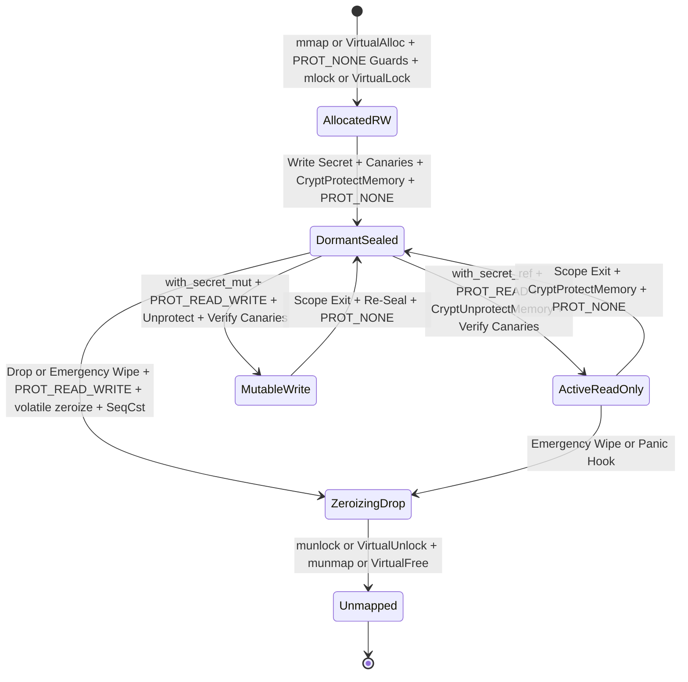
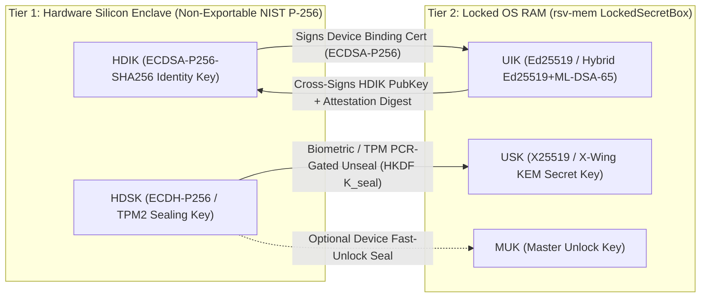

# Specification 03: Memory Safety, OS Hardening, and Hardware Trust

| Metadata | Value |
| :--- | :--- |
| **Document ID** | `RSV-SPEC-03` |
| **Project** | RusticStack Core (`ZK-Vault`) — `https://github.com/KelpHect/ZK-Vault` |
| **License** | Dual MIT / Apache-2.0 |
| **Status** | Normative — Native (`rsv-mem`, `rsv-enclave`, `rsv-daemon`, `rsv-desktop`) & Web (`rsv-wasm`) |
| **Target Toolchain** | Rust 2024 Edition, MSRV `1.94.0` |
| **Normative Crates** | `rsv-mem`, `rsv-enclave`, `rsv-wasm`, `rsv-types` |
| **Related ADRs** | [ADR-0004](../adrs/ADR-0004-two-tier-hardware-enclave-p256-delegation.md), [ADR-0008](../adrs/ADR-0008-wasm-fixed-arena-zeroization-strategy.md) |

---

## 1. Conformance & Scope

The key words **MUST**, **MUST NOT**, **REQUIRED**, **SHALL**, **SHALL NOT**, **SHOULD**, **SHOULD NOT**, **RECOMMENDED**, **MAY**, and **OPTIONAL** in this specification are to be interpreted as described in RFC 2119 and RFC 8174.

Cryptography that is mathematically sound on the wire fails completely if plaintext key material (`MUK`, `USK`, `UIK`, `CK`, `DEK`, `ORPK_SEED`) leaks into swap space, crash dumps, freed heap allocations, debugger attachments, or browser garbage-collected heaps. This specification defines the normative memory lifecycle, platform OS hardening calls, two-tier hardware enclave offloading architecture, and WebAssembly linear memory boundary for RusticStack Core.

---

## 2. Hostile Operating System Threat Model

RusticStack Core assumes client endpoints run on commodity operating systems (Linux, macOS, Windows) and web browsers where other unprivileged applications, crash-reporting daemons, backup agents, and browser extensions share the host.

### 2.1 Threat Vectors & Honest Security Boundaries

| Threat Class | Concrete Attack Mechanism | Native `rsv-mem` Defense | Hardware `rsv-enclave` (`L3`) Defense | `rsv-wasm` Defense | Honest Residual Boundary |
| :--- | :--- | :--- | :--- | :--- | :--- |
| **Swap / Hibernation Leakage** | OS pages inactive RAM containing keys to `/swapfile`, `pagefile.sys`, `hiberfil.sys`, or macOS `sleepimage` | **MITIGATED**: `mlock()` / `VirtualLock()` pins secret pages in physical RAM; auto-lock wipes RAM before sleep/suspend signals | **MITIGATED**: `HDIK` / `HDSK` never enter host RAM | **OUT OF SCOPE** (browsers cannot `mlock`) | Hibernation on OS kernels that force-flush locked pages to `hiberfil.sys` requires client sleep-event listener (`WM_PBT_APMSUSPEND` / `NSWorkspaceWillSleepNotification` / `logind PrepareForSleep`) to zeroize unlocked keys BEFORE suspend! |
| **Crash Core Dumps** | Unhandled crash writes process RAM to `systemd-coredump`, macOS `ReportCrash`, or Windows WER / `MiniDumpWriteDump` | **MITIGATED**: `MADV_DONTDUMP`, `RLIMIT_CORE = 0`, `PR_SET_DUMPABLE = 0`, `WerRegisterExcludedMemoryBlock`, panic emergency wipe | **MITIGATED**: Enclave keys unreachable by OS crash dumpers | **PARTIAL**: Fixed-arena zeroize on JS/WASM trap handler | Kernel crash dumps (`kdump`/BSOD full memory dump) capture physical RAM of active unlocked sessions |
| **Same-UID Userland Scrapers & Debuggers** | Infostealer running under the same user account calls `ptrace`, `/proc/<pid>/mem`, `task_for_pid`, or `ReadProcessMemory` | **MITIGATED**: `PR_SET_DUMPABLE = 0`, `PT_DENY_ATTACH`, Hardened Runtime (`get-task-allow=false`), Windows Process DACL stripping `PROCESS_VM_READ`, `CryptProtectMemory` idle encryption | **MITIGATED**: `HDIK` / `HDSK` cannot be extracted even via memory scrape | **PARTIAL**: Dedicated Worker isolation; vulnerable to same-origin XSS | Same-UID attacker with `CAP_SYS_PTRACE` or Windows `SeDebugPrivilege` (elevated Administrator/root) bypasses userland DACLs |
| **Child Process Fork Inheritance** | Process calls `fork()` / `posix_spawn()`, cloning parent's secret pages into child address space | **MITIGATED**: `MADV_WIPEONFORK` (Linux), `minherit(VM_INHERIT_NONE)` (macOS), `rsv-daemon` forbids unguarded `fork()` | **MITIGATED** | N/A | None within native runtime |
| **Memory Overrun / Heartbleed-Style Read** | Buggy FFI call or out-of-bounds read scans adjacent heap memory looking for keys | **MITIGATED**: Dedicated `PROT_NONE` / `PAGE_NOACCESS` guard pages flanking secret allocations + random slot canaries | **MITIGATED**: Hardware bus isolation | **PARTIAL**: Fixed-arena isolation + bounds-checked Rust slices | Spatial safety guaranteed by safe Rust + hardware MMU guard pages |
| **Freed Heap / Allocator Copy Remnants** | Secret buffers deallocated or relocated (`Vec::realloc`, WASM `memory.grow`) without overwriting old memory | **MITIGATED**: `ZeroizeOnDrop` with volatile fence + non-relocating `LockedArena` | **MITIGATED** | **MITIGATED**: Fixed `initial == max` WASM memory forbids `memory.grow()` | None when arena contract is respected |
| **Kernel Rootkit / Cold-Boot / Physical DMA** | Attacker holds Ring-0 kernel compromise or physical RAM freeze/DMA probe | **CANNOT PREVENT** for active unlocked session keys in host RAM | **MITIGATED FOR ROOT DEVICE KEYS**: `HDIK` and `HDSK` remain non-exportable inside Secure Enclave / TPM 2.0 silicon | **CANNOT PREVENT** | **Honest Boundary**: No software vault can protect an actively decrypted plaintext secret in host RAM against a compromised OS kernel. Hardware enclave offloading guarantees that stolen disk + offline device compromise cannot extract `HDIK`/`HDSK`, and biometric gating prevents silent offline unsealing. |

---

## 3. Memory Lifecycle Architecture (`rsv-mem`)

### 3.1 Compiler-Safe Secret Types & Zeroization Rules

1. **Mandatory Secret Wrapping**: All secret key types in `rsv-crypto`, `rsv-vss`, `rsv-graph`, and `rsv-daemon` MUST be wrapped in `secrecy::SecretBox<T>` (`secrecy` 0.10) or `rsv_mem::LockedSecretBox<T>`, where `T: zeroize::Zeroize + zeroize::ZeroizeOnDrop` (`zeroize` 1.9).
2. **Prohibition on Accidental Leakage**:
   - Secret types SHALL NOT implement `Copy`, `Clone` (except via explicit auditable `try_clone_locked()`), `Serialize`, `Display`, or raw `Debug` (only `[REDACTED]`).
   - Callers MUST access inner bytes exclusively inside tightly scoped closures via `ExposeSecret::expose_secret()` or `LockedSecretBox::with_secret_ref(|bytes| ...)`.
3. **Dead Store Elimination (DSE) Prevention**:
   - Standard Rust `slice.fill(0)` before drop MAY be eliminated by LLVM optimization passes if the buffer is never read again.
   - `rsv-mem` MUST rely strictly on `zeroize::Zeroize` (`core::ptr::write_volatile` followed by `core::sync::atomic::compiler_fence(Ordering::SeqCst)`), ensuring the zero-fill instructions survive `-C opt-level=3` and LTO across x86_64, ARM64, and `wasm32`.
4. **No Stack-to-Heap Relocating Buffers for Secrets**:
   - Secrets MUST NEVER be pushed into a dynamically growing `Vec<u8>` whose capacity may reallocate (leaving an unzeroized copy in the old heap chunk). All secret deserialization and decryption outputs MUST allocate directly into exact-sized `LockedSecretBox` or `LockedArena` buffers.

### 3.2 Guarded Page-Aligned Memory Architecture (`LockedSecretBox` & `LockedArena`)

Allocating an independent 3-page `mmap` (leading guard + secret page + trailing guard = `12 KiB` on 4 KiB pages, or `48 KiB` on 16 KiB Apple Silicon pages) for every 32-byte `DEK` would rapidly exhaust Linux's default `RLIMIT_MEMLOCK` quota (`64 KiB` on many distros). `rsv-mem` therefore provides **two complementary primitives**:

1. **`LockedSecretBox<T>` (Dedicated Page-Isolated Allocation)**:
   - Reserved for long-lived root/session keys (`MUK`, `USK`, `UIK` private key, `ORPK_SEED`, `ORPK`, `DRPK`, `TBK`).
   - Allocates `1` leading guard page + `ceil(size / page_size)` secret page(s) + `1` trailing guard page via direct OS virtual memory syscalls (`mmap` / `VirtualAlloc`).
   - Supports dynamic hardware MMU page-protection transitions (`PROT_NONE` when dormant, `PROT_READ` during cryptographic use, `PROT_READ | PROT_WRITE` only during init/zeroize) AND Windows `CryptProtectMemory` encryption when dormant.
2. **`LockedArena` (Pooled Guarded Slab Allocator)**:
   - Reserved for high-frequency ephemeral keys (`TK`, `CK`, `DEK`, intermediate HKDF subkeys, item plaintext CBOR buffers).
   - Reserves a single contiguous slab of $P_{\text{secret}}$ locked pages (default `64 KiB` = 16 pages on 4 KiB x86_64, or 4 pages on 16 KiB ARM64) flanked by 1 leading `PROT_NONE` guard page and 1 trailing `PROT_NONE` guard page.
   - Sub-allocates fixed size classes (`64 B`, `256 B`, `1024 B`, `4096 B`) — all multiples of `16` bytes (`CRYPTPROTECTMEMORY_BLOCK_SIZE`) — separated by 8-byte per-instance CSPRNG slot canaries checked on every access and free.
   - Tracks all active allocations in a global thread-safe registry (`Mutex<ArenaRegistry>`) so `rsv_mem::emergency_wipe_all()` can atomically zeroize EVERY active secret across all threads on lock timeout, OS sleep event, `SIGTERM`/`SIGINT`, or panic!

#### Virtual Address Layout of a `LockedSecretBox` / `LockedArena` Region

```text
Low Virtual Address                                                       High Virtual Address
+---------------------------+-------------------------------------------+---------------------------+
|   LEADING GUARD PAGE      |        LOCKED SECRET PAGE(S) (N * P)      |   TRAILING GUARD PAGE     |
|   Size: 1 * OS_PAGE_SIZE  |  mmap(MAP_PRIVATE|MAP_ANON) / VirtualAlloc|   Size: 1 * OS_PAGE_SIZE  |
|   Prot: PROT_NONE /       |  mlock() / VirtualLock()                  |   Prot: PROT_NONE /       |
|         PAGE_NOACCESS     |  madvise(MADV_DONTDUMP | MADV_WIPEONFORK) |         PAGE_NOACCESS     |
|   (NOT counted against    |  minherit(VM_INHERIT_NONE) [macOS]        |   (NOT counted against    |
|    RLIMIT_MEMLOCK!)       |  WerRegisterExcludedMemoryBlock [Windows] |    RLIMIT_MEMLOCK!)       |
|                           |                                           |                           |
|  1-byte underflow ->      |  [16B Canary][Aligned Secret (16B mult)]  |  <- 1-byte overflow       |
|  Immediate Hardware       |  [16B Canary][Zero-Pad to Page End]       |  Immediate Hardware       |
|  SIGSEGV / ACCESS_VIOL    |  (Dormant: PROT_NONE / CryptProtectMem)   |  SIGSEGV / ACCESS_VIOL    |
+---------------------------+-------------------------------------------+---------------------------+
```

#### Dynamic Protection Lifecycle State Machine (`LockedSecretBox<T>`)



### 3.3 `RLIMIT_MEMLOCK` Budget Calculation & Handling

On Linux systems, default unprivileged `RLIMIT_MEMLOCK` can be as low as `64 KiB` (`65,536` bytes), whereas systemd-managed `rsv-daemon` units SHOULD declare `LimitMEMLOCK=64M`.

| Target Page Size | Dedicated Root Keys (`MUK`, `USK`, `UIK`, `TBK`: 4 boxes) | Pooled `LockedArena` (Active `TK`/`CK`/`DEK`s) | Total Locked Physical RAM (Guard Pages Excluded) | Fits Default Linux `64 KiB`? |
| :--- | :--- | :--- | :--- | :--- |
| **4 KiB** (x86_64 Linux / Windows) | `4 * 4 KiB = 16 KiB` (or co-located in 1 `4 KiB` Root Page when `RLIMIT_MEMLOCK <= 64 KiB`) | `48 KiB` (12 pages, holds >250 keys) | **`64 KiB`** exact cap (or `52 KiB` with co-located Root Page) | **YES** (zero failures on stock Linux desktops) |
| **16 KiB** (ARM64 Linux / Apple Silicon macOS) | Co-located 1 Root Page (`16 KiB`) | `48 KiB` (3 pages, holds >250 keys) | **`64 KiB`** | **YES** (macOS has generous default wired-memory allowance; ARM64 Linux fits `64 KiB`) |
| **Daemon / Enterprise Server Config** (`LimitMEMLOCK=64M`) | Dedicated page-isolated `LockedSecretBox` per root key | `4 MiB` pooled arena + on-demand `1 MiB` slabs | `~4.1 MiB` | Requires `LimitMEMLOCK >= 16M` |

**Normative `RLIMIT_MEMLOCK` Startup Probe**:
1. At initialization, `rsv_mem::init_process_hardening()` MUST query `getrlimit(RLIMIT_MEMLOCK)` (Linux/macOS) or `GetProcessWorkingSetSizeEx()` (Windows).
2. If `RLIMIT_MEMLOCK < 65_536` bytes, `rsv-mem` MUST attempt to raise `rlim_cur` up to `min(rlim_max, 67_108_864)`.
3. If available lockable memory is `< 32 KiB`, `rsv-mem` MUST switch to `CoLocatedRootPage` mode (1 page for root keys + 1 page for arena = `8 KiB` on 4 KiB pages) and emit a structured `MemoryHardeningReport { mlock_active: true, degraded_quota: true }`.
4. If `mlock()` / `VirtualLock()` fails with `ENOMEM` / `EPERM` / `ERROR_WORKING_SET_QUOTA`, `rsv-mem` MUST fail closed (`MemError::MemoryLockDenied`) in **Strict Enterprise Mode** (default for `rsv-daemon` and `root_quorum_only` operations); consumer fallback MAY continue ONLY if explicitly authorized by tenant policy (`allow_unlocked_memory_fallback = false` by default) and MUST downgrade device posture telemetry.

---

## 4. Normative Platform OS Hardening Matrix

`rsv_mem::init_process_hardening()` MUST be invoked as the **very first call in `main()`** of `rsv-daemon`, `rsv-desktop`, and `rsv-compliance-cli`—BEFORE opening network sockets, spawning worker threads, loading plugins, or prompting for credentials.

### 4.1 Platform Syscall & API Matrix

| Hardening Control | Linux (`x86_64` / `aarch64`) | macOS (`aarch64` / `x86_64`) | Windows (`x86_64` / `aarch64`, `windows` crate) |
| :--- | :--- | :--- | :--- |
| **Virtual Page Allocation** | `mmap(NULL, len, PROT_READ \| PROT_WRITE, MAP_PRIVATE \| MAP_ANONYMOUS, -1, 0)` | `mmap(NULL, len, PROT_READ \| PROT_WRITE, MAP_PRIVATE \| MAP_ANON, -1, 0)` | `VirtualAlloc(None, len, MEM_RESERVE \| MEM_COMMIT, PAGE_READWRITE)` |
| **Guard Pages** | `mprotect(guard_ptr, page_sz, PROT_NONE)` | `mprotect(guard_ptr, page_sz, PROT_NONE)` / Mach `vm_protect` | `VirtualProtect(guard_ptr, page_sz, PAGE_NOACCESS, &mut old)` |
| **Pin RAM (Anti-Swap)** | `mlock2(ptr, len, 0)` (fallback `mlock(ptr, len)` on kernels `< 4.4`) | `mlock(ptr, len)` | `VirtualLock(ptr, len)` (expand quota via `SetProcessWorkingSetSizeEx` if `ERROR_WORKING_SET_QUOTA`) |
| **Exclude From Core Dumps** | `madvise(ptr, len, MADV_DONTDUMP)` + `setrlimit(RLIMIT_CORE, {0, 0})` | `setrlimit(RLIMIT_CORE, {0, 0})` | `WerRegisterExcludedMemoryBlock(ptr, len)` + `WerSetFlags(WER_FAULT_REPORTING_NO_UI)` + `SetErrorMode(SEM_NOGPFAULTERRORBOX)` |
| **Anti-Fork Secret Inheritance** | `madvise(ptr, len, MADV_WIPEONFORK)` (Linux `>= 4.14`; fail-warn if `EINVAL` on older kernels) | `minherit(ptr, len, VM_INHERIT_NONE)` | Windows has no POSIX `fork()`; handles created with `bInheritHandle = FALSE` |
| **Kernel Zero-on-Unlock** | Explicit volatile zeroize BEFORE `munlock` + `munmap` | Explicit volatile zeroize + `madvise(ptr, len, MADV_ZERO_WIRED_PAGES)` before `munlock` | Explicit volatile zeroize (`SecureZeroMemory` / `zeroize`) BEFORE `VirtualUnlock` + `VirtualFree` |
| **Anti-Debugger / Anti-Dump** | `prctl(PR_SET_DUMPABLE, 0, 0, 0, 0)` + `prctl(PR_SET_NO_NEW_PRIVS, 1, 0, 0, 0)` | `ptrace(PT_DENY_ATTACH, 0, 0, 0)` (release builds ONLY) + Codesign Hardened Runtime (`CS_RUNTIME`, `com.apple.security.get-task-allow = false`) | Process DACL hardening via `SetSecurityInfo(GetCurrentProcess(), SE_KERNEL_OBJECT, DACL_SECURITY_INFORMATION, ...)` stripping `PROCESS_VM_READ`, `PROCESS_VM_WRITE`, `PROCESS_VM_OPERATION`, `PROCESS_QUERY_INFORMATION`, `PROCESS_DUP_HANDLE`, `PROCESS_CREATE_THREAD` from non-`SYSTEM` ACEs |
| **In-RAM Dormant Encryption** | `mprotect(PROT_NONE)` when idle | `mprotect(PROT_NONE)` when idle | `CryptProtectMemory(ptr, aligned_len, CRYPTPROTECTMEMORY_SAME_PROCESS)` (MUST satisfy `aligned_len % 16 == 0`) + `VirtualProtect(PAGE_NOACCESS)` when idle |
| **Code Injection / DLL Mitigations** | Seccomp-BPF allowlist on `rsv-daemon` (optional strict profile); `W^X` non-executable heap/stack | Hardened Runtime: disable `allow-dyld-environment-variables`, `disable-library-validation = false`, `allow-jit = false` | `SetProcessMitigationPolicy`: `ProcessImageLoadPolicy` (`NoRemoteImages`, `NoLowMandatoryLabelImages`, `PreferSystem32Images`), `ProcessDynamicCodePolicy` (`ProhibitDynamicCode = 1`), `ProcessExtensionPointDisablePolicy` (`DisableExtensionPoints = 1`), `ProcessStrictHandleCheckPolicy` (`RaiseExceptionOnInvalidHandleReference = 1`) |

### 4.2 Critical Platform Implementation Notes

1. **Windows `CryptProtectMemory` 16-Byte Block Alignment**:
   - `CryptProtectMemory` operates on 16-byte AES blocks (`CRYPTPROTECTMEMORY_BLOCK_SIZE = 16`) and fails with `ERROR_INVALID_USER_BUFFER` if `cbData % 16 != 0`.
   - Every `LockedSecretBox<T>` allocation MUST round its protected inner payload length up to `aligned_len = (size_of::<T>() + 15) & !15` (minimum `16` bytes), zero-initializing padding bytes before encryption and re-zeroizing upon drop.
   - Note that `CryptProtectMemory` encrypts the buffer in-place using a kernel/LSASS ephemeral session key, requiring `PAGE_READWRITE` during the `CryptProtectMemory` / `CryptUnprotectMemory` call itself; `rsv-mem` MUST execute the exact sequence:
     - **Seal**: `CryptProtectMemory(ptr, aligned_len, CRYPTPROTECTMEMORY_SAME_PROCESS)` -> `VirtualProtect(ptr, page_len, PAGE_NOACCESS)`.
     - **Unseal (read-only use)**: `VirtualProtect(ptr, page_len, PAGE_READWRITE)` -> `CryptUnprotectMemory(ptr, aligned_len, CRYPTPROTECTMEMORY_SAME_PROCESS)` -> `VirtualProtect(ptr, page_len, PAGE_READONLY)`.
2. **Windows Process DACL Hardening**:
   - Strip `PROCESS_VM_READ` (`0x0010`), `PROCESS_VM_WRITE` (`0x0020`), `PROCESS_VM_OPERATION` (`0x0008`), `PROCESS_QUERY_INFORMATION` (`0x0400`), `PROCESS_DUP_HANDLE` (`0x0040`), and `PROCESS_CREATE_THREAD` (`0x0002`) from the process DACL for the current user SID, retaining ONLY `SYNCHRONIZE | PROCESS_TERMINATE | PROCESS_QUERY_LIMITED_INFORMATION` so Task Manager can display/terminate the app while same-user malware and `MiniDumpWriteDump` receive `ERROR_ACCESS_DENIED`.
   - Preserve `NT AUTHORITY\SYSTEM` access so OS session management remains stable.
3. **macOS Keychain & Entitlements**:
   - Release builds of `rsv-desktop` and `rsv-daemon` MUST be signed with Apple Hardened Runtime (`--options runtime`), `com.apple.security.get-task-allow = false`, `keychain-access-groups`, and `kSecUseDataProtectionKeychain = true`.
   - All Secure Enclave / Keychain items MUST set `kSecAttrAccessible = kSecAttrAccessibleWhenUnlockedThisDeviceOnly` (strictly preventing iCloud Keychain or unencrypted iTunes/Finder backup sync of device-bound key references).
4. **Linux `PR_SET_DUMPABLE` & `/proc/<pid>/mem`**:
   - Calling `prctl(PR_SET_DUMPABLE, 0)` instructs the Linux kernel to change ownership of `/proc/<pid>/*` files to `root:root`, blocking any non-root same-UID process from opening `/proc/<pid>/mem`, `/proc/<pid>/maps` sensitive descriptors, or invoking `ptrace(PTRACE_ATTACH)` or `process_vm_readv()`.
   - `rsv-mem` MUST wrap `PT_DENY_ATTACH` (macOS) and `PR_SET_DUMPABLE` (Linux) with `#[cfg(not(debug_assertions))]` or explicit `--allow-debug` dev-build flag so local developer debugging works while release binaries are ALWAYS hardened unconditionally!

### 4.3 OS Sleep, Screen-Lock, and Idle Zeroization Hooks

Even with `mlock()`/`VirtualLock()`, OS hibernation and unlocked unattended sessions pose physical access risks. `rsv-desktop` and `rsv-daemon` MUST register platform power/session listeners that invoke `rsv_mem::emergency_wipe_all()` synchronously BEFORE sleep completion:
- **Linux**: D-Bus `org.freedesktop.login1.Manager.PrepareForSleep(true)` (holding an inhibitor lock for max `500 ms` until zeroize completes) and `org.freedesktop.ScreenSaver.ActiveChanged(true)`.
- **macOS**: `NSWorkspaceWillSleepNotification` and `com.apple.screenIsLocked` distributed notification.
- **Windows**: `WM_POWERBROADCAST` (`PBT_APMSUSPEND`) and `WTSRegisterSessionNotification` (`WTS_SESSION_LOCK`).

---

## 5. Two-Tier Hardware Enclave Offloading (`rsv-enclave`)

### 5.1 Architectural Rationale: Why Tier 1 Uses NIST P-256

RusticStack Core uses Curve25519 (`Ed25519` / `X25519`) and post-quantum `X-Wing` (`ML-KEM-768 + X25519`) for all end-to-end protocol cryptography (`CS-01` / `CS-02`). However, **consumer and enterprise hardware security modules enforce strict curve constraints**:

1. **Apple Secure Enclave Processor (SEP)**: Hardware silicon ONLY generates, isolates, and executes **NIST P-256 (`secp256r1`)** private keys (`kSecAttrTokenIDSecureEnclave`). Apple SEP does NOT support Ed25519, X25519, or ML-KEM in silicon.
2. **Discrete & Firmware TPM 2.0 (TCG Specification 1.59)**: Virtually all deployed Windows 11 and Linux TPM 2.0 chips mandate **NIST P-256** (`TPM_ECC_NIST_P256`) and RSA-2048; Ed25519/X25519 support in TPM 2.0 is non-universal and absent from `Microsoft Platform Crypto Provider (PCPKSP)`.

Therefore, RusticStack Core implements a clean **Two-Tier Cryptographic Delegation Model** (see [ADR-0004](../adrs/ADR-0004-two-tier-hardware-enclave-p256-delegation.md)):



- **Mutual Cross-Signing (Device Enrollment in `vault.user_devices`)**:
  When a user enrolls a device, `rsv-enclave` generates non-exportable `HDIK` and `HDSK` in silicon and constructs the canonical transcript:
  $$T_{\text{bind}} = \text{"rsv:device-bind:v1"} \parallel \text{tenant\_id} \parallel \text{user\_id} \parallel \text{device\_id} \parallel \text{HDIK\_pk} \parallel \text{UIK\_pk} \parallel \text{BE\_u64}(\text{issued\_at})$$
  1. Hardware enclave signs $T_{\text{bind}}$ with `HDIK` (`ECDSA-P256-SHA256`, low-S normalized) -> $\sigma_{\text{hdik}}$.
  2. Software `UIK` signs `T_bind || sigma_hdik || attestation_digest` -> $\sigma_{\text{uik}}$.
  3. `rsv-server` verifies BOTH signatures and the vendor attestation chain (`vault.user_devices`) before issuing device-bound session tokens.
- **Zero Impact on Wire Post-Quantum Security**: Because `HDSK` only seals keys *locally* inside the physical endpoint (never transmitting `HDSK` ciphertexts across untrusted networks or storing them in `vault.vault_item_revisions`), local P-256 sealing does NOT expose network ciphertexts to Harvest-Now-Decrypt-Later (HNDL) quantum interception.

### 5.2 Normative `HardwareKeyProvider` Rust Trait (`rsv-enclave`)

```rust
//! Normative Hardware Trust Anchor contract for `rsv-enclave` (Rust 2024 Edition, MSRV 1.94.0).

use secrecy::SecretBox;
use zeroize::{Zeroize, ZeroizeOnDrop};

/// Hardware trust posture recorded in `vault.user_devices` and enforced by `vault.tenants`.
#[repr(u8)]
#[derive(Clone, Copy, Debug, PartialEq, Eq, PartialOrd, Ord, Hash)]
pub enum HardwareAttestationLevel {
    /// Software-only `rsv-mem` LockedArena + Argon2id password unlock. No hardware key isolation.
    L1SoftwareLockedMem = 1,
    /// Roaming FIDO2/CTAP2 authenticator with WebAuthn PRF (`hmac-secret`) extension.
    L2WebAuthnRoaming = 2,
    /// Platform Hardware Enclave (Apple Secure Enclave or Verified TPM 2.0 with non-exportable P-256).
    L3HardwareEnclave = 3,
}

/// Biometric / user-presence gating policy for hardware key operations.
#[derive(Clone, Copy, Debug, PartialEq, Eq)]
pub enum BiometricPolicy {
    /// No interactive prompt (permitted only for headless daemon `rsv-daemon` with TPM PCR policy).
    NoneHeadlessPcrBound,
    /// Require Touch ID / Face ID / Windows Hello (current enrolled biometric set only — invalidates on new finger!).
    BiometryCurrentSet,
    /// Require biometry OR OS device passcode/PIN fallback.
    UserPresenceOrPasscode,
}

/// Uncompressed SEC1 65-byte NIST P-256 public key (`0x04 || X[32] || Y[32]`).
#[derive(Clone, Debug, PartialEq, Eq)]
pub struct P256PublicKey(pub [u8; 65]);

/// Fixed-size 64-byte IEEE P1363 (`r || s`, low-S normalized) ECDSA-P256-SHA256 signature.
#[derive(Clone, Debug, PartialEq, Eq)]
pub struct P256Signature(pub [u8; 64]);

/// Platform-specific hardware attestation evidence verified during device enrollment.
#[derive(Clone, Debug)]
pub enum DeviceAttestationEvidence {
    AppleSecureEnclave {
        app_attest_cbor: Vec<u8>,
        key_id: [u8; 32],
    },
    Tpm2Quote {
        ek_cert_chain_der: Vec<Vec<u8>>,
        aik_public_area: Vec<u8>,
        certify_info: Vec<u8>,
        certify_signature: Vec<u8>,
        pcr_selection_mask: u32,
        pcr_digest: [u8; 32],
    },
    WindowsPcpksp {
        pcp_key_attestation_blob: Vec<u8>,
        ek_cert_der: Vec<u8>,
    },
    WebAuthnPrf {
        authenticator_data: Vec<u8>,
        attestation_statement_cbor: Vec<u8>,
    },
    SoftwareUnattested,
}

/// Opaque hardware-sealed blob persisted locally on disk (never valid on any other physical device).
#[derive(Clone, Debug)]
pub struct EnclaveSealedBlob {
    pub backend_id: EnclaveBackendId,
    pub key_label: String,
    pub pcr_digest_binding: Option<[u8; 32]>,
    pub sealed_payload: Vec<u8>,
}

#[derive(Clone, Copy, Debug, PartialEq, Eq)]
pub enum EnclaveBackendId {
    AppleSecureEnclave,
    LinuxTpm2Esapi,
    WindowsTpm2Pcpksp,
    WebAuthnRoamingPrf,
    SoftwareFallback,
}

#[derive(Debug, thiserror::Error)]
pub enum EnclaveError {
    #[error("hardware enclave unavailable on this host")]
    HardwareUnavailable,
    #[error("device attestation level {actual:?} rejected by tenant minimum policy {required:?}")]
    AttestationPolicyRejected {
        actual: HardwareAttestationLevel,
        required: HardwareAttestationLevel,
    },
    #[error("biometric or user-presence authentication canceled or failed")]
    UserAuthFailed,
    #[error("biometric enrollment changed; hardware key invalidated (re-unlock via MUK required)")]
    BiometryInvalidated,
    #[error("TPM PCR policy mismatch (firmware/Secure Boot state changed; recover via MUK)")]
    PcrPolicyMismatch,
    #[error("hardware cryptographic operation failed: {0}")]
    BackendFailure(String),
}

/// Normative cross-platform Hardware Key Provider trait implemented by `rsv-enclave`.
pub trait HardwareKeyProvider: Send + Sync {
    /// Reports exact backend identity and cryptographic attestation level.
    fn backend_id(&self) -> EnclaveBackendId;
    fn attestation_level(&self) -> HardwareAttestationLevel;

    /// Generates non-exportable `HDIK` (ECDSA-P256) and `HDSK` (ECDH-P256 / TPM2 seal key)
    /// inside hardware silicon and returns public `HDIK` + verifiable hardware attestation.
    fn provision_device_keys(
        &self,
        device_id: [u8; 16],
        biometric_policy: BiometricPolicy,
    ) -> Result<(P256PublicKey, DeviceAttestationEvidence), EnclaveError>;

    /// Signs a challenge or device-binding transcript using non-exportable `HDIK`.
    /// MUST normalize the resulting ECDSA-P256 signature to low-S before returning.
    fn sign_with_hdik(
        &self,
        device_id: [u8; 16],
        transcript: &[u8],
        auth_prompt: &str,
    ) -> Result<P256Signature, EnclaveError>;

    /// Seals a 32..=64-byte secret (e.g., `USK` seed or `MUK`) under non-exportable `HDSK`.
    /// Sealed ciphertext can ONLY be unwrapped on this exact physical silicon enclave.
    fn seal_secret(
        &self,
        device_id: [u8; 16],
        aad: &[u8],
        plaintext_secret: &SecretBox<[u8; 32]>,
    ) -> Result<EnclaveSealedBlob, EnclaveError>;

    /// Unseals a previously sealed secret directly into a `SecretBox` backed by `rsv-mem`.
    fn unseal_secret(
        &self,
        device_id: [u8; 16],
        aad: &[u8],
        blob: &EnclaveSealedBlob,
        auth_prompt: &str,
    ) -> Result<SecretBox<[u8; 32]>, EnclaveError>;

    /// Permanently destroys `HDIK` and `HDSK` handles from hardware keystore on device wipe/logout.
    fn destroy_device_keys(&self, device_id: [u8; 16]) -> Result<(), EnclaveError>;
}
```

### 5.3 Platform Backend Specifications

#### 5.3.1 Apple Secure Enclave (macOS / iOS)
- **Framework**: `Security.framework` + `LocalAuthentication.framework` via minimal audited Rust FFI bindings.
- **Key Generation (`SecKeyCreateRandomKey`)**:
  - `kSecAttrTokenID`: `kSecAttrTokenIDSecureEnclave` (guarantees private scalar NEVER exists outside SEP silicon).
  - `kSecAttrKeyType`: `kSecAttrKeyTypeECSECPrimeRandom`, `kSecAttrKeySizeInBits`: `256`.
  - `kSecAttrIsPermanent`: `true`, `kSecUseDataProtectionKeychain`: `true`.
  - `kSecAttrApplicationTag`: `"io.rusticstack.zkvault.hdik.<device_uuid>"` / `"io.rusticstack.zkvault.hdsk.<device_uuid>"`.
- **Access Control (`SecAccessControlCreateWithFlags`)**:
  - Protection class: `kSecAttrAccessibleWhenUnlockedThisDeviceOnly`.
  - Flags for `BiometryCurrentSet`: `kSecAccessControlPrivateKeyUsage | kSecAccessControlBiometryCurrentSet` (automatically invalidates key if an attacker enrolls a new Touch ID fingerprint!).
  - Flags for `UserPresenceOrPasscode`: `kSecAccessControlPrivateKeyUsage | kSecAccessControlUserPresence`.
- **Operations**:
  - **Sign (`HDIK`)**: `SecKeyCreateSignature` with `kSecKeyAlgorithmECDSASignatureMessageX962SHA256`, ASN.1 DER decoded and low-S normalized into `P256Signature([u8; 64])`.
  - **Seal (`HDSK`)**: `SecKeyCreateEncryptedData` with `kSecKeyAlgorithmECIESEncryptionCofactorVariableIVX963SHA256AESGCM` (binds `aad` via HKDF-wrapped inner envelope using `CanonicalAadContext` `object_type = "device_sealed_key"`).
  - **Unseal (`HDSK`)**: `SecKeyCreateDecryptedData` triggers native Touch ID prompt via `LAContext`, decrypts inside SEP, and copies directly into `rsv-mem` `LockedSecretBox` while zeroizing the transient `CFData` buffer.

#### 5.3.2 Linux TPM 2.0 (`tss-esapi`)
- **Transport**: MUST connect via the Linux kernel in-kernel resource manager `/dev/tpmrm0` (TCTI `Device("/dev/tpmrm0")`) or `tabrmd`. Direct access to raw `/dev/tpm0` is FORBIDDEN (race conditions and transient slot exhaustion).
- **Storage Primary Key (SRK)**:
  - Created deterministically in `Hierarchy::Owner` using TCG EK/SRK NIST P-256 template (`PublicEccParameters` with `EccCurve::NistP256`, `SymmetricDefinitionObject::AES_128_CFB`).
  - Mandatory `ObjectAttributes`: `TPMA_OBJECT_FIXEDTPM | TPMA_OBJECT_FIXEDPARENT | TPMA_OBJECT_SENSITIVEDATAORIGIN | TPMA_OBJECT_USERWITHAUTH | TPMA_OBJECT_RESTRICTED | TPMA_OBJECT_DECRYPT | TPMA_OBJECT_NODA`.
- **Child Device Identity Key (`HDIK`)**:
  - Created via `TPM2_Create` under SRK with `EccCurve::NistP256`, `TPM2_ALG_ECDSA` + `TPM2_ALG_SHA256`.
  - Mandatory `ObjectAttributes`: `TPMA_OBJECT_FIXEDTPM | TPMA_OBJECT_FIXEDPARENT | TPMA_OBJECT_SENSITIVEDATAORIGIN | TPMA_OBJECT_USERWITHAUTH | TPMA_OBJECT_SIGN_ENCRYPT` (private key NEVER leaves TPM silicon).
- **Child Sealing Object (`HDSK` / Sealed Secret)**:
  - Uses `TPM2_Create` with `ObjectType::KeyedHash` (sealing a 32-byte `K_seal` or `USK` blob directly inside TPM sensitive area) bound to a **PolicyPCR** digest over **PCR 0 (SRTM/BIOS), PCR 2 (Option ROMs), PCR 4 (Bootloader/MBR), and PCR 7 (Secure Boot state)** (SHA-256 PCR bank).
  - **Firmware Update Resilience (No Bricking)**: If a legitimate UEFI/Secure Boot update changes PCR 0/4/7, `TPM2_Unseal` returns `TPM_RC_POLICY_FAIL` -> mapped to `EnclaveError::PcrPolicyMismatch`. The client cleanly prompts the user for password + WebAuthn PRF to re-derive `MUK`, unwraps the authoritative `USK` from `vault.users`, and transparently re-seals under the new PCR baseline!
- **Attestation**: Uses `TPM2_Certify` signed by an Attestation Key (AK) linked to the manufacturer's Endorsement Key (EK) certificate in TPM NV index `0x01C0000A` (ECC P-256 EK cert) or `0x01C00002` (RSA EK cert).

#### 5.3.3 Windows TPM 2.0 / CNG (`windows` crate + `PCPKSP`)
- **Provider**: `NCryptOpenStorageProvider(&mut h_provider, MS_PLATFORM_CRYPTO_PROVIDER, 0)` (`"Microsoft Platform Crypto Provider"`, backed by `PCPKSP.dll` -> Windows TBS -> TPM 2.0).
- **Key Generation (`NCryptCreatePersistedKey`)**:
  - `HDIK`: `BCRYPT_ECDSA_P256_ALGORITHM`, key name `"RSV-HDIK-<device_uuid>"`, export policy strictly `0` (non-exportable; `NCRYPT_ALLOW_EXPORT_FLAG` MUST NOT be set).
  - `HDSK`: `BCRYPT_ECDH_P256_ALGORITHM` (or TPM-backed symmetric sealing via `NCryptCreatePersistedKey` + `NCryptSecretAgreement` with ephemeral P-256 key -> `HKDF-SHA256` `"rsv:enclave:device-seal:v1"` -> `AES-256-GCM` inside `rsv-mem`).
- **Biometric / Windows Hello Integration**:
  - Interactive desktop sessions (`BiometryCurrentSet` / `UserPresenceOrPasscode`) set `NCRYPT_UI_POLICY_PROPERTY` (`NCRYPT_UI_FORCE_HIGH_PROTECTION_FLAG`) and gate `unseal_secret` / `sign_with_hdik` via Windows Hello `UserConsentVerifier::RequestVerificationAsync` (or Windows Hello `KeyCredentialManager` for biometric-gated signing).
- **Attestation**: Extract TPM key attestation statement via `NCryptGetProperty(h_key, NCRYPT_PCP_KEYATTESTATION_PROPERTY, ...)` and EK certificate via `NCryptGetProperty(h_provider, NCRYPT_PCP_EKCERT_PROPERTY, ...)` for `rsv-server` verification.

### 5.4 Graceful Degradation & Enterprise Policy Enforcement

Not every host possesses a working Secure Enclave or TPM 2.0 (e.g., older Linux workstations, virtual machines, browser clients). RusticStack Core defines three explicit, cryptographically audited posture tiers:

| Tier | Constant | Hardware Root | Key Protection Guarantee | Allowed Enterprise Operations |
| :--- | :--- | :--- | :--- | :--- |
| **Level 3** | `L3_HARDWARE_ENCLAVE` | Apple Secure Enclave, Linux TPM 2.0, or Windows PCPKSP TPM 2.0 | Non-exportable P-256 `HDIK`/`HDSK` in silicon + verified vendor attestation + `rsv-mem` | Unrestricted (eligible for `root_quorum_only` collections & Custodian VSS ceremonies) |
| **Level 2** | `L2_WEBAUTHN_ROAMING` | FIDO2/CTAP2 authenticator with WebAuthn `prf` (`hmac-secret`) | Hardware-bound `MUK` derivation factor + `rsv-mem` (native) or fixed-arena `rsv-wasm` (web); no local silicon `HDSK` | Standard enterprise collections; permitted on `root_quorum_only` ONLY if tenant policy allows `L2` |
| **Level 1** | `L1_SOFTWARE_LOCKED_MEM` | None (OS software only) | `rsv-mem` guarded/locked RAM + Argon2id password `MUK` only | Permitted ONLY when `vault.tenants.min_device_attestation_level == 1` |

**Normative Enforcement**:
- `vault.tenants` stores `min_device_attestation_level` (`1`, `2`, or `3`) and `root_quorum_min_attestation_level` (default `3`).
- `rsv-server` MUST verify the submitted `DeviceAttestationEvidence` during `POST /v1/devices/enroll` before inserting a row in `vault.user_devices` with `attestation_level = 3`. Unverified or self-asserted `L3` claims MUST be rejected with HTTP `403 Forbidden`.
- An enterprise tenant setting `min_device_attestation_level = 3` guarantees that NO `L1` or `L2` device can ever authenticate or fetch `vault.key_graph_edges` ciphertext.

---

## 6. WASM Linear Memory Security Model (`rsv-wasm`)

Browser clients execute `rsv-crypto` compiled to `wasm32-unknown-unknown` via `rsv-wasm`. Because WebAssembly executes inside a browser sandbox without OS `mlock()`, `mprotect()`, or hardware TPM access, `rsv-wasm` enforces a **hardened, honest browser boundary** (see [ADR-0008](../adrs/ADR-0008-wasm-fixed-arena-zeroization-strategy.md)).

### 6.1 The `memory.grow()` Copy Leak Vulnerability

In WebAssembly, dynamic heap growth triggers the `memory.grow` opcode. On major browser engines (V8, SpiderMonkey, JavaScriptCore), growing a non-shared `WebAssembly.Memory` frequently:
1. Allocates a brand-new, larger backing `ArrayBuffer` in the browser renderer process;
2. `memcpy`s the entire previous linear memory (including active `MUK`, `USK`, `CK`, and `DEK` bytes!) into the new buffer; and
3. Frees/detaches the old `ArrayBuffer` **WITHOUT zeroizing its contents**.

Consequently, a single `memory.grow()` call silently clones every secret key into unreferenced, unzeroizable browser heap memory—defeating `ZeroizeOnDrop` completely.

### 6.2 Fixed-Arena Pre-Allocated Memory Pool Specification

`rsv-wasm` eliminates `memory.grow()` copy leaks **while accommodating `Argon2id` (`m >= 65536 KiB`, up to `128 MiB` tenant-hardened policy)** via a **Dual Fixed-Memory Worker Split**:

1. **Static Fixed Linear Memory Size (`initial == max`, Zero `memory.grow`)**:
   - **Persistent Session Crypto Module (`rsv-wasm` core worker)**: Holds `MUK`, `USK`, `UIK`, `TK`, `CK`, `DEK`, HPKE (`CS-01` / `CS-02` X-Wing), and AES-256-GCM inside a sleek **`16 MiB`** fixed linear memory (`256` WASM pages of `64 KiB`):
     ```text
     RUSTFLAGS="-C link-arg=--initial-memory=16777216 -C link-arg=--max-memory=16777216"
     ```
   - **Ephemeral Argon2id KDF Module (`rsv-wasm-kdf` worker)**: Spawned ONLY during unlock/enrollment with a fixed **`144 MiB`** linear memory (`2304` WASM pages — sufficient for `Argon2id` up to `m = 131072 KiB` (`128 MiB`) plus `16 MiB` stack/workspace):
     ```text
     RUSTFLAGS="-C link-arg=--initial-memory=150994944 -C link-arg=--max-memory=150994944"
     ```
     Immediately after deriving `K_pwd`, the KDF worker zeroizes its input password buffer and the entire Argon2id working memory matrix, transfers the 32-byte `K_pwd` directly to the persistent `rsv-wasm` core worker over a private Worker-to-Worker `MessageChannel` (never touching the DOM main thread), zeroes the transfer buffer, and terminates itself (`self.close()` / `worker.terminate()`) so the browser reclaims all `144 MiB` immediately.
   - CI MUST run a binary inspection gate (`wasm-tools dump` / `wasmparser`) asserting that **BOTH** compiled `.wasm` modules contain **ZERO `memory.grow` instructions** and declare `memory.limits.initial == memory.limits.maximum` (`256` pages for core, `2304` pages for KDF)!
2. **Partitioned `WasmSecretArena`**:
   - Inside the `16 MiB` `rsv-wasm` core module, a dedicated `2 MiB` static region is managed by a custom non-growing slab allocator (`WasmSecretArena`) reserved exclusively for cryptographic keys, HPKE states, and decrypted item payloads.
   - Every slot in `WasmSecretArena` is zeroized via `zeroize::Zeroize` (`write_volatile` + `compiler_fence`) immediately upon `free` or handle eviction.
   - On session lock, idle timeout, or Worker `beforeunload`/`close`, JS invokes `rsv_wasm_wipe_all()`, which overwrites the ENTIRE `2 MiB` `WasmSecretArena` byte-for-byte with zeros in a single deterministic pass (`< 1 ms`).

### 6.3 Zero-Copy Opaque Handle FFI & Zero-JS-String Policy

JavaScript `string` values are **immutable, UTF-16 encoded, interned, and garbage-collected**—they CANNOT be zeroized from JavaScript!

Therefore, the `rsv-wasm` FFI boundary enforces these strict rules:
1. **Opaque Generation-Indexed Handles (`KeyHandle(u32)`)**:
   - Every key loaded inside `rsv-wasm` (`MUK`, `USK`, `UIK`, `TK`, `CK`, `DEK`) is referenced across the JS/WASM boundary ONLY by an opaque `u32` handle packed as `(generation: u16) << 16 | (slot_index: u16)`.
   - Destroying a handle increments `slot.generation` (wrapping skips `0`), zeroizes the slot in `WasmSecretArena`, and causes any subsequent use-after-free call with a stale handle to fail immediately with `WasmCryptoError::StaleKeyHandle`.
   - **NO WASM export SHALL EVER return raw key bytes (`MUK`, `USK`, `UIK`, `TK`, `CK`, `DEK`) to JavaScript.**
2. **Prohibition on JS String Secrets**:
   - Passwords submitted by users MUST be encoded from an `<input>` directly into a reusable `Uint8Array` via `TextEncoder.encodeInto()`, transferred into the ephemeral `rsv-wasm-kdf` Worker's fixed linear memory for Argon2id derivation (and cleared from `<input>.value = ""`), and immediately wiped in JS via `u8buf.fill(0)`.
   - Decrypted item secrets displayed in the UI are passed ONLY as transient `Uint8Array` buffers copied on demand for a single visible field and immediately zeroed via `.fill(0)` once copied to clipboard or hidden.
3. **Dedicated Web Worker Isolation & Strict CSP**:
   - `rsv-wasm` MUST execute exclusively inside a **Dedicated Web Worker** (`new Worker(...)`, zero DOM access, zero `window`/`document`/`localStorage` visibility), communicating with the UI thread strictly over a scoped `MessagePort` RPC protocol.
   - The web application MUST enforce:
     - `Content-Security-Policy: default-src 'none'; script-src 'self' 'wasm-unsafe-eval'; worker-src 'self'; connect-src 'self' https://api.vault.example; frame-ancestors 'none'; base-uri 'none'`
     - Subresource Integrity (SRI `sha384-...`) on the Worker loader script and SHA-256 verification of the fetched `.wasm` binary before `WebAssembly.instantiate()`.
   - **Honest Browser Boundary**: Even with Worker isolation and fixed-arena zeroization, a same-origin XSS vulnerability or a malicious browser extension granted `<all_urls>` host permissions can invoke Worker RPC methods while the vault is unlocked. Browser clients are therefore capped at `L2_WEBAUTHN_ROAMING` (with WebAuthn PRF) or `L1_SOFTWARE_LOCKED_MEM`, and tenants requiring `L3_HARDWARE_ENCLAVE` MUST mandate `rsv-desktop` / `rsv-daemon`.

---

## 7. Normative Verification & Testing Checklist

Implementations of `rsv-mem`, `rsv-enclave`, and `rsv-wasm` MUST pass the following automated verification gates:

1. **Guard Page Trap Tests (`rsv-mem`)**:
   - Subprocess unit tests attempting a 1-byte read/write immediately before (`base - 1`) and immediately after (`base + len`) a `LockedSecretBox` MUST terminate with `SIGSEGV` / `SIGBUS` (Unix) or `STATUS_ACCESS_VIOLATION` (`0xC0000005`, Windows).
2. **Anti-Dump & Zeroization Tests (`rsv-mem`)**:
   - Linux integration test asserting `/proc/self/smaps` shows `dd` (`MADV_DONTDUMP`), `wi` (`MADV_WIPEONFORK`), and `lo` (`mlock`) flags on the `LockedArena` VMA, and `/proc/self/status` reports `Dumpable: 0` (release).
   - Linux `fork()` test verifying that a forked child process reads all-zero bytes from the parent's `LockedArena` address (`MADV_WIPEONFORK`).
   - Assembly inspection / volatile-read test verifying LLVM `-C opt-level=3` does NOT optimize away `ZeroizeOnDrop` writes.
   - Windows integration test verifying `CryptProtectMemory` round-trip on 16-byte aligned payloads (`1`, `16`, `32`, `33`, `64` byte logical structs) and confirming an unprivileged sibling process calling `OpenProcess(PROCESS_VM_READ)` fails with `ERROR_ACCESS_DENIED`.
3. **Hardware Enclave Tests (`rsv-enclave`)**:
   - Platform CI runners (macOS Apple Silicon, Linux with `swtpm` emulator, Windows TPM simulator) verifying `provision_device_keys` -> `sign_with_hdik` (low-S check) -> `seal_secret` -> `unseal_secret` -> `destroy_device_keys`.
   - Negative test asserting `L1` / `L2` enrollment is rejected when tenant policy requires `L3_HARDWARE_ENCLAVE`.
4. **WASM Static & Runtime Audits (`rsv-wasm`)**:
   - CI binary audit asserting `0` occurrences of `memory.grow` opcode and `initial == maximum` in BOTH release `.wasm` binaries (`256` pages = `16 MiB` for `rsv_wasm.wasm` core; `2304` pages = `144 MiB` for `rsv_wasm_kdf.wasm` Argon2id worker).
   - Argon2id `m = 65536 KiB` and `m = 131072 KiB` browser/wasmtime integration tests proving zero OOM and full KDF matrix zeroization prior to Worker termination.
   - Stale `KeyHandle` replay test confirming `WasmCryptoError::StaleKeyHandle` after drop.
   - Full-arena wipe test confirming every byte of the `2 MiB` `WasmSecretArena` equals `0x00` after `rsv_wasm_wipe_all()`.
