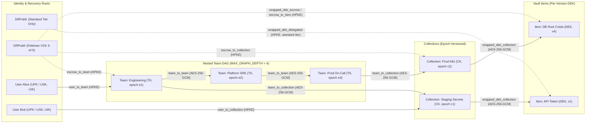
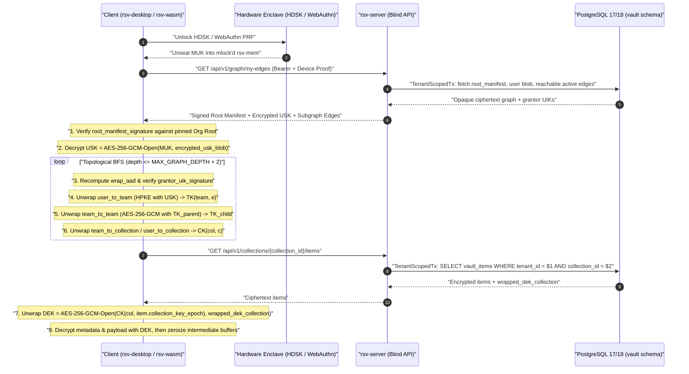
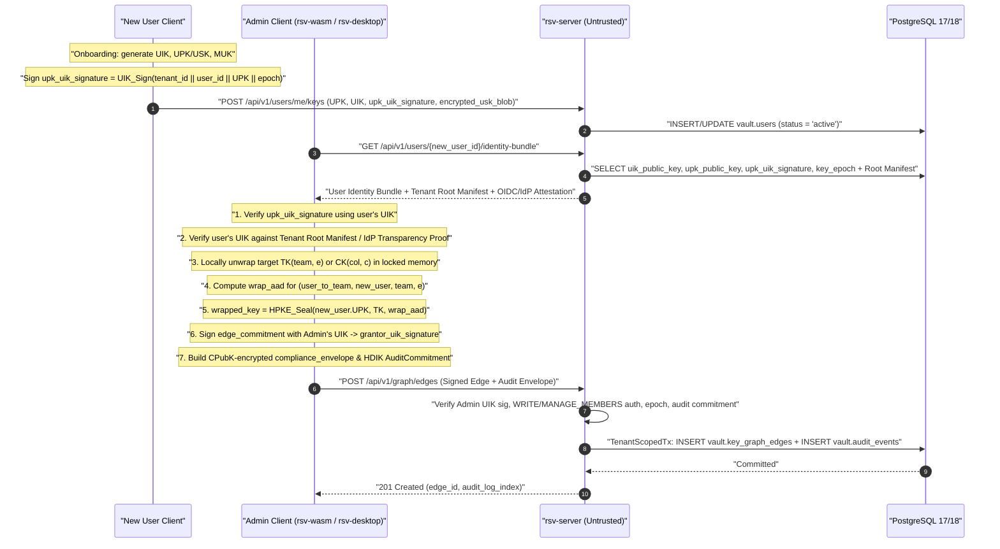
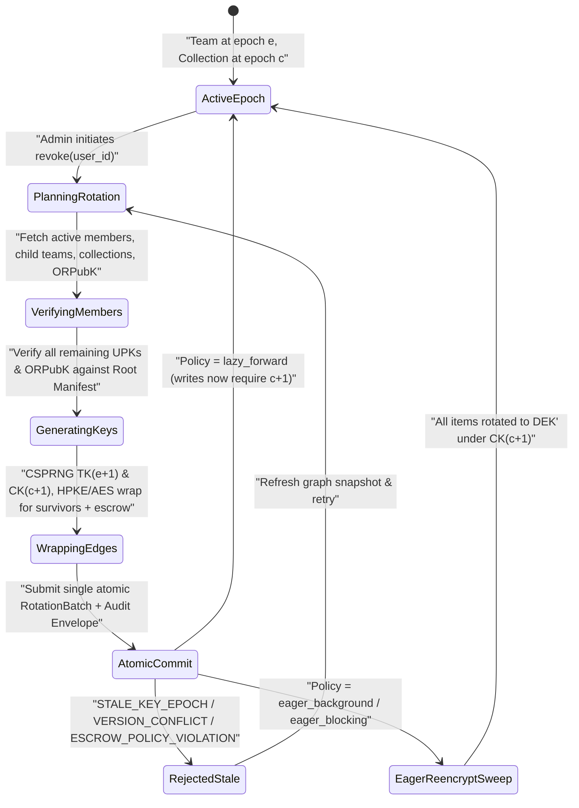
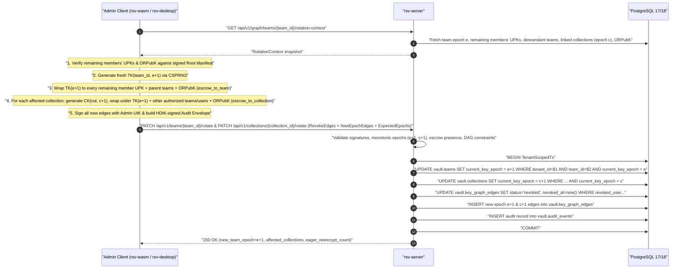
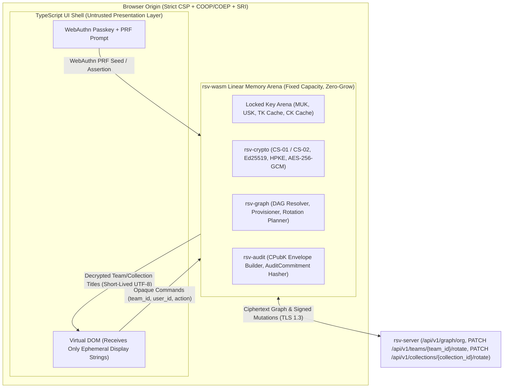

# Specification 04: Blind RBAC & Cryptographic Access Graph

| Field | Value |
| :--- | :--- |
| **Document ID** | `RSV-SPEC-04` |
| **Status** | Normative Draft |
| **Version** | `1.0.0` |
| **Project** | RusticStack Core (`ZK-Vault`, `https://github.com/KelpHect/ZK-Vault`) |
| **License** | Dual MIT / Apache-2.0 |
| **Target Toolchain** | Rust 2024 Edition (MSRV `1.94.0`), `axum` 0.8, `sqlx` 0.9, PostgreSQL 17/18 |
| **Primary Crates** | `rsv-graph`, `rsv-crypto`, `rsv-types`, `rsv-mem`, `rsv-wasm`, `rsv-desktop`, `rsv-server` |
| **Schema Reference** | [`schemas/postgresql-schema.sql`](../schemas/postgresql-schema.sql) |

> The key words **MUST**, **MUST NOT**, **REQUIRED**, **SHALL**, **SHALL NOT**, **SHOULD**, **SHOULD NOT**, **RECOMMENDED**, **MAY**, and **OPTIONAL** in this document are to be interpreted as described in RFC 2119 and RFC 8174.

---

## 1. Executive Summary & Architectural Principle

Traditional enterprise secret managers enforce Role-Based Access Control (RBAC) through server-side policy tables: a database administrator, compromised API server, or SQL injection vulnerability can alter a boolean permission flag and immediately read any secret in any tenant.

RusticStack Core (**ZK-Vault**) replaces server-trusted RBAC with a **Blind Cryptographic Access Graph** backed by a strict separation between two orthogonal control planes:

1. **Logical Access Control (Server-Enforced, Coarse)**: The untrusted backend (`rsv-server` + PostgreSQL 17/18) enforces tenant boundaries (via Row-Level Security), coarse mutation authorization (`WRITE`, `MANAGE_MEMBERS`, `ROTATE_KEYS`), structural graph validity (DAG acyclicity, bounded depth `MAX_GRAPH_DEPTH = 4`, monotonic key epochs, escrow-tier compliance), optimistic concurrency, and mandatory audit logging.
2. **Cryptographic Access Control (Math-Enforced, Fine-Grained)**: Secret confidentiality is governed exclusively by a Directed Acyclic Graph (DAG) of wrapped cryptographic keys stored in `vault.key_graph_edges` and `vault.vault_items`. A principal can read a secret **if and only if** there exists a valid, cryptographically verifiable decryption path from their hardware-protected User Secret Key (`USK`)—or an authorized Quorum Recovery Key (`ORPK` via Feldman VSS 3-of-5) or Delegated Recovery Key (`DRPK`)—to the target item's Data Encryption Key (`DEK`).

| Property | Logical Access Control (`rsv-server` + Postgres) | Cryptographic Access Control (`rsv-graph` + Client) |
| :--- | :--- | :--- |
| **Primary Threat Mitigated** | Unauthorized writes, vandalism, DoS, cross-tenant API queries, graph corruption, escrow bypass | Compromised server, rogue DBA, snapshot exfiltration, memory scraping, MITM key substitution |
| **Can Grant Read Access Alone?** | **NO.** Modifying server tables without valid key-wrap edges yields undecryptable ciphertext | **YES.** Possession of a valid cryptographic chain from `USK` to `DEK` is mathematically required |
| **Visibility into Names/Metadata** | **NONE.** Team names, collection titles, item titles, and secrets are AES-256-GCM ciphertexts | **FULL (Authorized Principals Only).** Decrypted exclusively in locked client memory (`rsv-mem` / WASM arena) |
| **Enforcement Mechanism** | `TenantScopedTx` + PostgreSQL `FORCE RLS` + `UIK` signature verification + DAG triggers | `CS-01` (HPKE X25519 / AES-256-GCM) or `CS-02` (X-Wing `X25519+ML-KEM-768` / AES-256-GCM) |
| **Failure Mode** | Fails closed (`TENANT_MISMATCH`, `INVALID_SIGNATURE`, `STALE_KEY_EPOCH`, `GRAPH_CYCLE_REJECTED`) | Fails closed (AEAD tag mismatch / HPKE open failure; plaintext never materializes) |

---

## 2. Cryptographic Access Graph Model

### 2.1 Formal Graph Definition

For each tenant $T$ identified by `tenant_id` (UUIDv7), the access state forms a typed, epoch-versioned Directed Acyclic Graph:

$$G_T = (V_T, E_T)$$

Where the vertex set $V_T$ is partitioned into six disjoint entity classes:

1. **Users** ($u \in V_{\text{user}}$): Identified by `(tenant_id, user_id)` in `vault.users`. Each active user possesses:
   - `UIK`: User Identity Keypair (Ed25519 under `CS-01`; Hybrid Ed25519+ML-DSA-65 under `CS-02`) used to sign graph mutations, device endorsements, and public-key bindings.
   - `UPK` / `USK`: User Encryption Keypair (X25519 under `CS-01`; X-Wing `X25519 + ML-KEM-768` under `CS-02`). `USK` is wrapped under the user's Master Unlock Key (`MUK`), which in turn is sealed to the device's Hardware Device Sealing Key (`HDSK`) and/or derived via Argon2id.
2. **Teams** ($g \in V_{\text{team}}$): Identified by `(tenant_id, team_id)` in `vault.teams`. Each team owns an epoch-indexed 256-bit symmetric Team Key `TK(team_id, epoch)`.
3. **Collections** ($c \in V_{\text{collection}}$): Identified by `(tenant_id, collection_id)` in `vault.collections`. Each collection owns an epoch-indexed 256-bit symmetric Collection Key `CK(collection_id, epoch)`.
4. **Vault Items** ($i \in V_{\text{item}}$): Identified by `(tenant_id, item_id)` in `vault.vault_items`. Each item version owns a unique 256-bit symmetric Data Encryption Key `DEK(item_id, version)` that encrypts `encrypted_metadata` and `encrypted_payload`.
5. **Organization Recovery Anchor** ($\text{ORPubK}_T$): Tenant-wide Feldman Verifiable Secret Sharing (VSS) public key (default threshold `3-of-5` trustees, tracked in `vault.tenant_vss_ceremonies`). The private key `ORPK` **MUST NEVER** exist on `rsv-server`.
6. **Delegated Recovery Anchor** ($\text{DRPubK}_T$): Tenant-wide delegated recovery public key provisioned ONLY for tenants operating in the `standard` escrow tier (`vault.tenants.drpk_public_key`).

### 2.2 Canonical Edge Taxonomy

Every graph edge stored in `vault.key_graph_edges` **MUST** carry one of the seven canonical `vault.graph_edge_type` values, while item-level leaf wrappings are stored directly on `vault.vault_items` for single-round-trip sync efficiency:

| Edge Type / Storage Location | Source Key | Target Key | Wrapping Primitive (`CS-01` / `CS-02`) | Purpose |
| :--- | :--- | :--- | :--- | :--- |
| `user_to_team` (`key_graph_edges`) | `UPK(user_id, src_epoch)` | `TK(team_id, target_epoch)` | Asymmetric HPKE (X25519 / X-Wing) | Grants user cryptographic membership in a team |
| `team_to_team` (`key_graph_edges`) | `TK(parent_id, src_epoch)` | `TK(child_id, target_epoch)` | Symmetric AES-256-GCM Key Wrap | Optional nested team inheritance (bounded `MAX_GRAPH_DEPTH = 4`) |
| `team_to_collection` (`key_graph_edges`) | `TK(team_id, src_epoch)` | `CK(collection_id, target_epoch)` | Symmetric AES-256-GCM Key Wrap | Grants all members of a team access to a collection |
| `user_to_collection` (`key_graph_edges`) | `UPK(user_id, src_epoch)` | `CK(collection_id, target_epoch)` | Asymmetric HPKE (X25519 / X-Wing) | Direct user-to-collection grant (bypassing teams) |
| `escrow_to_team` (`key_graph_edges`) | `ORPubK(tenant_id, src_epoch)` | `TK(team_id, target_epoch)` | Asymmetric HPKE (X25519 / X-Wing) | Quorum disaster recovery of team key & team metadata |
| `escrow_to_collection` (`key_graph_edges`) | `ORPubK(tenant_id, src_epoch)` | `CK(collection_id, target_epoch)` | Asymmetric HPKE (X25519 / X-Wing) | Quorum disaster recovery of collection key & metadata |
| `escrow_to_item` (`key_graph_edges`) | `ORPubK(tenant_id, src_epoch)` | `DEK(item_id, version)` | Asymmetric HPKE (X25519 / X-Wing) | Explicit detached escrow edge (bulk re-escrow / trustee migration) |
| `vault_items.wrapped_dek_collection` | `CK(collection_id, ck_epoch)` | `DEK(item_id, item_version)` | Symmetric AES-256-GCM Key Wrap | Primary access path from collection to item payload |
| `vault_items.wrapped_dek_escrow` | `ORPubK(tenant_id, orpk_epoch)` | `DEK(item_id, item_version)` | Asymmetric HPKE (X25519 / X-Wing) | Mandatory item escrow for `enterprise_escrow` and `standard` tiers |
| `vault_items.wrapped_dek_delegated` | `DRPubK(tenant_id, drpk_epoch)` | `DEK(item_id, item_version)` | Asymmetric HPKE (X25519 / X-Wing) | Delegated recovery path strictly for `standard` tier |

### 2.3 Access Graph Topology Diagram



### 2.4 Bounded DAG Depth & Acyclicity Invariants

To guarantee deterministic $O(|V| + |E|)$ client-side key resolution, prevent denial-of-service amplification during recursive database queries, and bound key-rotation blast radius:

1. **Strict Acyclicity**: The subgraph induced by active `team_to_team` edges **MUST** be a Directed Acyclic Graph (DAG). Self-loops (`source_id = target_id`) and cycles of any length **MUST** be rejected with canonical error code `GRAPH_CYCLE_REJECTED`.
2. **Bounded Nesting Depth (`MAX_GRAPH_DEPTH = 4`)**: The longest directed path of active `team_to_team` edges within any tenant **MUST NOT** exceed `tenants.max_graph_depth`, which defaults to and is hard-capped at `MAX_GRAPH_DEPTH = 4` (i.e., at most 4 `team_to_team` hops, yielding at most 5 chained team keys from a user's direct team membership to a leaf team before crossing `team_to_collection` into a collection).
3. **No Cross-Tenant Edges**: Every edge's `source_id` and `target_id` **MUST** belong to the same `tenant_id`. Cross-tenant foreign keys are structurally impossible due to composite `(tenant_id, ...)` foreign keys and `FORCE ROW LEVEL SECURITY`.

### 2.5 Cryptographic Binding: AAD & Grantor Signature Commitments

An attacker controlling the server database **MUST NOT** be able to transplant a valid `wrapped_key_ciphertext` from one edge, tenant, epoch, or permission level to another (edge substitution / downgrade attack).

#### 2.5.1 Canonical Wrap AAD (`SPEC-02 §4.2` `RSV1` + `CanonicalAadContext`)

Every key-wrapping operation (both HPKE `SealBase` info/AAD and AES-256-GCM AAD) **MUST** encode its ciphertext inside a canonical `RSV1` binary envelope (`SPEC-02 §4.1`) and authenticate the single unified `SPEC-02 §4.2` AAD construction:

```text
AEAD_AAD = RSV1_Header[0..52] || EncappedKey || canonical_aad_cbor

canonical_aad_cbor = CBOR_CANONICAL({
    1:  1 (uint, schema_version),
    2:  object_type (tstr: "team_key_edge" | "collection_key_edge" | "item_dek_escrow_root"),
    3:  tenant_id (bstr, 16 bytes),
    4:  subject_id (bstr, 16 bytes: target_id),
    5:  parent_id (bstr, 16 bytes: source_id),
    6:  wrapping_key_role (tstr: "upk" | "tk" | "orpubk" | "mpk"),
    7:  wrapping_key_epoch (uint32: source_epoch),
    8:  target_version_or_epoch (uint32: target_epoch),
    9:  cipher_suite_id (uint16: 0x0001 | 0x0002),
    10: escrow_tier (tstr | null: collection escrow_tier or null),
    11: extra_context ({
            1: edge_type (uint: 1..8),
            2: permission_mask (uint8)
        })
})
wrap_aad_digest = SHA-256(canonical_aad_cbor)   -- Identical to RSV1 Header[16..48] AadHash
```

- `permission_mask` bit definitions:
  - `0x01` (`READ`): Cryptographic read access (always set on any key-bearing edge).
  - `0x02` (`WRITE`): Logical authorization to create/update items in target collection.
  - `0x04` (`MANAGE_MEMBERS`): Logical authorization to add/remove team/collection edges.
  - `0x08` (`ROTATE_KEYS`): Logical authorization to bump `current_key_epoch` and re-wrap keys.
- The server stores `wrap_aad_digest` in `vault.key_graph_edges.wrap_aad_digest` and independently recomputes `SHA-256(canonical_aad_cbor)` from the edge's cleartext structural columns on `INSERT`, asserting constant-time equality with both `wrap_aad_digest` and `RSV1_Header[16..48]` (`AadHash`). Any mismatch **MUST** be rejected with `INVALID_SIGNATURE`.

#### 2.5.2 Grantor Edge Signature (`grantor_uik_signature`)

Every graph edge **MUST** be signed by the grantor's `UIK` (Ed25519 for `CS-01`; Hybrid Ed25519+ML-DSA-65 for `CS-02`) over:

```text
edge_commitment = SHA-256(
    "rsv:graph:edge:sig:v1"
    || tenant_id (16 bytes)
    || edge_id (16 bytes)
    || grantor_user_id (16 bytes)
    || wrap_aad_digest (32 bytes)
    || SHA-256(wrapped_key_ciphertext) (32 bytes)
)
grantor_uik_signature = UIK_Sign(edge_commitment)
```

Clients resolving a graph **MUST** verify `grantor_uik_signature` before unwrapping `wrapped_key_ciphertext`, chaining trust back to the tenant's signed `root_manifest_cbor` (Section 3.2).

---

## 3. Normative Protocol Flows

### 3.1 Client Graph Resolution (`USK -> TK -> CK -> DEK -> Plaintext`)

When an authenticated user unlocks their client (`rsv-desktop`, `rsv-daemon`, or `rsv-wasm`), key resolution proceeds strictly client-side inside zeroized, memory-locked buffers (`rsv-mem`):



#### Resolution Normative Rules

1. **Root Manifest Verification**: The client **MUST** validate `tenants.root_manifest_signature` before trusting any grantor `UIK`, `ORPubK`, `DRPubK`, or `CPubK`. Trust-on-First-Use (TOFU) pinning or out-of-band enterprise MDM root key pinning **MUST** be enforced on desktop/daemon clients.
2. **Diamond DAG Deduplication**: Because a user may belong to multiple teams converging on the same child team or collection (a diamond DAG), `AccessGraphResolver` **MUST** maintain a visited set keyed by `(NodeKind, Uuid, Epoch)` and **MUST** ignore redundant edges to an already-resolved `(node_id, epoch)` after verifying signatures.
3. **Epoch Selection for Multi-Epoch Collections**: If a user holds valid edges to multiple historical epochs of the same collection (e.g., `CK(c, 2)` and `CK(c, 3)` during lazy re-encryption), the client **MUST** cache all unwrapped epochs in its ephemeral session keyring for decryption, while strictly selecting `collections.current_key_epoch` (`c = 3`) for all new writes and edits.
4. **Hard Depth Circuit Breaker**: Client resolution **MUST** enforce `team_hop_count <= MAX_GRAPH_DEPTH` (`4`) independent of server enforcement, aborting with `GraphError::CycleOrDepthExceeded` (`GRAPH_CYCLE_REJECTED`) if a malicious server serves a cyclic or overly deep synthetic graph.

---

### 3.2 Zero-Knowledge User Provisioning

Adding a user to a team or collection **MUST NEVER** expose plaintext `TK` or `CK` to `rsv-server`. Critically, the provisioning protocol **MUST** defend against a compromised server attempting a **Key Substitution Attack** (returning the attacker's own `UPK` instead of the victim's `UPK`):



#### Provisioning Normative Rules

1. **Key Transparency / Manifest Pinning**: Prior to encrypting any `TK` or `CK` to `new_user.UPK`, the Admin client **MUST** verify `upk_uik_signature` against `new_user.uik_public_key`. For high-assurance tenants (`enterprise_escrow` / `strict_zk`), `new_user.uik_public_key` **MUST** additionally be anchored via either (a) an OIDC/SSO ID-token `nonce` hash binding verified by the client, (b) an out-of-band Safety Number / SAS fingerprint confirmation, or (c) an immutable enrollment leaf in `vault.audit_events` verified against a witnessed checkpoint.
2. **Minimum Necessary Epoch**: By default, newly provisioned users **MUST** only receive edges for the target team/collection's `current_key_epoch`, ensuring backward secrecy for historical epochs unless an administrator explicitly initiates historical epoch sharing.
3. **Atomic Audit Binding**: Every `POST /api/v1/graph/edges` request **MUST** include a valid `X-RSV-Audit-Envelope` and `HDIK` client signature; requests lacking one **MUST** be rejected with `MISSING_AUDIT_ENVELOPE`.

---

### 3.3 Member Revocation & Atomic Key Rotation

Revoking a user from a team or collection requires BOTH immediate server-side logical revocation AND cryptographic key rotation so the revoked user cannot decrypt future secrets—and, where required by collection policy, cannot decrypt historical secrets even if they retained an offline snapshot of the database.

#### 3.3.1 Lazy Forward vs. Eager Re-encryption Tradeoffs

RusticStack Core supports three per-collection `vault.reencryption_policy` modes configured on `vault.collections.reencryption_policy`:

| Policy Mode | Triggered Work on Revocation | Latency Profile | Post-Revocation Confidentiality Guarantee | Recommended Use Case |
| :--- | :--- | :--- | :--- | :--- |
| **`lazy_forward`** (Default) | Revoke user edges + rotate `TK(e -> e+1)` + rotate `CK(c -> c+1)` + re-wrap `TK`/`CK` for remaining members & `ORPubK`. Existing items keep `CK(c)` until next edit. | **$O(M + C)$** (sub-second for 100 members, 50 collections) | **Forward Secrecy**: Revoked user cannot decrypt any *new* or *edited* item (`c+1`). Server blocks API reads of old items immediately. Offline DB snapshots of un-edited items remain decryptable by revoked user if they cached `CK(c)`. | Standard SaaS teams, low-churn collections, large collections (>10,000 items) |
| **`eager_background`** | Same atomic epoch bump as `lazy_forward`, PLUS queues background client/admin worker job to rotate every item's `DEK -> DEK'` and re-encrypt item ciphertext under `CK(c+1)`. | **Fast commit** ($O(M + C)$), background sweep $O(N_{\text{items}})$ | **Post-Compromise Confidentiality (Eventual)**: Once sweep completes and historical `vault_item_revisions` / `CK(c)` edges are retired per retention policy, revoked user cannot decrypt current item ciphertexts even with stolen DB snapshots. | Production infrastructure secrets, cloud IAM keys, finance credentials |
| **`eager_blocking`** | Atomic transaction commits `TK(e+1)`, `CK(c+1)`, AND rotated `DEK'` re-encryptions for all items in the collection before returning success (bounded to collections $\le 500$ items). | **$O(M + N_{\text{items}})$** (seconds) | **Immediate Post-Compromise Confidentiality**: Zero window during which current item rows remain encrypted under `CK(c)`. | Root certificates, break-glass credentials, regulated PCI/HIPAA high-sensitivity vaults |

> [!IMPORTANT]
> **Critical Cryptographic Distinction — DEK Re-Wrapping vs. DEK Rotation:**
> Simply unwrapping an item's existing `DEK` from `CK(c)` and re-wrapping that *same* `DEK` under `CK(c+1)` does **NOT** defend against a revoked user who previously read the item and cached its `DEK` or plaintext! Therefore, `eager_background` and `eager_blocking` **MUST** generate a fresh CSPRNG 256-bit `DEK'` for every rotated item, re-encrypt `encrypted_metadata` and `encrypted_payload` under `DEK'`, wrap `DEK'` under `CK(c+1)`, `ORPubK`, and (if `standard` tier) `DRPubK`, and increment `item_version`. Furthermore, operators **MUST** rotate the underlying external credentials (e.g., AWS keys, database passwords) whenever an insider with prior read access departs.

#### 3.3.2 Revocation & Key Rotation State Machine



#### 3.3.3 Atomic Revocation & Epoch Bump Sequence



#### 3.3.4 Atomic Rotation Normative Invariants

1. **All-or-Nothing Database Transaction**: Revoking the member's edge, incrementing `teams.current_key_epoch` and `collections.current_key_epoch`, and inserting all replacement `e+1` / `c+1` edges **MUST** commit within a single PostgreSQL `TenantScopedTx`. Partial rotation states **MUST NOT** be observable.
2. **Optimistic Epoch Compare-And-Swap (CAS)**: Every `UPDATE` incrementing `current_key_epoch` **MUST** include `AND current_key_epoch = $expected_epoch`. If a concurrent admin already rotated the team or collection, the transaction **MUST** roll back and return `STALE_KEY_EPOCH` (HTTP `409 Conflict`).
3. **Mandatory Escrow Continuity**: If the tenant's `escrow_tier` is `enterprise_escrow` or `standard`, every rotation batch bumping `TK` or `CK` **MUST** include a fresh `escrow_to_team` / `escrow_to_collection` edge wrapping the new key under the tenant's current `ORPubK` (`orpk_epoch`). Omitting it **MUST** abort the transaction with `ESCROW_POLICY_VIOLATION`.
4. **Write Forwarding Gate**: Once `collections.current_key_epoch` advances to `c+1`, `rsv-server` **MUST** reject any subsequent `POST` or `PUT` on `vault.vault_items` specifying `collection_key_epoch < c+1` with `STALE_KEY_EPOCH`, forcing clients to sync the new `CK(c+1)` before writing.

---

## 4. Org Dashboard Thick-Client WASM Security Architecture (`rsv-wasm`)

Enterprise administrators manage users, teams, collections, and key rotations through the browser-based Organization Dashboard. Because `rsv-server` is strictly blind to team names, collection names, and key material, the Organization Dashboard operates as a **zero-knowledge thick client** powered by the `rsv-wasm` Rust crate compiled to `wasm32-unknown-unknown`.

### 4.1 Execution Boundary & Memory Isolation



### 4.2 Normative Security Requirements for `rsv-wasm`

1. **WebAuthn + PRF Authentication**: Admin browser login **MUST** authenticate using a FIDO2/WebAuthn hardware authenticator (`HDIK`). Where the authenticator supports the WebAuthn `prf` extension, the PRF output **MUST** be combined with the user's passphrase via Argon2id inside WASM to derive `MUK`. Hardware assertions **MUST** sign every admin mutation's `AuditCommitment`.
2. **Fixed-Capacity Non-Growing Crypto Arena**: In WebAssembly, `memory.grow` can cause the JavaScript engine to allocate a larger backing `ArrayBuffer`, copy existing bytes, and leave orphaned plaintext key copies in unzeroized freed host memory. Therefore, `rsv-wasm` **MUST** pre-allocate a deterministic fixed-size sensitive key arena at initialization (`--initial-memory` = `--max-memory` for the dedicated crypto worker or a statically bounded `rsv-mem` bump/slab allocator) and **MUST** explicitly overwrite all key slots via volatile zeroization (`zeroize::Zeroize`) on session lock, idle timeout (default 15 minutes), tab `visibilitychange` timeout, or explicit logout.
3. **No Raw Key Export Across JS/WASM FFI**: Plaintext `MUK`, `USK`, `TK`, `CK`, and `DEK` bytes **MUST NEVER** cross the `wasm-bindgen` boundary into JavaScript objects, `localStorage`, `sessionStorage`, `IndexedDB`, or React/UI state. Only opaque handles (`KeyHandle(u32)`) and decrypted UI display metadata (team names, collection names) MAY be returned to the UI layer.
4. **Opaque Graph Fetch (`GET /api/v1/graph/org`)**: The server endpoint returns only encrypted `teams.encrypted_metadata`, encrypted `collections.encrypted_metadata`, ciphertext `key_graph_edges`, and user public identity bundles (`uik_public_key`, `upk_public_key`, `upk_uik_signature`). `rsv-wasm` decrypts the metadata locally for the teams/collections reachable from the admin's `USK` (or via a dedicated Trustee Quorum Recovery session if operating under `ORPK`).
5. **Supply-Chain & Runtime Hardening**:
   - The web application **MUST** serve strict HTTP headers:
     - `Content-Security-Policy: default-src 'none'; script-src 'self' 'wasm-unsafe-eval'; connect-src 'self'; style-src 'self'; frame-ancestors 'none'; base-uri 'none'`
     - `Cross-Origin-Opener-Policy: same-origin`
     - `Cross-Origin-Embedder-Policy: require-corp`
   - All `.wasm` and `.js` assets **MUST** be pinned with SHA-384 Subresource Integrity (`integrity="sha384-..."`) hashes verifiable against signed release manifests.

---

## 5. Server-Side Blind Structural Validation

Although `rsv-server` holds zero decryption keys, it is **NOT** a passive dumb blob store. A malicious or buggy client could otherwise corrupt the tenant's graph, inject cycles, strip escrow envelopes, downgrade epochs, or forge another admin's grants.

On every graph mutation (`POST /api/v1/graph/edges`, `PATCH /api/v1/teams/{team_id}/rotate`, `PATCH /api/v1/collections/{collection_id}/rotate`, `DELETE /api/v1/graph/edges/{edge_id}`), `rsv-server` **MUST** execute the following blind validation pipeline inside `TenantScopedTx` before committing:

| Step | Blind Validation Check | What Server Inspects (Zero Plaintext) | Error Code on Failure |
| :--- | :--- | :--- | :--- |
| **1. Tenant Binding** | Verify authenticated JWT/session `tenant_id` matches path/body `tenant_id` and `TenantScopedTx` context | `tenant_id` UUID | `TENANT_MISMATCH` |
| **2. Cipher Suite Policy** | Verify `edge.cipher_suite` is enabled by tenant policy (`CS-01 = 1` or `CS-02 = 2`) | `cipher_suite` integer | `UNSUPPORTED_CIPHER_SUITE` |
| **3. Coarse Write Auth** | Verify `grantor_user_id` is `status = 'active'` and holds tenant `owner`/`admin` role OR an active edge to the target with `MANAGE_MEMBERS` (`0x04`) / `ROTATE_KEYS` (`0x08`) | `users.role`, `key_graph_edges.permission_mask` | `INVALID_SIGNATURE` / HTTP `403` |
| **4. AAD Digest Consistency** | Recompute `SHA-256(canonical_aad_cbor)` (`SPEC-02 §4.2`) from cleartext edge columns and compare constant-time to `wrap_aad_digest` & `RSV1_Header[16..48]` | Structural columns + `wrap_aad_digest` + `RSV1` header | `INVALID_SIGNATURE` |
| **5. Grantor UIK Signature** | Recompute `edge_commitment` and verify `grantor_uik_signature` against `users.uik_public_key` (`Ed25519` or Hybrid `Ed25519+ML-DSA-65`) | `uik_public_key`, `grantor_uik_signature` | `INVALID_SIGNATURE` |
| **6. Monotonic Epoch Guard** | For edge creation: `target_epoch` **MUST** equal target's `current_key_epoch` (or `current_key_epoch + 1` during atomic rotation). Downgrades **MUST** be rejected | `teams.current_key_epoch`, `collections.current_key_epoch` | `STALE_KEY_EPOCH` |
| **7. Escrow Tier Enforcement** | For `enterprise_escrow` / `standard` tiers: every new team/collection epoch **MUST** include an `escrow_to_team` / `escrow_to_collection` edge with `source_epoch = tenants.orpk_epoch`; `vault_items` **MUST** satisfy `chk_vault_items_escrow_policy` | `tenants.escrow_tier`, `collections.escrow_tier`, presence of escrow edges/columns | `ESCROW_POLICY_VIOLATION` |
| **8. DAG Cycle & Depth Check** | For `team_to_team` edges: acquire per-tenant advisory lock `hashtextextended('rsv:graph:dag:' \|\| tenant_id, 0)` and execute recursive CTE verifying no cycle and `ancestor_depth + 1 + descendant_depth <= max_graph_depth` (`4`) | `key_graph_edges` topology (enforced in both `rsv-graph` and DB trigger `trg_key_graph_edges_validate_dag`) | `GRAPH_CYCLE_REJECTED` |
| **9. Audit Envelope & Non-Repudiation** | Verify presence of `compliance_envelope`, verify `HDIK` signature over `AuditCommitment`, check nonce uniqueness, and append to `vault.audit_events` | `client_signature`, `hdik_public_key`, `request_digest`, `client_nonce` | `MISSING_AUDIT_ENVELOPE` / `AUDIT_COMMITMENT_INVALID` |

### 5.1 Normative Recursive CTE for Server-Side Cycle & Depth Verification

The exact recursive CTE executed by `rsv-server` (and mirrored as a defense-in-depth `BEFORE INSERT OR UPDATE` trigger in [`schemas/postgresql-schema.sql`](../schemas/postgresql-schema.sql)) is:

```sql
-- Must run inside TenantScopedTx after:
-- SELECT pg_advisory_xact_lock(hashtextextended('rsv:graph:dag:' || $1::text, 0));

WITH RECURSIVE
reachable(node_id, depth) AS (
    SELECT $3::uuid AS node_id, 1 AS depth           -- $3 = candidate target_id
    UNION ALL
    SELECT e.target_id, r.depth + 1
      FROM reachable r
      JOIN vault.key_graph_edges e
        ON e.tenant_id = $1::uuid                    -- $1 = tenant_id (partition pruning!)
       AND e.edge_type = 'team_to_team'
       AND e.status = 'active'
       AND e.source_id = r.node_id
     WHERE r.depth <= $4::int + 1                    -- $4 = MAX_GRAPH_DEPTH (4)
),
ancestors(node_id, depth) AS (
    SELECT $2::uuid AS node_id, 0 AS depth           -- $2 = candidate source_id
    UNION ALL
    SELECT e.source_id, a.depth + 1
      FROM ancestors a
      JOIN vault.key_graph_edges e
        ON e.tenant_id = $1::uuid
       AND e.edge_type = 'team_to_team'
       AND e.status = 'active'
       AND e.target_id = a.node_id
     WHERE a.depth < $4::int
),
descendants(node_id, depth) AS (
    SELECT $3::uuid AS node_id, 0 AS depth
    UNION ALL
    SELECT e.target_id, d.depth + 1
      FROM descendants d
      JOIN vault.key_graph_edges e
        ON e.tenant_id = $1::uuid
       AND e.edge_type = 'team_to_team'
       AND e.status = 'active'
       AND e.source_id = d.node_id
     WHERE d.depth < $4::int
)
SELECT
    EXISTS (SELECT 1 FROM reachable WHERE node_id = $2::uuid) AS introduces_cycle,
    COALESCE((SELECT MAX(depth) FROM ancestors), 0)
        + 1
        + COALESCE((SELECT MAX(depth) FROM descendants), 0)   AS resulting_depth;
```

> [!NOTE]
> **Concurrency Safety Under `READ COMMITTED`**: Without `pg_advisory_xact_lock`, two concurrent transactions could simultaneously insert `Team A -> Team B` and `Team B -> Team A`, with neither seeing the other's uncommitted row, committing a 2-cycle! Acquiring a transaction-scoped per-tenant advisory lock strictly serializes `team_to_team` topology edits within a single tenant while allowing zero cross-tenant contention and full concurrency for `user_to_team`, `team_to_collection`, and item writes.

---

## 6. Normative Rust Trait Contracts (`rsv-graph`)

The `rsv-graph` crate **MUST** be `#![no_std]`-compatible (with `alloc`) and strictly obey the Tier-0 dependency firewall (zero dependency on `rsv-mem`, `tokio`, `sqlx`, or OS FFI) so the exact same validation, AAD construction, and topological resolution logic runs identically across `rsv-server`, `rsv-desktop`, `rsv-daemon`, `rsv-wasm`, and `rsv-compliance-cli`.

> [!NOTE]
> **Workspace Contract Alignment (`agents/CRATE-CONTRACTS.md`):** The authoritative, compile-locked workspace crate API signatures for `rsv-graph` (including `BlindKeyGraph`, `ValidatedGraph`, `RotationPlan`, and `GraphError`) are defined in [`agents/CRATE-CONTRACTS.md`](../agents/CRATE-CONTRACTS.md) Section 3.4. The conceptual domain traits below elaborate the internal resolver, planner, and blind-validator responsibilities and **MUST** remain semantically aligned with `agents/CRATE-CONTRACTS.md`.

```rust
//! Normative trait contracts for crate `rsv-graph` (Rust 2024 Edition, MSRV 1.94.0).
//! Spec: RSV-SPEC-04 (04-BLIND-RBAC-ACCESS-GRAPH.md)

#![no_std]
#![forbid(unsafe_code)]

extern crate alloc;

use alloc::vec::Vec;
use rsv_crypto::{CipherSuiteId, PublicKeyBytes, SignatureBytes, SymmetricKey256, VerifiedRootManifest};
use secrecy::SecretBox;
use rsv_types::{
    CollectionId, EdgeId, EscrowTier, KeyEpoch, TeamId, TenantId, UserId, VaultItemId,
};

/// Hard architectural upper bound on nested `team_to_team` hops.
pub const MAX_GRAPH_DEPTH: u8 = 4;

/// Domain separation prefix for grantor UIK edge signatures.
pub const GRAPH_EDGE_SIG_DOMAIN: &[u8] = b"rsv:graph:edge:sig:v1";

/// Canonical edge types mirroring `vault.graph_edge_type`.
#[derive(Debug, Clone, Copy, PartialEq, Eq, Hash)]
#[repr(u8)]
pub enum EdgeType {
    UserToTeam = 1,
    TeamToTeam = 2,
    TeamToCollection = 3,
    UserToCollection = 4,
    EscrowToTeam = 5,
    EscrowToCollection = 6,
    EscrowToItem = 7,
}

/// Bitmask for coarse logical authorization bound into edge AAD.
#[derive(Debug, Clone, Copy, PartialEq, Eq, Hash)]
pub struct PermissionMask(u8);

impl PermissionMask {
    pub const READ: Self = Self(0b0001);
    pub const WRITE: Self = Self(0b0010);
    pub const MANAGE_MEMBERS: Self = Self(0b0100);
    pub const ROTATE_KEYS: Self = Self(0b1000);

    pub const fn bits(self) -> u8 {
        self.0
    }

    pub const fn contains(self, other: Self) -> bool {
        (self.0 & other.0) == other.0
    }
}

/// Canonical error enum mapping 1:1 to RusticStack Core protocol error codes.
#[derive(Debug, Clone, PartialEq, Eq)]
pub enum GraphError {
    /// `TENANT_MISMATCH`
    TenantMismatch,
    /// `INVALID_SIGNATURE`
    InvalidSignature,
    /// `STALE_KEY_EPOCH`
    StaleKeyEpoch { expected: KeyEpoch, provided: KeyEpoch },
    /// `GRAPH_CYCLE_REJECTED`
    GraphCycleRejected,
    /// `GRAPH_CYCLE_REJECTED` (depth > MAX_GRAPH_DEPTH)
    MaxDepthExceeded { resulting_depth: u8, max_depth: u8 },
    /// `ESCROW_POLICY_VIOLATION`
    EscrowPolicyViolation,
    /// `UNSUPPORTED_CIPHER_SUITE`
    UnsupportedCipherSuite(CipherSuiteId),
    /// Cryptographic AEAD/HPKE open failure during client resolution.
    KeyUnwrapFailed(EdgeId),
}

/// Wire & persistence representation of a signed cryptographic graph edge.
#[derive(Debug, Clone)]
pub struct SignedGraphEdge {
    pub tenant_id: TenantId,
    pub edge_id: EdgeId,
    pub edge_type: EdgeType,
    pub source_id: uuid::Uuid,
    pub target_id: uuid::Uuid,
    pub source_epoch: KeyEpoch,
    pub target_epoch: KeyEpoch,
    pub permission_mask: PermissionMask,
    pub cipher_suite: CipherSuiteId,
    pub wrapped_key_ciphertext: Vec<u8>,
    pub wrap_aad_digest: [u8; 32],
    pub grantor_user_id: UserId,
    pub grantor_uik_signature: SignatureBytes,
}

/// Unwrapped ephemeral keyring materialized strictly inside locked client memory.
pub trait ResolvedKeyring {
    fn get_team_key(&self, team_id: TeamId, epoch: KeyEpoch) -> Option<&SecretBox<SymmetricKey256>>;
    fn get_collection_key(
        &self,
        collection_id: CollectionId,
        epoch: KeyEpoch,
    ) -> Option<&SecretBox<SymmetricKey256>>;
    fn zeroize_all(&mut self);
}

/// Client-side cryptographic DAG resolver (`rsv-desktop`, `rsv-daemon`, `rsv-wasm`).
pub trait AccessGraphResolver {
    type Keyring: ResolvedKeyring;

    /// Verifies grantor UIK signatures against `root_manifest` and resolves all
    /// reachable `TK` and `CK` keys via bounded topological BFS starting from `usk`.
    fn resolve_user_subgraph(
        &self,
        tenant_id: TenantId,
        user_id: UserId,
        usk: &SecretBox<[u8]>,
        root_manifest: &VerifiedRootManifest,
        grantor_uiks: &[(UserId, PublicKeyBytes)],
        edges: &[SignedGraphEdge],
    ) -> Result<Self::Keyring, GraphError>;

    /// Unwraps an item's per-version `DEK` using the resolved `CK(collection_id, ck_epoch)`.
    fn unwrap_item_dek(
        &self,
        keyring: &Self::Keyring,
        collection_id: CollectionId,
        ck_epoch: KeyEpoch,
        item_id: VaultItemId,
        wrapped_dek_collection: &[u8],
        expected_aad_digest: &[u8; 32],
    ) -> Result<SecretBox<SymmetricKey256>, GraphError>;
}

/// Client-side atomic rotation & zero-knowledge provisioning planner.
pub trait GraphMutationPlanner {
    /// Wraps `TK` or `CK` for a newly verified user `UPK` and signs the edge with grantor `UIK`.
    fn build_provision_edge(
        &self,
        tenant_id: TenantId,
        grantor_user_id: UserId,
        grantor_uik_secret: &SecretBox<[u8]>,
        recipient_upk: &PublicKeyBytes,
        edge_type: EdgeType,
        target_id: uuid::Uuid,
        target_epoch: KeyEpoch,
        target_key: &SecretBox<SymmetricKey256>,
        permission_mask: PermissionMask,
        cipher_suite: CipherSuiteId,
    ) -> Result<SignedGraphEdge, GraphError>;

    /// Plans an atomic member revocation, generating fresh `TK(e+1)` and `CK(c+1)`
    /// keys and re-wrapping edges for all surviving members plus mandatory `ORPubK` escrow.
    fn plan_atomic_revocation(
        &self,
        ctx: &RotationContext,
        revoked_user_id: UserId,
        grantor_uik_secret: &SecretBox<[u8]>,
    ) -> Result<AtomicRotationBatch, GraphError>;
}

/// Server-side blind structural validator (zero decryption capability).
pub trait BlindGraphValidator {
    /// Verifies AAD digest consistency, grantor UIK signature, cipher suite policy,
    /// and escrow tier invariants without decrypting `wrapped_key_ciphertext`.
    fn validate_edge_cryptographic_envelope(
        &self,
        edge: &SignedGraphEdge,
        grantor_uik: &PublicKeyBytes,
        allowed_suites: &[CipherSuiteId],
    ) -> Result<(), GraphError>;

    /// Validates that an atomic rotation batch increments epochs strictly by `+1`
    /// and includes mandatory `ORPubK` escrow edges for the tenant's `EscrowTier`.
    fn validate_rotation_batch(
        &self,
        batch: &AtomicRotationBatch,
        tenant_escrow_tier: EscrowTier,
        current_orpk_epoch: KeyEpoch,
    ) -> Result<(), GraphError>;
}

/// Input snapshot supplied to `GraphMutationPlanner::plan_atomic_revocation`.
#[derive(Debug, Clone)]
pub struct RotationContext {
    pub tenant_id: TenantId,
    pub team_id: TeamId,
    pub current_team_epoch: KeyEpoch,
    pub escrow_tier: EscrowTier,
    pub orpk_public_key: PublicKeyBytes,
    pub orpk_epoch: KeyEpoch,
    pub cipher_suite: CipherSuiteId,
    pub surviving_members: Vec<(UserId, PublicKeyBytes, PermissionMask)>,
    pub affected_collections: Vec<(CollectionId, KeyEpoch, EscrowTier)>,
}

/// Signed atomic mutation payload submitted to `PATCH /api/v1/teams/{team_id}/rotate`
/// and `PATCH /api/v1/collections/{collection_id}/rotate`.
#[derive(Debug, Clone)]
pub struct AtomicRotationBatch {
    pub tenant_id: TenantId,
    pub revoked_edge_ids: Vec<EdgeId>,
    pub expected_team_epoch: KeyEpoch,
    pub new_team_epoch: KeyEpoch,
    pub expected_collection_epochs: Vec<(CollectionId, KeyEpoch)>,
    pub new_edges: Vec<SignedGraphEdge>,
}
```

---

## 7. Security Considerations & Threat Matrix

| Attack Vector | Mitigation Enforced by `RSV-SPEC-04` |
| :--- | :--- |
| **Rogue DBA grants themselves `user_to_team` row in Postgres** | Without a valid HPKE wrap of `TK` encrypted to their `UPK`, the inserted row contains garbage bytes; AES/HPKE unwrap fails. Furthermore, clients reject edges lacking a valid `grantor_uik_signature` anchored in the signed Tenant Root Manifest. |
| **Compromised server swaps new user's `UPK` with attacker's `UPK` during provisioning** | Admin client verifies `upk_uik_signature` AND verifies the user's `UIK` against OIDC/SSO attestation or signed Root Manifest transparency proof before sealing `TK`/`CK`. |
| **Edge Replay / Cross-Tenant Edge Transplant** | `SPEC-02 §4.2` `RSV1` header + `CanonicalAadContext` cryptographically binds `tenant_id`, `subject_id`, `parent_id`, `wrapping_key_role`, `wrapping_key_epoch`, `target_version_or_epoch`, `cipher_suite_id`, `escrow_tier`, and `extra_context(edge_type, permission_mask)`. Any field alteration causes AEAD authentication failure. |
| **Concurrent Cycle Injection (`A -> B` and `B -> A`)** | Per-tenant transaction-scoped advisory lock `pg_advisory_xact_lock` serializes `team_to_team` mutations; both `rsv-graph` and DB trigger `trg_key_graph_edges_validate_dag` reject cycles and depth `> 4` with `GRAPH_CYCLE_REJECTED`. |
| **Stale Client Encrypts New Secret Under Revoked Member's Old `CK(c)`** | `rsv-server` enforces `item.collection_key_epoch == collections.current_key_epoch` on all writes, returning `STALE_KEY_EPOCH` until the client fetches `CK(c+1)`. |
| **Malicious Admin Strips Escrow Wrap to Create Unrecoverable Shadow Vault** | `rsv-server` checks `escrow_to_team` / `escrow_to_collection` presence during rotation AND PostgreSQL `chk_vault_items_escrow_policy` hard-blocks non-compliant `vault_items` inserts with `ESCROW_POLICY_VIOLATION`. |
| **WASM Heap Growth Leaks Plaintext Keys into JS Memory** | `rsv-wasm` uses a fixed-capacity, non-growing key arena with explicit volatile zeroization; raw keys never cross the JS FFI boundary. |
