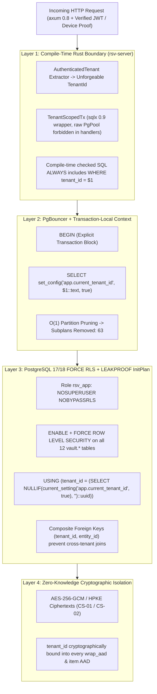
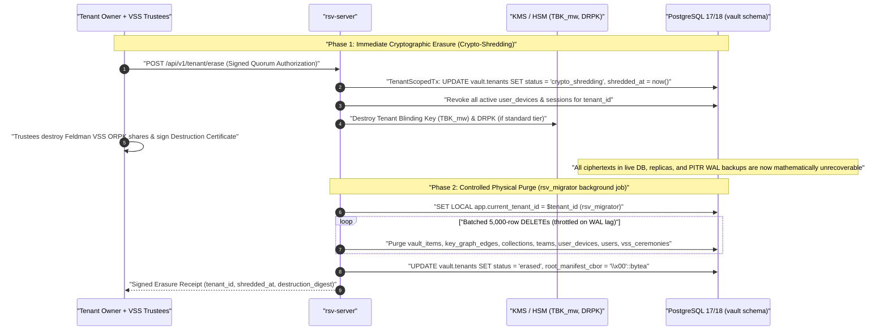

# Specification 05: Multi-Tenant Database Architecture (PostgreSQL 17/18)

| Field | Value |
| :--- | :--- |
| **Document ID** | `RSV-SPEC-05` |
| **Status** | Normative Draft |
| **Version** | `1.0.0` |
| **Project** | RusticStack Core (`ZK-Vault`, `https://github.com/KelpHect/ZK-Vault`) |
| **License** | Dual MIT / Apache-2.0 |
| **Target DBMS** | PostgreSQL 17.x / 18.x + PgBouncer (Transaction Pooling Mode) |
| **Backend Stack** | Rust 2024 Edition (MSRV `1.94.0`), `axum` 0.8, `tokio` 1.x, `sqlx` 0.9 |
| **Related ADR** | [`adrs/ADR-0002-shared-schema-rls-over-schema-per-tenant.md`](../adrs/ADR-0002-shared-schema-rls-over-schema-per-tenant.md) |
| **Normative DDL** | [`schemas/postgresql-schema.sql`](../schemas/postgresql-schema.sql) |

> The key words **MUST**, **MUST NOT**, **REQUIRED**, **SHALL**, **SHALL NOT**, **SHOULD**, **SHOULD NOT**, **RECOMMENDED**, **MAY**, and **OPTIONAL** in this document are to be interpreted as described in RFC 2119 and RFC 8174.

---

## 1. Scale Target & Engineering Rejection of Schema-per-Tenant

RusticStack Core (**ZK-Vault**) is engineered to support **1,000 to 10,000+ concurrent enterprise tenants** and **10,000 to 500,000+ active seats** per primary database cluster while maintaining sub-10ms P99 query latency and zero-downtime schema deployments.

A common anti-pattern in multi-tenant PostgreSQL architectures is **Schema-per-Tenant** (`CREATE SCHEMA tenant_<id>`). While superficially attractive at 10–50 tenants, Schema-per-Tenant suffers catastrophic operational failure modes at RusticStack Core's target scale:

| Failure Mode | Schema-per-Tenant at 5,000 Tenants | Shared Schema + `HASH(tenant_id)` + RLS (RusticStack Core) |
| :--- | :--- | :--- |
| **`pg_class` / `pg_attribute` Catalog Bloat** | 12 tables + ~35 indexes/TOAST objects per tenant $\approx 235{,}000$ `pg_class` rows and $\approx 2.1\text{M}$ `pg_attribute` rows. Per-backend `RelCache` / `CatCache` memory grows $O(\text{connections} \times \text{tenants})$, triggering OOM kills and multi-hour `pg_upgrade` stalls. | Fixed **12 parent tables + 320 leaf partitions** (`5 × 64`) regardless of whether the cluster hosts 10 or 50,000 tenants. Constant $O(1)$ catalog footprint. |
| **`ALTER TABLE` Lock Storms & Migration Duration** | Migrating 5,000 schemas requires 5,000 `ACCESS EXCLUSIVE` locks, exhausting `max_locks_per_transaction`, creating lock-queue pileups, and leaving tenants on heterogeneous schema versions for 30–120 minutes. | Single atomic Expand-and-Contract DDL operation completes in milliseconds with strict `lock_timeout = '2s'`. All tenants share one schema version atomically. |
| **Connection Pool & Prepared Statement Thrashing** | `SET search_path` invalidates/fragments backend plans across PgBouncer connections, creating $O(\text{queries} \times \text{tenants})$ backend plans and spiking CPU inside `Parse`/`Bind`. | Uniform `vault.*` qualified SQL allows 100% prepared-statement plan reuse across all tenants under PgBouncer transaction pooling. |
| **Autovacuum & OS Page Cache Fragmentation** | 200,000+ sparse heap/index files exhaust `max_files_per_process`, fragment OS page cache, and starve `autovacuum_max_workers`. | 64 compact HASH partitions concentrate hot pages in `shared_buffers` and allow balanced parallel autovacuum across 64 relations. |

For the full architectural decision record and benchmark trade-off matrix, see [`ADR-0002`](../adrs/ADR-0002-shared-schema-rls-over-schema-per-tenant.md).

---

## 2. Four-Layer Defense-in-Depth Multi-Tenant Isolation

RusticStack Core enforces tenant isolation across **four independent, fail-closed layers** so that no single application bug, SQL oversight, or even a hypothetical database engine vulnerability can disclose cross-tenant plaintext secrets:



### 2.1 Why Naive RLS Alone Breaks Partition Pruning & Performance

A classic PostgreSQL engineering trap occurs when teams rely **solely** on a Row-Level Security policy such as:

```sql
-- ANTI-PATTERN: Naive RLS without InitPlan wrapping or explicit WHERE predicate
CREATE POLICY bad_policy ON vault.vault_items
    USING (tenant_id = current_setting('app.current_tenant_id', true)::uuid);
```

This naive design fails in three severe ways on partitioned tables at scale:

1. **Plan-Time Partition Pruning Failure**: `current_setting(...)` is a `STABLE` runtime function, not a query constant or bound parameter (`$1`). During query planning, the PostgreSQL planner **cannot** evaluate `current_setting` to prune partitions statically. As a result, the planner acquires `AccessShareLock` on and generates subplans for **all 64 partitions** on every query, inflating planning time linearly with partition count (`O(N_partitions)`) and stressing the lock manager (`fastpath` lock table overflow when a query joins multiple 64-partition tables!).
2. **Per-Row GUC Re-Evaluation Overhead**: Without a scalar subselect `(SELECT ...)`, PostgreSQL may fail to hoist `current_setting(...)::uuid` into an `InitPlan` on complex joins or CTEs, invoking the GUC lookup and UUID string parser on every scanned tuple.
3. **Non-`LEAKPROOF` Cast Ordering Hazard**: While `uuid_eq(uuid, uuid)` (`=`) is marked `proleakproof = true` in `pg_proc`, the text-to-uuid cast (`uuid_in`) can throw an error on malformed input and is NOT `LEAKPROOF`. Wrapping the GUC lookup and cast inside a single uncorrelated scalar subselect `(SELECT NULLIF(current_setting('app.current_tenant_id', true), '')::uuid)` forces PostgreSQL to evaluate the GUC cast **once** as an `InitPlan` producing typed parameter `$0::uuid`, leaving the row-level `security_barrier` predicate as strictly `LEAKPROOF` `tenant_id = $0`.

### 2.2 The RusticStack Dual-Enforcement Pattern

To achieve **both** ironclad DB-enforced isolation AND optimal PostgreSQL 17/18 execution plans, RusticStack Core mandates the **Dual-Enforcement Pattern**:

1. **Mandatory Transaction-Local GUC Binding**: Every database transaction opened by `rsv-server` **MUST** be constructed via `TenantScopedTx::begin(&pool, tenant_id)`, which executes:
   ```sql
   SELECT set_config('app.current_tenant_id', $1::text, true);
   ```
   The third argument `is_local = true` scopes the GUC strictly to the active transaction (`BEGIN ... COMMIT`/`ROLLBACK`). When the transaction terminates and PgBouncer returns the backend connection to the pool, PostgreSQL automatically clears `app.current_tenant_id`.
2. **Mandatory Explicit `WHERE tenant_id = $1` in Every Query**: Every query executed through `TenantScopedTx` **MUST** explicitly pass `tx.tenant_id()` as `$1` in a `WHERE tenant_id = $1` (or `ON e.tenant_id = $1`) predicate. This allows PostgreSQL to perform immediate partition pruning (`Subplans Removed: 63`), select optimal single-partition `(tenant_id, ...)` composite index scans, and avoid planning regressions under prepared statements.
3. **InitPlan-Cached `FORCE ROW LEVEL SECURITY` Backstop**: All 12 tables in schema `vault` execute:
   ```sql
   ALTER TABLE vault.<table_name> ENABLE ROW LEVEL SECURITY;
   ALTER TABLE vault.<table_name> FORCE ROW LEVEL SECURITY;

   CREATE POLICY pol_<table_name>_tenant_isolation
       ON vault.<table_name>
       AS PERMISSIVE
       FOR ALL
       TO rsv_app, rsv_auditor_ro, rsv_migrator
       USING (tenant_id = (SELECT NULLIF(current_setting('app.current_tenant_id', true), '')::uuid))
       WITH CHECK (tenant_id = (SELECT NULLIF(current_setting('app.current_tenant_id', true), '')::uuid));
   ```
   If an application bug ever omits `WHERE tenant_id = $1` or binds the wrong UUID, PostgreSQL's `FORCE RLS` policy silently filters out all non-matching rows (for `SELECT`) or raises a policy violation error (`42501`, mapped to `TENANT_MISMATCH`) for `INSERT`/`UPDATE`. If `app.current_tenant_id` is unset or empty, `NULLIF(..., '')` returns `NULL`, and `tenant_id = NULL` evaluates to `UNKNOWN` (**fail-closed: zero rows visible, zero writes permitted**).

> [!CAUTION]
> **The Autocommit GUC Bleed / Vanishing Bug (PgBouncer Transaction Pooling):**
> - Calling `set_config('app.current_tenant_id', $1, false)` (session-scoped) under PgBouncer transaction pooling is a **critical cross-tenant vulnerability**: the GUC persists on the physical PostgreSQL backend after `COMMIT` and bleeds into the next tenant's transaction!
> - Calling `set_config('app.current_tenant_id', $1, true)` (transaction-scoped) outside an explicit `BEGIN ... COMMIT` block (autocommit mode) immediately resets the GUC at the end of the `SELECT set_config` statement, causing the subsequent query to fail closed with 0 rows!
> - Therefore, `rsv-server` **MUST** forbid direct `PgPool` query execution in request handlers and **MUST** route all tenant queries exclusively through `TenantScopedTx` backed by an explicit `sqlx::Transaction<'_, Postgres>`.

---

## 3. Normative Rust `TenantScopedTx` Wrapper (`sqlx` 0.9 + `axum` 0.8)

The following Rust 2024 pattern is **NORMATIVE** for `rsv-server`. Handlers receive an `AuthenticatedTenant` extractor and obtain a `TenantScopedTx` whose `tenant_id` is immutable for the lifetime of the transaction:

```rust
//! Normative `TenantScopedTx` database isolation boundary (`rsv-server`, sqlx 0.9).
//! Spec: RSV-SPEC-05 (05-MULTI-TENANT-DATABASE.md)

use rsv_types::TenantId;
use sqlx::{PgPool, Postgres, Transaction};
use uuid::Uuid;

/// Wraps a PostgreSQL pool with startup role verification and no raw public `PgPool` getter.
#[derive(Clone)]
pub struct VaultDb {
    pool: PgPool,
}

impl VaultDb {
    /// Verifies at startup that the connected DB role is strictly `NOSUPERUSER NOBYPASSRLS`.
    /// Boot MUST abort if misconfigured.
    pub async fn connect_and_verify(pool: PgPool) -> Result<Self, DbInitError> {
        let row: (String, bool, bool) = sqlx::query_as(
            r#"
            SELECT rolname, rolsuper, rolbypassrls
              FROM pg_catalog.pg_roles
             WHERE rolname = current_user
            "#,
        )
        .fetch_one(&pool)
        .await
        .map_err(DbInitError::Sqlx)?;

        let (role_name, is_super, bypass_rls) = row;
        if is_super || bypass_rls {
            return Err(DbInitError::UnsafeDatabaseRole {
                role_name,
                is_super,
                bypass_rls,
            });
        }

        Ok(Self { pool })
    }

    /// Opens an explicit transaction and pins `app.current_tenant_id` locally.
    pub async fn begin_tenant_tx(
        &self,
        tenant_id: TenantId,
    ) -> Result<TenantScopedTx<'_>, sqlx::Error> {
        let mut tx = self.pool.begin().await?;

        // Strictly transaction-local (`is_local = true`) for PgBouncer transaction-pooling safety.
        sqlx::query("SELECT pg_catalog.set_config('app.current_tenant_id', $1::text, true)")
            .bind(tenant_id.as_uuid())
            .execute(&mut *tx)
            .await?;

        Ok(TenantScopedTx { tenant_id, tx })
    }

    /// Pre-auth narrow lookup via `rsv_slug_resolver` SECURITY DEFINER function ONLY.
    pub async fn resolve_tenant_by_slug(
        &self,
        slug: &str,
    ) -> Result<Option<(TenantId, String)>, sqlx::Error> {
        let row: Option<(Uuid, String)> = sqlx::query_as(
            "SELECT tenant_id, status::text FROM vault.resolve_tenant_id_by_slug($1)",
        )
        .bind(slug)
        .fetch_optional(&self.pool)
        .await?;

        Ok(row.map(|(id, status)| (TenantId::from_uuid(id), status)))
    }
}

/// Active PostgreSQL transaction locked to a single immutable `TenantId`.
pub struct TenantScopedTx<'a> {
    tenant_id: TenantId,
    tx: Transaction<'a, Postgres>,
}

impl<'a> TenantScopedTx<'a> {
    #[inline]
    pub const fn tenant_id(&self) -> TenantId {
        self.tenant_id
    }

    /// Internal accessor restricted to repository modules audited to pass `self.tenant_id()`
    /// in every `WHERE tenant_id = $1` clause.
    pub(crate) fn conn(&mut self) -> &mut sqlx::PgConnection {
        &mut self.tx
    }

    pub async fn commit(self) -> Result<(), sqlx::Error> {
        self.tx.commit().await
    }

    pub async fn rollback(self) -> Result<(), sqlx::Error> {
        self.tx.rollback().await
    }
}

#[derive(Debug)]
pub enum DbInitError {
    Sqlx(sqlx::Error),
    UnsafeDatabaseRole {
        role_name: String,
        is_super: bool,
        bypass_rls: bool,
    },
}
```

---

## 4. Canonical 12-Table Layout, Partitioning & UUIDv7 Locality

### 4.1 Complete Table Inventory (`vault` Schema)

All 12 tables defined in [`schemas/postgresql-schema.sql`](../schemas/postgresql-schema.sql) lead every primary key, unique constraint, secondary index, and foreign key with `tenant_id UUID NOT NULL` and enforce `ENABLE` + `FORCE ROW LEVEL SECURITY`:

| # | Table Name | Partitioning Strategy | Primary Key | Mutability | Primary Workload |
| :-: | :--- | :--- | :--- | :--- | :--- |
| 1 | `vault.tenants` | Unpartitioned | `(tenant_id)` | Mutable (`rsv_app`) | Tenant manifest, `ORPubK`/`DRPubK`/`CPubK`, `blind_epoch` |
| 2 | `vault.tenant_vss_ceremonies` | Unpartitioned | `(tenant_id, ceremony_id)` | Mutable (`rsv_app`) | Feldman VSS 3-of-5 DKG, refresh & recovery ceremonies |
| 3 | `vault.users` | Unpartitioned | `(tenant_id, user_id)` | Mutable (`rsv_app`) | User `UIK`/`UPK`, encrypted `USK`, Argon2id KDF params |
| 4 | `vault.user_devices` | Unpartitioned | `(tenant_id, device_id)` | Mutable (`rsv_app`) | Hardware `HDIK` (ECDSA-P256), `HDSK`-wrapped `MUK`, attestation |
| 5 | `vault.teams` | Unpartitioned | `(tenant_id, team_id)` | Mutable (`rsv_app`) | Team `current_key_epoch`, encrypted metadata |
| 6 | `vault.collections` | Unpartitioned | `(tenant_id, collection_id)` | Mutable (`rsv_app`) | Collection `current_key_epoch`, `escrow_tier`, re-encrypt policy |
| 7 | `vault.key_graph_edges` | **`HASH(tenant_id)` (64 parts)** | `(tenant_id, edge_id)` | Mutable + DAG Trigger | Blind RBAC wrapped key edges (`user_to_team`, `team_to_team`, etc.) |
| 8 | `vault.vault_items` | **`HASH(tenant_id)` (64 parts)** | `(tenant_id, item_id)` | Mutable (`rsv_app`) | Latest item ciphertext, `wrapped_dek_collection`/`escrow`/`delegated` |
| 9 | `vault.vault_item_revisions` | **`HASH(tenant_id)` (64 parts)** | `(tenant_id, item_id, item_version)` | **APPEND-ONLY** | Immutable version history with hash-chained `previous_revision_digest` |
| 10 | `vault.audit_events` | **`HASH(tenant_id)` (64 parts)** | `(tenant_id, log_index)` | **APPEND-ONLY** | Blinded HMAC IDs, `CPubK` envelope, `HDIK` sig, RFC 9162 `leaf_hash` |
| 11 | `vault.audit_merkle_tiles` | **`HASH(tenant_id)` (64 parts)** | `(tenant_id, tile_level, tile_index, partial_width)` | **APPEND-ONLY** | C2SP `tlog-tiles` 256-entry height-8 immutable binary hash tiles |
| 12 | `vault.audit_checkpoints` | Unpartitioned | `(tenant_id, tree_size)` | **APPEND-ONLY** | C2SP signed checkpoints + witness cosignature quorum JSONB |

### 4.2 Why 64 HASH Partitions (`p00`..`p63`) & Scaling Path

1. **Baseline (64 Partitions per High-Cardinality Table)**:
   - At 5,000 tenants averaging 20,000 audit events and 2,000 vault items each, `vault.audit_events` holds 100M rows (~80 GB) and `vault.vault_items` holds 10M rows (~20 GB).
   - Dividing across 64 `HASH(tenant_id)` partitions keeps each `audit_events_pXX` partition at ~1.5M rows (~1.25 GB) and each `vault_items_pXX` partition at ~156K rows (~310 MB).
   - Every partition's composite B-tree index stays at height $\le 3$ and remains hot inside `shared_buffers`, while `autovacuum` operates independently on up to `autovacuum_max_workers` partitions concurrently.
2. **Mid-Scale Expansion (64 $\to$ 256 Partitions)**:
   - Because PostgreSQL HASH partitioning fixes `MODULUS`, transitioning from 64 to 256 partitions is performed with near-zero downtime via PostgreSQL logical replication (`CREATE PUBLICATION` $\to$ 256-partition subscriber cluster $\to$ read-only fence & DNS/PgBouncer cutover).
3. **Enterprise Whale Scale (Dedicated Cell Sharding)**:
   - Tenants exceeding 50,000 seats or requiring sovereign data residency (EU/FedRAMP) are routed at the API gateway (`rsv-server` cell directory) to a dedicated PostgreSQL cell running the **exact same 12-table `vault` schema**. Zero application SQL changes are required.

### 4.3 UUIDv7 Temporal Locality Inside Composite B-Tree Indexes

All record identifiers (`tenant_id`, `user_id`, `device_id`, `team_id`, `collection_id`, `edge_id`, `item_id`, `event_id`, `ceremony_id`) **MUST** be generated as **RFC 9562 UUIDv7** (48-bit Unix millisecond timestamp prefix + 74 bits of cryptographic randomness):

- **Why UUIDv4 Fails at Scale**: Random UUIDv4 inserts scatter writes uniformly across all B-tree leaf pages inside a tenant's `(tenant_id, item_id)` subtree, causing 50%-filled leaf page splits, heavy random I/O, dirty buffer churn, and excessive Full Page Writes (FPW) in WAL.
- **UUIDv7 Advantage**: Within each tenant's `(tenant_id, record_id)` key range, new inserts land strictly on the rightmost B-tree leaf page for that tenant, maintaining ~90% page fill density and reducing WAL volume by 3–5× under heavy write loads.
- **PostgreSQL 17 & 18 Compatibility**: Application/client code (`rsv-types` via `uuid::Uuid::now_v7()`) generates all UUIDv7 identifiers prior to `INSERT` so [`schemas/postgresql-schema.sql`](../schemas/postgresql-schema.sql) executes identically on both PostgreSQL 17 and PostgreSQL 18 (PostgreSQL 18 clusters MAY additionally leverage native `uuidv7()` in administrative scripts).

---

## 5. PgBouncer Transaction Pooling & `sqlx` 0.9 Configuration

### 5.1 Normative PgBouncer Settings (`pgbouncer.ini`)

RusticStack Core **MUST** run PgBouncer 1.21+ in `transaction` pooling mode to multiplex thousands of stateless `axum` 0.8 worker tasks onto a bounded pool of PostgreSQL backend processes (typically `2 * vCPU` to `4 * vCPU` active connections):

```ini
[pgbouncer]
pool_mode = transaction
listen_port = 6432
auth_type = scram-sha-256
default_pool_size = 64
min_pool_size = 16
reserve_pool_size = 16
reserve_pool_timeout = 3
max_client_conn = 4000
# PgBouncer 1.21+ native protocol-level prepared statement multiplexing:
max_prepared_statements = 256
# Guarantee clean backend state if any connection returns unexpectedly:
server_reset_query = DISCARD ALL
server_reset_query_always = 0
query_wait_timeout = 10
server_idle_timeout = 300
ignore_startup_parameters = extra_float_digits,options
```

### 5.2 Normative `sqlx` 0.9 Driver Configuration & CI Verification

1. **Prepared Statement Cache Cap**: `PgConnectOptions::statement_cache_capacity(128)` **MUST** be strictly less than or equal to PgBouncer's `max_prepared_statements` (`256`) so PgBouncer never evicts active client statement bindings mid-transaction.
2. **Compile-Time Query Verification**: All SQL statements in `rsv-server` **MUST** use `sqlx::query!` / `sqlx::query_as!` checked in CI against a live PostgreSQL 17/18 instance migrated with [`schemas/postgresql-schema.sql`](../schemas/postgresql-schema.sql) (with offline `.sqlx/` metadata committed for deterministic builds).
3. **Mandatory Startup Role Invariant**: `VaultDb::connect_and_verify` **MUST** abort server startup if `current_user` holds `rolsuper = true` or `rolbypassrls = true`.
4. **Role Segregation**:

| PostgreSQL Role | Attributes | Permitted Operations | Purpose |
| :--- | :--- | :--- | :--- |
| `rsv_migrator` | `NOLOGIN NOSUPERUSER NOBYPASSRLS` | Owns `vault` schema; DDL migrations; controlled single-tenant crypto-shred purge | CI/CD migration runner only |
| `rsv_app` | `NOLOGIN NOSUPERUSER NOBYPASSRLS` | `SELECT/INSERT/UPDATE` on 8 mutable tables; `SELECT/INSERT` ONLY on 4 immutable tables; `EXECUTE` on `resolve_tenant_id_by_slug` | Runtime `rsv-server` API pool |
| `rsv_auditor_ro` | `NOLOGIN NOSUPERUSER NOBYPASSRLS` | `SELECT` ONLY on `tenants`, `tenant_vss_ceremonies`, `user_devices`, `audit_events`, `audit_merkle_tiles`, `audit_checkpoints` | Compliance CLI / read-replica audit verification |
| `rsv_slug_resolver` | `NOLOGIN NOSUPERUSER NOBYPASSRLS` | Column-level `SELECT (tenant_id, slug, status)` on `vault.tenants` ONLY | Owner of narrow `SECURITY DEFINER` pre-auth slug lookup |

---

## 6. Target `EXPLAIN (ANALYZE, BUFFERS)` Plan Invariants

Every hot-path query in `rsv-server` **MUST** satisfy three strict CI-verified planner invariants:

1. **Zero `Seq Scan`** on any partitioned or tenant-scoped operational table.
2. **`Subplans Removed: 63`** (or single-partition direct scan) on all queries targeting the 5 HASH-partitioned tables.
3. **`Index Cond: (tenant_id = ...)`** leading every index scan, with the RLS `InitPlan` evaluated **at most once** per statement.

### 6.1 Target Plan 1: Active Collection Item Sync (`vault.vault_items`)

```sql
EXPLAIN (ANALYZE, BUFFERS)
SELECT item_id, collection_key_epoch, item_version,
       wrapped_dek_collection, encrypted_metadata, encrypted_payload
  FROM vault.vault_items
 WHERE tenant_id = $1::uuid
   AND collection_id = $2::uuid
   AND deleted_at IS NULL;
```

**Expected Normative Plan Shape:**

```text
Append  (cost=0.43..12.84 rows=18 width=512) (actual time=0.041..0.098 rows=18 loops=1)
  InitPlan 1 (returns $0)
    ->  Result  (cost=0.00..0.01 rows=1 width=16) (actual time=0.004..0.004 rows=1 loops=1)
  Subplans Removed: 63
  ->  Index Scan using vault_items_p27_tenant_id_collection_id_collection_key_epoc_idx
        on vault_items_p27 vault_items_1
        (cost=0.43..12.75 rows=18 width=512) (actual time=0.036..0.089 rows=18 loops=1)
        Index Cond: ((tenant_id = $1) AND (tenant_id = $0) AND (collection_id = $2))
        Buffers: shared hit=5
Planning Time: 0.420 ms
Execution Time: 0.145 ms
```

Observe:
- `InitPlan 1` executes **once** (`loops=1`, 4 microseconds).
- `Subplans Removed: 63` proves O(1) execution on partition `p27` exclusively.
- Both the explicit parameter `$1` and the RLS InitPlan parameter `$0` push cleanly into the LEAKPROOF B-tree `Index Cond`.

### 6.2 Target Plan 2: Gap-Free Audit Tail Lookup (`vault.audit_events`)

```sql
EXPLAIN (ANALYZE, BUFFERS)
SELECT log_index
  FROM vault.audit_events
 WHERE tenant_id = $1::uuid
 ORDER BY log_index DESC
 LIMIT 1;
```

**Expected Normative Plan Shape:**

```text
Limit  (cost=0.44..0.48 rows=1 width=8) (actual time=0.025..0.026 rows=1 loops=1)
  InitPlan 1 (returns $0)
    ->  Result  (cost=0.00..0.01 rows=1 width=16) (actual time=0.003..0.003 rows=1 loops=1)
  ->  Append  (cost=0.44..1842.10 rows=42000 width=8) (actual time=0.024..0.024 rows=1 loops=1)
        Subplans Removed: 63
        ->  Index Only Scan Backward using vault_audit_events_p41_pkey
              on audit_events_p41 audit_events_1
              (cost=0.44..1632.10 rows=42000 width=8) (actual time=0.023..0.023 rows=1 loops=1)
              Index Cond: ((tenant_id = $1) AND (tenant_id = $0))
              Heap Fetches: 0
              Buffers: shared hit=4
Planning Time: 0.290 ms
Execution Time: 0.048 ms
```

### 6.3 Mandatory RLS Negative-Test Gate (CI Suite)

CI **MUST** execute the following negative security assertions as `rsv_app` on every pull request:

1. **Unset GUC Fail-Closed**: `SELECT count(*) FROM vault.vault_items` with no `set_config` **MUST** return `0`, even when rows exist for multiple tenants.
2. **Cross-Tenant Read Isolation**: With `app.current_tenant_id = Tenant_A`, executing `SELECT count(*) FROM vault.vault_items WHERE tenant_id = Tenant_B` **MUST** return `0`.
3. **Cross-Tenant Write Rejection**: With `app.current_tenant_id = Tenant_A`, executing `INSERT INTO vault.vault_items (tenant_id, ...) VALUES (Tenant_B, ...)` **MUST** fail with PostgreSQL SQLSTATE `42501` (`new row violates row-level security policy`).
4. **Immutability Enforcement**: Executing `UPDATE` or `DELETE` on `vault.audit_events`, `vault.audit_merkle_tiles`, `vault.audit_checkpoints`, or `vault.vault_item_revisions` **MUST** fail with `42501` (`APPEND_ONLY_VIOLATION`).

---

## 7. Zero-Downtime Expand-and-Contract Migration Strategy

Schema migrations execute exclusively under role `rsv_migrator` using a strict **4-Phase Expand-and-Contract** workflow so rolling `rsv-server` deployments experience zero downtime and zero blocked transactions:

1. **Guardrail Session Parameters**: Every migration script **MUST** set:
   ```sql
   SET lock_timeout = '2s';
   SET statement_timeout = '30s';
   ```
   If an `ACCESS EXCLUSIVE` metadata lock cannot be acquired within 2 seconds, the migration aborts cleanly and retries with exponential backoff rather than queuing behind long-running queries and stalling incoming API traffic.
2. **Phase 1 — Expand (Backward-Compatible)**:
   - Add nullable columns or columns with fast constant `DEFAULT`s (PostgreSQL 11+ metadata-only `ADD COLUMN ... DEFAULT` requires no table rewrite!).
   - Add new `CHECK` or `FOREIGN KEY` constraints as `NOT VALID` first, then run `ALTER TABLE ... VALIDATE CONSTRAINT ...` (which requires only `SHARE UPDATE EXCLUSIVE`, permitting concurrent reads and writes).
   - Build new indexes on partitioned tables **without blocking writes** using PostgreSQL's partition-attach pattern:
     ```sql
     CREATE INDEX idx_new ON ONLY vault.vault_items (tenant_id, ...);
     -- For each partition p00..p63:
     CREATE INDEX CONCURRENTLY idx_new_p00 ON vault.vault_items_p00 (tenant_id, ...);
     ALTER INDEX vault.idx_new ATTACH PARTITION vault.idx_new_p00;
     ```
3. **Phase 2 — Dual-Write & Batched Backfill**: Deploy updated `rsv-server` binaries reading old/new columns and writing both; backfill historical rows in bounded 1,000-row batches throttled on replication lag (`pg_stat_replication`).
4. **Phase 3 — Switchover**: Deploy binaries reading exclusively from the new column/structure.
5. **Phase 4 — Contract**: After one full release cycle (rollback window closed), drop deprecated columns/indexes cleanly.

---

## 8. Single-Tenant Logical Export & GDPR Crypto-Shredding

Because all tenant data shares the `vault` schema while every row carries a leading `tenant_id`, both tenant portability (export/cell migration) and GDPR Article 17 ("Right to Erasure") execute cleanly without disrupting neighboring tenants:



### 8.1 Single-Tenant Logical Export

1. **Isolation Guarantee**: Export workers open a `REPEATABLE READ` read-only `TenantScopedTx` using `rsv_auditor_ro` (or a dedicated read-only export role with `NOBYPASSRLS`), guaranteeing snapshot consistency across all 12 tables for exactly one `tenant_id`.
2. **Zero-Knowledge Export Bundle**: The exported archive contains strictly ciphertexts (`vault_items`, `vault_item_revisions`, `key_graph_edges`, `teams`, `collections`, `users`), public identity metadata, and the full RFC 9162 Merkle audit ledger (`audit_events`, `audit_merkle_tiles`, `audit_checkpoints`), signed with the tenant's latest checkpoint root hash.

### 8.2 GDPR Crypto-Shredding vs. Immutable Audit Logs

1. **Backups & WAL Archives**: Deleting rows in PostgreSQL does **not** erase historical Point-in-Time Recovery (PITR) backups or WAL archives. Because RusticStack Core encrypts all user PII, vault metadata, secret payloads, and compliance audit envelopes (`compliance_envelope` under `CPubK`), destroying the tenant's root decryption keys (`ORPK` shares, `DRPK`, `CPK`, user `MUK`s) and `TBK_mw` renders every historical backup and WAL segment mathematically indistinguishable from random noise—satisfying GDPR Art. 17 erasure immediately without corrupting shared cluster PITR backups.
2. **Audit Log Retention**: For regulated tenants subject to statutory audit retention (SOX, HIPAA, SEC 17a-4), `vault.audit_events` contains **zero cleartext PII** (only rotating HMAC-SHA256 `blinded_actor_id` / `blinded_resource_id` and `CPubK`-encrypted `compliance_envelope`). Once `TBK_mw` and `CPK` are shredded, even retained ledger rows cannot be correlated to natural persons; where statutory law permits full deletion, a controlled `rsv_migrator` maintenance procedure temporarily disables the tenant-scoped retention lock only for `status = 'crypto_shredding'` tenants under dual-control approval and purges the remaining partition rows.
