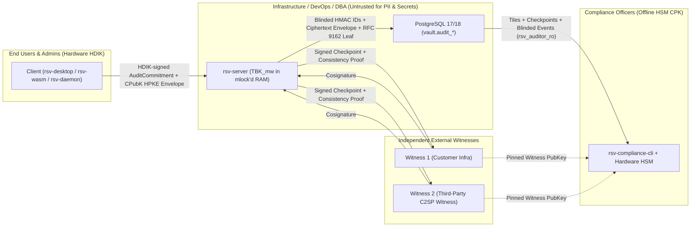
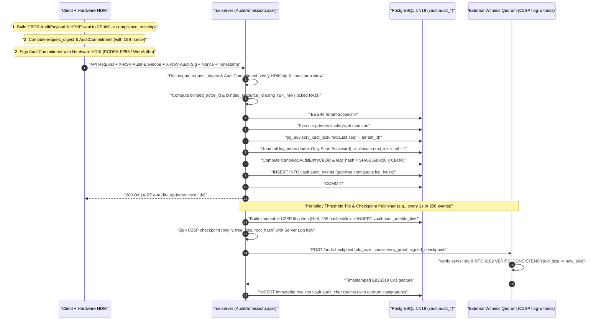
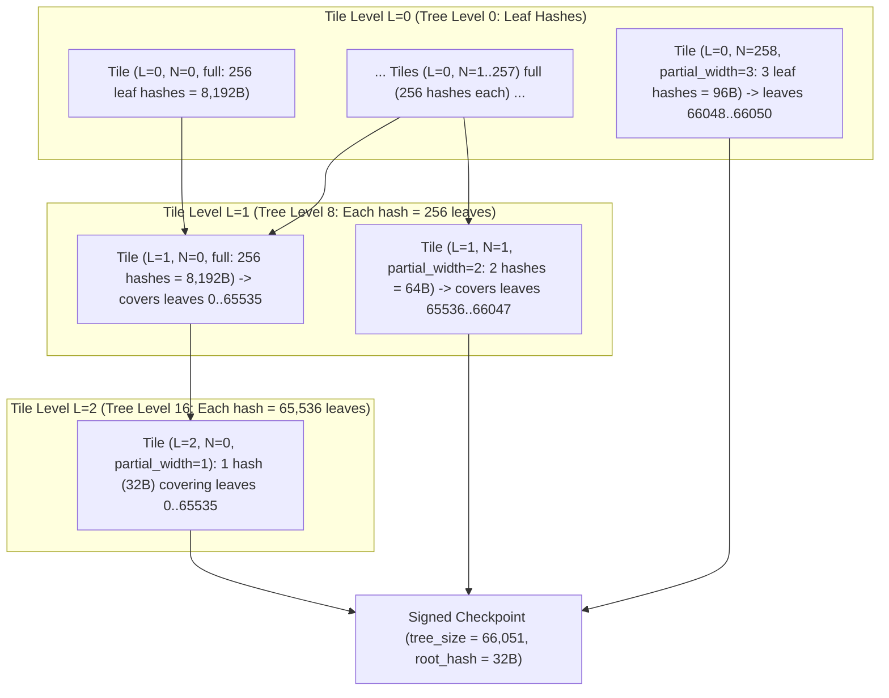

# Specification 06: Zero-Knowledge Audit Ledger & Verifiable Transparency Log

| Field | Value |
| :--- | :--- |
| **Document ID** | `RSV-SPEC-06` |
| **Status** | Normative Draft |
| **Version** | `1.0.0` |
| **Project** | RusticStack Core (`ZK-Vault`, `https://github.com/KelpHect/ZK-Vault`) |
| **License** | Dual MIT / Apache-2.0 |
| **Primary Crates** | `rsv-audit`, `rsv-compliance-cli`, `rsv-crypto`, `rsv-mem`, `rsv-server` |
| **Standards** | RFC 9162 (Certificate Transparency v2.0 Merkle Trees), C2SP `tlog-tiles`, C2SP `tlog-checkpoint`, C2SP `tlog-witness`, RFC 8949 (Deterministic CBOR) |
| **Related ADR** | [`adrs/ADR-0005-rfc9162-c2sp-tiled-merkle-audit-log.md`](../adrs/ADR-0005-rfc9162-c2sp-tiled-merkle-audit-log.md) |
| **Schema Reference** | [`schemas/postgresql-schema.sql`](../schemas/postgresql-schema.sql) (`vault.audit_events`, `vault.audit_merkle_tiles`, `vault.audit_checkpoints`) |

> The key words **MUST**, **MUST NOT**, **REQUIRED**, **SHALL**, **SHALL NOT**, **SHOULD**, **SHOULD NOT**, **RECOMMENDED**, **MAY**, and **OPTIONAL** in this document are to be interpreted as described in RFC 2119 and RFC 8174.

---

## 1. Security Model & Strict Separation of Duties

Conventional audit logging systems create a toxic privacy-versus-compliance paradox: storing cleartext user identities, secret titles, and access graphs in PostgreSQL allows compliance investigations, but immediately turns the audit table into an espionage goldmine for compromised cloud administrators or rogue DBAs. Conversely, opaque encrypted logs without cryptographic append-only commitments allow a compromised server to silently delete or rewrite incriminating events.

RusticStack Core (**ZK-Vault**) resolves this paradox through **Strict Cryptographic Separation of Duties** across three mutually distrusting roles:



| Capability | End User / Admin | Infrastructure / DevOps / DBA | Compliance Officer (`rsv-compliance-cli` + HSM `CPK`) | External Witness (`tlog-witness`) |
| :--- | :---: | :---: | :---: | :---: |
| **Decrypt Vault Secrets (`DEK` / `CK` / `TK`)** | Authorized DAG only | **NEVER** | **NEVER** | **NEVER** |
| **Read Unblinded Forensic Audit Details (`AuditPayload`)** | Own submitted request only | **NEVER** | **YES (Offline HSM `CPK`)** | **NEVER** |
| **Correlate Actor/Resource Across `blind_epoch`s in DB** | **NO** | **NO** (`TBK_mw` never in DB) | **YES** (via decrypted envelopes) | **NO** |
| **Forge Client Action Attribution** | Cannot forge other devices | **NO** (lacks hardware `HDIK`) | **NO** (lacks hardware `HDIK`) | **NO** |
| **Silently Delete, Rewrite, or Fork Audit History** | **NO** | **NO** (blocked by DB triggers + Merkle tree + Witnesses) | **NO** (read-only `rsv_auditor_ro`) | Detects & rejects split-views |
| **Independently Verify Log Integrity & Inclusion** | **YES** | **YES** | **YES** | **YES** |

---

## 2. Blinded Identifiers & Epoch Rotation (`TBK_mw`)

To enable operational abuse monitoring and per-epoch indexing in PostgreSQL without persisting cleartext `user_id` or `item_id` correlations inside `vault.audit_events`, the `rsv-server` audit middleware computes **Blinded Identifiers** using a per-tenant secret **Tenant Blinding Key (`TBK_mw`)**.

### 2.1 Normative Blinding Construction

For every audited event in tenant $T$ at current `blind_epoch` $E \ge 1$ (`vault.tenants.blind_epoch`):

$$\text{BlindId}(\text{TBK}_{\text{mw}}, T, E, X) = \text{HMAC-SHA256}\Big(\text{TBK}_{\text{mw}},\ \text{"rsv:audit:blind:v1"} \parallel T_{16} \parallel E_{4\text{BE}} \parallel X_{16}\Big)$$

Where:
- `"rsv:audit:blind:v1"` is the exact 18-byte ASCII domain separation tag.
- $T_{16}$ is `tenant_id` serialized as 16 raw RFC 9562 bytes.
- $E_{4\text{BE}}$ is `blind_epoch` serialized as a 4-byte unsigned big-endian integer (`u32::to_be_bytes`).
- $X_{16}$ is the target entity UUID (16 raw bytes):
  - `blinded_actor_id` = $\text{BlindId}(\text{TBK}_{\text{mw}}, \text{tenant\_id}, \text{blind\_epoch}, \text{actor\_user\_id})$
  - `blinded_resource_id` = $\text{BlindId}(\text{TBK}_{\text{mw}}, \text{tenant\_id}, \text{blind\_epoch}, \text{resource\_uuid})$ (where `resource_uuid` is `item_id`, `collection_id`, `team_id`, `user_id`, or `tenant_id` depending on `action_category`).
- Both outputs are strictly 32 bytes (`CHECK (octet_length(...) = 32)` in `vault.audit_events`).

### 2.2 `TBK_mw` Custody & Anti-Correlation Epoch Rotation

1. **Zero Database Persistence**: `TBK_mw` **MUST NEVER** be stored in PostgreSQL, written to disk, emitted to logs, or exposed to database replicas. `TBK_mw` **MUST** reside exclusively in a dedicated KMS/HSM key slot and be cached transiently inside `mlock()`'d zeroized `rsv-mem::SecretBox<[u8; 32]>` memory within `rsv-server` middleware.
2. **Scheduled Epoch Rotation**: `vault.tenants.blind_epoch` **SHOULD** rotate every 30 days (and **MUST** rotate immediately upon suspected infrastructure credential exposure). When `blind_epoch` advances from $E \to E + 1$, the same actor and resource map to completely unlinkable pseudorandom 32-byte digests in `vault.audit_events`, defeating long-horizon traffic and frequency analysis by a compromised DBA.
3. **Optional Forward-Secure Key Ratcheting**: High-assurance deployments **MAY** ratchet `TBK_mw` itself via `HKDF-SHA256(ikm = TBK_mw(E), info = "rsv:audit:blind:ratchet:v1" || tenant_id || (E+1))` and destroy `TBK_mw(E)` in KMS, ensuring even subsequent compromise of `TBK_mw(E+1)` cannot test guesses against historical epochs.
4. **Intra-Epoch Indexing**: Within a single active epoch $E$, `idx_audit_events_blinded_actor` and `idx_audit_events_blinded_resource` allow fast O(log N) rate-anomaly queries without revealing who the actor or resource actually is.

---

## 3. Asymmetric Compliance Audit Envelopes (`CPubK` / `CPK`)

While PostgreSQL stores blinded IDs, regulated enterprises (SOC 2, ISO 27001, HIPAA, PCI-DSS, FedRAMP) require full unblinded forensic attribution during audits. RusticStack Core achieves this without trusting `rsv-server` by encrypting forensic details directly on the client to the tenant's **Compliance Public Key (`CPubK`)**.

### 3.1 Canonical CBOR `AuditPayload` Schema

Before executing any audited API request, the client (`rsv-desktop`, `rsv-daemon`, `rsv-wasm`) constructs a deterministic RFC 8949 CBOR map (`AuditPayload`):

| CBOR Key | Field Name | Type | Description |
| :---: | :--- | :--- | :--- |
| `1` | `schema_version` | `uint` (`1`) | Audit payload schema version |
| `2` | `tenant_id` | `bstr` (16B) | Raw tenant UUID |
| `3` | `actor_user_id` | `bstr` (16B) | Unblinded acting user UUID |
| `4` | `actor_device_id` | `bstr` (16B) | Hardware device UUID (`user_devices.device_id`) |
| `5` | `action_category` | `uint16` | Canonical category (`1=AUTH`, `2=VAULT_READ`, `3=VAULT_WRITE`, `4=GRAPH_MUTATION`, `5=KEY_ROTATION`, `6=VSS_CEREMONY`, `7=TENANT_POLICY`, `8=COMPLIANCE_EXPORT`) |
| `6` | `action_detail` | `tstr` | Granular operation verb (e.g., `"item.decrypt"`, `"team.revoke_member"`) |
| `7` | `target_collection_id` | `bstr` (16B) / `null` | Unblinded collection UUID (if applicable) |
| `8` | `target_item_id` | `bstr` (16B) / `null` | Unblinded item UUID (if applicable) |
| `9` | `target_version_or_epoch` | `uint64` / `null` | Item version or key epoch affected |
| `10` | `client_context` | `map` | Client OS/version, local source interface metadata, session ID |
| `11` | `policy_justification` | `tstr` / `null` | Optional break-glass / ticket reference (e.g., `"INC-4821"`) |
| `12` | `client_timestamp_ms` | `uint64` | Client UTC Unix epoch timestamp in milliseconds |

### 3.2 HPKE Encryption & Offline HSM Decryption

1. **Client Sealing**: The client verifies `CPubK` (`tenants.compliance_public_key`) and `compliance_key_epoch` against the signed Tenant Root Manifest, constructs:
   ```text
   envelope_aad = "rsv:audit:envelope:v1"
       || tenant_id (16 bytes)
       || compliance_key_epoch (4 bytes BE)
       || cipher_suite (2 bytes BE)
   ```
   and encrypts `CBOR_CANONICAL(AuditPayload)` using:
   - **`CS-01` (`0x0001`)**: RFC 9180 HPKE Base Mode (`DHKEM(X25519, HKDF-SHA256)`, `HKDF-SHA256`, `AES-256-GCM`) -> `enc || ciphertext || tag`.
   - **`CS-02` (`0x0002`)**: X-Wing (`X25519 + ML-KEM-768`) Hybrid KEM + HKDF-SHA256 + `AES-256-GCM` -> `xwing_ct || ciphertext || tag`.
2. **Offline Compliance Decryption**: The Compliance Private Key (`CPK`) **MUST NEVER** be loaded onto `rsv-server`. `CPK` resides inside an offline or air-gapped hardware HSM (PKCS#11 / KMIP / YubiHSM 2 / CloudHSM). Compliance Officers invoke `rsv-compliance-cli` to verify Merkle proofs + witness cosignatures first, and only after mathematical integrity passes does the CLI request HSM unwrapping of each `compliance_envelope`.

---

## 4. Cryptographic Non-Repudiation (`HDIK` + `AuditCommitment`)

To prevent either (a) a compromised server from fabricating fake audit entries blaming an innocent user, or (b) a malicious insider from repudiating a secret access or permission grant they actually performed, every audited API call **MUST** carry a hardware-signed `AuditCommitment`.

### 4.1 Canonical `AuditCommitment` Formula

```text
AuditCommitment = SHA-256(
    "rsv:audit:sig:v1"                      -- 16-byte ASCII domain separator
    || tenant_id                            -- 16 bytes (UUIDv7)
    || actor_id                             -- 16 bytes (user_id UUIDv7)
    || device_id                            -- 16 bytes (client_signing_device_id)
    || action_category                      -- 2 bytes big-endian u16
    || SHA-256(compliance_envelope)         -- 32 bytes
    || request_digest                       -- 32 bytes
    || timestamp_ms                         -- 8 bytes big-endian u64
    || nonce                                -- 16 bytes CSPRNG
)
```

Where `request_digest` cryptographically binds the exact HTTP API request payload:

```text
request_digest = SHA-256(
    "rsv:http:req:v1"
    || uppercase_http_method || "\n"
    || canonical_request_path || "\n"
    || SHA-256(raw_request_body_bytes)
)
```

### 4.2 Hardware Signature & Server Admission Gate

1. **Signing Key**: The client signs `AuditCommitment` using its attested Hardware Device Identity Key (`HDIK`, ECDSA-P256 in Apple Secure Enclave, TPM 2.0, or WebAuthn FIDO2 authenticator; bound to the user via `user_devices.uik_device_endorsement`).
2. **Mandatory Admission Middleware (`rsv-server`)**: Every protected vault read/write, graph mutation, key rotation, and VSS ceremony endpoint **MUST** run the `AuditAdmissionLayer` (`axum` 0.8 middleware) inside the same `TenantScopedTx` as the primary business mutation:
   - If `compliance_envelope`, `client_signature`, `client_nonce`, or `client_timestamp_ms` is absent -> reject immediately with `MISSING_AUDIT_ENVELOPE` (HTTP `400`).
   - Recompute `request_digest` from the buffered HTTP request and recompute `AuditCommitment` using the authenticated session's `(tenant_id, actor_id, device_id)` (never trusting caller-supplied identity headers!).
   - Verify `|server_now_ms - client_timestamp_ms| <= 300_000` (5-minute drift tolerance).
   - Fetch `user_devices.hdik_public_key` (`status = 'active'`, `attestation_verified_at IS NOT NULL`) and verify `client_signature` over `AuditCommitment`. On failure -> reject with `AUDIT_COMMITMENT_INVALID` (or `DEVICE_ATTESTATION_FAILED` if device attestation is invalid/revoked).
   - Insert into `vault.audit_events` — duplicate `(tenant_id, client_signing_device_id, client_nonce)` hits `uq_audit_events_device_nonce` and fails with `AUDIT_COMMITMENT_INVALID` (replay rejected).
   - **Atomicity**: Because the audit event insert shares the exact same `TenantScopedTx` as the vault/graph mutation, an action **CANNOT** take effect without being committed to `vault.audit_events`, and a rolled-back action **NEVER** pollutes the contiguous Merkle log!



---

## 5. Tamper-Evident Transparency Ledger (RFC 9162 + C2SP `tlog-tiles`)

### 5.1 RFC 9162 Domain-Separated Merkle Tree

Each tenant maintains an independent append-only binary Merkle Tree over `vault.audit_events` ordered strictly by contiguous `log_index = 0, 1, 2, ..., N - 1`.

#### 5.1.1 Canonical Leaf Preimage (`CanonicalAuditEntryCBOR`)

Each leaf commits deterministically to all verifiable fields of row `(tenant_id, log_index)` encoded in RFC 8949 canonical CBOR:

```text
CanonicalAuditEntryCBOR = CBOR_CANONICAL({
    1:  1 (uint, leaf_version),
    2:  tenant_id (bstr, 16B),
    3:  log_index (uint64),
    4:  event_id (bstr, 16B),
    5:  blinded_actor_id (bstr, 32B),
    6:  blinded_resource_id (bstr, 32B),
    7:  blind_epoch (uint32),
    8:  action_category (uint16),
    9:  cipher_suite (uint16),
    10: compliance_key_epoch (uint32),
    11: SHA-256(compliance_envelope) (bstr, 32B),
    12: request_digest (bstr, 32B),
    13: client_nonce (bstr, 16B),
    14: client_timestamp_ms (uint64),
    15: client_signing_device_id (bstr, 16B),
    16: client_signature (bstr)
})
```

#### 5.1.2 Domain-Separated Hash Functions (RFC 9162 §2.1.1)

To eliminate second-preimage attacks (where a 64-byte leaf could otherwise masquerade as an internal node concatenation):

- **Empty Tree ($n = 0$)**:
  $$\text{MTH}(\emptyset) = \text{SHA-256}(\text{""}) = \texttt{e3b0c44298fc1c149afbf4c8996fb92427ae41e4649b934ca495991b7852b855}$$
- **Leaf Hash ($n = 1$)**:
  $$\text{LeafHash}(d_i) = \text{SHA-256}(\texttt{0x00} \parallel d_i)$$
  where $d_i = \text{CanonicalAuditEntryCBOR}_i$.
- **Internal Node Hash ($n > 1$)**:
  Let $k$ be the largest power of two strictly less than $n$ ($k = 2^{\lfloor \log_2(n - 1) \rfloor}$):
  $$\text{MTH}(D[0..n]) = \text{SHA-256}\Big(\texttt{0x01} \parallel \text{MTH}(D[0..k]) \parallel \text{MTH}(D[k..n])\Big)$$

#### 5.1.3 Gap-Free Contiguous `log_index` Allocation

PostgreSQL `SEQUENCE` / `IDENTITY` generators **MUST NOT** be used for `log_index` because rolled-back transactions leave permanent gaps that violate RFC 9162 tree contiguity. Instead:

1. **Transactional Allocation**: Within `TenantScopedTx`, acquire `pg_advisory_xact_lock(hashtextextended('rsv:audit:seq:' || tenant_id::text, 0))`, read the maximum existing index via an O(1) backward index-only scan on `pk_audit_events` (`SELECT log_index FROM vault.audit_events WHERE tenant_id = $1 ORDER BY log_index DESC LIMIT 1`), and assign `next_index = COALESCE(tail, -1) + 1`.
2. **High-Throughput Micro-Batch Sequencer (Optional Optimization)**: For whale tenants sustaining $> 1{,}000$ events/sec, a per-tenant in-memory Tokio sequencer batches incoming validated audit commits into 5–20ms windows, assigns contiguous `log_index` spans in memory, and bulk-inserts them inside a single `TenantScopedTx` under the same advisory lock.

---

### 5.2 C2SP `tlog-tiles` Static Tiled Storage (`H = 8`, 256 Hashes/Tile)

Rather than storing every individual Merkle internal node as a separate database row (which doubles row count and breaks CDN/object-store caching), RusticStack Core implements the **C2SP `tlog-tiles`** specification with canonical tile height $H = 8$ (width $2^8 = 256$ hashes per tile):



#### 5.2.1 Tile Binary Layout & Database Mapping (`vault.audit_merkle_tiles`)

1. **Tile Coordinate `(L, N, W)`**:
   - `tile_level` $L \in \{0, 1, \dots, 7\}$ corresponds to Merkle tree level $8 \cdot L$ (level `0` holds leaf hashes; level `1` holds roots of 256-leaf complete subtrees; level `7` holds roots of $2^{56}$-leaf subtrees, supporting up to $2^{64}$ audit entries per tenant).
   - `tile_index` $N \ge 0$ indexes horizontal 256-entry blocks at tile level $L$, covering subtree range $[N \cdot 256,\ (N + 1) \cdot 256 - 1]$ at tree level $8 \cdot L$.
   - `partial_width` $W \in \{0, 1, \dots, 255\}$:
     - $W = 0$: Complete immutable tile containing exactly `256` concatenated 32-byte SHA-256 hashes (`8,192` bytes).
     - $1 \le W \le 255$: Immutable partial tile `.p/<W>` containing exactly `W` concatenated 32-byte SHA-256 hashes (`W * 32` bytes).
2. **Strictly Append-Only Immutability**: Because `PRIMARY KEY (tenant_id, tile_level, tile_index, partial_width)` includes `partial_width`, publishing a newer partial tile `.p/42` after `.p/17` inserts a **new** row without ever executing an `UPDATE` or `DELETE` on `vault.audit_merkle_tiles`!
3. **Intermediate Levels Recomputed in RAM**: Tree levels $8L + 1 \dots 8L + 7$ are never stored on disk; any verifier (or server) computes the complete 8-level binary subtree above a 256-hash tile in $< 50\ \mu\text{s}$ using 255 SHA-256 calls.
4. **C2SP Static HTTP & CDN Addressing**:
   - Full tile: `GET /api/v1/tenants/{tenant_id}/audit/tile/{L}/{N_c2sp}`
   - Partial tile: `GET /api/v1/tenants/{tenant_id}/audit/tile/{L}/{N_c2sp}.p/{W}`
   - Where `N_c2sp` encodes $N$ in base-1000 3-digit zero-padded groups prefixed with `x` for all high-order segments (e.g., `N = 0` -> `000`; `N = 1234067` -> `x001/x234/067`).
   - Every tile response **MUST** carry `Cache-Control: public, max-age=31536000, immutable` and `Content-Type: application/octet-stream`, enabling zero-cost mirroring to S3/R2/CloudFront and offline auditor caching.

---

### 5.3 C2SP Signed Checkpoints & External Witness Cosigning

A Merkle tree signed solely by `rsv-server` prevents post-hoc tampering against a previously pinned root, **but does NOT prevent a Split-View (Equivocation) Attack** where a compromised server serves Log Fork A to Auditor Alice and Log Fork B to Auditor Bob.

RusticStack Core defeats split-view attacks by requiring **C2SP Signed Checkpoints** cosigned by an independent quorum of **External Witnesses** (`tlog-witness`):

#### 5.3.1 C2SP Signed Note Checkpoint Format

Stored verbatim in `vault.audit_checkpoints.checkpoint_body` (with signatures stored in `server_signature` and `witness_cosignatures`):

```text
zkvault.example/v1/tenants/0196a3f0-9b4c-7a10-8e21-4c9a00112233/audit
66051
47DEQpj8HBSa+/TImW+5JCeuQeRkm5NMpJWZG3hSuFU=

— zkvault.example/v1/log-key-01 AAAA<base64(4B_key_id || 64B_ed25519_sig)>
— witness-corp-hsm.internal     BBBB<base64(4B_key_id || 8B_unix_ts_be || 64B_ed25519_sig)>
— witness-public-auditor.org    CCCC<base64(4B_key_id || 8B_unix_ts_be || 64B_ed25519_sig)>
```

#### 5.3.2 Synchronous Witness Cosigning Protocol

1. When the checkpoint publisher advances a tenant's checkpoint from `old_size` to `new_size`:
   - It computes `new_root = MTH(0..new_size)` from the published tiles, signs the C2SP checkpoint note with the server's Ed25519 log key, and computes the RFC 9162 consistency proof `CONSISTENCY(old_size, new_size)`.
   - It dispatches `POST /add-checkpoint` concurrently to the tenant's configured C2SP witnesses (`tlog-witness`), supplying `old_size`, the consistency proof, and the newly signed checkpoint.
2. Each external witness independently:
   - Verifies the server's Ed25519 signature.
   - Looks up its locally persisted `(last_size, last_root)` for `origin`.
   - Executes `VERIFY_CONSISTENCY(last_size, new_size, last_root, new_root, proof)`. If verification fails (or `new_size < last_size`, or `new_size == last_size && new_root != last_root`), the witness **MUST** reject with HTTP `409 Conflict` and fire a high-severity equivocation alert!
   - Otherwise, the witness atomically updates its local state to `(new_size, new_root)` and returns a C2SP `cosignature/v1` line signing `"cosignature/v1\ntime <unix_sec>\n" || checkpoint_body`.
3. Once at least $Q_w$ witnesses (default **2-of-3**) return valid cosignatures, `rsv-server` executes a single append-only `INSERT` into `vault.audit_checkpoints` storing `witness_cosignatures` JSONB. If fewer than $Q_w$ witnesses respond within timeout, `rsv-server` **MUST** emit `QUORUM_THRESHOLD_UNMET` metrics/alerts and **MUST NOT** advertise the checkpoint as witnessed (strict tenants **MAY** fail-closed on new writes until witness quorum recovers).

---

## 6. Mathematical Proof Verification Algorithms

All proof verifiers (`rsv-audit`, `rsv-compliance-cli`, client libraries) **MUST** implement the following exact RFC 9162 algorithms without deviation.

### 6.1 Algorithm 1: RFC 9162 Inclusion Proof Verification

Given `leaf_hash` (32 bytes), 0-based `leaf_index` ($i$), `tree_size` ($n$), audit path `proof[0..m-1]`, and `expected_root` (32 bytes):

```text
FUNCTION VERIFY_INCLUSION(leaf_hash, leaf_index, tree_size, proof, expected_root) -> Result<(), AuditError>:
    1. IF tree_size == 0 OR leaf_index >= tree_size:
           RETURN Err(InvalidInclusionProof)

    2. fn = leaf_index
       sn = tree_size - 1
       r  = leaf_hash

    3. FOR p IN proof:
           IF sn == 0:
               RETURN Err(InvalidInclusionProof)   // Excess proof nodes rejected!

           IF (fn & 1) == 1 OR fn == sn:
               r = SHA-256(0x01 || p || r)
               WHILE (fn & 1) == 0 AND fn != 0:
                   fn = fn >> 1
                   sn = sn >> 1
           ELSE:
               r = SHA-256(0x01 || r || p)

           fn = fn >> 1
           sn = sn >> 1

    4. IF sn != 0:
           RETURN Err(InvalidInclusionProof)       // Truncated proof rejected!

    5. IF constant_time_eq(r, expected_root):
           RETURN Ok(())
       ELSE:
           RETURN Err(RootHashMismatch)
```

### 6.2 Algorithm 2: RFC 9162 Consistency Proof Verification

Proves that the tree of size `first` ($m$) with root `first_root` is an exact append-only prefix of the tree of size `second` ($n$) with root `second_root`:

```text
FUNCTION VERIFY_CONSISTENCY(first, second, first_root, second_root, proof) -> Result<(), AuditError>:
    1. IF first == 0 OR first > second:
           RETURN Err(InvalidConsistencyProof)

    2. IF first == second:
           IF proof.is_empty() AND constant_time_eq(first_root, second_root):
               RETURN Ok(())
           ELSE:
               RETURN Err(InvalidConsistencyProof)

    3. IF proof.is_empty():
           RETURN Err(InvalidConsistencyProof)

    4. // If `first` is an exact power of two, prepend `first_root` virtually as the first element.
       is_pow2 = (first & (first - 1)) == 0
       IF is_pow2:
           fn = first - 1
           sn = second - 1
           fr = first_root
           sr = first_root
           proof_iter = proof[0..]
       ELSE:
           fn = first - 1
           sn = second - 1
           fr = proof[0]
           sr = proof[0]
           proof_iter = proof[1..]

    5. WHILE (fn & 1) == 1:
           fn = fn >> 1
           sn = sn >> 1

    6. FOR c IN proof_iter:
           IF sn == 0:
               RETURN Err(InvalidConsistencyProof)

           IF (fn & 1) == 1 OR fn == sn:
               fr = SHA-256(0x01 || c || fr)
               sr = SHA-256(0x01 || c || sr)
               WHILE (fn & 1) == 0 AND fn != 0:
                   fn = fn >> 1
                   sn = sn >> 1
           ELSE:
               sr = SHA-256(0x01 || sr || c)

           fn = fn >> 1
           sn = sn >> 1

    7. IF sn != 0:
           RETURN Err(InvalidConsistencyProof)

    8. IF constant_time_eq(fr, first_root) AND constant_time_eq(sr, second_root):
           RETURN Ok(())
       ELSE:
           RETURN Err(ConsistencyVerificationFailed)
```

### 6.3 Algorithm 3: Client-Side Proof Assembly from C2SP `tlog-tiles`

A verifier (`rsv-compliance-cli` or witness) **NEVER** needs to ask the server to compute a custom proof endpoint; it assembles inclusion and consistency proofs directly from immutable cached tiles:

```text
FUNCTION RESOLVE_SUBTREE_HASH(tree_level, subtree_index, tree_size, tile_cache) -> [u8; 32]:
    // Identify the C2SP tile covering (tree_level, subtree_index) at tile height H = 8:
    tile_level   = tree_level / 8
    inner_level  = tree_level % 8          // 0..7 inside the height-8 tile
    span_in_tile = 1 << inner_level        // number of base entries in this tile covered
    base_start   = subtree_index * span_in_tile
    tile_index   = base_start / 256
    offset       = base_start % 256

    // Determine whether this tile is full (256) or partial (.p/W) at `tree_size`:
    entries_at_tile_level = ceil(tree_size / (256 ^ tile_level))
    tile_width = min(256, entries_at_tile_level - tile_index * 256)
    partial_w  = IF tile_width == 256 THEN 0 ELSE tile_width

    tile_hashes = tile_cache.fetch_tile(tile_level, tile_index, partial_w)
    end_offset  = min(offset + span_in_tile, tile_width)

    // Recompute RFC 9162 MTH locally over the slice tile_hashes[offset..end_offset]:
    RETURN MTH_FROM_PREHASHED(tile_hashes[offset..end_offset])
```

Because `H = 8`, verifying an inclusion proof in a 10-million-entry tenant ledger requires fetching at most **3 static immutable tiles** (`L=0`, `L=1`, `L=2`), totaling $\le 24\text{ KiB}$ over HTTP/CDN!

---

## 7. Normative Rust Trait Contracts (`rsv-audit` & `rsv-compliance-cli`)

```rust
//! Normative trait contracts for crate `rsv-audit` (Rust 2024 Edition, MSRV 1.94.0).
//! Spec: RSV-SPEC-06 (06-ZERO-KNOWLEDGE-AUDIT-LEDGER.md)

#![forbid(unsafe_code)]

use alloc::string::String;
use alloc::vec::Vec;
use rsv_crypto::{CipherSuiteId, PublicKeyBytes, SignatureBytes};
use rsv_mem::SecretBox;
use rsv_types::{DeviceId, KeyEpoch, TenantId, UserId};

/// RFC 9162 Merkle leaf domain separator byte.
pub const MERKLE_LEAF_PREFIX: u8 = 0x00;

/// RFC 9162 Merkle internal node domain separator byte.
pub const MERKLE_NODE_PREFIX: u8 = 0x01;

/// C2SP tlog-tiles canonical height (2^8 = 256 hashes per tile).
pub const TILE_HEIGHT: u8 = 8;
pub const TILE_WIDTH: usize = 1 << TILE_HEIGHT;

/// Domain separation constants.
pub const AUDIT_BLIND_DOMAIN: &[u8] = b"rsv:audit:blind:v1";
pub const AUDIT_SIG_DOMAIN: &[u8] = b"rsv:audit:sig:v1";
pub const AUDIT_ENVELOPE_AAD_DOMAIN: &[u8] = b"rsv:audit:envelope:v1";
pub const HTTP_REQUEST_DIGEST_DOMAIN: &[u8] = b"rsv:http:req:v1";

pub type Sha256Digest = [u8; 32];

#[derive(Debug, Clone, Copy, PartialEq, Eq, Hash)]
pub struct TileCoord {
    pub level: u8,          // 0..=7
    pub index: u64,         // >= 0
    pub partial_width: u8,  // 0 = full (256), 1..=255 = partial `.p/<W>`
}

#[derive(Debug, Clone, PartialEq, Eq)]
pub enum AuditError {
    /// `MISSING_AUDIT_ENVELOPE`
    MissingAuditEnvelope,
    /// `AUDIT_COMMITMENT_INVALID`
    AuditCommitmentInvalid,
    /// `DEVICE_ATTESTATION_FAILED`
    DeviceAttestationFailed,
    /// `INVALID_SIGNATURE`
    InvalidSignature,
    /// `QUORUM_THRESHOLD_UNMET`
    QuorumThresholdUnmet { required: usize, verified: usize },
    /// RFC 9162 proof failure.
    InvalidInclusionProof,
    InvalidConsistencyProof,
    RootHashMismatch,
    TileCorrupted(TileCoord),
    EquivocationDetected {
        tree_size: u64,
        expected_root: Sha256Digest,
        observed_root: Sha256Digest,
    },
}

/// Middleware HMAC identifier blinder (`TBK_mw` held strictly in `rsv-mem::SecretBox`).
pub trait IdentifierBlinder {
    fn blind_uuid(
        &self,
        tbk_mw: &SecretBox<[u8; 32]>,
        tenant_id: TenantId,
        blind_epoch: KeyEpoch,
        target_uuid: uuid::Uuid,
    ) -> Sha256Digest;
}

/// Client-side & server-side `AuditCommitment` builder and verifier.
pub trait AuditCommitmentCodec {
    fn compute_request_digest(
        &self,
        http_method: &str,
        canonical_path: &str,
        raw_body: &[u8],
    ) -> Sha256Digest;

    #[allow(clippy::too_many_arguments)]
    fn compute_commitment(
        &self,
        tenant_id: TenantId,
        actor_id: UserId,
        device_id: DeviceId,
        action_category: u16,
        compliance_envelope: &[u8],
        request_digest: &Sha256Digest,
        timestamp_ms: u64,
        nonce: &[u8; 16],
    ) -> Sha256Digest;

    fn compute_leaf_hash(&self, canonical_entry_cbor: &[u8]) -> Sha256Digest;
}

/// Static tile storage / fetcher abstraction (PostgreSQL, S3/CDN, or local archive).
pub trait TileStore {
    fn get_tile(&self, tenant_id: TenantId, coord: TileCoord) -> Result<Vec<Sha256Digest>, AuditError>;
}

/// RFC 9162 + C2SP `tlog-tiles` pure mathematical verifier (`rsv-audit`, `rsv-compliance-cli`).
pub trait TransparencyVerifier {
    fn verify_inclusion_proof(
        &self,
        leaf_hash: &Sha256Digest,
        leaf_index: u64,
        tree_size: u64,
        proof: &[Sha256Digest],
        expected_root: &Sha256Digest,
    ) -> Result<(), AuditError>;

    fn verify_consistency_proof(
        &self,
        first_size: u64,
        second_size: u64,
        first_root: &Sha256Digest,
        second_root: &Sha256Digest,
        proof: &[Sha256Digest],
    ) -> Result<(), AuditError>;

    fn assemble_inclusion_proof_from_tiles<S: TileStore>(
        &self,
        store: &S,
        tenant_id: TenantId,
        leaf_index: u64,
        tree_size: u64,
    ) -> Result<Vec<Sha256Digest>, AuditError>;

    fn verify_witnessed_checkpoint(
        &self,
        checkpoint_note: &str,
        expected_origin: &str,
        server_pub_key: &PublicKeyBytes,
        trusted_witnesses: &[(String, PublicKeyBytes)],
        quorum_threshold: usize,
    ) -> Result<VerifiedCheckpoint, AuditError>;
}

/// Offline compliance envelope decryptor (`rsv-compliance-cli` backed by hardware HSM `CPK`).
pub trait ComplianceEnvelopeDecryptor {
    fn decrypt_envelope(
        &self,
        tenant_id: TenantId,
        compliance_key_epoch: KeyEpoch,
        cipher_suite: CipherSuiteId,
        compliance_envelope: &[u8],
    ) -> Result<Vec<u8>, AuditError>;
}

#[derive(Debug, Clone, PartialEq, Eq)]
pub struct VerifiedCheckpoint {
    pub origin: String,
    pub tree_size: u64,
    pub root_hash: Sha256Digest,
    pub verified_witness_count: usize,
}
```

---

## 8. `rsv-compliance-cli` Offline Audit Verification Workflow

When a Compliance Officer executes `rsv-compliance-cli verify-and-export --tenant <UUID> --from-index 0 --to-size <N>`, the CLI **MUST** execute these steps in strict order before decrypting a single byte of forensic metadata:

1. **Checkpoint & Witness Quorum Check**: Fetch the latest checkpoint and historical checkpoints from `vault.audit_checkpoints` (via `rsv_auditor_ro`) or the public CDN mirror. Verify server Ed25519 signature and $\ge Q_w$ pinned witness cosignatures.
2. **Prefix Consistency Chain Check**: Verify `VERIFY_CONSISTENCY` between the auditor's locally pinned previous checkpoint `(old_size, old_root)` and the new checkpoint `(new_size, new_root)`. Any failure aborts immediately with `EquivocationDetected`.
3. **Tile & Leaf Verification**: Fetch `L=0..k` tiles from `vault.audit_merkle_tiles` (or S3 mirror), recompute every `leaf_hash = SHA-256(0x00 || canonical_entry_cbor)` from `vault.audit_events`, and confirm exact match against `L=0` tile hashes and `new_root`.
4. **Hardware Non-Repudiation Verification**: For every audited event, verify `SHA-256(compliance_envelope)` matches key `11` of `canonical_entry_cbor` and verify `client_signature` over `AuditCommitment` using the attested `hdik_public_key` recorded in `vault.user_devices`.
5. **Offline HSM Decryption**: Only after steps 1–4 pass 100%, invoke the local PKCS#11/HSM `CPK` handle to decrypt each `compliance_envelope` and cross-check that the decrypted `AuditPayload.tenant_id`, `actor_device_id`, `action_category`, and `client_timestamp_ms` match the outer committed leaf metadata. Any inner/outer discrepancy is flagged as a **Client Audit Tampering Anomaly**.
