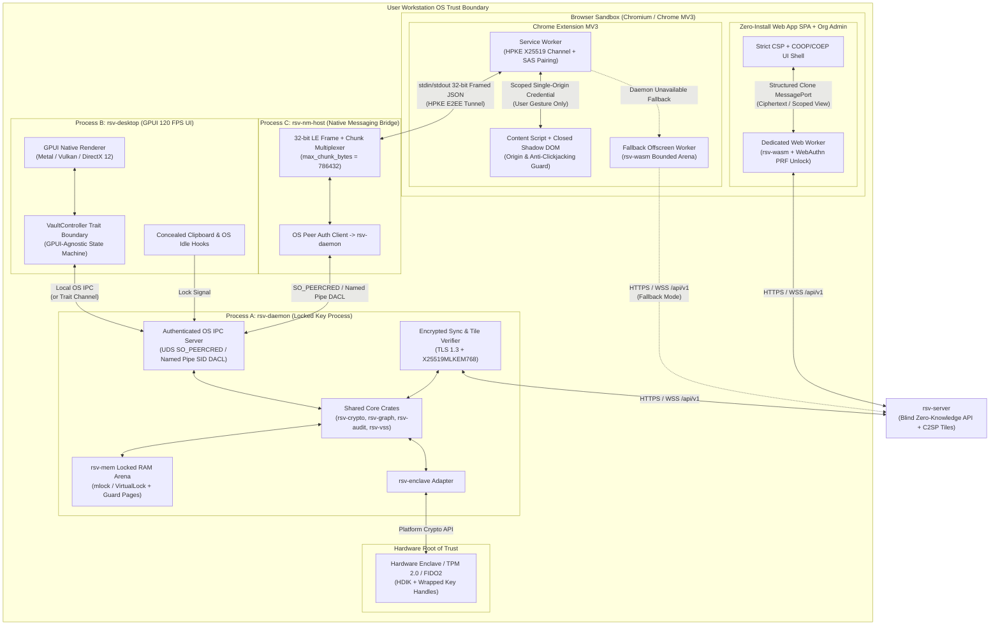
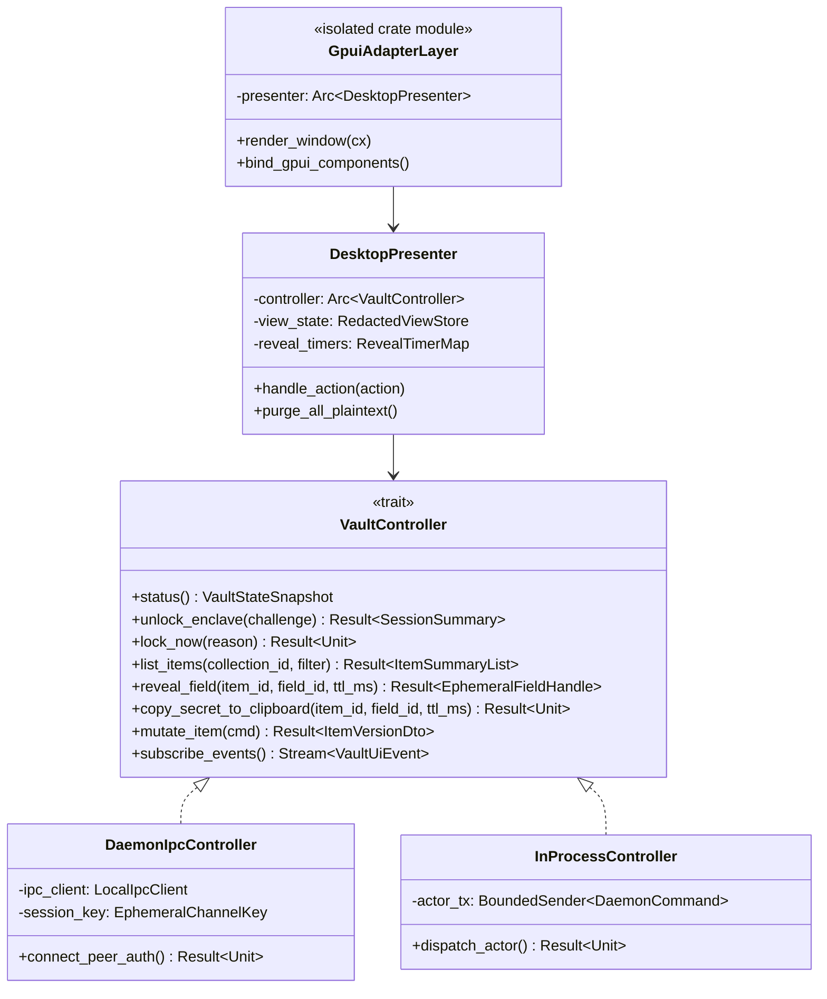
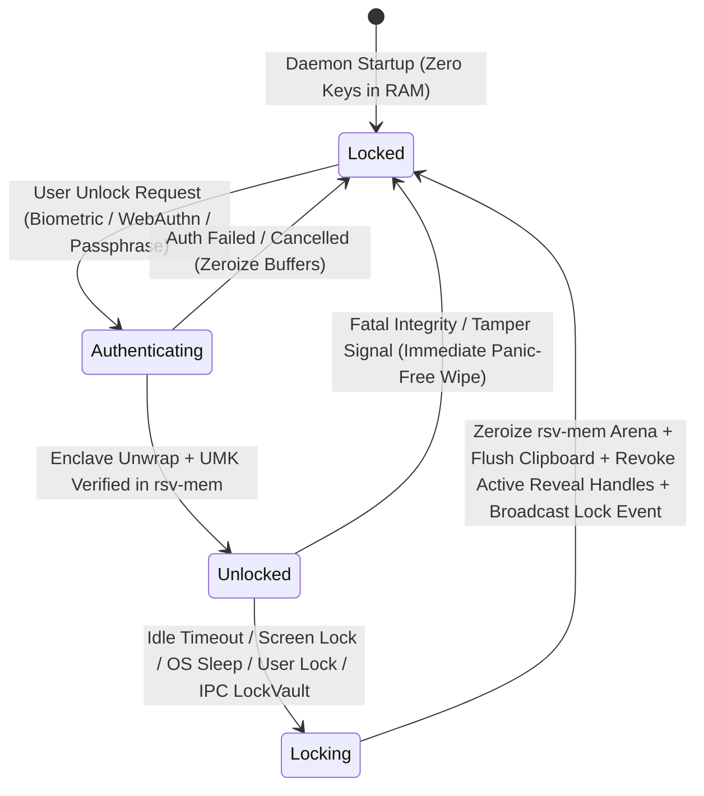
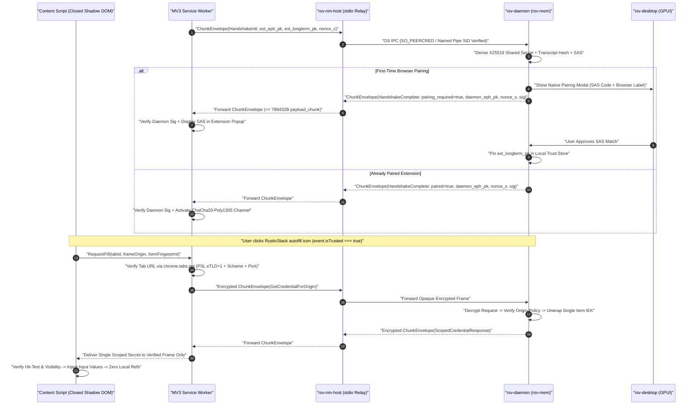
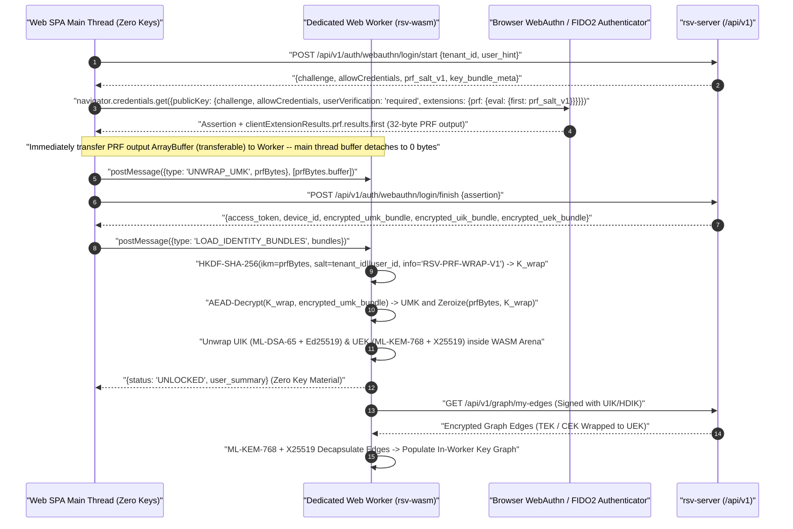

# SPEC-07: Omni-Client Architecture — GPUI Desktop, Chrome Extension MV3 & Zero-Install Web SPA

| Field | Value |
| :--- | :--- |
| **Document ID** | `RSV-SPEC-07` |
| **Project** | RusticStack Core (`ZK-Vault` — `https://github.com/KelpHect/ZK-Vault`) |
| **Status** | Normative Draft (v1.0) |
| **License** | Dual MIT / Apache-2.0 |
| **Target Toolchain** | Rust 2024 Edition, MSRV `1.94.0` |
| **Related Specifications** | `SPEC-08` (API & Wire Protocols), `ADR-0003` (GPUI Native Desktop), `ADR-0006` (Native Messaging Daemon Offload), `schemas/ipc-native-messaging.schema.json` |

---

## 1. Scope & Normative Conventions

This specification defines the end-to-end client architecture for **RusticStack Core (`ZK-Vault`)** across three first-class execution surfaces that share a single audited Rust cryptographic core:

1. **GPUI Native Desktop (`rsv-desktop`) + Locked Cryptographic Daemon (`rsv-daemon`)** — macOS, Windows, and Linux native client with hardware-enclave key binding and 120 FPS GPU-accelerated UI.
2. **Chrome Extension (Manifest V3 + Native Messaging + `rsv-wasm` Fallback)** — zero-ambient-privilege browser autofill and passkey assistant delegating cryptographic operations to `rsv-daemon` when present, with an isolated `rsv-wasm` fallback for unmanaged/Chromebook endpoints.
3. **Zero-Install Web App SPA + Org Admin Dashboard** — WebAuthn PRF-authenticated web vault and zero-knowledge organizational graph administration console running `rsv-wasm` in a cross-origin isolated Dedicated Web Worker.

The key words **MUST**, **MUST NOT**, **REQUIRED**, **SHALL**, **SHALL NOT**, **SHOULD**, **SHOULD NOT**, **RECOMMENDED**, **NOT RECOMMENDED**, **MAY**, and **OPTIONAL** in this document are to be interpreted as described in BCP 14 (RFC 2119 and RFC 8174) when, and only when, they appear in all capitals.

### 1.1 Fundamental Client Security Invariants

Every RusticStack Core client surface MUST uphold the following non-negotiable invariants:

- **Zero-Knowledge Boundary**: Plaintext vault items, Item Encryption Keys (`IEK`), Collection Keys (`CEK`), Team Keys (`TEK`), Organization Encryption Keys (`OEK`), User Encryption Keys (`UEK`), User Identity Keys (`UIK`), and User Master Keys (`UMK`) MUST NEVER be transmitted unencrypted outside the client trust boundary.
- **Single Cryptographic Authority**: All cryptographic primitives (hybrid `ML-KEM-768 + X25519` KEM, hybrid `ML-DSA-65 + Ed25519` signatures, `XChaCha20-Poly1305` / `AES-256-GCM` AEAD, deterministic RFC 8949 CBOR serialization, C2SP `tlog-tiles` Merkle verification, and `rsv-vss` threshold secret sharing) MUST execute exclusively inside the shared Rust core crates (`rsv-crypto`, `rsv-graph`, `rsv-audit`, `rsv-vss`). Client UI layers (GPUI views, TypeScript extension scripts, Web SPA components) MUST NOT re-implement cryptography in JavaScript, TypeScript, or ad-hoc OS wrappers.
- **UI-to-Secret Segregation**: Rendering surfaces (GPU framebuffers, DOM trees, accessibility trees, and browser content scripts) MUST receive only the minimal plaintext required for an active, user-initiated interaction, and MUST purge that plaintext immediately upon focus loss, lock trigger, or expiry timer.
- **Mandatory Audit Provenance**: Every mutating vault or graph action initiated by any client MUST construct and sign a deterministic CBOR `AuditEnvelope` (header `X-RSV-Audit-Envelope`) locally before sending the HTTP request to `rsv-server`.

---

## 2. Unified Shared Rust Core & Target Compilation Matrix

RusticStack Core enforces a strict workspace architecture (Rust 2024 Edition, MSRV `1.94.0`) separating pure, portable cryptographic logic from OS-specific memory locking, hardware enclaves, and UI toolkits.

### 2.1 Workspace Crate Responsibilities Across Clients

| Crate | Compilation Targets | Role in Client Surfaces | Contains Secrets? |
| :--- | :--- | :--- | :--- |
| `rsv-types` | Native (`x86_64`/`aarch64`), `wasm32-unknown-unknown` | Canonical IDs (UUIDv7), cipher suite enums, error codes, CBOR wire structs, zero-copy views | Metadata & Ciphertext Handles |
| `rsv-crypto` | Native, `wasm32-unknown-unknown` | Hybrid `X-Wing` (`ML-KEM-768 + X25519`), `ML-DSA-65 + Ed25519`, `XChaCha20-Poly1305`, `AES-256-GCM`, `HKDF-SHA-256/512`, `Argon2id`, RFC 8949 deterministic CBOR | Yes (ephemeral, `ZeroizeOnDrop`) |
| `rsv-vss` | Native, `wasm32-unknown-unknown` | Threshold M-of-N Verifiable Secret Sharing (Shamir + Feldman/Pedersen commitments) for recovery & enterprise escrow | Yes (during ceremony only) |
| `rsv-graph` | Native, `wasm32-unknown-unknown` | Local DAG key-graph traversal (`Org -> Team -> Collection -> Item`), cycle detection, epoch rotation key wrapping | Yes (unwrapped graph keys) |
| `rsv-audit` | Native, `wasm32-unknown-unknown` | Signed `AuditEnvelope` construction, C2SP `tlog-tiles` inclusion & consistency proof verification | Signing invocation only |
| `rsv-mem` | Native only (`macOS`, `Linux`, `Windows`) | Locked physical RAM arena (`mlock`/`VirtualLock`), guard pages, core-dump suppression, explicit zeroization | Yes (primary key arena) |
| `rsv-enclave` | Native only (`macOS`, `Linux`, `Windows`) | Hardware Root of Trust (`HDIK` & key-wrap handles): Secure Enclave, Windows TPM 2.0/CNG, Linux TPM 2.0 / CTAP2 | Hardware-bound handles |
| `rsv-wasm` | `wasm32-unknown-unknown` only | `wasm-bindgen` FFI facade over `rsv-crypto`, `rsv-graph`, `rsv-audit`, `rsv-vss` with bounded arena & explicit handle lifecycle | Yes (inside isolated Worker) |
| `rsv-daemon` | Native only (`macOS`, `Linux`, `Windows`) | Locked cryptographic daemon, local OS IPC server, sync client, auto-lock engine, and `rsv-nm-host` bridge protocol | Yes (via `rsv-mem`) |
| `rsv-desktop` | Native only (`macOS`, `Linux`, `Windows`) | GPUI native 120 FPS desktop application bound to `rsv-daemon` exclusively via `VaultController` trait / IPC | Transient visible text only |
| `rsv-server` | Native (`Linux` server target) | Blind zero-knowledge API & sync relay server (reference context) | Never (ciphertext only) |
| `rsv-compliance-cli` | Native (`macOS`, `Linux`, `Windows`) | Independent audit log & C2SP tile verifier CLI | Never (public keys & proofs) |

### 2.2 Portable Core Compilation Requirements

1. `rsv-types`, `rsv-crypto`, `rsv-vss`, `rsv-graph`, and `rsv-audit` MUST compile cleanly on both native desktop targets (`aarch64-apple-darwin`, `x86_64-apple-darwin`, `x86_64-pc-windows-msvc`, `aarch64-pc-windows-msvc`, `x86_64-unknown-linux-gnu`, `aarch64-unknown-linux-gnu`) and `wasm32-unknown-unknown` with zero `unsafe` blocks in `rsv-types`, `rsv-graph`, and `rsv-audit`.
2. Cryptographic randomness in portable crates MUST be injected via `rand_core::CryptoRng` traits (`OsRng` on native targets; `getrandom` backed by `crypto.getRandomValues` on `wasm32-unknown-unknown`).
3. Wall-clock timestamps MUST be injected via a `Clock` trait rather than calling `std::time::SystemTime::now()` directly inside pure crypto/audit verification code, guaranteeing deterministic test vectors across native and WASM builds.
4. All secret-bearing Rust structs MUST derive `Zeroize` and `ZeroizeOnDrop` (with `#[zeroize(drop)]`), MUST NOT implement `Debug` or `Display` in a way that emits raw key bytes (custom `Debug` MUST redact to `"[REDACTED]"`), and MUST NOT implement `Clone` unless explicitly gated behind an audited key-duplication method.

---

## 3. Omni-Client Trust Topology

The following diagram illustrates the trust boundaries, process separation, hardware roots of trust, and communication channels across all three RusticStack Core clients.



---

## 4. Client 1: GPUI Native Desktop (`rsv-desktop`) + Locked Cryptographic Daemon (`rsv-daemon`)

### 4.1 Process Isolation & Deployment Modes

The native desktop architecture strictly separates cryptographic custody (`rsv-daemon`) from GPU presentation (`rsv-desktop`).

1. **Primary Split-Process Mode (RECOMMENDED & Default for Production)**:
   - `rsv-daemon` executes as a dedicated, long-lived user-session background process (`systemd --user` unit on Linux, `LaunchAgent` on macOS, per-user non-elevated background service / AppContainer helper on Windows).
   - `rsv-daemon` initializes `rsv-mem` (disabling core dumps via `prctl(PR_SET_DUMPABLE, 0)` on Linux, `RLIMIT_CORE = 0` + `PT_DENY_ATTACH` on macOS, and restricted process DACL + `SetProcessMitigationPolicy(ProcessDynamicCodePolicy)` on Windows) BEFORE deriving or unwrapping any key material.
   - `rsv-desktop` runs as a separate GPU-accelerated UI process that holds **zero long-term keys**, communicates with `rsv-daemon` exclusively over authenticated local OS IPC, and can be killed or restarted at any moment without compromising or interrupting background vault synchronization or Chrome Extension Native Messaging sessions.
2. **Embedded In-Process Daemon Mode (OPTIONAL, e.g., Portable/Single-Binary Execution)**:
   - When OS policy prevents background user daemons, `rsv-desktop` MAY spawn `rsv-daemon`'s service actor on a dedicated Rust OS thread pool inside the same address space.
   - Even in embedded mode, all calls from GPUI views MUST traverse the exact same asynchronous `VaultController` trait boundary and receive only redacted view DTOs (`SecretMask` / ephemeral `RevealedSecret` guards); GPUI components MUST NEVER obtain direct references to `rsv-mem` arenas or `rsv-crypto` key types.

### 4.2 GPUI Ecosystem Isolation Strategy (2026)

As of 2026, GPUI provides native GPU-accelerated rendering across Metal (macOS), Vulkan over Wayland/X11 (Linux), and DirectX 12 over Win32 (Windows), while its crate API continues evolving across upstream Zed `gpui` (pinned workspace commit) and community standalone forks/component libraries (`gpui-ce`, `gpui-kit`).

To prevent GPUI API churn from ever touching security-critical code, `rsv-desktop` MUST enforce a strict hexagonal boundary:



Normative isolation rules:

1. **Trait Boundary**: `DesktopPresenter` and `VaultController` MUST have zero Cargo dependencies on `gpui`, `gpui-ce`, or `gpui-kit`.
2. **Toolkit Adapter Containment**: All `gpui::*` types (`View`, `Entity`, `Window`, `App`, `Render`, `Element`) MUST be confined to `rsv-desktop`'s UI adapter module (`rsv-desktop/src/ui_gpui/`). Swapping between a pinned upstream Zed `gpui` commit and `gpui-ce`/`gpui-kit` MUST require changes ONLY inside that adapter module and Cargo feature flags (`--features gpui-upstream` vs `--features gpui-ce`).
3. **Zero Crypto Dependency in `rsv-desktop`**: `rsv-desktop/Cargo.toml` MUST NOT depend on `rsv-crypto`, `rsv-mem`, `rsv-enclave`, or `rsv-vss`. It MUST depend ONLY on `rsv-types` (DTOs, enums, error codes) and the local IPC client protocol crate/module.

### 4.3 GPU Rendering & Memory Hygiene

GPU command buffers, glyph atlases, and font rasterization caches live in driver-managed memory (VRAM or unified RAM) that applications cannot reliably `mlock` or overwrite deterministically. Therefore `rsv-desktop` MUST enforce strict rendering hygiene:

1. **Default-Masked Secret Fields**: Passwords, passphrases, TOTP seeds, SSH private keys, recovery shares, and custom `concealed` fields MUST render by default as fixed-length bullet placeholders (`••••••••••••`, 12 bullets regardless of true secret length to prevent length-side-channel observation).
2. **Never Pre-Fetch Secret Values**: `list_items` and `get_item_metadata` calls from `rsv-desktop` to `rsv-daemon` MUST return ONLY non-secret metadata (`title`, `origin_urls`, `username_hint`, `tags`, `updated_at`, `field_descriptors`). Secret field bytes MUST NOT enter `rsv-desktop` process memory until the user explicitly triggers **Reveal** or **Copy**.
3. **Ephemeral Reveal Lifecycle**:
   - When the user clicks **Reveal** (or holds a Reveal button), `rsv-desktop` requests a single field via `reveal_field(item_id, field_id, ttl_ms <= 30_000)`.
   - The returned plaintext MUST be wrapped in a `Zeroizing<String>` inside `DesktopPresenter` with an enforced hard deadline (default **15 seconds**, configurable max **30 seconds**).
   - Upon timer expiration, window blur (`window_did_resign_key`), navigation away from the item, or vault lock, `DesktopPresenter` MUST immediately zeroize the `Zeroizing<String>`, replace the GPUI text model with the fixed bullet mask, trigger a full redraw frame, and invoke the GPUI glyph-atlas eviction / surface flush hook so plaintext glyphs do not linger across inactive windows.
4. **OS Screen-Capture Protection**:
   - **macOS**: `rsv-desktop` MUST set `NSWindow.sharingType = .none` (configurable via enterprise policy, default ON) to prevent unauthorized screen recorders and WindowServer thumbnails from capturing revealed vault contents.
   - **Windows**: `rsv-desktop` MUST invoke `SetWindowDisplayAffinity(hwnd, WDA_EXCLUDEFROMCAPTURE)` on vault windows containing unlocked views (default ON, policy-configurable for accessibility testing).
   - **Linux (Wayland/X11)**: `rsv-desktop` MUST disable compositor thumbnail previews where supported and clear window buffers with solid opaque background before minimizing or locking.

### 4.4 OS Pasteboard & Clipboard Hardening

When a user copies a secret (`copy_secret_to_clipboard`), `rsv-daemon` (or `rsv-desktop` acting directly on an immediate single-use handoff) MUST tag the clipboard payload with platform-specific concealment metadata so clipboard history managers, cloud sync daemons, and telemetry monitors exclude it:

| Operating System | Mandatory Clipboard Concealment Mechanism | Auto-Clear Behavior |
| :--- | :--- | :--- |
| **macOS** | Write payload to `NSPasteboard.general` alongside empty markers for `org.nspasteboard.ConcealedType`, `org.nspasteboard.TransientType`, and `org.nspasteboard.AutoGeneratedType`. | Record `changeCount` + BLAKE3/SHA-256 digest of copied secret. After TTL (default **30s**, configurable 10s–120s) or on vault lock, if `changeCount` is unchanged (or current clipboard digest matches), call `clearContents()`. |
| **Windows** | Open Win32 clipboard (`OpenClipboard`/`EmptyClipboard`), set `CF_UNICODETEXT`, AND register and set custom formats: `ExcludeClipboardContentFromMonitorProcessing` (non-empty marker), `CanIncludeInClipboardHistory` (`DWORD(0)`), and `CanUploadClipboardDataToCloud` (`DWORD(0)`). | Record `GetClipboardSequenceNumber()`. After TTL or vault lock, if sequence number is unchanged, call `OpenClipboard` + `EmptyClipboard` + `CloseClipboard`. |
| **Linux (Wayland)** | Serve MIME type `text/plain;charset=utf-8` alongside `x-kde-passwordManagerHint` containing UTF-8 bytes `"secret"` via Wayland data-device selection protocol (`wl_data_source`). | Maintain transient selection ownership only until TTL expires or vault locks; drop/destroy `wl_data_source` immediately on expiry so no clipboard data remains offered. |
| **Linux (X11 Fallback)** | Own `CLIPBOARD` selection and advertise target `x-kde-passwordManagerHint` (`"secret"`). NEVER populate `PRIMARY` (middle-click) selection. | Relinquish `CLIPBOARD` ownership and overwrite internal selection buffer with zeros on TTL expiry or vault lock. |

**Non-Clobber Rule**: Auto-clear MUST verify that the clipboard still contains the RusticStack secret (via OS sequence/change counter or constant-time digest comparison) before clearing, ensuring a user's subsequent unrelated copy is never unexpectedly destroyed.

### 4.5 OS Idle, Sleep & Screen-Lock Hooks

`rsv-daemon` MUST independently monitor OS session security state (not relying solely on `rsv-desktop` being open) and execute an immediate, non-blocking lock sequence upon any lock trigger:

- **macOS**:
  - Subscribe via `NSDistributedNotificationCenter` to `com.apple.screenIsLocked` and `com.apple.screensaver.didstart`.
  - Subscribe via `NSWorkspace.notificationCenter` to `NSWorkspace.willSleepNotification`, `NSWorkspace.screensDidSleepNotification`, and `NSWorkspace.sessionDidResignActiveNotification` (fast user switching).
  - Poll/track HID idle time via `CGEventSourceSecondsSinceLastEventType(kCGEventSourceStateCombinedSessionState, kCGAnyInputEventType)` against configured idle timeout (default **5 minutes**).
- **Windows**:
  - Maintain a hidden message-only window (`HWND_MESSAGE`) registered with `WTSRegisterSessionNotification(hwnd, NOTIFY_FOR_THIS_SESSION)` handling `WM_WTSSESSION_CHANGE` (`WTS_SESSION_LOCK`, `WTS_CONSOLE_DISCONNECT`, `WTS_REMOTE_DISCONNECT`).
  - Handle `WM_POWERBROADCAST` (`PBT_APMSUSPEND`, `PBT_APMSTANDBY`).
  - Track user idle time via `GetLastInputInfo`.
- **Linux**:
  - Subscribe on the system D-Bus to `org.freedesktop.login1.Manager.PrepareForSleep(true)` and `org.freedesktop.login1.Session.Lock`.
  - Subscribe on the session D-Bus to `org.freedesktop.ScreenSaver.ActiveChanged(true)` and `org.gnome.ScreenSaver.ActiveChanged(true)`.
  - Track compositor idle via Wayland `ext-idle-notify-v1` (or X11 `XScreenSaverQueryInfo` fallback).



When transitioning `Unlocked -> Locking -> Locked`, `rsv-daemon` MUST complete the following within **<= 50 ms**:
1. Overwrite and zeroize all unlocked keys (`UMK`, `UEK`, `UIK`, `OEK`, `TEK`, `CEK`, `IEK`, cached plaintext) inside the `rsv-mem` locked arena using volatile zeroization (`zeroize::Zeroize`).
2. Drop active hardware enclave authorization contexts (`LAContext::invalidate()` on macOS, CNG handle flush on Windows).
3. Clear any active RusticStack clipboard entry (subject to the Non-Clobber Rule).
4. Broadcast a `VaultLocked` push event to all connected `rsv-desktop` windows and paired `rsv-nm-host` / Chrome Extension sessions, causing immediate UI purge.

### 4.6 Local OS IPC Hardening (`rsv-daemon` <-> `rsv-desktop` & `rsv-nm-host`)

All local inter-process communication to `rsv-daemon` MUST bind strictly to the local user's identity and verify peer process provenance on every accepted connection before reading any application payload.

| Platform | Transport Endpoint | Kernel / OS Access Control | Mandatory Peer Verification |
| :--- | :--- | :--- | :--- |
| **Linux** | Unix Domain Socket: `$XDG_RUNTIME_DIR/rusticstack/daemon.sock` (parent dir mode `0700`, socket mode `0600`) | POSIX UID/GID ownership (`euid` match) | `getsockopt(fd, SOL_SOCKET, SO_PEERCRED)` verifying `cred.uid == daemon_euid`; resolve `/proc/<pid>/exe` via `readlink` and verify canonical path matches installed `rsv-desktop` or `rsv-nm-host` binary (no `(deleted)` binaries). |
| **macOS** | Unix Domain Socket: `~/Library/Application Support/RusticStack/run/daemon.sock` (dir `0700`, socket `0600`) | POSIX UID ownership + macOS Sandbox App Group container (when sandboxed) | `getsockopt(fd, SOL_LOCAL, LOCAL_PEERCRED)` (`cr_uid == daemon_euid`) + `LOCAL_PEERTOKEN` (`audit_token_t`) verified via `SecCodeCopyGuestWithAttributes` against RusticStack's Apple Developer Team ID & designated code-signing requirement. |
| **Windows** | Named Pipe: `\\.\pipe\rusticstack-daemon-<SHA256_USER_SID_PREFIX>` | Created with `PIPE_TYPE_BYTE \| PIPE_WAIT \| PIPE_REJECT_REMOTE_CLIENTS` and explicit `SECURITY_ATTRIBUTES` built via `ConvertStringSecurityDescriptorToSecurityDescriptorW` (`D:P(A;;GA;;;<CURRENT_USER_SID>)`, blocking `Everyone`, `NETWORK`, and other local users). | Call `GetNamedPipeClientProcessId(pipe, &pid)`, open process with `PROCESS_QUERY_LIMITED_INFORMATION`, read full image path via `QueryFullProcessImageNameW`, verify path matches installed `rsv-desktop.exe` or `rsv-nm-host.exe`, and validate Authenticode signature via `WinVerifyTrust` (in release builds). |

**TCP Localhost Prohibition**: `rsv-daemon` MUST NEVER bind a TCP or HTTP listener on `127.0.0.1` or `::1` for desktop or browser extension communication, eliminating DNS rebinding, cross-site request forgery (CSRF), and cross-user local port hijacking entirely.

---

## 5. Client 2: Chrome Extension (Manifest V3 + WASM + Native Messaging)

### 5.1 Dual-Mode Execution Model

The RusticStack Chrome Extension (Manifest V3) operates in one of two mutually exclusive cryptographic execution modes, strongly preferring **Mode A (Daemon-Backed)**.

#### Mode A: Daemon-Backed Mode (Primary & Recommended)
- **Zero Long-Term Keys in Browser**: The extension NEVER receives `UMK`, `UEK`, `UIK`, `OEK`, `TEK`, `CEK`, or bulk vault ciphertext dumps.
- **Delegated Crypto**: All vault decryption, graph traversal, TOTP generation, passkey signing, and `AuditEnvelope` signing occur inside `rsv-daemon`'s `rsv-mem` locked arena, bridged through the thin `rsv-nm-host` binary via Chrome Native Messaging.
- **Scoped Single-Origin Release**: When the user explicitly activates autofill on a verified tab origin (e.g., `https://app.example.com`), the Service Worker requests ONLY matching item metadata (`GetMatchesForOrigin`) and, upon user selection and trusted gesture, requests ONLY the single scoped credential (`GetCredentialForOrigin`) bound to that exact verified origin.
- **Unified Lock State**: Locking `rsv-desktop` or locking the OS screen instantaneously invalidates all extension capabilities because `rsv-daemon` wipes its key arena.

#### Mode B: Standalone WASM Mode (Fallback for Chromebooks / Restricted Workstations)
- **Activation Criteria**: Enabled ONLY when `rsv-nm-host` is absent or unreachable AND tenant policy (`tenant/manifest.allow_standalone_extension_wasm`) permits standalone browser vaults.
- **Isolation Architecture**: The extension spawns an MV3 Offscreen Document (`chrome.offscreen.createDocument`, reason `WORKERS`) hosting a Dedicated Web Worker that loads `rsv-wasm` (`wasm32-unknown-unknown`). The Service Worker itself MUST NOT load or hold decrypted keys because MV3 Service Workers terminate unpredictably and lack guaranteed cleanup hooks.
- **Memory & Session Bounds**:
  - `rsv-wasm` operates inside a pre-allocated fixed-size linear memory arena (max 64 MiB) with explicit `zeroize_arena()` invoked on `chrome.idle.onStateChanged` (`idle`/`locked`), explicit lock, or configurable session timeout (default **15 minutes**, max **60 minutes**).
  - Decrypted keys MUST NEVER be written to `chrome.storage.local`, `chrome.storage.sync`, or `chrome.storage.session`. Only encrypted ciphertext blobs (re-encrypted under an ephemeral session wrapping key or server-fetched AEAD envelopes) MAY be cached locally for offline read availability.

### 5.2 Native Messaging Framing, Chunking & Cryptographic Pairing

Chrome Native Messaging imposes strict platform wire constraints:
- Every message on `stdin`/`stdout` is framed as a **32-bit native-endian unsigned integer (`u32`) length prefix** followed immediately by that exact number of UTF-8 JSON bytes.
- **Extension -> Native Host hard cap**: **64 MiB** (67,108,864 bytes).
- **Native Host -> Extension hard cap**: **1 MiB** (1,048,576 bytes). Exceeding this by even 1 byte causes Chrome to immediately terminate the native messaging port with `"Error when communicating with the native messaging host"`.

#### 5.2.1 Deterministic Chunked Enveloping (`ipc-native-messaging.schema.json`)

To guarantee that no `rsv-nm-host -> Extension` message (such as a large list of vault match summaries, signed audit proofs, or large SSH/certificate items) can EVER violate Chrome's 1 MiB limit, ALL messages in both directions MUST be wrapped in a `ChunkEnvelope` conforming to `schemas/ipc-native-messaging.schema.json`:

- `frame_id`: UUIDv7 uniquely identifying the logical IPC message across its chunks.
- `chunk_index`: Zero-based chunk sequence index (`0 <= chunk_index < total_chunks`).
- `total_chunks`: Total chunks comprising this logical message (`1 <= total_chunks <= 64`, capping max reassembled logical message size at 48 MiB).
- `max_chunk_bytes`: Protocol constant **`786432`** (768 KiB = `768 * 1024` bytes) defining the maximum UTF-8 byte length of the `payload_chunk` field (base64url-encoded ciphertext or handshake JSON bytes).
- **Serialized Frame Ceiling**: With `payload_chunk <= 786432` bytes and fixed JSON envelope overhead (< 512 bytes), every serialized `ChunkEnvelope` UTF-8 JSON frame emitted by `rsv-nm-host` is deterministically guaranteed to be **<= 787,456 bytes (< 770 KiB)** — leaving > 260 KiB safety margin below Chrome's hard `1,048,576`-byte cap.
- **Reassembly Rules**:
  - Receivers MUST reject duplicate `chunk_index`, out-of-range `chunk_index >= total_chunks`, mismatched `total_chunks` for an in-flight `frame_id`, or `payload_chunk` exceeding `786432` bytes.
  - Incomplete multi-chunk frames MUST expire and be purged from reassembly buffers after **10 seconds** (preventing memory exhaustion).
  - `rsv-nm-host` MUST validate the final `u32` byte length is `<= 851968` (832 KiB) before writing to `stdout`; any violation MUST abort the frame and return an `IPC_FRAME_TOO_LARGE` error frame.

#### 5.2.2 OS-Signed Manifest Pinning & End-to-End HPKE Session Pairing

Native Messaging manifests (`com.rusticstack.vault.json`) MUST be installed with restrictive OS permissions (root/Administrator-owned in system paths or user-locked profile paths) and MUST pin the exact canonical Chrome Web Store Extension ID in `allowed_origins`:

```json
{
  "name": "com.rusticstack.vault",
  "description": "RusticStack Core (ZK-Vault) Native Cryptographic Host",
  "path": "/usr/local/libexec/rusticstack/rsv-nm-host",
  "type": "stdio",
  "allowed_origins": [
    "chrome-extension://<CANONICAL_32_CHAR_EXTENSION_ID>/"
  ]
}
```

Even with `allowed_origins` pinning and `SO_PEERCRED`/Named Pipe DACL peer checks, RusticStack enforces **end-to-end channel encryption** between the Chrome Extension Service Worker and `rsv-daemon`, treating `rsv-nm-host` as an untrusted framing relay:

1. **Ephemeral X25519 Key Exchange + HPKE / Noise-Style Channel**:
   - On every port connect, the Extension generates an ephemeral `X25519` keypair (`ext_eph_pk`, `ext_eph_sk`) and sends `HandshakeInit` (carrying `protocol_version`, `extension_id`, `ext_eph_pk`, `ext_longterm_pk`, and a 32-byte random `client_nonce`).
   - `rsv-daemon` generates its own ephemeral `X25519` keypair (`daemon_eph_pk`, `daemon_eph_sk`), computes the shared secret using `DHKEM(X25519, HKDF-SHA256)` (RFC 9180) / Noise `XX`-style transcript binding `SHA-256("RSV-IPC-v1" || extension_id || client_nonce || server_nonce || ext_eph_pk || daemon_eph_pk || ext_longterm_pk || daemon_longterm_pk)`, derives bidirectional AEAD keys (`k_ext_to_daemon`, `k_daemon_to_ext`) via `HKDF-SHA-256`, and responds with `HandshakeComplete` signed by `daemon_longterm_sk`.
   - All subsequent `IpcRequest` / `IpcResponse` payloads are encrypted with `ChaCha20-Poly1305` (monotonic 64-bit counter nonce per direction; session rekeys after `2^20` messages or 1 hour).
2. **Initial SAS (Short Authentication String) Pairing Ceremony**:
   - The first time an unrecognized `ext_longterm_pk` connects, `rsv-daemon` MUST refuse all vault commands until interactive pairing succeeds.
   - Both `rsv-desktop` (via OS-native modal dialog triggered by `rsv-daemon`) and the Chrome Extension popup independently compute a **6-digit decimal + 4-word SAS** from `HKDF-Expand(transcript_hash, "RSV-IPC-SAS-v1", 16)`.
   - The user visually compares the SAS displayed in the browser popup against the native GPUI desktop dialog and clicks **Approve Browser Pairing** inside `rsv-desktop`.
   - Upon approval, `rsv-daemon` persists `(extension_id, ext_longterm_pk, browser_profile_label, paired_at)` in its authenticated local config store. Subsequent reconnects verify the Extension's signature over `transcript_hash` using `ext_longterm_pk` silently while still negotiating fresh ephemeral X25519 session keys.



### 5.3 Autofill Security Engineering (Normative Rules)

Browser DOM environments are actively hostile. Malicious pages, compromised third-party ad scripts, and phishing overlays routinely attempt to harvest credentials from password managers. The Chrome Extension MUST enforce ALL of the following rules without exception:

1. **Zero Ambient Autofill on Page Load**:
   - The extension MUST NEVER automatically populate username, password, TOTP, or payment fields on `DOMContentLoaded`, `load`, or `focus` events.
   - Credential release from `rsv-daemon` (or `rsv-wasm`) MUST require an explicit, trusted user gesture (`event.isTrusted === true` on a click inside the extension popup, toolbar action, Closed Shadow DOM suggestion item, or registered browser keyboard shortcut `chrome.commands`).
2. **Strict Origin & Public Suffix List (PSL) Matching**:
   - The Service Worker MUST obtain the authoritative tab and frame URLs from Chrome's privileged browser APIs (`sender.tab.url`, `sender.url`, `sender.frameId`) rather than trusting `window.location` reported by a content script.
   - Matching MUST enforce:
     - **HTTPS Mandatory**: Scheme MUST be `https:`. Plaintext `http:` origins MUST be blocked by default, with narrow explicit allowlisting permitted ONLY for loopback development origins (`http://localhost`, `http://127.0.0.1`, `http://[::1]`) or an item explicitly flagged `allow_insecure_http = true` accompanied by a prominent red warning banner.
     - **Exact Port Match**: `https://app.example.com:8443` MUST NOT match a credential stored for `https://app.example.com:443` unless explicitly configured as a port-equivalent URI rule.
     - **PSL (`eTLD+1`) Boundary**: Domain matching MUST use an embedded, regularly updated Mozilla Public Suffix List (`eTLD+1`). Shared hosting suffixes (e.g., `github.io`, `appspot.com`, `s3.amazonaws.com`, `pages.dev`) MUST enforce **exact full-hostname match** and MUST NEVER share credentials across sibling subdomains (`alice.github.io` MUST NOT match `bob.github.io`).
     - **IDN / Punycode Homograph Protection**: All hostnames MUST be canonicalized via Unicode Technical Standard #46 (`UTS #46`) to ASCII Punycode (`xn--...`) before matching; mixed-script confusable labels MUST display both Punycode and an explicit homograph caution indicator in the autofill menu.
     - **Equivalent Domains**: Cross-domain equivalence (e.g., `example.com` and `example.co.uk`) MUST be explicitly defined via signed tenant policy or user configuration — never heuristically guessed.
3. **Cross-Origin `<iframe>` Blocking**:
   - By default, the extension MUST refuse to autofill any `<input>` residing inside an `<iframe>` whose origin differs from the top-level document origin (`topOrigin !== frameOrigin`), defeating cross-origin credential-harvesting embeds.
   - If a top-level page embeds a cross-origin federated login frame (e.g., an enterprise SSO widget), the user MUST explicitly open the extension toolbar popup and confirm a dual-origin consent banner displaying **both** the top-level origin and the embedded frame origin (`"Filling credentials for idp.corp.com inside portal.partner.com"`).
   - Sandboxed iframes with `opaque` origins (`"null"`) MUST NEVER receive autofill under any circumstance.
4. **Anti-Clickjacking & Invisible-Input / CSS-Overlay Defenses**:
   Before injecting characters into any candidate `<input>` element, the Content Script MUST execute a synchronous DOM visibility and occlusion check and ABORT injection if ANY check fails:
   - Element MUST be connected (`el.isConnected === true`), not `disabled`, not `readOnly`, and inside the active viewport.
   - Computed CSS checks on the element and every ancestor up to `document.documentElement`:
     - `display !== "none"`, `visibility === "visible"`, `parseFloat(opacity) >= 0.85` (rejects near-transparent hidden traps).
     - Bounding box MUST satisfy `rect.width >= 24 && rect.height >= 16` (rejects `1px x 1px` off-screen/tiny inputs).
     - `clip-path` / `overflow: hidden` MUST NOT collapse the visible clipped area below 80% of the element's bounding box.
     - Bounding box MUST intersect the visible viewport (`rect.right > 0 && rect.bottom > 0 && rect.left < innerWidth && rect.top < innerHeight`).
   - **Hit-Test Overlay Verification**: Sample five points on the `<input>` bounding box (center and four inset corners) using `document.elementsFromPoint(x, y)`. The target `<input>` (or an explicitly associated `<label>` / same-origin non-obstructing wrapper) MUST be the topmost hit-tested element at the center point and at least three inset points, preventing transparent cross-origin or CSS overlays from hijacking clicks.
   - **No Hidden Auxiliary Field Filling**: Fields with `type="hidden"`, `tabindex="-1"` off-screen (`left: -9999px`), or `aria-hidden="true"` MUST NEVER be populated during a fill operation (prevents a page from slipping hidden username/credit-card fields into a benign newsletter form to steal unrelated vault attributes).
5. **Closed Shadow DOM UI Isolation**:
   - Any inline autofill badge or dropdown rendered onto a web page MUST be mounted inside a host container using `element.attachShadow({ mode: "closed" })` with completely reset CSS (`all: initial`), randomized custom element tag/attribute identifiers, and zero event bubbling of sensitive data into the page DOM (`event.stopImmediatePropagation()`).
   - Page JavaScript MUST NOT be able to inspect dropdown suggestions, scrape matched account lists, or synthesize fake clicks onto the autofill menu.
6. **Isolated World & Anti-Tampering**:
   - Content scripts execute strictly in Chrome's Isolated World. They MUST avoid relying on prototype methods that could be polluted if interacting with page-exposed DOM properties, using native `HTMLInputElement.prototype.value` setter descriptors (`Object.getOwnPropertyDescriptor(HTMLInputElement.prototype, "value").set.call(el, secret)`) followed by synthetic `input` and `change` events (without attaching secret strings to `CustomEvent.detail`) so React/Vue/Angular/Svelte forms update cleanly.
   - Immediately after filling, the Content Script MUST discard all string references and MUST NOT retain the filled secret in memory.

---

## 6. Client 3: Zero-Install Web App SPA + Org Admin Dashboard

The Zero-Install Web App serves users on unmanaged machines and provides the **Org Admin Dashboard** for zero-knowledge tenant governance (team creation, member provisioning, cryptographic RBAC edge management, epoch key rotation, and VSS recovery quorum administration).

### 6.1 Mandatory Browser Security Posture & HTTP Headers

Every HTTP response serving the Web App SPA shell, JS bundles, and `rsv-wasm` `.wasm` binaries MUST enforce the following security headers (verified continuously in CI and by `rsv-compliance-cli`):

| HTTP Response Header | Mandatory Value | Security Rationale |
| :--- | :--- | :--- |
| `Content-Security-Policy` | `default-src 'none'; script-src 'self' 'wasm-unsafe-eval'; style-src 'self'; img-src 'self' data:; font-src 'self'; connect-src 'self' https://<api-host> wss://<api-host>; worker-src 'self'; frame-ancestors 'none'; base-uri 'none'; form-action 'none'; object-src 'none'; require-trusted-types-for 'script'; trusted-types rsv-spa;` | Blocks all inline scripts, third-party script injection, `eval()`, framing/clickjacking, and DOM XSS while permitting static `WebAssembly.instantiateStreaming` (`'wasm-unsafe-eval'`). |
| `Cross-Origin-Opener-Policy` | `same-origin` | Isolates browsing context group from cross-origin popups (`window.opener` severed). |
| `Cross-Origin-Embedder-Policy` | `require-corp` | Enables full Cross-Origin Isolation (`self.crossOriginIsolated === true`), mitigating Spectre-class cross-origin memory reads inside the renderer process. |
| `Cross-Origin-Resource-Policy` | `same-origin` | Prevents external origins from embedding or reading SPA scripts/WASM assets. |
| `Strict-Transport-Security` | `max-age=63072000; includeSubDomains; preload` | Enforces HTTPS-only transport across all subdomains. |
| `Referrer-Policy` | `no-referrer` | Prevents tenant IDs or vault item UUIDs in paths from leaking in `Referer` headers. |
| `Permissions-Policy` | `camera=(), microphone=(), geolocation=(), payment=(), usb=(), interest-cohort=()` | Minimizes browser attack surface. |

**Subresource Integrity (SRI) & Signed Build Manifest**:
- Every `<script>` and `<link>` tag in `index.html` MUST include a `sha384-...` `integrity` attribute and `crossorigin="anonymous"`.
- Before instantiating `rsv-wasm`, the bootstrapper MUST verify the fetched `.wasm` binary's SHA-384 digest against the build manifest embedded inside the SRI-protected bootstrap module.

### 6.2 WebAuthn + PRF Extension Unlock Ceremony (`rsv-wasm` Dedicated Web Worker)

To achieve phishing-resistant, passwordless authentication AND zero-knowledge vault decryption directly in the browser without transmitting a master password to `rsv-server`, the Web App SPA uses the **WebAuthn Level 3 `prf` (Pseudo-Random Function) Extension** combined with `rsv-wasm` isolated inside a Dedicated Web Worker.

#### 6.2.1 Worker Isolation Boundary
- `rsv-wasm` MUST execute exclusively inside a Dedicated Web Worker (`new Worker(url, { type: "module" })`).
- The main UI thread MUST NEVER receive raw `UMK`, `UEK`, `UIK`, `OEK`, `TEK`, or `CEK` bytes. The UI thread communicates with the Worker over a strict typed `MessagePort` RPC protocol mirroring `VaultController` (receiving redacted item summaries and TTL-bounded single-field reveals).
- On `visibilitychange` (configurable hidden-tab lock timeout, default **2 minutes**), `pagehide`, `beforeunload`, or explicit **Lock**, the Worker invokes `rsv_wasm::zeroize_all_keys()` (explicitly zero-filling the entire WASM key arena) and terminates itself (`self.close()`).

#### 6.2.2 WebAuthn PRF Ceremony Sequence



**Normative Ceremony Details**:
1. **Zero-Copy Transfer & Detachment**: Immediately upon receiving `assertion.getClientExtensionResults().prf.results.first`, the main UI thread MUST copy/extract the `ArrayBuffer` and transfer ownership to the Dedicated Web Worker via `worker.postMessage(msg, [prfArrayBuffer])`, neutering the main-thread buffer to byte-length `0` in the same microtask turn.
2. **PRF Salt Domain Separation**: `prf_salt_v1` MUST be `SHA-256("RSV-WEBAUTHN-PRF-SALT-V1" || tenant_id_bytes || user_id_bytes || credential_salt_nonce)` (32 bytes). Rotating a passkey or re-keying `UMK` increments the salt nonce while keeping the same authenticator capable of unwrapping newly wrapped `UMK` envelopes.
3. **Authenticator Without PRF Fallback**: If `clientExtensionResults.prf?.enabled !== true` (e.g., legacy hardware security key lacking `hmac-secret`), the Web SPA MUST still enforce WebAuthn assertion for server authentication (`POST /api/v1/auth/webauthn/login/finish`), then prompt for the user's Master Passphrase, transfer its encoded bytes to the Dedicated Web Worker, and execute `Argon2id` inside `rsv-wasm` (parameters enforced by tenant policy: minimum `m=65536` KiB, `t=3`, `p=1` in WASM single-threaded mode or `p=4` where `SharedArrayBuffer` worker threads are available) to derive `K_wrap` and unwrap `UMK`.
4. **Encrypted Browser Storage Only**: The Web SPA MUST NEVER store plaintext secrets, `UMK`, `UIK`, `UEK`, `OEK`, `TEK`, `CEK`, or `IEK` in `localStorage`, `sessionStorage`, `cookies`, or `IndexedDB`. Only server-fetched AEAD ciphertexts, public directory keys, and verified C2SP Merkle checkpoints MAY be cached in `IndexedDB` / OPFS for offline performance.

### 6.3 Org Admin Dashboard: Local Graph Decryption & Zero-Knowledge Provisioning UX

In RusticStack Core, `rsv-server` has **zero access** to Organization (`OEK`), Team (`TEK`), or Collection (`CEK`) keys. Consequently, all organizational RBAC provisioning, revocation, and key rotation operations execute locally inside the Org Admin's `rsv-wasm` Worker (or `rsv-daemon` when using `rsv-desktop`):

1. **Local Graph Hydration**:
   - The Org Admin unlocks their session and fetches `GET /api/v1/graph/org` and `GET /api/v1/users/directory`.
   - `rsv-wasm` verifies every user's `UIK` and `UEK` certificate chain against the tenant manifest (`GET /api/v1/tenant/manifest`) and C2SP transparency log (`GET /api/v1/audit/checkpoint` + tile inclusion proofs) to defend against a malicious server substituting an attacker's public key into the directory!
   - `rsv-wasm` traverses the admin's authorized graph edges (`rsv-graph`), unwrapping `OEK`, `TEK`, and `CEK` keys locally.
2. **Zero-Knowledge Member Provisioning (`POST /api/v1/graph/edges`)**:
   - Admin selects target user `Bob` and target team/collection `Engineering Secrets`.
   - `rsv-graph` validates locally that adding edge `Engineering Secrets -> Bob` preserves DAG acyclicity (preventing `GRAPH_CYCLE_REJECTED`).
   - `rsv-crypto` encapsulates the current epoch's `TEK`/`CEK` to Bob's verified `UEK` using hybrid `ML-KEM-768 + X25519` (`RSV-HYBRID-2026-V1`), binds Associated Data `(tenant_id, source_node_id, target_node_id, key_epoch, edge_type)`, and signs the edge with the Admin's `UIK`.
   - `rsv-audit` builds and signs a deterministic CBOR `AuditEnvelope` describing the privilege grant (`edge.create`).
   - The Worker submits `POST /api/v1/graph/edges` with `X-RSV-Request-Signature`, `X-RSV-Audit-Envelope`, and `Idempotency-Key`.
3. **Zero-Knowledge Member Revocation & Epoch Key Rotation (`PATCH /api/v1/teams/{team_id}/rotate` & `PATCH /api/v1/collections/{collection_id}/rotate`)**:
   - Removing a member requires cryptographic forward secrecy: `rsv-graph` generates a fresh random 256-bit `TEK_{epoch+1}` (or `CEK_{epoch+1}`), re-encapsulates the new epoch key to every *remaining* authorized member's verified `UEK`, optionally rotates dependent child collection edges, constructs a signed `AuditEnvelope`, and submits the atomic rotation payload.
   - If another admin rotated concurrently, `rsv-server` returns `409 STALE_KEY_EPOCH`; the dashboard reloads the latest graph state, displays the conflict summary, and lets the admin re-confirm before re-signing.
4. **VSS Recovery & Enterprise Escrow Administration (`POST /api/v1/recovery/ceremonies`, `POST /api/v1/recovery/escrow-bundle`)**:
   - During escrow setup, `rsv-vss` splits the target recovery secret into `N` shares with threshold `M` (enforced by tenant policy; violations return `ESCROW_POLICY_VIOLATION`), generates public Feldman/Pedersen commitments, encapsulates each share to a designated custodian's verified `UEK`, and uploads the signed bundle.
   - During a recovery ceremony, custodians independently inspect the ceremony details (`GET /api/v1/recovery/ceremonies/{ceremony_id}`), verify the requester's out-of-band identity, decrypt their single share locally inside `rsv-wasm`/`rsv-daemon`, re-wrap it to the requester's fresh ephemeral recovery `UEK`, and submit their signed quorum contribution. Once `M` valid shares are collected (fewer returns `QUORUM_THRESHOLD_UNMET`), ONLY the requester can reconstruct the secret locally.

---

## 7. Cross-Client Capability & Security Comparison Matrix

| Capability / Control | GPUI Desktop (`rsv-desktop` + `rsv-daemon`) | Chrome Extension (Mode A: Daemon-Backed) | Chrome Extension (Mode B: Standalone WASM) | Zero-Install Web SPA + Org Admin |
| :--- | :--- | :--- | :--- | :--- |
| **Cryptographic Core** | Native `rsv-crypto` / `rsv-graph` / `rsv-audit` / `rsv-vss` | Delegated to `rsv-daemon` over HPKE Native Messaging | `rsv-wasm` inside MV3 Offscreen Dedicated Worker | `rsv-wasm` inside Cross-Origin Isolated Web Worker |
| **Locked Memory (`mlock`/`VirtualLock`)** | Mandatory (`rsv-mem` arena + guard pages) | Inherited from `rsv-daemon` (`rsv-mem`) | Browser WASM linear memory (bounded & explicit zeroize) | Browser WASM linear memory (bounded & explicit zeroize) |
| **Hardware Root of Trust (`rsv-enclave`)** | Native TPM 2.0 / Secure Enclave / CTAP2 | Inherited from `rsv-daemon` (`rsv-enclave`) | WebAuthn PRF / FIDO2 only | WebAuthn PRF / FIDO2 only |
| **Long-Term Keys in Browser Process** | N/A (No browser) | **None (Zero keys in Chrome)** | Session-scoped only (wiped on idle/lock) | Session-scoped only (wiped on lock/tab close) |
| **Clipboard Concealment + Auto-Clear** | Native OS Concealed Flags + 30s non-clobber clear | Delegated to `rsv-daemon` when available; timed clear otherwise | Timed clipboard clear (limited OS hint support) | Timed clipboard clear (`navigator.clipboard.writeText`) |
| **Screen-Capture Protection** | `NSWindow.sharingType = .none` / `WDA_EXCLUDEFROMCAPTURE` | Closed Shadow DOM (non-inspectable by page scripts) | Closed Shadow DOM | `frame-ancestors 'none'` + auto-remask |
| **Offline Read Vault Support** | Full encrypted local SQLite/file cache | Full via `rsv-daemon` | Encrypted `IndexedDB` cache (policy-gated) | Optional encrypted OPFS/IndexedDB cache |
| **Org Admin Graph & VSS Ceremonies** | Full native support | Not applicable (redirects to Desktop or Web SPA) | Not applicable | Full zero-knowledge Admin Dashboard |
| **C2SP Audit Tile Verification** | Full background verification (`rsv-audit`) | Verified by `rsv-daemon` | Verified in `rsv-wasm` before key acceptance | Verified in `rsv-wasm` before key acceptance |

---

## 8. Client Verification & Acceptance Criteria

Before any client release is promoted to production, automated CI and security test harnesses MUST pass the following verification gates:

1. **Core Parity Vector Suite**: Native (`rsv-crypto` / `rsv-graph` / `rsv-audit` / `rsv-vss`) and `wasm32-unknown-unknown` (`rsv-wasm`) MUST produce bit-for-bit identical deterministic CBOR envelopes, KEM ciphertexts (under deterministic KAT seeds), hybrid signatures, C2SP Merkle proofs, and VSS commitments.
2. **Memory & Crash Dump Audit (`rsv-desktop` + `rsv-daemon`)**:
   - Inspecting a forced process memory snapshot of `rsv-desktop` while unlocked (without active field reveal) MUST find zero occurrences of test vault passwords or key bytes.
   - Inspecting `rsv-daemon` memory immediately after triggering OS screen-lock or `LockVault` IPC MUST find zero occurrences of `UMK`, `UEK`, `UIK`, `CEK`, or `IEK` bytes.
3. **Clipboard Forensics Test**: Automated macOS, Windows, and Wayland tests MUST confirm concealment metadata flags (`org.nspasteboard.ConcealedType`, `ExcludeClipboardContentFromMonitorProcessing`, `CanIncludeInClipboardHistory=0`, `x-kde-passwordManagerHint=secret`) are set and verify both TTL auto-clear and the Non-Clobber Rule.
4. **Native Messaging Chunk Boundary Fuzzing**: Fuzz `rsv-nm-host` and the Extension chunk multiplexer with payloads from `0` bytes to `48 MiB`, asserting that NO `rsv-nm-host -> Extension` frame ever exceeds `851,968` bytes (< `1,048,576` bytes), and that malformed/out-of-order/stale `frame_id` sequences are cleanly rejected without panics or memory leaks.
5. **Hostile Page Autofill Test Suite**: Run automated Playwright/Chromium security tests against synthetic phishing traps covering: cross-origin iframes, `opacity: 0.01` transparent overlays, `1x1` off-screen fields, `clip-path` hidden fields, Punycode homographs (`xn--pple-43d.com`), shared-suffix subdomains (`attacker.github.io` vs `victim.github.io`), prototype pollution, and synthetic untrusted click events (`isTrusted === false`). Every attack vector MUST result in zero leaked credentials.
6. **Web SPA Isolation & CSP Gate**: Automated browser checks MUST assert `window.crossOriginIsolated === true`, strict CSP violation zero-count, SRI verification failure abort, and WebAuthn PRF `ArrayBuffer` zero-length detachment on the main UI thread immediately after Worker handoff.
