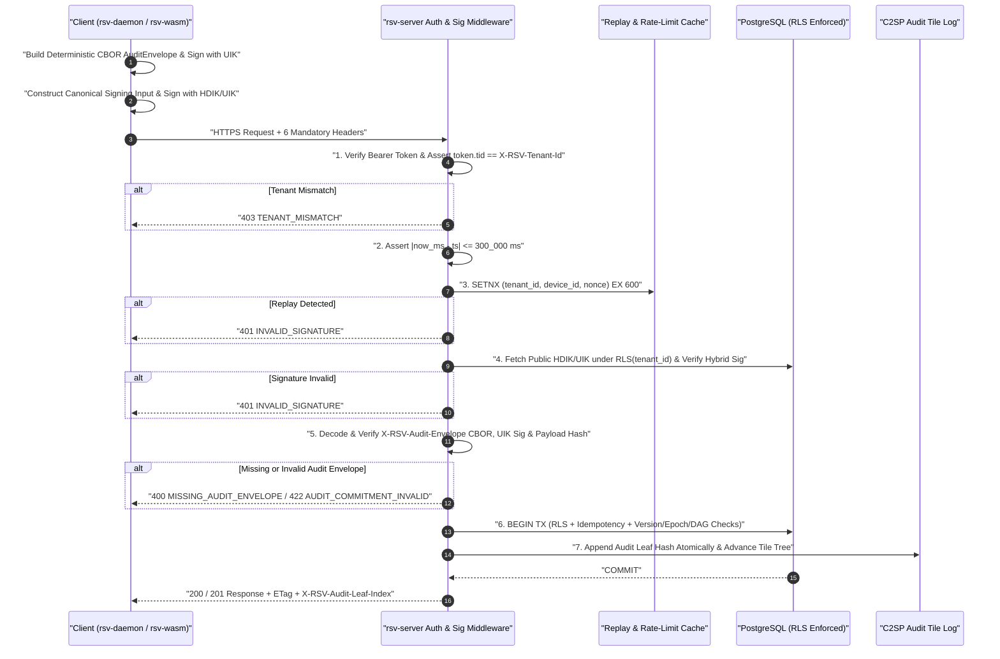

# SPEC-08: API & Wire Protocols — Blind Zero-Knowledge REST, C2SP Audit Tiles & Real-Time Sync

| Field | Value |
| :--- | :--- |
| **Document ID** | `RSV-SPEC-08` |
| **Project** | RusticStack Core (`ZK-Vault` — `https://github.com/KelpHect/ZK-Vault`) |
| **Status** | Normative Draft (v1.0) |
| **License** | Dual MIT / Apache-2.0 |
| **Target Toolchain** | Rust 2024 Edition, MSRV `1.94.0` |
| **Normative Schemas** | `schemas/openapi-v1.yaml` (OpenAPI 3.1.0), `schemas/ipc-native-messaging.schema.json` (JSON Schema Draft 2020-12) |

---

## 1. Scope & Normative Conventions

This specification defines the authoritative network wire protocols between RusticStack Core clients (`rsv-daemon`, `rsv-desktop`, Chrome Extension MV3, Zero-Install Web SPA, and `rsv-compliance-cli`) and the zero-knowledge blind relay & storage backend (`rsv-server`).

The key words **MUST**, **MUST NOT**, **REQUIRED**, **SHALL**, **SHALL NOT**, **SHOULD**, **SHOULD NOT**, **RECOMMENDED**, **NOT RECOMMENDED**, **MAY**, and **OPTIONAL** in this document are to be interpreted as described in BCP 14 (RFC 2119 and RFC 8174).

### 1.1 Blind Server Wire Principle

`rsv-server` is a **cryptographically blind, authenticated state machine**. On the wire:
- `rsv-server` MUST verify transport integrity, tenant isolation (`X-RSV-Tenant-Id`), device/user request signatures (`X-RSV-Request-Signature`), optimistic concurrency (`version` / `key_epoch`), DAG acyclicity, escrow quorum thresholds, and signed `AuditEnvelope` commitments (`X-RSV-Audit-Envelope`).
- `rsv-server` MUST NEVER request, accept, inspect, or log plaintext vault contents, plaintext item titles/URLs/usernames, or unwrapped symmetric/private key material.

---

## 2. Transport Layer Security

1. **TLS 1.3 Mandatory**: All `/api/v1` endpoints MUST be served exclusively over TLS 1.3 (RFC 8446). TLS 1.2, TLS 1.1, TLS 1.0, and plaintext HTTP MUST be rejected at the edge listener (except internal loopback health checks isolated from external interfaces).
2. **Post-Quantum Hybrid TLS Key Exchange**:
   - Both `rsv-server` and native clients (`rsv-daemon`, `rsv-compliance-cli`) MUST advertise and prefer the hybrid post-quantum named group **`X25519MLKEM768`** (IANA TLS Supported Group `0x11EC`) as the primary key share, preventing Harvest-Now-Decrypt-Later (HNDL) traffic metadata capture.
   - Classical `X25519` (`0x001D`) MAY remain configured as a secondary fallback group for compatibility with legacy enterprise TLS middleboxes; native clients MUST emit a structured security warning when a session downgrades from `X25519MLKEM768`.
3. **Allowed TLS 1.3 Cipher Suites**: ONLY `TLS_AES_256_GCM_SHA384` and `TLS_CHACHA20_POLY1305_SHA256` MUST be enabled. `TLS_AES_128_GCM_SHA256` SHOULD be disabled unless mandated by a specific client runtime.
4. **HSTS & Certificate Transparency**:
   - Responses MUST include `Strict-Transport-Security: max-age=63072000; includeSubDomains; preload`.
   - Server certificates MUST embed valid RFC 6962 / RFC 9162 Signed Certificate Timestamps (SCTs) from at least two independent CT logs.
5. **Optional Enterprise mTLS**:
   - Enterprise tenants MAY enable mutual TLS (`tenant/manifest.mtls_required = true`) on dedicated API hostnames, requiring client X.509 device certificates issued by the tenant's Enterprise PKI in addition to `HDIK` request signing.

---

## 3. Canonical Serialization Rules: Deterministic CBOR vs. JSON

RusticStack Core strictly bifurcates wire encoding between **cryptographic structures** (signed/hashed/encrypted bytes) and **HTTP control-plane envelopes**:

| Data Category | Wire Encoding | Normative Standard | Rules |
| :--- | :--- | :--- | :--- |
| **Signed & Encrypted Cryptographic Envelopes** (`AuditEnvelope`, `EncryptedItemEnvelope`, `WrappedKeyEdge`, `VssEscrowBundle`, `DeviceAttestationPayload`, `TenantManifestPayload`) | **Deterministic CBOR** | **RFC 8949 Section 4.2** | Definite-length arrays/maps/byte strings ONLY; shortest canonical integer representations; map keys sorted strictly by encoded byte length ascending, then bytewise lexicographical order; **no floating-point values** (`major types 7` float16/32/64 forbidden inside signed structs); integer map keys preferred for compact envelopes. |
| **HTTP Request/Response Envelopes, Pagination, WebAuthn Ceremonies, Error Payloads** | **UTF-8 JSON** | **RFC 8259** (`Content-Type: application/json; charset=utf-8`) | Unknown fields MUST be rejected (`deny_unknown_fields`) on mutating security-sensitive inputs (`auth`, `edges`, `rotate`, `recovery`) and ignored safely on forward-compatible reads. |
| **Binary Fields Embedded in JSON or HTTP Headers** | **Unpadded Base64URL** | **RFC 4648 Section 5** (NO `=` padding) | Applies to all embedded deterministic CBOR envelopes, ciphertexts, KEM encapsulations, hybrid signatures, public keys, nonces, and hashes. Standard base64 (`+`, `/`, `=`) MUST be rejected with `400`. |
| **Identifiers (`*_id`)** | **Canonical UUIDv7 String** | **RFC 9562** | Lowercase hyphenated 36-character ASCII (`^[0-9a-f]{8}-[0-9a-f]{4}-7[0-9a-f]{3}-[89ab][0-9a-f]{3}-[0-9a-f]{12}$`). |
| **Timestamps in JSON** | **RFC 3339 UTC** | **RFC 3339** | UTC millisecond precision ending in `Z` (`2026-11-19T19:30:00.000Z`). |
| **C2SP Audit Tiles (`GET /api/v1/audit/tile/...`)** | **Raw Binary** | **C2SP `tlog-tiles`** (`application/octet-stream`) | Exact concatenation of `width` 32-byte raw SHA-256 hashes (`32 * width` bytes, `1 <= width <= 256`). |
| **C2SP Audit Checkpoint (`GET /api/v1/audit/checkpoint`)** | **Signed Note UTF-8 Text** | **C2SP `signed-note`** (`text/plain; charset=utf-8`) | Standard C2SP 3-line checkpoint body (`origin\ntree_size\nbase64_root_hash\n`) + blank line + signature lines (Ed25519 + ML-DSA-65). |

### 3.1 Supported Cipher Suite Identifiers

Every cryptographic envelope MUST declare an explicit `cipher_suite` string. Unrecognized or deprecated suites MUST be rejected by both server and clients with `400 UNSUPPORTED_CIPHER_SUITE`:

| `cipher_suite` ID | KEM | Signature | AEAD | KDF / Hash | Profile |
| :--- | :--- | :--- | :--- | :--- | :--- |
| `RSV-HYBRID-2026-V1` | `X-Wing` (`ML-KEM-768` + `X25519`) | Hybrid `ML-DSA-65` + `Ed25519` | `XChaCha20-Poly1305` | `HKDF-SHA-256` / `SHA-256` | **Default Mandatory** |
| `RSV-HYBRID-FIPS-2026-V1` | `X-Wing` (`ML-KEM-768` + `X25519`) | Hybrid `ML-DSA-65` + `Ed25519` | `AES-256-GCM` | `HKDF-SHA-256` / `SHA-256` | FIPS 140-3 Regulated Tenants |

---

## 4. Mandatory Request Headers & Canonical Request Signing

### 4.1 Mandatory Request Header Registry

| Header Name | Format | Applicability | Validation & Failure Mode |
| :--- | :--- | :--- | :--- |
| `Authorization` | `Bearer <token>` | All authenticated endpoints (all except `/health`, `/auth/webauthn/*/start`, `/auth/webauthn/*/finish`, and public tenant manifest discovery if enabled) | Ed25519/ML-DSA-65 signed short-lived access token (TTL <= 15 min) bound to `(tenant_id, user_id, device_id, session_id)`. Invalid/expired -> `401 Unauthorized`. |
| `X-RSV-Tenant-Id` | Lowercase UUIDv7 | All tenant-scoped endpoints (every endpoint except `GET /api/v1/health`) | MUST exactly match the `tid` claim in `Authorization` AND the PostgreSQL RLS session context `app.current_tenant_id`. Mismatch -> `403 TENANT_MISMATCH`. |
| `X-RSV-Device-Id` | Lowercase UUIDv7 | All authenticated endpoints | MUST match a registered, non-revoked device belonging to the authenticated user and the `did` claim in `Authorization`. Unknown/revoked -> `401 DEVICE_ATTESTATION_FAILED`. |
| `X-RSV-Request-Signature` | Structured key-value header (Section 4.2) | All authenticated endpoints (mandatory for every non-health, non-initial-auth call) | Cryptographic signature by `HDIK` (native/enclave device) or `UIK` (browser WASM session) over the canonical request string. Failure or replay -> `401 INVALID_SIGNATURE`. |
| `X-RSV-Audit-Envelope` | Unpadded `base64url(deterministic_cbor(AuditEnvelope))` | Mandatory on ALL `POST`, `PUT`, `PATCH`, `DELETE` state mutations (except `/auth/session/refresh`) and sensitive reads (`GET /items/{item_id}`, `GET /recovery/ceremonies/{ceremony_id}`) | Server decodes CBOR, verifies `UIK` signature, verifies `action`, `tenant_id`, `actor_id`, `target_id`, and `payload_sha256` match the request, and commits the envelope hash into the tenant's C2SP transparency log atomically. Missing -> `400 MISSING_AUDIT_ENVELOPE`; invalid signature/hash mismatch -> `422 AUDIT_COMMITMENT_INVALID`. |
| `Idempotency-Key` | Lowercase UUIDv7 or UUIDv4 | Mandatory on ALL `POST`, `PUT`, `PATCH`, `DELETE` endpoints | Deduplicates retried writes for 24 hours scoped to `(tenant_id, user_id, method, path, idempotency_key)`. Reusing an existing key with a different `SHA-256(body)` returns `409 VERSION_CONFLICT`. |

### 4.2 Canonical Request Signing Algorithm (`X-RSV-Request-Signature`)

To defeat replay attacks, MITM header/body modification, path traversal confusion, and audit-envelope stripping even if a bearer session token is compromised, every authenticated request MUST carry `X-RSV-Request-Signature`:

#### Header Syntax
```http
X-RSV-Request-Signature: v=1; kid=<key_uuidv7>; signer=<hdik|uik>; suite=RSV-HYBRID-2026-V1; ts=1795116600123; nonce=aB3dE5fG7hI9jK1lM3nO5p; sig=<base64url_hybrid_signature>
```

Field requirements:
- `v`: Protocol version, MUST be `1`.
- `kid`: UUIDv7 of the signing key (`HDIK` key ID for registered hardware devices, or `UIK` key ID for browser WASM sessions).
- `signer`: `"hdik"` (preferred, hardware-backed device identity key) or `"uik"` (user identity key; allowed only if tenant policy permits browser sessions without native `HDIK`).
- `suite`: MUST be a supported `cipher_suite` (`RSV-HYBRID-2026-V1` or `RSV-HYBRID-FIPS-2026-V1`).
- `ts`: Client UTC Unix timestamp in **milliseconds** (`u64` decimal ASCII).
- `nonce`: 16-byte CSPRNG value encoded as 22-character unpadded `base64url`.
- `sig`: Unpadded `base64url` hybrid signature (`ML-DSA-65 || Ed25519` encoded in canonical signature wire format) over the UTF-8 bytes of the Canonical Signing Input below.

#### Canonical Signing Input (Normative Exact Construction)

Construct the exact UTF-8 byte string using Unix LF (`0x0A`, `\n`) delimiters and **no trailing newline**:

```text
RSV-REQ-SIG-V1
<UPPERCASE_HTTP_METHOD>
<CANONICAL_REQUEST_PATH>
<CANONICAL_QUERY_STRING>
<LOWERCASE_X_RSV_TENANT_ID>
<LOWERCASE_X_RSV_DEVICE_ID>
<TIMESTAMP_UNIX_MS>
<NONCE_BASE64URL>
<LOWERCASE_HEX_SHA256_BODY>
<LOWERCASE_HEX_SHA256_AUDIT_ENVELOPE>
```

Exact canonicalization rules for each line:
1. **Line 1 (Domain Separator)**: Literal ASCII string `RSV-REQ-SIG-V1`.
2. **Line 2 (`UPPERCASE_HTTP_METHOD`)**: Exact HTTP verb in uppercase (`GET`, `POST`, `PUT`, `PATCH`, `DELETE`).
3. **Line 3 (`CANONICAL_REQUEST_PATH`)**: RFC 3986 normalized path starting with `/` (e.g., `/api/v1/items/01934567-89ab-7cde-8f01-23456789abcd`), with no dot segments (`.`, `..`), no duplicate slashes (`//`), and uppercase percent-encoding only for reserved characters.
4. **Line 4 (`CANONICAL_QUERY_STRING`)**: Query parameters split on `&`, percent-encoded per RFC 3986 unreserved set, sorted lexicographically by `(encoded_key, encoded_value)` ascending, joined by `&`. If no query parameters exist, this line is the empty string `""` (preserving the `\n` separator).
5. **Line 5 (`LOWERCASE_X_RSV_TENANT_ID`)**: Exact lowercase UUIDv7 value of `X-RSV-Tenant-Id`.
6. **Line 6 (`LOWERCASE_X_RSV_DEVICE_ID`)**: Exact lowercase UUIDv7 value of `X-RSV-Device-Id`.
7. **Line 7 (`TIMESTAMP_UNIX_MS`)**: Exact `ts` decimal integer from `X-RSV-Request-Signature`.
8. **Line 8 (`NONCE_BASE64URL`)**: Exact `nonce` string from `X-RSV-Request-Signature`.
9. **Line 9 (`LOWERCASE_HEX_SHA256_BODY`)**: Lowercase 64-char hex `SHA-256` digest of the exact raw HTTP request body bytes (`e3b0c44298fc1c149afbf4c8996fb92427ae41e4649b934ca495991b7852b855` for an empty body).
10. **Line 10 (`LOWERCASE_HEX_SHA256_AUDIT_ENVELOPE`)**: Lowercase 64-char hex `SHA-256` digest of the **raw decoded deterministic CBOR bytes** of `X-RSV-Audit-Envelope` (or `e3b0c44298fc1c149afbf4c8996fb92427ae41e4649b934ca495991b7852b855` if `X-RSV-Audit-Envelope` is absent on endpoints where it is optional).

#### Server Verification Sequence



---

## 5. Complete `/api/v1` Endpoint Reference

All 32 canonical endpoints in `schemas/openapi-v1.yaml` are specified below.

### 5.1 Master Endpoint Index

| # | Method | Path | Auth | `X-RSV-Audit-Envelope` | `Idempotency-Key` | Purpose |
| :-: | :--- | :--- | :--- | :---: | :---: | :--- |
| 1 | `GET` | `/api/v1/health` | Public | No | No | Liveness, readiness, supported cipher suites & protocol version |
| 2 | `POST` | `/api/v1/auth/webauthn/register/start` | Enrollment Token / Public | No | Yes | Begin FIDO2/WebAuthn credential + PRF salt registration ceremony |
| 3 | `POST` | `/api/v1/auth/webauthn/register/finish` | Enrollment Token / Public | Yes | Yes | Complete WebAuthn registration & upload encrypted `UMK`/`UIK`/`UEK` bundles |
| 4 | `POST` | `/api/v1/auth/webauthn/login/start` | Public (Tenant-Scoped) | No | Yes | Issue WebAuthn login challenge & deterministic `prf_salt` |
| 5 | `POST` | `/api/v1/auth/webauthn/login/finish` | Public (Tenant-Scoped) | No | Yes | Verify WebAuthn assertion & issue signed session token + encrypted identity bundles |
| 6 | `POST` | `/api/v1/auth/session/refresh` | Refresh Token + Sig | No | Yes | Rotate refresh token (reuse detection) & mint fresh access token |
| 7 | `POST` | `/api/v1/auth/session/revoke` | Bearer + Sig | Yes | Yes | Revoke current or specified device session immediately |
| 8 | `GET` | `/api/v1/tenant/manifest` | Bearer + Sig | No | No | Retrieve signed tenant security policy, cipher suite policy, and log verification keys |
| 9 | `GET` | `/api/v1/users/directory` | Bearer + Sig | No | No | Paginated directory of verified user public `UIK`/`UEK` identity bundles |
| 10 | `POST` | `/api/v1/users/devices` | Bearer + Sig | Yes | Yes | Register & attest hardware device (`HDIK` + TPM/Secure Enclave attestation) |
| 11 | `GET` | `/api/v1/graph/my-edges` | Bearer + Sig | No | No | Fetch all encrypted RBAC graph edges reachable by authenticated user |
| 12 | `GET` | `/api/v1/graph/org` | Bearer + Sig (Org Admin) | No | No | Fetch full tenant encrypted key-graph topology for local admin decryption |
| 13 | `POST` | `/api/v1/teams` | Bearer + Sig | Yes | Yes | Create team node with initial epoch-1 `TEK` wrapped edges |
| 14 | `PATCH` | `/api/v1/teams/{team_id}/rotate` | Bearer + Sig | Yes | Yes | Atomically rotate `TEK` to `epoch + 1` with replacement member edges |
| 15 | `POST` | `/api/v1/collections` | Bearer + Sig | Yes | Yes | Create collection node with initial epoch-1 `CEK` wrapped edges |
| 16 | `PATCH` | `/api/v1/collections/{collection_id}/rotate` | Bearer + Sig | Yes | Yes | Atomically rotate `CEK` to `epoch + 1` with replacement edges |
| 17 | `POST` | `/api/v1/graph/edges` | Bearer + Sig | Yes | Yes | Grant access by inserting signed KEM-wrapped graph edge (DAG cycle checked) |
| 18 | `DELETE` | `/api/v1/graph/edges/{edge_id}` | Bearer + Sig | Yes | Yes | Remove graph edge (normally paired with epoch rotation) |
| 19 | `GET` | `/api/v1/collections/{collection_id}/items` | Bearer + Sig | No | No | Cursor-paginated list of encrypted item envelopes in a collection |
| 20 | `POST` | `/api/v1/collections/{collection_id}/items` | Bearer + Sig | Yes | Yes | Create a new encrypted vault item bound to current collection `key_epoch` |
| 21 | `GET` | `/api/v1/items/{item_id}` | Bearer + Sig | Yes | No | Fetch latest encrypted item envelope (audited read) |
| 22 | `PUT` | `/api/v1/items/{item_id}` | Bearer + Sig | Yes | Yes | Optimistically update encrypted item (`If-Match` version + `key_epoch` checked) |
| 23 | `DELETE` | `/api/v1/items/{item_id}` | Bearer + Sig | Yes | Yes | Soft-delete or tombstone encrypted item (`If-Match` version checked) |
| 24 | `GET` | `/api/v1/items/{item_id}/revisions` | Bearer + Sig | No | No | Paginated immutable revision history of encrypted item envelopes |
| 25 | `POST` | `/api/v1/recovery/ceremonies` | Bearer + Sig | Yes | Yes | Initiate an M-of-N VSS recovery ceremony or submit a custodian share |
| 26 | `GET` | `/api/v1/recovery/ceremonies/{ceremony_id}` | Bearer + Sig | Yes | No | Retrieve recovery ceremony state, VSS commitments, and released encrypted shares |
| 27 | `POST` | `/api/v1/recovery/escrow-bundle` | Bearer + Sig | Yes | Yes | Upload verifiable M-of-N VSS escrow bundle satisfying tenant escrow policy |
| 28 | `GET` | `/api/v1/audit/checkpoint` | Bearer + Sig (or Auditor Key) | No | No | Fetch latest signed C2SP transparency log checkpoint for tenant |
| 29 | `GET` | `/api/v1/audit/tile/{level}/{index}` | Bearer + Sig (or Auditor Key) | No | No | Fetch complete immutable C2SP Merkle tile (`256 * 32` = 8,192 bytes) |
| 30 | `GET` | `/api/v1/audit/tile/{level}/{index}.p/{width}` | Bearer + Sig (or Auditor Key) | No | No | Fetch partial C2SP Merkle tile (`width * 32` bytes, `1 <= width <= 255`) |
| 31 | `GET` | `/api/v1/audit/entries/{index}` | Bearer + Sig (or Auditor Key) | No | No | Fetch canonical deterministic CBOR audit log entry at leaf `index` |
| 32 | `GET` | `/api/v1/sync/stream` | Bearer + Sig (or WS First-Frame Auth) | No | No | Real-time opaque synchronization stream (WebSocket `rsv-sync.v1` / SSE fallback) |

---

### 5.2 Detailed Endpoint Contracts

#### 5.2.1 Health (`GET /api/v1/health`)
- **Response `200 OK`**:
  ```json
  {
    "status": "ok",
    "version": "1.0.0",
    "api_version": "v1",
    "supported_cipher_suites": ["RSV-HYBRID-2026-V1", "RSV-HYBRID-FIPS-2026-V1"],
    "tls_pq_enabled": true,
    "server_time": "2026-11-19T19:30:00.000Z"
  }
  ```

#### 5.2.2 WebAuthn Registration & Login (`/api/v1/auth/webauthn/*`, `/api/v1/auth/session/*`)
- **`POST /api/v1/auth/webauthn/register/start`**:
  - Request: `{ "tenant_id": "<uuidv7>", "email": "alice@corp.example", "display_name": "Alice", "enrollment_token": "<opaque>" }`
  - Response `200 OK`: `{ "ceremony_id": "<uuidv7>", "public_key_credential_creation_options": { ... }, "prf_salt_v1": "<base64url_32B>" }`
  - `public_key_credential_creation_options` MUST request `authenticatorSelection.userVerification = "required"`, `residentKey = "preferred"`, and `extensions.prf = {}`.
- **`POST /api/v1/auth/webauthn/register/finish`**:
  - Request: `{ "ceremony_id": "<uuidv7>", "attestation_response": { ... }, "cipher_suite": "RSV-HYBRID-2026-V1", "uik_public_key": "<base64url>", "uek_public_key": "<base64url>", "encrypted_umk_bundle": "<base64url_cbor>", "encrypted_uik_bundle": "<base64url_cbor>", "encrypted_uek_bundle": "<base64url_cbor>", "kdf_metadata": { "mode": "webauthn_prf_v1", "prf_salt_nonce": "<base64url_16B>" } }`
  - Response `201 Created`: `{ "user_id": "<uuidv7>", "credential_id": "<base64url>", "uik_key_id": "<uuidv7>", "uek_key_id": "<uuidv7>", "audit_leaf_index": 1001 }`
- **`POST /api/v1/auth/webauthn/login/start`**:
  - Request: `{ "tenant_id": "<uuidv7>", "user_identifier": "alice@corp.example", "device_id": "<uuidv7_optional>" }`
  - Response `200 OK`: `{ "ceremony_id": "<uuidv7>", "public_key_credential_request_options": { ... }, "prf_salt_v1": "<base64url_32B>", "kdf_metadata": { ... } }`
- **`POST /api/v1/auth/webauthn/login/finish`**:
  - Request: `{ "ceremony_id": "<uuidv7>", "assertion_response": { ... }, "device_id": "<uuidv7_optional>" }`
  - Response `200 OK`: `{ "access_token": "<jwt>", "access_token_expires_in": 900, "refresh_token": "<opaque_64B>", "session_id": "<uuidv7>", "user_id": "<uuidv7>", "device_id": "<uuidv7>", "cipher_suite": "RSV-HYBRID-2026-V1", "encrypted_umk_bundle": "<base64url_cbor>", "encrypted_uik_bundle": "<base64url_cbor>", "encrypted_uek_bundle": "<base64url_cbor>" }`
- **`POST /api/v1/auth/session/refresh`**:
  - Request: `{ "refresh_token": "<opaque_64B>" }`
  - Behavior: Single-use rotating refresh token family. Presenting a previously rotated refresh token MUST immediately revoke the entire session family and emit a security audit event (`401 INVALID_SIGNATURE`).
  - Response `200 OK`: `{ "access_token": "<jwt>", "access_token_expires_in": 900, "refresh_token": "<new_opaque_64B>", "session_id": "<uuidv7>" }`
- **`POST /api/v1/auth/session/revoke`**:
  - Request: `{ "session_id": "<uuidv7_or_null_for_current>", "revoke_all_user_sessions": false }`
  - Response `200 OK`: `{ "revoked_session_ids": ["<uuidv7>"], "revoked_at": "2026-11-19T19:35:00.000Z", "audit_leaf_index": 1002 }`

#### 5.2.3 Tenant Manifest, User Directory & Device Attestation
- **`GET /api/v1/tenant/manifest`**:
  - Response `200 OK`: Returns deterministic CBOR `signed_manifest_cbor` (`base64url`) signed by the tenant's Root Authority Key + parsed projection: `tenant_id`, `manifest_version`, `allowed_cipher_suites`, `require_hardware_attestation`, `allow_standalone_extension_wasm`, `mtls_required`, `escrow_policy` (`required`, `min_threshold_m`, `min_custodians_n`, `custodian_user_ids`), `audit_log_origin`, `audit_log_public_keys` (Ed25519 + ML-DSA-65).
- **`GET /api/v1/users/directory`**:
  - Query params: `cursor` (optional), `limit` (`1..200`, default `50`), `updated_after` (optional RFC 3339).
  - Response `200 OK`: `{ "users": [{ "user_id", "handle", "status", "uik_key_id", "uik_public_key", "uek_key_id", "uek_public_key", "cipher_suite", "audit_leaf_index", "key_proof_cbor" }], "next_cursor": "<opaque_or_null>" }`
  - Clients MUST verify `key_proof_cbor` against the tenant's C2SP transparency log before encapsulating any secret to another user's `uek_public_key`.
- **`POST /api/v1/users/devices`**:
  - Request: `{ "device_label": "MacBook Pro (Work)", "platform": "macos" | "windows" | "linux" | "web_wasm", "cipher_suite": "RSV-HYBRID-2026-V1", "hdik_public_key": "<base64url>", "attestation_format": "apple_secure_enclave" | "tpm2_ek_ak" | "fido2_packed" | "none", "attestation_payload_cbor": "<base64url_cbor>", "uik_countersignature": "<base64url>" }`
  - Server verifies hardware attestation certificate chain (if `tenant/manifest.require_hardware_attestation == true`, `attestation_format == "none"` or invalid TPM/Enclave attestation returns `422 DEVICE_ATTESTATION_FAILED`) AND verifies `uik_countersignature` binding `hdik_public_key` to the user's `UIK`.
  - Response `201 Created`: `{ "device_id": "<uuidv7>", "hdik_key_id": "<uuidv7>", "attested": true, "registered_at": "...", "audit_leaf_index": 1003 }`

#### 5.2.4 Cryptographic RBAC Key Graph (`/api/v1/graph/*`, `/api/v1/teams/*`, `/api/v1/collections/*`)
- **`GET /api/v1/graph/my-edges`**:
  - Query params: `since_revision` (optional `u64`).
  - Response `200 OK`: `{ "graph_revision": 42, "nodes": [...], "edges": [{ "edge_id", "source_node_id", "source_node_type", "target_node_id", "target_node_type", "role", "key_epoch", "cipher_suite", "wrapped_key_cbor", "signer_user_id", "edge_signature", "created_at" }] }`
- **`GET /api/v1/graph/org`**:
  - Requires Org Admin role. Returns paginated or snapshot view of all nodes (`org`, `team`, `collection`, `user`) and encrypted edges in the tenant so the admin's client can decrypt authorized subgraphs and plan zero-knowledge rotations locally.
- **`POST /api/v1/teams`**:
  - Request: `{ "team_id": "<client_uuidv7>", "parent_node_id": "<org_or_team_uuidv7>", "encrypted_metadata_cbor": "<base64url_cbor>", "cipher_suite": "RSV-HYBRID-2026-V1", "initial_edges": [<SignedWrappedEdgeInput>...] }`
  - Server enforces DAG acyclicity (`GRAPH_CYCLE_REJECTED`) and creates the team at `active_key_epoch = 1`.
  - Response `201 Created`: `{ "team_id": "<uuidv7>", "active_key_epoch": 1, "created_edge_ids": ["<uuidv7>"], "audit_leaf_index": 1024 }`
- **`PATCH /api/v1/teams/{team_id}/rotate`**:
  - Request: `{ "expected_key_epoch": 1, "new_key_epoch": 2, "cipher_suite": "RSV-HYBRID-2026-V1", "replacement_edges": [<SignedWrappedEdgeInput>...], "revoked_edge_ids": ["<uuidv7>..."], "encrypted_metadata_cbor": "<base64url_cbor_optional>" }`
  - Invariants: `new_key_epoch` MUST equal `expected_key_epoch + 1`; `expected_key_epoch` MUST equal current `team.active_key_epoch` (else `409 STALE_KEY_EPOCH`). All `replacement_edges` and `revoked_edge_ids` apply atomically in one PostgreSQL transaction.
  - Response `200 OK`: `{ "node_id": "<team_uuidv7>", "active_key_epoch": 2, "active_edge_count": 14, "audit_leaf_index": 1025 }`
- **`POST /api/v1/collections`**:
  - Request: `{ "collection_id": "<client_uuidv7>", "parent_node_id": "<org_or_team_uuidv7>", "encrypted_metadata_cbor": "<base64url_cbor>", "cipher_suite": "RSV-HYBRID-2026-V1", "initial_edges": [<SignedWrappedEdgeInput>...] }`
  - Response `201 Created`: `{ "collection_id": "<uuidv7>", "active_key_epoch": 1, "created_edge_ids": ["<uuidv7>"], "audit_leaf_index": 1026 }`
- **`PATCH /api/v1/collections/{collection_id}/rotate`**:
  - Request: `{ "expected_key_epoch": 1, "new_key_epoch": 2, "cipher_suite": "RSV-HYBRID-2026-V1", "replacement_edges": [<SignedWrappedEdgeInput>...], "revoked_edge_ids": ["<uuidv7>..."] }`
  - Atomically increments `collection.active_key_epoch`, swaps edges, and emits an `epoch_rotated` sync event so all clients invalidate stale `CEK` write keys.
  - Response `200 OK`: `{ "node_id": "<collection_uuidv7>", "active_key_epoch": 2, "active_edge_count": 8, "audit_leaf_index": 1027 }`
- **`POST /api/v1/graph/edges`**:
  - Request: `{ "source_node_id": "<uuidv7>", "target_node_id": "<uuidv7>", "role": "reader" | "writer" | "admin", "key_epoch": 2, "cipher_suite": "RSV-HYBRID-2026-V1", "wrapped_key_cbor": "<base64url_cbor>", "edge_signature": "<base64url>" }`
  - Validation:
    - Verifies `key_epoch == source_node.active_key_epoch` (else `409 STALE_KEY_EPOCH`).
    - Runs recursive CTE DAG cycle detection in PostgreSQL; if inserting `(source_node_id -> target_node_id)` introduces a cycle (including self-loop), rejects with `422 GRAPH_CYCLE_REJECTED`.
  - Response `201 Created`: `{ "edge_id": "<uuidv7>", "key_epoch": 2, "audit_leaf_index": 1028 }`
- **`DELETE /api/v1/graph/edges/{edge_id}`**:
  - Response `200 OK`: `{ "edge_id": "<uuidv7>", "deleted": true, "rotation_recommended": true, "audit_leaf_index": 1029 }`

#### 5.2.5 Encrypted Vault Items & Immutable Revisions (`/api/v1/collections/{collection_id}/items`, `/api/v1/items/*`)
- **`GET /api/v1/collections/{collection_id}/items`**:
  - Query params: `cursor`, `limit` (`1..100`, default `50`), `include_deleted` (`false` default), `updated_after` (optional RFC 3339).
  - Response `200 OK`: `{ "collection_id": "<uuidv7>", "active_key_epoch": 2, "items": [<EncryptedItemRecord>...], "next_cursor": "<opaque_or_null>" }`
- **`POST /api/v1/collections/{collection_id}/items`**:
  - Request: `{ "item_id": "<client_uuidv7>", "key_epoch": 2, "cipher_suite": "RSV-HYBRID-2026-V1", "wrapped_iek_cbor": "<base64url_cbor>", "encrypted_payload_cbor": "<base64url_cbor>", "blind_index_tokens": ["<base64url_optional>"] }`
  - Validation: `key_epoch` MUST equal `collection.active_key_epoch` (else `409 STALE_KEY_EPOCH`).
  - Response `201 Created` (with `ETag: "v1"`): `{ "item_id": "<uuidv7>", "collection_id": "<uuidv7>", "version": 1, "key_epoch": 2, "etag": "\"v1\"", "updated_at": "...", "audit_leaf_index": 1030 }`
- **`GET /api/v1/items/{item_id}`**:
  - Requires `X-RSV-Audit-Envelope` (logging audited item access).
  - Response `200 OK` (with `ETag: "v<version>"`): Full `EncryptedItemRecord` (`item_id`, `collection_id`, `version`, `key_epoch`, `cipher_suite`, `wrapped_iek_cbor`, `encrypted_payload_cbor`, `deleted`, `created_at`, `updated_at`, `etag`).
- **`PUT /api/v1/items/{item_id}`**:
  - Headers: MUST include `If-Match: "v<expected_version>"` (and body `expected_version` MUST match).
  - Request: `{ "expected_version": 1, "key_epoch": 2, "cipher_suite": "RSV-HYBRID-2026-V1", "wrapped_iek_cbor": "<base64url_cbor>", "encrypted_payload_cbor": "<base64url_cbor>" }`
  - Concurrency & Epoch Checks:
    1. If `key_epoch != collection.active_key_epoch` -> `409 STALE_KEY_EPOCH`.
    2. If `expected_version != current_item.version` OR `If-Match` mismatches -> `409 VERSION_CONFLICT`.
    3. Atomically archives previous ciphertext row into `item_revisions` and updates item to `version = expected_version + 1`.
  - Response `200 OK` (with `ETag: "v2"`): Updated item metadata + `audit_leaf_index`.
- **`DELETE /api/v1/items/{item_id}`**:
  - Headers: MUST include `If-Match: "v<expected_version>"`.
  - Query param: `mode=soft|purge` (default `soft`; `purge` permanently erases ciphertext blobs while retaining tombstone metadata + audit record).
  - Response `200 OK`: `{ "item_id": "<uuidv7>", "version": 3, "deleted": true, "mode": "soft", "audit_leaf_index": 1032 }`
- **`GET /api/v1/items/{item_id}/revisions`**:
  - Query params: `cursor`, `limit` (`1..100`, default `25`).
  - Response `200 OK`: `{ "item_id": "<uuidv7>", "revisions": [{ "version", "key_epoch", "cipher_suite", "wrapped_iek_cbor", "encrypted_payload_cbor", "actor_user_id", "created_at", "audit_leaf_index" }], "next_cursor": "<opaque_or_null>" }`

#### 5.2.6 Verifiable Secret Sharing (VSS) Recovery & Enterprise Escrow (`/api/v1/recovery/*`)
- **`POST /api/v1/recovery/escrow-bundle`**:
  - Request: `{ "escrow_id": "<client_uuidv7>", "subject_user_id": "<uuidv7>", "escrow_epoch": 1, "cipher_suite": "RSV-HYBRID-2026-V1", "threshold_m": 3, "total_shares_n": 5, "vss_commitments_cbor": "<base64url_cbor>", "encrypted_shares": [{ "share_index": 1, "custodian_user_id": "<uuidv7>", "wrapped_share_cbor": "<base64url_cbor>" }], "bundle_signature": "<base64url>" }`
  - Policy Check: Server validates `threshold_m`, `total_shares_n`, unique authorized custodian IDs, and structural VSS commitment count against `tenant/manifest.escrow_policy`. Any policy failure returns `422 ESCROW_POLICY_VIOLATION`.
  - Response `201 Created`: `{ "escrow_id": "<uuidv7>", "escrow_epoch": 1, "threshold_m": 3, "total_shares_n": 5, "audit_leaf_index": 1040 }`
- **`POST /api/v1/recovery/ceremonies`**:
  - Dual action discriminated by `action`:
    - `action = "initiate"`: `{ "action": "initiate", "escrow_id": "<uuidv7>", "ephemeral_recovery_uek_public_key": "<base64url>", "cipher_suite": "RSV-HYBRID-2026-V1", "reason_code": "device_loss" | "passkey_loss" | "enterprise_audit_recovery" }` -> creates ceremony (`201 Created`, status `pending_quorum`).
    - `action = "submit_share"`: `{ "action": "submit_share", "ceremony_id": "<uuidv7>", "share_index": 2, "rewrapped_share_cbor": "<base64url_cbor>", "custodian_signature": "<base64url>" }` -> records custodian's verified contribution (`200 OK`, advances `collected_shares`; flips status to `quorum_met` once `collected_shares >= threshold_m`).
- **`GET /api/v1/recovery/ceremonies/{ceremony_id}`**:
  - Query param: `release_shares=true|false` (default `false`).
  - If `release_shares=true` and `collected_shares < threshold_m`, server MUST NOT release partial shares and MUST return `412 Precondition Failed` with error code `QUORUM_THRESHOLD_UNMET` (`details: { collected_shares, required_threshold_m }`).
  - Once `collected_shares >= threshold_m`, returns all `rewrapped_share_cbor` entries + `vss_commitments_cbor` so the requester can cryptographically verify every share against the commitments and reconstruct the secret locally inside `rsv-vss`.

#### 5.2.7 C2SP Verifiable Transparency Log (`/api/v1/audit/*`)
RusticStack Core implements the **C2SP `tlog-tiles` specification** per tenant (with independent tile namespaces strictly isolated by `X-RSV-Tenant-Id`):
- **`GET /api/v1/audit/checkpoint`**:
  - Response `200 OK` (`Content-Type: text/plain; charset=utf-8`, `Cache-Control: no-store`):
    ```text
    rusticstack.io/audit/v1/tenant/01934567-89ab-7cde-8f01-23456789abcd
    1042
    47DEQpj8HBSa+/TImW+5JCeuQeRkm5NMpJWZG3hSuFU=

    — rusticstack-ed25519 <base64_keyhash_and_ed25519_sig>
    — rusticstack-mldsa65 <base64_keyhash_and_mldsa65_sig>
    ```
- **`GET /api/v1/audit/tile/{level}/{index}`**:
  - Path params: `level` (`0..63`, tile height = 8 -> 256 hashes per full tile), `index` (non-negative integer or C2SP `xNNN/` grouped path segment normalized by router).
  - Response `200 OK` (`Content-Type: application/octet-stream`, `Cache-Control: public, max-age=31536000, immutable`): Exactly `8192` bytes (`256 * 32` SHA-256 node hashes).
- **`GET /api/v1/audit/tile/{level}/{index}.p/{width}`**:
  - Path params: `level`, `index`, `width` (`1..255`).
  - Response `200 OK` (`Content-Type: application/octet-stream`, `Cache-Control: no-cache`): Exactly `width * 32` raw bytes representing the rightmost partial tile.
- **`GET /api/v1/audit/entries/{index}`**:
  - Path param: `index` (`0 <= index < tree_size`).
  - Response `200 OK` (`Content-Type: application/json`, `Cache-Control: public, max-age=31536000, immutable`): `{ "leaf_index": 1041, "leaf_hash": "<base64url_32B>", "recorded_at": "2026-11-19T19:35:00.000Z", "audit_envelope_cbor": "<base64url_cbor>" }`.
  - Clients and `rsv-compliance-cli` compute `SHA-256(0x00 || audit_envelope_cbor)` and verify it equals `leaf_hash` and hashes up through the C2SP tiles to the signed checkpoint root.

---

## 6. Optimistic Concurrency & Key Epoch Validation Rules

Concurrent multi-device edits and admin key rotations MUST never silently overwrite vault items or allow items to be encrypted under revoked keys.

1. **Dual-Guard Write Contract**:
   - Every item creation (`POST /collections/{id}/items`) and update (`PUT /items/{id}`) MUST supply the `key_epoch` of the `CEK` used to wrap `IEK`.
   - Every item update (`PUT`) and deletion (`DELETE`) MUST supply `If-Match: "v<expected_version>"` (and body `expected_version`).
2. **Validation Precedence (Strict Server Order)**:
   - Step A: Verify authorization & `collection.active_key_epoch`. If `request.key_epoch != collection.active_key_epoch`, reject immediately with **`409 Conflict` (`STALE_KEY_EPOCH`)** including `details: { "provided_key_epoch": 1, "required_key_epoch": 2, "collection_id": "<uuidv7>" }`.
   - Step B: Verify `expected_version == item.version` and `If-Match == item.etag`. If mismatched, reject with **`409 Conflict` (`VERSION_CONFLICT`)** including `details: { "expected_version": 4, "current_version": 5, "current_etag": "\"v5\"" }`.
3. **Deterministic Client Recovery Flow**:
   - On `STALE_KEY_EPOCH`: Client fetches `GET /api/v1/graph/my-edges`, verifies the new `epoch` edge signature, decapsulates the new `CEK`, re-wraps the item's `IEK` (or generates a fresh `IEK` and re-encrypts the payload) with updated AEAD Associated Data binding the new `key_epoch`, constructs a new `AuditEnvelope` and `Idempotency-Key`, and retries.
   - On `VERSION_CONFLICT`: Client fetches `GET /api/v1/items/{item_id}`, decrypts both local draft and server version locally, performs three-way field merge (or prompts the user to resolve field conflicts), and retries with the new `If-Match` and `Idempotency-Key`.

---

## 7. Real-Time Opaque Sync Protocol (`GET /api/v1/sync/stream`)

To keep GPUI desktop, Chrome Extension, and Web SPA clients synchronized in sub-second latency without leaking plaintext metadata, `rsv-server` exposes `GET /api/v1/sync/stream`.

### 7.1 Transport Negotiation & Browser-Safe Authentication

1. **WebSocket Primary (`Upgrade: websocket`, `Sec-WebSocket-Protocol: rsv-sync.v1`)**:
   - **Native Clients (`rsv-daemon`)**: MAY pass `Authorization`, `X-RSV-Tenant-Id`, `X-RSV-Device-Id`, and `X-RSV-Request-Signature` directly on the HTTP Upgrade handshake request.
   - **Browser Clients (Web SPA / Fallback WASM)**: Because browser `new WebSocket()` cannot set custom HTTP headers, browsers MUST NEVER put bearer tokens in URL query strings. Instead, the browser connects to `wss://<api-host>/api/v1/sync/stream` with subprotocol `rsv-sync.v1` and MUST send an `authenticate` JSON frame within **5 seconds** carrying `authorization`, `tenant_id`, `device_id`, `request_signature`, and optional `resume_cursor`. Failing to authenticate within 5 seconds closes the socket with custom WebSocket close code `4401`.
2. **SSE Fallback (`Accept: text/event-stream`)**:
   - Clients behind proxies blocking WebSockets MAY invoke `GET /api/v1/sync/stream?cursor=<resume_cursor>` using standard `fetch()` streaming (which supports all 6 mandatory headers cleanly). Events are formatted as standard SSE (`id: <cursor>\nevent: <event_type>\ndata: <json>\n\n`).

### 7.2 WebSocket Frame Wire Schema

Every WebSocket text frame MUST be a UTF-8 JSON object containing a `type` discriminator:

#### Client -> Server Frames
- `authenticate`: `{ "type": "authenticate", "tenant_id": "<uuidv7>", "device_id": "<uuidv7>", "access_token": "<jwt>", "request_signature": "<X-RSV-Request-Signature value>", "resume_cursor": "<opaque_optional>" }`
- `ack`: `{ "type": "ack", "cursor": "<opaque>" }`
- `ping`: `{ "type": "ping", "ts": 1795116600123 }`

#### Server -> Client Frames
- `authenticated`: `{ "type": "authenticated", "session_id": "<uuidv7>", "current_cursor": "<opaque>", "heartbeat_interval_ms": 30000 }`
- `event`:
  ```json
  {
    "type": "event",
    "cursor": "eyJ0IjoiMDE5MzQ1NjctODlhYi03Y2RlLThmMDEtMjM0NTY3ODlhYmNkIiwicyI6OTgyMX0",
    "event_id": "01934567-89ab-7cde-8f01-23456789abef",
    "event_type": "epoch_rotated",
    "occurred_at": "2026-11-19T19:36:10.420Z",
    "payload": {
      "node_type": "collection",
      "node_id": "01934567-89ab-7cde-8f01-23456789ac01",
      "new_key_epoch": 3,
      "audit_leaf_index": 1043
    }
  }
  ```
- `pong`: `{ "type": "pong", "ts": 1795116600123 }`
- `resync_required`: `{ "type": "resync_required", "reason": "cursor_expired", "min_available_cursor": "<opaque>" }`

### 7.3 Canonical Opaque Sync Event Types & Client Actions

| `event_type` | Opaque Payload Fields | Mandatory Client Reaction |
| :--- | :--- | :--- |
| `item_upserted` | `collection_id`, `item_id`, `version`, `key_epoch`, `etag` | Fetch `GET /api/v1/items/{item_id}` (or collection delta), verify AEAD & AD, update encrypted cache & UI list. |
| `item_deleted` | `collection_id`, `item_id`, `version`, `mode` | Evict item from local encrypted cache and UI; purge any active reveal handle for `item_id`. |
| `edge_granted` | `edge_id`, `source_node_id`, `target_node_id`, `key_epoch` | Fetch `GET /api/v1/graph/my-edges`, verify edge signature & C2SP inclusion, decapsulate newly granted key. |
| `edge_revoked` | `edge_id`, `source_node_id`, `target_node_id` | Drop local write permissions immediately and reload `GET /api/v1/graph/my-edges`. |
| `epoch_rotated` | `node_type` (`team`/`collection`), `node_id`, `new_key_epoch`, `audit_leaf_index` | **CRITICAL**: Immediately invalidate cached `TEK`/`CEK` for `node_id` from the write-key table in `rsv-mem`/`rsv-wasm`, fetch `GET /api/v1/graph/my-edges`, verify whether the user still has an edge for `new_key_epoch`. If revoked (no edge for `new_key_epoch`), zeroize cached plaintext & keys for that subgraph immediately. |
| `recovery_ceremony_updated` | `ceremony_id`, `status`, `collected_shares`, `threshold_m` | Notify custodians / requester UI to refresh `GET /api/v1/recovery/ceremonies/{ceremony_id}`. |
| `audit_checkpoint_advanced` | `tree_size`, `root_hash` | Trigger background C2SP consistency proof check (`rsv-audit`) between pinned local checkpoint and new checkpoint. |
| `session_revoked` | `session_id`, `reason` | Immediately lock vault, zeroize all keys in `rsv-mem`/`rsv-wasm`, discard session tokens, and close stream. |

### 7.4 Heartbeats, Backpressure & Cursor Resumption
- Server sends keepalive requirements (`heartbeat_interval_ms = 30000`). If the server receives no `ping` or frame within `45000 ms`, it closes the socket (`4408`).
- Clients MUST persist the latest processed `cursor` locally (unencrypted metadata is safe since `cursor` contains only `(tenant_id, sequence_id)`). On reconnect with exponential jitter backoff (`1s -> 2s -> 4s -> ... -> 30s`), clients supply `resume_cursor`.
- If the server's event journal has compacted past `resume_cursor`, the server emits `resync_required`; the client MUST execute a full metadata sync (`GET /api/v1/graph/my-edges` + per-collection `updated_after` queries) before resuming streaming.

---

## 8. Canonical Error Code Registry

Every 4xx/5xx error response from `rsv-server` MUST return `Content-Type: application/json; charset=utf-8` adhering to the canonical `ErrorResponse` schema:

```json
{
  "error": {
    "code": "STALE_KEY_EPOCH",
    "message": "Collection key_epoch 1 is stale; current active key_epoch is 2.",
    "request_id": "01934567-89ab-7cde-8f01-23456789ffff",
    "retryable": true,
    "retry_after_ms": null,
    "details": {
      "collection_id": "01934567-89ab-7cde-8f01-23456789ac01",
      "provided_key_epoch": 1,
      "required_key_epoch": 2
    }
  }
}
```

### 8.1 Normative Canonical Error Codes

| Machine Code | HTTP Status | Retryable? | Exact Trigger Condition | Mandatory Client Remediation |
| :--- | :---: | :---: | :--- | :--- |
| `TENANT_MISMATCH` | `403 Forbidden` | No | `X-RSV-Tenant-Id` disagrees with JWT `tid` claim, target resource's tenant, or RLS session scope. | Abort request; log security anomaly; force session re-validation or tenant switch. |
| `INVALID_SIGNATURE` | `401 Unauthorized` | Conditional | `X-RSV-Request-Signature` failed hybrid verification, `ts` drifted outside `±300s`, `nonce` replayed, or refresh token reuse detected. | Check system clock skew against `GET /api/v1/health.server_time`; generate fresh `ts`+`nonce` and re-sign once; if still failing, re-authenticate device/session. |
| `MISSING_AUDIT_ENVELOPE` | `400 Bad Request` | No (fix request) | Endpoint requires `X-RSV-Audit-Envelope` header and it was omitted or empty. | Construct and sign deterministic CBOR `AuditEnvelope` via `rsv-audit` before retrying. |
| `STALE_KEY_EPOCH` | `409 Conflict` | Yes (after refresh) | Submitted `key_epoch` is behind the active `key_epoch` of the target team or collection. | Fetch `GET /api/v1/graph/my-edges`, unwrap current `TEK`/`CEK`, re-encrypt payload with new `key_epoch` in AAD, generate new `Idempotency-Key`, and retry. |
| `VERSION_CONFLICT` | `409 Conflict` | Yes (after merge) | `If-Match` / `expected_version` does not match current item version, or `Idempotency-Key` reused with a different request payload digest. | Fetch latest `GET /api/v1/items/{item_id}`, perform client-side 3-way merge, bump `expected_version` + new `Idempotency-Key`, and retry. |
| `GRAPH_CYCLE_REJECTED` | `422 Unprocessable Entity` | No | Proposed `POST /api/v1/graph/edges` or team/collection creation would create a cycle in the tenant RBAC DAG. | Reject edge in Admin UI; inspect local `rsv-graph` topology and select a valid acyclic parent/child relationship. |
| `ESCROW_POLICY_VIOLATION` | `422 Unprocessable Entity` | No | Uploaded VSS escrow bundle violates tenant manifest policy (`threshold_m` too low/high, unapproved custodians, duplicate share indices, or missing mandatory escrow). | Re-fetch `GET /api/v1/tenant/manifest`, prompt user/admin to regenerate VSS shares compliant with `escrow_policy`. |
| `UNSUPPORTED_CIPHER_SUITE` | `400 Bad Request` | No | Client specified a `cipher_suite` not supported by server or prohibited by `tenant/manifest.allowed_cipher_suites` (e.g., non-FIPS suite in a FIPS tenant). | Query `GET /api/v1/tenant/manifest`, select a permitted suite (`RSV-HYBRID-2026-V1` or `RSV-HYBRID-FIPS-2026-V1`), or prompt client upgrade. |
| `DEVICE_ATTESTATION_FAILED` | `422 Unprocessable Entity` / `401` | No | Hardware attestation payload (TPM 2.0 EK/AK, Apple Secure Enclave, FIDO2) failed cryptographic chain verification, or device was revoked. | Display hardware attestation diagnostics; re-enroll device via `POST /api/v1/users/devices` or contact tenant admin. |
| `RATE_LIMITED` | `429 Too Many Requests` | Yes (with backoff) | Tenant, user, IP, or device exceeded sliding-window token bucket rate limits. Response includes `Retry-After` header and `error.retry_after_ms`. | Honor `retry_after_ms` with randomized jitter before retrying; never tight-loop. |
| `QUORUM_THRESHOLD_UNMET` | `412 Precondition Failed` | Yes (after approvals) | Requester attempted to release recovery shares before `collected_shares >= threshold_m`. | Display remaining custodian approvals needed (`details.collected_shares / details.required_threshold_m`) and wait for `recovery_ceremony_updated` event. |
| `AUDIT_COMMITMENT_INVALID` | `422 Unprocessable Entity` | No (fix envelope) | `X-RSV-Audit-Envelope` failed deterministic CBOR decoding, `UIK` signature verification, non-canonical encoding check, or `payload_sha256`/action/target binding mismatch. | Recompute canonical CBOR `AuditEnvelope` via `rsv-audit` matching exact request body bytes and target resource ID; report bug if reproducible. |

---

## 9. Wire Protocol Conformance & Security Checklists

Every client and server release MUST verify the following protocol compliance gates:
1. **OpenAPI 3.1 Schema Validation**: Every request and response fixture generated by integration tests MUST validate against `schemas/openapi-v1.yaml` with zero schema drift.
2. **Deterministic CBOR Canonicality Fuzzing**: `rsv-server` MUST reject non-canonical CBOR inputs (unsorted map keys, non-minimal integer encodings, indefinite-length items) in `X-RSV-Audit-Envelope` with `422 AUDIT_COMMITMENT_INVALID`.
3. **Replay & Skew Test Vectors**: Requests with `ts` shifted by `+301s` or `-301s`, or with a duplicated `(tenant_id, device_id, nonce)`, MUST be deterministically rejected with `401 INVALID_SIGNATURE`.
4. **Cross-Tenant Isolation Verification**: Submitting a valid signed request for Tenant A with `X-RSV-Tenant-Id` set to Tenant B (or referencing an item UUID owned by Tenant B) MUST return `403 TENANT_MISMATCH` (or `404` without disclosing cross-tenant existence) enforced simultaneously at API middleware and PostgreSQL RLS layers.
5. **C2SP `tlog-tiles` Interoperability**: `rsv-compliance-cli` MUST independently verify checkpoints, full tiles, partial `.p/{width}` tiles, leaf entries, and consistency proofs across sequential mutations without requiring any privileged server credentials beyond read access to `/api/v1/audit/*`.
