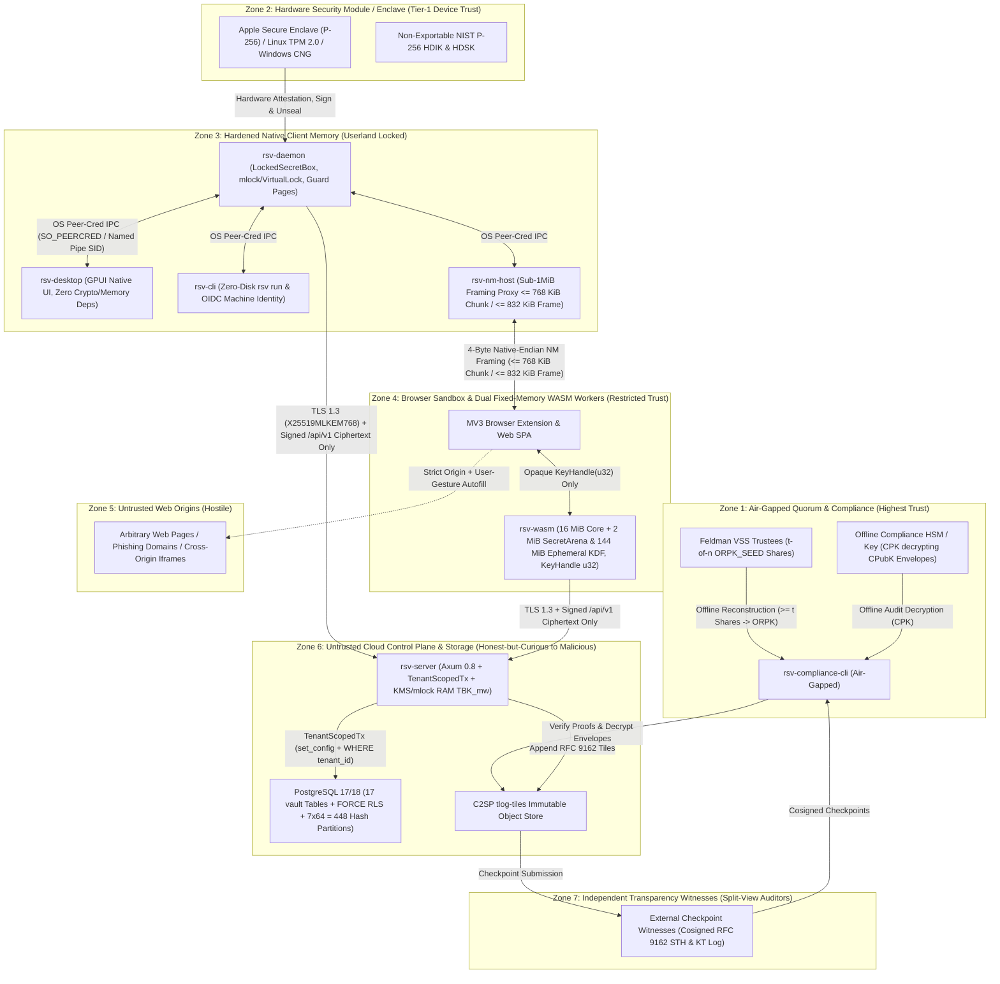

# Specification 09: Threat Model & Formal System Invariants

> **Document ID**: `RSV-SPEC-09`
> **Project**: RusticStack Core (`ZK-Vault` — `https://github.com/KelpHect/ZK-Vault`)
> **Status**: Normative (`v1.0.0-normative`)
> **Target Toolchain**: Rust 2024 Edition (MSRV `1.94.0`)
> **License**: Dual `MIT OR Apache-2.0`

---

## 1. Security Philosophy & Trust Boundaries

RusticStack Core is a **zero-knowledge, multi-tenant enterprise secret vault** engineered under a **hostile-infrastructure assumption**: the cloud backend (`rsv-server`), its PostgreSQL 17/18 cluster, its backup snapshots, its TLS termination proxies, and the cloud operator are treated as **untrusted for confidentiality and integrity of vault data**.

Security properties are enforced by **cryptographic construction**, **OS memory isolation**, **hardware-backed device binding**, and **database-level defense-in-depth**—never by trusting application middleware alone. Where an endpoint operating system kernel is fully compromised, RusticStack Core states the exact physical boundary honestly rather than claiming impossible protections.

### 1.1 System Trust Zones

### 1.2 Trust Boundary Invariant Summary

| Boundary Crossing | Permitted Data | Strictly Forbidden Data | Enforcement Mechanism |
|---|---|---|---|
| **Z3/Z4 -> Z6** (Client to `rsv-server`) | `RSV1` ciphertext envelopes (`CS-01`/`CS-02`), signed public keys (`UPK`, `UIK`, `MIK`, `ORPubK`, `DRPubK`, `CPubK`), `X-RSV-Request-Signature`, `X-RSV-Audit-Envelope` sealed to `CPubK` | Plaintext item payloads, plaintext metadata, `MUK`, `USK`, `TK`, `CK`, `DEK`, `AEK`, `ORPK`, `ORPK_SEED`, `DRPK`, `CPK`, raw passphrases | `rsv-crypto`, `rsv-types`, `INV-001`, `INV-019`, `INV-030` |
| **Z6 (`rsv-server`) -> Z6 (`PostgreSQL`)** | Ciphertext rows, `TBK_mw`-blinded audit lookup tags (`blinded_actor_id`, `blinded_resource_id`, `blind_epoch`), RFC 9162 hashes/tiles, KT leaves | Raw `TBK_mw` (held strictly in backend KMS / `rsv-mem` locked RAM, never stored in PostgreSQL), plaintext vault or compliance payloads | `rsv-server`, `rsv-audit`, `INV-001`, `INV-017` |
| **Z2 -> Z3** (Enclave to `rsv-daemon`) | ECDSA P-256 signatures from `HDIK`, ECDH/unsealed wrapping via `HDSK` | Raw private key bytes of `HDIK` or `HDSK` | `rsv-enclave` hardware non-exportable flags, `INV-013` |
| **Z4 (`rsv-wasm`) -> Z4 (JS Heap)** | Opaque `KeyHandle(u32)`, ciphertext bytes, bounded short-lived plaintext strictly on explicit UI reveal | Raw key bytes (`MUK`, `USK`, `TK`, `CK`, `DEK`, `AEK`), WASM `memory.grow()` reallocations in either `rsv_wasm.wasm` or `rsv_wasm_kdf.wasm` | `rsv-wasm` Dual Fixed-Memory Worker Split & handle table, `INV-022`, `INV-024`, `INV-033` |
| **Z3 (`rsv-nm-host`) -> Z4 (Extension)** | Chunk payloads `<= 786,432` B (`768 KiB`) inside JSON wire frames `<= 851,968` B (`832 KiB`) with 32-bit length prefix | Chunks `> 786,432` B or wire frames `> 851,968` B (strictly below Chrome's `1,048,576` B cap), unauthenticated peer requests | `rsv-daemon` / `rsv-nm-host`, `INV-014`, `INV-021` |
| **Z4 (Extension) -> Z5 (Web Page)** | Single matched credential strictly on explicit trusted user gesture for exact `https://` origin via Closed Shadow DOM | Cross-origin credentials, `http://` or cross-origin `<iframe>` silent fills, vault keys | Origin verifier, Closed Shadow DOM & gesture gate, `INV-023`, `INV-035` |
| **Z6 (Tenant A) <-> Z6 (Tenant B)** | Zero cross-tenant visibility | Any row where `tenant_id != current_tenant_id` across all 17 `vault` tables | `TenantScopedTx` + PostgreSQL `FORCE RLS` + 7×64 = 448 hash partitions, `INV-006`, `INV-007` |

---

## 2. Adversary Capability Matrix (`ADV-01` through `ADV-07`)

Every security claim in RusticStack Core is evaluated against seven explicitly bounded adversary profiles.

| Adversary ID | Threat Actor | Capabilities & Access Level | Primary Attack Goals | Primary Defenses | Honest Residual Risk |
|---|---|---|---|---|---|
| **ADV-01** | **Compromised / Malicious Backend Server & Cloud Operator** | Full root access to `rsv-server` containers, RAM (including `TBK`), TLS keys, load balancers, and database; can drop, delay, reorder, replay, or forge HTTP responses, alter `vault.key_graph_edges`, inject rogue `UPK`s, omit audit rows, or attempt split-view Merkle logs. | Decrypt customer vaults; inject a rogue `UPK` to capture future shared secrets; read `CPubK` compliance envelopes; silently erase or fork audit history; cross-contaminate tenant data. | End-to-end `CS-01`/`CS-02` AEAD + AAD binding (`INV-001`, `INV-002`); `UIK`-signed key-graph edges (`INV-008`); `HDIK` request signing (`INV-020`); `CPubK` offline-only compliance envelopes (`INV-019`); RFC 9162 Merkle log + C2SP `tlog-tiles` + independent witnesses (`INV-018`). | Can perform denial of service, correlate live request metadata/sizes/timestamps, reverse blinded tags *only* for active tenants if backend RAM `TBK` is exfiltrated alongside DB (mitigated by HSM/KMS envelope rotation of `TBK`), or attempt TOFU key substitution if out-of-band `UIK`/`UPK` safety fingerprints are never verified. |
| **ADV-02** | **Compromised DBA / Legal Subpoena / Backup Exfiltration** | Full offline snapshot of PostgreSQL `vault` schema (`pg_dump`, basebackup, WAL segments), object storage `audit_merkle_tiles`, or live `SELECT` as PostgreSQL superuser (`BYPASSRLS`). Does **NOT** possess backend KMS/RAM `TBK`, client `MUK`/`USK`, `CPK`, or `ORPK_SEED`. | Bulk offline decryption of `vault.vault_items` and `vault.vault_item_revisions`; deanonymization of `vault.audit_events` resource/actor IDs; recovery of `ORPK`. | Zero plaintext in DB (`INV-001`); Argon2id + WebAuthn PRF `MUK` prevents brute force; per-item/version random 256-bit `DEK` + mandatory AAD prevents ciphertext swapping (`INV-002`, `INV-003`); `TBK` never resides in PostgreSQL so blinded audit columns remain opaque (`INV-017`); `CPK` & `ORPK_SEED` (`t`-of-`n` Feldman VSS) remain strictly offline (`INV-015`, `INV-016`, `INV-019`). | Superuser can observe structural graph cardinality (row counts, revision counts, timestamps, and equality of identical blinded tags within a single tenant). |
| **ADV-03** | **Hostile Client OS & Userland Memory Scraper** | Unprivileged or same-user malware executing on the workstation; attempts `/proc/<pid>/mem` reads, `ptrace` attachment, crash-induced core dumps, `MiniDumpWriteDump`, swap/hibernation inspection, local IPC socket spoofing, and OS clipboard polling. | Harvest live `MUK`/`USK`/`TK`/`CK`/`DEK` from RAM, swap, or crash dumps; connect to `rsv-daemon` IPC to impersonate `rsv-desktop`; exfiltrate copied secrets from clipboard. | `LockedSecretBox<T>` with `mlock`/`VirtualLock`, `PROT_NONE`/`PAGE_NOACCESS` guard pages, `MADV_DONTDUMP`, `PR_SET_DUMPABLE(0)`, Windows `CryptProtectMemory` & process DACL (`INV-011`, `INV-012`); `SO_PEERCRED` / Named Pipe SID + PID binary validation (`INV-014`); auto-lock timeout & clipboard TTL clearing. | Same-UID malware on desktop OSes without mandatory access control may read the OS clipboard during the brief active paste window or inject synthetic GUI input events unless isolated by OS sandbox / macOS TCC / SELinux. |
| **ADV-04** | **Compromised Root / Kernel on Endpoint** | Ring-0 kernel code execution, rootkit, hypervisor introspection, or debugger attached with `CAP_SYS_PTRACE` / `SeDebugPrivilege` on an endpoint. | Extract non-exportable hardware device keys (`HDIK`/`HDSK`); decrypt historical offline vault blobs; capture live keystrokes, unlocked screen buffers, or decrypted items during an active user session. | Tier-1 hardware enclaves (Apple Secure Enclave P-256, Linux TPM 2.0 `tss-esapi`, Windows CNG/PCPKSP) keep `HDIK`/`HDSK` strictly non-exportable inside dedicated silicon (`INV-013`); locked zeroization minimizes post-lock RAM exposure (`INV-011`). | **Explicit Honest Security Boundary (No Security Theater)**: While the vault is *actively unlocked* on a kernel-compromised host, `ADV-04` **CAN** log keystrokes/passphrases, capture GPU framebuffers, read live unlocked secrets in host RAM, and invoke the local enclave as an oracle while resident. Hardware silicon protects **non-exportability of `HDIK`/`HDSK`** (preventing offline cloning of device identity to an external host) and **sealed offline blobs while the vault is locked**—it CANNOT defeat an active ring-0 spyware implant during an unlocked session. |
| **ADV-05** | **Rogue Enterprise Administrator / Malicious Insider** | Valid organization admin account with permission to invite/revoke users, manage teams, hold `DRPK` (if delegated), and query audit APIs; may collude with `< t` VSS trustees. | Read `enterprise_escrow` (root-quorum-only) or `strict_zk` vaults using `DRPK` or admin privileges; forge or erase audit logs; impersonate another user's API mutations; poison Feldman VSS recovery shares to brick disaster recovery. | `enterprise_escrow` vaults forbid `DRPubK` and admin escrow edges, wrapping recovery exclusively to `ORPubK`, while `strict_zk` forbids all recovery escrow (`INV-005`); per-device `HDIK` signatures prevent user impersonation (`INV-020`); Feldman VSS polynomial commitment checks deterministically reject poisoned shares (`INV-015`, `INV-016`); immutable RFC 9162 audit log + `CPubK` `X-RSV-Audit-Envelope` exposes admin tampering (`INV-018`, `INV-019`); Key Transparency blocks rogue `UPK` grants (`INV-025`, `INV-036`). | A rogue admin with `DRPK` can recover `standard`-tier vaults (by design of Delegated Recovery, logged immutably to `vault.audit_events`), and can execute authorized administrative DoS (e.g., revoking legitimate users), with every action permanently recorded. |
| **ADV-06** | **Malicious Web Page / Compromised Browser Tab / Phishing Origin** | Full JS/DOM/CSS control inside an untrusted web origin (homograph phishing domains, malicious nested `<iframe>` overlays, clickjacking), or XSS in a third-party tab; attempts to scrape browser JS heap or induce unauthorized autofill. | Trick extension into autofilling credentials onto lookalike or cross-origin domains; extract vault keys from `rsv-wasm` memory via JS heap inspection or reallocation remnants; crash Native Messaging bridge via oversized frames. | Strict canonical `https://` origin + Punycode/eTLD+1 + same-origin frame + explicit user-gesture autofill gate + Closed Shadow DOM (`INV-023`, `INV-035`); opaque `KeyHandle(u32)` boundary (`INV-022`); Dual Fixed-Memory WASM Worker Split with zero `memory.grow()` (`INV-024`); sub-1MiB chunked Native Messaging (`INV-021`). | If XSS achieves code execution *inside* the trusted RusticStack Web SPA origin itself (via browser 0-day or compromised CDN), it can invoke authorized `KeyHandle` APIs during the unlocked session; SRI, strict CSP, and desktop-first workflows (`rsv-desktop`) mitigate this surface. |
| **ADV-07** | **Harvest-Now-Decrypt-Later (HNDL) Quantum Adversary** | Passive network eavesdropper and/or future holder of exfiltrated database/backup snapshots who later acquires a Cryptographically Relevant Quantum Computer (CRQC) capable of Shor's algorithm (breaking X25519, Ed25519, P-256) and Grover's algorithm (halving symmetric security). | Record TLS traffic and encrypted vault/audit ciphertexts today (`2026+`) and retroactively decrypt long-lived enterprise secrets (`10–30` year retention) once CRQC matures. | `CS-02` (`0x0002`) Post-Quantum Hybrid cipher suite: X-Wing (`X25519 + ML-KEM-768` SHA3-256 combiner) for all vault envelopes and key-graph edges (`INV-004`), AES-256-GCM (128-bit post-Grover security), SHA-256/SHA3-256, hybrid `Ed25519 + ML-DSA-65` signatures, and TLS 1.3 `X25519MLKEM768`. | Tenants opting into legacy `CS-01` (`0x0001`) remain vulnerable to HNDL until migrated to `CS-02`; hardware enclaves limited to P-256 (`HDSK`) protect local-only device sealing and are layered beneath Argon2id/PRF `MUK` and software `ML-KEM-768` for network-transmitted ciphertexts. |

---

## 3. Comprehensive STRIDE Threat Analysis

### 3.1 Spoofing (`S`)

| ID | Component / Interface | Attack Scenario | Adversary | Architectural Mitigation | Invariants |
|---|---|---|---|---|---|
| `STRIDE-S1` | `/api/v1` REST & WS API | Attacker replays a captured bearer JWT or impersonates a legitimate user from an unauthorized device. | `ADV-01`, `ADV-05` | Mandatory per-request device signature (`X-RSV-Request-Signature`) produced by `HDIK` (or Tier-2 device key) over canonical request tuple including `X-RSV-Tenant-Id`, `X-RSV-Device-Id`, timestamp (`±300s`), `Idempotency-Key`, and body/`X-RSV-Audit-Envelope` digests. | `INV-013`, `INV-020` |
| `STRIDE-S2` | `vault.key_graph_edges` | Malicious server substitutes a victim user's `UPK` with an attacker key to trick sharers into wrapping `TK`/`CK` to the attacker. | `ADV-01` | Every key-graph edge is signed by the granter's `UIK` (`Ed25519` or `CS-02` hybrid) over `(tenant_id, src_id, dst_id, target_upk_fingerprint, key_epoch)`; clients verify org directory signatures and out-of-band key fingerprints. | `INV-004`, `INV-008` |
| `STRIDE-S3` | `rsv-daemon` OS IPC | Unprivileged or malicious local process connects to `rsv-daemon` Unix socket / Windows Named Pipe impersonating `rsv-desktop` or `rsv-nm-host`. | `ADV-03` | Kernel-enforced peer authentication via `SO_PEERCRED` (UID + PID executable validation on Linux/macOS) and Windows Named Pipe client SID + `GetNamedPipeClientProcessId` + explicit owner-only SDDL DACL. | `INV-014` |
| `STRIDE-S4` | Browser Autofill | Homograph phishing site (`аpple.com` with Cyrillic `а`) or `http://` MITM page solicits credentials belonging to `https://apple.com`. | `ADV-06` | Canonical Punycode/ASCII origin verification (`scheme == "https"`, exact host or policy eTLD+1), cross-origin `<iframe>` rejection, and mandatory explicit user gesture. | `INV-023` |

### 3.2 Tampering (`T`)

| ID | Component / Interface | Attack Scenario | Adversary | Architectural Mitigation | Invariants |
|---|---|---|---|---|---|
| `STRIDE-T1` | `vault.vault_items` / `vault_item_revisions` | Compromised server or DBA copies a valid ciphertext blob across tenants, collections, items, or revisions to induce rollback or context confusion. | `ADV-01`, `ADV-02` | Mandatory canonical CBOR AAD `(domain, tenant_id, object_id, parent_id, epoch_or_version, cipher_suite_id)` bound into every `AES-256-GCM` and HPKE/X-Wing envelope; tampering fails authentication deterministically. | `INV-002`, `INV-003` |
| `STRIDE-T2` | `vault.audit_events` & `audit_merkle_tiles` | Malicious operator alters 1 byte in an audit event, deletes an incriminating row, or serves divergent Merkle roots to different auditors (split-view). | `ADV-01`, `ADV-02`, `ADV-05` | RFC 9162 domain-separated Merkle hashing (`0x00` leaves, `0x01` nodes), immutable C2SP `tlog-tiles`, signed `audit_checkpoints`, and independent witness cosignatures verifying append-only consistency proofs. | `INV-018` |
| `STRIDE-T3` | `vault.tenant_vss_ceremonies` | Malicious admin or compromised coordinator distributes poisoned recovery shares so disaster recovery fails silently during an incident. | `ADV-01`, `ADV-05` | Feldman VSS over Ristretto255 (`vsss-rs` 6.0) publishes commitments `[C_0, ..., C_{t-1}]` for both 128-bit chunks of `ORPK_SEED`; every custodian verifies `g^{s_i} == Π C_j^{i^j}` independently at receipt time without reconstruction. | `INV-015`, `INV-016` |
| `STRIDE-T4` | `vault.key_graph_edges` | Malicious server injects a cyclic edge (`Team A -> Team B -> Team A`) to cause infinite recursion / DoS during key unwrapping. | `ADV-01` | `rsv-graph` enforces strict DAG stratification (`User -> Team -> Collection -> Item`) and cycle rejection (`GRAPH_CYCLE_REJECTED`) prior to cryptographic unwrapping. | `INV-008` |

### 3.3 Repudiation (`R`)

| ID | Component / Interface | Attack Scenario | Adversary | Architectural Mitigation | Invariants |
|---|---|---|---|---|---|
| `STRIDE-R1` | Vault Read / Mutate Operations | Malicious insider denies accessing or modifying a production credential, or denies executing a Delegated Recovery (`DRPK`) operation. | `ADV-05` | Every mutation and sensitive read requires a hardware-signed `X-RSV-Request-Signature` (`HDIK`) and client-encrypted `X-RSV-Audit-Envelope` (`CPubK`), committed to the append-only RFC 9162 Merkle log (`vault.audit_events` + `audit_checkpoints`). | `INV-018`, `INV-019`, `INV-020` |
| `STRIDE-R2` | Recovery Ceremony Abuse | Trustees attempt an untracked `ORPK_SEED` recovery or share refresh ceremony. | `ADV-05` | Every ceremony in `vault.tenant_vss_ceremonies` records immutable Ristretto255 commitments, participant fingerprints, and signed transcripts anchored into `audit_checkpoints`. | `INV-015`, `INV-016`, `INV-018` |

### 3.4 Information Disclosure (`I`)

| ID | Component / Interface | Attack Scenario | Adversary | Architectural Mitigation | Invariants |
|---|---|---|---|---|---|
| `STRIDE-I1` | PostgreSQL Multi-Tenant Shared Schema | Application bug in `rsv-server` omits `WHERE tenant_id = $1`, risking cross-tenant leakage across shared tables. | `ADV-01`, `ADV-05` | Dual enforcement: `TenantScopedTx` calls `set_config('app.current_tenant_id', $1::text, true)` AND requires explicit `WHERE tenant_id = $1`, backed by PostgreSQL `FORCE ROW LEVEL SECURITY` and `NOBYPASSRLS` on `rsv_app`. | `INV-006`, `INV-007` |
| `STRIDE-I2` | Native Client RAM / Swap / Crash Dumps | OS swaps unlocked vault memory to disk, dumps core on crash, or malware scans process address space for keys. | `ADV-03` | `LockedSecretBox<T>` enforces page-aligned `mlock`/`VirtualLock`, `PROT_NONE`/`PAGE_NOACCESS` guard pages, `MADV_DONTDUMP`/`PR_SET_DUMPABLE(0)` or `CryptProtectMemory` + DACL, and volatile zeroization on `Drop`. | `INV-010`, `INV-011`, `INV-012` |
| `STRIDE-I3` | Browser WASM Linear Memory Growth | Browser reallocates WASM linear memory on `memory.grow()`, leaving unzeroized copies of plaintext secrets in freed host heap pages. | `ADV-03`, `ADV-06` | `rsv-wasm` uses a statically bounded fixed linear memory arena with zero `memory.grow()` opcodes in the compiled `.wasm` artifact; JS interacts solely via opaque `KeyHandle(u32)`. | `INV-022`, `INV-024` |
| `STRIDE-I4` | Observability / Logging / Crash Traces | Developer formats a key struct via `{:?}` or error payload containing `MUK`, `DEK`, passphrase, or decrypted item fields. | `ADV-01`, `ADV-03` | `secrecy::SecretBox` enforces redacted `Debug`, forbids `Display`, installs a scrubbing panic hook, and passes workspace telemetry canary redaction gates. | `INV-011`, `INV-012` |
| `STRIDE-I5` | Long-Term Quantum Decryption (HNDL) | Adversary archives `CS-01` X25519 ciphertexts or TLS handshakes today and decrypts them later with a CRQC. | `ADV-07` | `CS-02` (`0x0002`) X-Wing (`X25519 + ML-KEM-768` SHA3-256 combiner) + AES-256-GCM + TLS 1.3 `X25519MLKEM768`. | `INV-004` |
| `STRIDE-I6` | Audit Database Deanonymization | Offline DBA (`ADV-02`) inspects `vault.audit_events` to map user emails, item titles, or admin targets. | `ADV-02` | Searchable lookup columns store `HMAC-SHA256(TBK, "rsv:audit:blind:v1" || ...)` where `TBK` resides strictly in backend KMS/locked RAM (never in PostgreSQL); rich payloads are HPKE/X-Wing sealed to offline `CPubK`. | `INV-017`, `INV-019` |

### 3.5 Denial of Service (`D`)

| ID | Component / Interface | Attack Scenario | Adversary | Architectural Mitigation | Invariants |
|---|---|---|---|---|---|
| `STRIDE-D1` | PostgreSQL Multi-Tenant Query Saturation | Unpruned full-table scan across all 64 hash partitions starves database I/O for neighboring tenants. | `ADV-01`, `ADV-05` | Mandatory `tenant_id` hash partition key (`MODULUS 64`) guarantees `Subplans Removed: 63` with composite `(tenant_id, ...)` indexes and per-tenant rate limits (`RATE_LIMITED`). | `INV-007` |
| `STRIDE-D2` | Chrome Native Messaging Pipe Termination | Any message exceeding Chrome's hard `1,048,576`-byte limit kills `rsv-nm-host`; unbounded chunk buffers OOM the host. | `ADV-06` | Strict `<= 786,432` B (`768 KiB`) chunking per `schemas/ipc-native-messaging.schema.json` with bounded reassembly window (`16 MiB` total cap, `8` concurrent streams). | `INV-021` |
| `STRIDE-D3` | Adversarial CBOR / Graph / Crypto Inputs | Malformed CBOR envelopes, non-canonical Ristretto255 bytes, or massive cyclic graphs attempt to panic or OOM parsers. | `ADV-01`, `ADV-06` | `#![forbid(unsafe_code)]`, bounded parser limits, and 7 continuous `cargo-fuzz` (`libFuzzer` + ASAN) harnesses. | `INV-008`, `INV-010` |

### 3.6 Elevation of Privilege (`E`)

| ID | Component / Interface | Attack Scenario | Adversary | Architectural Mitigation | Invariants |
|---|---|---|---|---|---|
| `STRIDE-E1` | Revoked Employee Continuing Decryption | Revoked user retains old cached `TK`/`CK` or server-side authorization bug serves new item revisions to a removed user. | `ADV-01`, `ADV-05` | Revocation bumps `key_epoch`, rotates `TK`/`CK`, re-wraps edges exclusively for remaining authorized members, and invalidates revoked devices (`STALE_KEY_EPOCH`). | `INV-009` |
| `STRIDE-E2` | Enterprise Admin Reading `root_quorum_only` Vaults | Rogue admin attempts to wrap a `root_quorum_only` collection to `DRPubK` or their own `UPK` to bypass quorum approval. | `ADV-05` | Clients and server policy checks enforce `ESCROW_POLICY_VIOLATION` on any non-`ORPubK` recovery edge for `root_quorum_only` collections; recovery requires `>= t` Feldman VSS trustees. | `INV-005`, `INV-015`, `INV-016` |
| `STRIDE-E3` | Memory Safety Violation / UB in FFI | Buffer overflow or use-after-free in parsers or cryptography achieves code execution. | `ADV-01`, `ADV-03`, `ADV-06` | `#![forbid(unsafe_code)]` enforced on 10 of 12 workspace crates; `unsafe` quarantined strictly to audited OS FFI in `rsv-mem` and `rsv-enclave`. | `INV-010` |

---

## 4. Formal System Invariants (`INV-001` through `INV-024`)

The following 24 invariants constitute the **top-precedence normative security contract** of RusticStack Core (precedence level 1 per `specs/00-INDEX.md`). No release candidate may ship if any invariant lacks a passing deterministic verification check.

---

### `INV-001` — Zero Server Decryption Capability
- **Formal Statement**: Let $\mathcal{S}$ denote the complete state of `rsv-server` (process memory, logs, traces) and PostgreSQL (`vault` schema) plus `audit_merkle_tiles`. For every plaintext vault item $m$, collection/team metadata $d$, and secret key $k \in \{\text{MUK}, \text{USK}, \text{TK}, \text{CK}, \text{DEK}, \text{ORPK}, \text{ORPK\_SEED}, \text{DRPK}, \text{CPK}\}$, no unencrypted byte of $m, d, k$ ever crosses `/api/v1` or exists in $\mathcal{S}$, and any PPT adversary given $\mathcal{S}$ has negligible advantage ($\le \text{negl}(\lambda)$) in distinguishing $\text{Enc}(m_0)$ from $\text{Enc}(m_1)$.
- **Threat Coverage**: `ADV-01`, `ADV-02`
- **Owning Crates**: `rsv-types`, `rsv-crypto`, `rsv-graph`, `rsv-server`
- **Failure Mode**: Server compromise or database exfiltration exposes customer secrets.
- **Verification Method**: Static DDL audit (`schemas/postgresql-schema.sql`) + E2E Wire & DB Zero-Knowledge Canary Audit asserting 0 plaintext canary matches on HTTP wire, PostgreSQL dump, and server logs (`specs/10` §4.1).

---

### `INV-002` — Mandatory AAD Context Binding
- **Formal Statement**: Every `AES-256-GCM` and HPKE/X-Wing seal operation MUST bind a non-empty RFC 8949 canonical CBOR AAD tuple:
  $$\text{AAD} = \text{CBOR\_Canonical}(\text{domain}, \text{tenant\_id}, \text{object\_id}, \text{parent\_id}, \text{epoch\_or\_version}, \text{cipher\_suite\_id})$$
  Empty AAD is forbidden at the type level. Mutating any single AAD component while holding ciphertext, nonce, and key constant MUST deterministically return `CryptoError::AeadAuthenticationFailed`.
- **Threat Coverage**: `ADV-01`, `ADV-02`, `ADV-05`
- **Owning Crates**: `rsv-types`, `rsv-crypto`, `rsv-graph`, `rsv-audit`
- **Failure Mode**: Ciphertext transplantation across tenants, collections, items, or versions succeeds silently.
- **Verification Method**: KAT AAD mutation matrix (`specs/10` §2.1) + `proptest` asserting 100% rejection across single-field swaps.

---

### `INV-003` — Nonce Uniqueness & Non-Reuse
- **Formal Statement**: No `(key, 96-bit nonce)` pair is ever reused under `AES-256-GCM`. Every vault item version samples a fresh random 256-bit `DEK` from CSPRNG (`getrandom`/`OsRng`); standalone AEAD encryptions sample fresh 96-bit CSPRNG nonces; HPKE/X-Wing contexts enforce monotonic sequence counters aborting strictly prior to $2^{32} - 1$.
- **Threat Coverage**: `ADV-01`, `ADV-02`
- **Owning Crates**: `rsv-crypto`
- **Failure Mode**: GHASH key recovery and catastrophic confidentiality loss under `AES-256-GCM`.
- **Verification Method**: Type-level nonce ownership (caller-supplied nonces prohibited outside `cfg(feature = "kat-deterministic")`), HPKE sequence-exhaustion test, and $10^5$-envelope uniqueness check (`specs/10` §2.1).

---

### `INV-004` — Post-Quantum Hybrid IND-CCA2 Security under `CS-02`
- **Formal Statement**: Under cipher suite `CS-02` (`0x0002`), key encapsulation MUST implement the exact X-Wing combiner (`draft-connolly-cfrg-xwing-kem`):
  $$ss = \text{SHA3-256}\big(ss_{\text{ML-KEM-768}} \parallel ss_{\text{X25519}} \parallel ct_{\text{X25519}} \parallel pk_{\text{X25519}} \parallel \texttt{0x5c2e2f2f5e5c}\big)$$
  Naive TLS `X25519MLKEM768` concatenation is strictly forbidden for vault envelopes. Hybrid signatures under `CS-02` MUST compute and verify BOTH `Ed25519` (`verify_strict`) AND `ML-DSA-65`; acceptance requires $\text{Verify}_{\text{Ed25519}} \land \text{Verify}_{\text{ML-DSA-65}} = \text{true}$.
- **Threat Coverage**: `ADV-07`, `ADV-01`
- **Owning Crates**: `rsv-crypto`
- **Failure Mode**: Harvest-now-decrypt-later compromise under CRQC or classical/PQ downgrade attack.
- **Verification Method**: Official `draft-connolly-cfrg-xwing-kem` KAT vectors + dual-signature single-component tamper rejection tests (`specs/10` §2.2).

---

### `INV-005` — Root Quorum Exclusivity & Hybrid Escrow Separation
- **Formal Statement**: For every collection $C$ classified `root_quorum_only`, the set of recovery escrow edges targeting $C$ MUST contain ONLY an edge wrapped to `ORPubK` (recoverable exclusively via `t`-of-`n` Feldman VSS reconstruction of `ORPK_SEED`) and MUST NEVER contain an edge wrapped to `DRPubK` or any individual Enterprise Admin `UPK`. Attempts to publish a `DRPubK` edge on a `root_quorum_only` vault MUST be rejected client-side and server-side with canonical error `ESCROW_POLICY_VIOLATION`.
- **Threat Coverage**: `ADV-05`
- **Owning Crates**: `rsv-crypto`, `rsv-graph`, `rsv-server`, `rsv-desktop`
- **Failure Mode**: Single rogue administrator holding `DRPK` unilaterally decrypts regulated break-glass or executive vaults.
- **Verification Method**: Escrow policy negative suite asserting `ESCROW_POLICY_VIOLATION` when attempting `DRPubK` or admin wrapping on `root_quorum_only` collections (`specs/10` §3.5).

---

### `INV-006` — Zero Cross-Tenant RLS Bleed
- **Formal Statement**: Every tenant-scoped table in schema `vault` MUST enforce `ENABLE ROW LEVEL SECURITY` and `FORCE ROW LEVEL SECURITY` with predicate:
  $$\text{tenant\_id} = \text{NULLIF}(\text{current\_setting}(\text{'app.current\_tenant\_id'}, \text{true}), \text{''})::\text{uuid}$$
  Every `rsv-server` database query MUST execute inside `TenantScopedTx`, which executes `SELECT set_config('app.current_tenant_id', $1::text, true)` (transaction-local for PgBouncer safety) AND includes an explicit `WHERE tenant_id = $1` clause. Role `rsv_app` MUST possess `NOSUPERUSER NOBYPASSRLS`. Unset or empty context MUST yield 0 rows on `SELECT` and fail with SQLSTATE `42501` on writes.
- **Threat Coverage**: `ADV-01`, `ADV-05`
- **Owning Crates**: `rsv-server`
- **Failure Mode**: Cross-tenant data exposure across enterprise customers in shared PostgreSQL schema.
- **Verification Method**: 100-tenant concurrent Cross-Tenant RLS Chaos Harness on PostgreSQL 17 & 18 executing deliberate buggy queries omitting `WHERE tenant_id` and unset-context probes (`specs/10` §3.1).

---

### `INV-007` — Hash-Partition Pruning Determinism
- **Formal Statement**: High-cardinality tenant tables (`vault.key_graph_edges`, `vault.vault_items`, `vault.vault_item_revisions`, `vault.audit_events`, `vault.audit_merkle_tiles`) MUST use `PARTITION BY HASH (tenant_id)` with `MODULUS 64`. Every production SQL query against these tables MUST prune 63 of 64 partitions (`Subplans Removed: 63` or single direct partition resolution) and use an index (`Index Cond` containing `tenant_id`, zero `Seq Scan`).
- **Threat Coverage**: `ADV-01`, `ADV-05` (noisy-neighbor / DoS)
- **Owning Crates**: `rsv-server`
- **Failure Mode**: Full multi-partition scans cause O(N) tail-latency collapse and cross-tenant I/O starvation.
- **Verification Method**: Automated `EXPLAIN (ANALYZE, FORMAT JSON)` CI assertions verifying `Subplans Removed: 63` and `Index Cond` on all 5 partitioned tables (`specs/10` §3.1).

---

### `INV-008` — Blind RBAC DAG Acyclicity & Authorized Edge Signatures
- **Formal Statement**: The encrypted access graph $G = (V, E)$ stored in `vault.key_graph_edges` MUST satisfy strict directed stratification ($\text{User} \to \text{Team} \to \text{Collection} \to \text{Item}$, plus direct $\text{User} \to \text{Collection}$ and authorized escrow roots), contain zero directed cycles (`GRAPH_CYCLE_REJECTED`), and carry a valid `UIK` signature from an authorized granter verified client-side before unwrapping any child key.
- **Threat Coverage**: `ADV-01`, `ADV-05`
- **Owning Crates**: `rsv-graph`, `rsv-server`
- **Failure Mode**: Infinite recursion DoS, privilege escalation via forged edges, or unauthorized key injection.
- **Verification Method**: `proptest` random DAG tests + cycle-injection negative tests + unsigned/forged-granter rejection tests + `fuzz_graph_dag_cycle` (`specs/10` §3.4).

---

### `INV-009` — Forward-Secure Key Rotation on Revocation
- **Formal Statement**: Revoking a user or device from a Team or Collection at epoch $e$ MUST advance `key_epoch` to $e+1$, sample fresh $K^{(e+1)} \xleftarrow{\$} \{0,1\}^{256}$, publish new `key_graph_edges` strictly for authorized remaining members, and reject writes citing stale epochs (`STALE_KEY_EPOCH`). Revoked actors holding $K^{(e)}$ MUST have negligible advantage in decrypting any revision encrypted at epoch $\ge e+1$.
- **Threat Coverage**: `ADV-05`, `ADV-01`
- **Owning Crates**: `rsv-graph`, `rsv-crypto`, `rsv-server`
- **Failure Mode**: Departed or revoked employees silently decrypt newly rotated secrets.
- **Verification Method**: Full revocation & epoch-rotation integration test confirming revoked actor's old key fails on `epoch + 1` ciphertexts while remaining members decrypt cleanly (`specs/10` §3.4).

---

### `INV-010` — Strict Unsafe Code Containment (`unsafe` Firewall)
- **Formal Statement**: Every Rust crate in the 12-crate workspace MUST declare `#![forbid(unsafe_code)]` at crate root EXCEPT `rsv-mem` and `rsv-enclave`. Within `rsv-mem` and `rsv-enclave`, `#![deny(unsafe_op_in_unsafe_fn)]` MUST be active, all FFI/syscall blocks MUST be isolated inside dedicated platform modules, and every `unsafe` block MUST carry a structured `// SAFETY:` justification verified in security review.
- **Threat Coverage**: `ADV-01`, `ADV-03`, `ADV-06`
- **Owning Crates**: All 12 workspace crates
- **Failure Mode**: Memory safety vulnerabilities (UAF, OOB read/write) undermine cryptographic guarantees.
- **Verification Method**: Automated CI unsafe-firewall check (`./scripts/ci/check-unsafe-policy.sh` + `cargo geiger`) failing on any violation (`specs/10` §6 Gate 2).

---

### `INV-011` — Locked Memory Zeroize-on-Drop
- **Formal Statement**: All native plaintext key material (`MUK`, `USK`, `TK`, `CK`, `DEK`, `ORPK`, `ORPK_SEED` shares, `CPK`) MUST reside inside `rsv_mem::LockedSecretBox<T>` (and core types wrapped in `secrecy::SecretBox<T>` with `zeroize::ZeroizeOnDrop`), enforcing:
  1. Page-aligned allocation flanked before and after by `PROT_NONE` (Unix) / `PAGE_NOACCESS` (Windows) guard pages;
  2. Physical memory locking via `mlock` (Unix) / `VirtualLock` (Windows);
  3. Core-dump exclusion via `madvise(MADV_DONTDUMP)` + `prctl(PR_SET_DUMPABLE, 0)` (Linux), `RLIMIT_CORE = 0` (macOS), or `CryptProtectMemory` + restrictive owner-only process DACL (Windows);
  4. Volatile zeroization via `zeroize` prior to unlock and deallocation on `Drop`.
- **Threat Coverage**: `ADV-03`
- **Owning Crates**: `rsv-mem`, `rsv-crypto`, `rsv-daemon`, `rsv-desktop`, `rsv-compliance-cli`
- **Failure Mode**: Unlocked secrets persist in OS swapfiles, hibernation images, crash dumps, or freed heap memory.
- **Verification Method**: Live Memory Dump & Swap Negative Test inspecting `/proc/self/smaps` (`VmLck`, `dd` flag), `PR_GET_DUMPABLE == 0`, subprocess guard-page `SIGSEGV`/`0xC0000005`, and post-`Drop` zeroed memory verification (`specs/10` §3.2).

---

### `INV-012` — Zero Secret Telemetry & Deterministic Crash Redaction
- **Formal Statement**: No crate in the workspace may emit plaintext key material, passphrases, `MUK`, `DEK`, or decrypted vault item fields into `tracing` logs, OpenTelemetry spans, `Debug`/`Display` strings, HTTP error responses, or GPUI crash dumps. All secret containers MUST print constant `"[REDACTED]"` for `Debug`, omit `Display`, and native binaries MUST install a scrubbing panic hook preventing formatted secrets from reaching stderr or crash reporters.
- **Threat Coverage**: `ADV-01`, `ADV-03`, `ADV-05`
- **Owning Crates**: All 12 workspace crates
- **Failure Mode**: Secrets leak passively into centralized SIEM pipelines, crash telemetry, or API error payloads.
- **Verification Method**: Canary Secret Telemetry Audit across all crates verifying 0 canary matches across captured `tracing` spans, error chains, HTTP 4xx/5xx responses, and panic outputs (`specs/10` §4.2).

---

### `INV-013` — Non-Exportable Hardware Device Key Binding (Two-Tier Hardware Trust)
- **Formal Statement**: Under Tier-1 hardware trust (`HardwareKeyProvider`), device identity (`HDIK`) and sealing (`HDSK`) private keys MUST be generated as **NIST P-256** non-exportable keys inside Apple Secure Enclave (`kSecAttrTokenIDSecureEnclave`), Linux TPM 2.0 (`tss-esapi` with `fixedTPM | fixedParent | sensitiveDataOrigin`), or Windows CNG/PCPKSP (`MS_PLATFORM_CRYPTO_PROVIDER`). Implementations MUST NEVER claim hardware storage of Ed25519/X25519 keys inside Apple SE; instead, silicon P-256 `HDSK`/`HDIK` seals and attests Tier-2 software vault keys (`USK`, `UIK`). Tier-2 software fallback MUST be explicitly tagged in `vault.user_devices` attestation metadata and auditable by tenant policy (`DEVICE_ATTESTATION_FAILED` when hardware is mandated).
- **Threat Coverage**: `ADV-03`, `ADV-04`
- **Owning Crates**: `rsv-enclave`, `rsv-daemon`, `rsv-server`
- **Failure Mode**: Endpoint malware clones device identity keys off the machine, or unsupported silicon claims fail silently at runtime.
- **Verification Method**: `swtpm` (Linux CI) / macOS SE / Windows CNG provider test suite verifying export rejection, P-256 hardware key operations, and explicit Tier-2 fallback tagging (`specs/10` §3.5).

---

### `INV-014` — Mutual OS IPC Peer Identity Verification
- **Formal Statement**: Every local IPC connection accepted by `rsv-daemon` (Unix Domain Socket with `0600` mode in `0700` user directory on Linux/macOS; Windows Named Pipe with owner-only SDDL DACL) MUST validate kernel peer credentials (`SO_PEERCRED` UID == daemon UID + executable binary validation on Linux/macOS; Named Pipe client token SID == daemon SID + `GetNamedPipeClientProcessId` validation on Windows) BEFORE deserializing or dispatching any RPC message.
- **Threat Coverage**: `ADV-03`
- **Owning Crates**: `rsv-daemon`
- **Failure Mode**: Malicious local process or secondary OS user invokes `rsv-daemon` to extract unlocked secrets or forge signatures.
- **Verification Method**: IPC peer-credential negative test spawning an unauthorized peer process/UID and asserting immediate disconnect prior to RPC handling (`specs/10` §3.5).

---

### `INV-015` — Feldman VSS Share Verifiability Without Reconstruction
- **Formal Statement**: During an `ORPK_SEED` (`256`-bit) `t`-of-`n` Feldman VSS ceremony over Ristretto255 (`vsss-rs` 6.0, encoded as two 128-bit little-endian scalar chunks $s_{\text{lo}}, s_{\text{hi}} \in \mathbb{Z}_\ell$), every trustee share $(i, y_{\text{lo},i}, y_{\text{hi},i})$ MUST verify independently against published Ristretto255 commitments $\{C_{\text{lo},j}\}_{j=0}^{t-1}, \{C_{\text{hi},j}\}_{j=0}^{t-1}$:
  $$y_{\text{lo},i} \cdot B = \sum_{j=0}^{t-1} i^j \cdot C_{\text{lo},j} \quad \land \quad y_{\text{hi},i} \cdot B = \sum_{j=0}^{t-1} i^j \cdot C_{\text{hi},j}$$
  Verification MUST NOT require any other trustee's share and MUST deterministically reject any 1-bit mutation in share index, chunk scalar, or commitment point.
- **Threat Coverage**: `ADV-01`, `ADV-05`
- **Owning Crates**: `rsv-vss`, `rsv-compliance-cli`
- **Failure Mode**: Poisoned recovery shares remain undetected until an emergency, permanently bricking org disaster recovery.
- **Verification Method**: 3-of-5 Feldman VSS KAT vectors (including single-bit tamper rejection) + `proptest` across `2 <= t <= n <= 32` (`specs/10` §2.4).

---

### `INV-016` — VSS Threshold Secrecy & Exact Quorum Reconstruction
- **Formal Statement**: Fewer than $t$ Feldman VSS shares reveal zero computational information about `ORPK_SEED` (under DDH in Ristretto255), and `rsv-vss::reconstruct` MUST reject any share set with $< t$ distinct verified shares (`QUORUM_THRESHOLD_UNMET`). Any subset of $\ge t$ distinct verified shares MUST reconstruct the bit-exact 256-bit `ORPK_SEED` across all CPU architectures and WASM, deterministically expanding identical `ORPK`/`ORPubK` fingerprints.
- **Threat Coverage**: `ADV-01`, `ADV-02`, `ADV-05`
- **Owning Crates**: `rsv-vss`, `rsv-compliance-cli`
- **Failure Mode**: Sub-quorum collusion recovers `ORPK`, or legitimate quorum fails cross-platform reconstruction.
- **Verification Method**: Exhaustive $\binom{5}{3} = 10$ subset reconstruction KATs + duplicate-index and `(t-1)` negative tests (`specs/10` §2.4).

---

### `INV-017` — Zero-Knowledge Blinded Audit Indexing (`TBK` Isolation)
- **Formal Statement**: Server-indexed lookup columns in `vault.audit_events` (`actor_blind_id`, `target_blind_id`, `action_blind_tag`) MUST be computed as domain-separated `HMAC-SHA256(TBK, "rsv:audit:blind:v1" || tenant_id || field_domain || canonical_value)`. The per-tenant `TBK` MUST reside strictly in backend KMS/locked memory and MUST NEVER be persisted in PostgreSQL, ensuring database snapshots (`ADV-02`) cannot correlate or invert blinded identifiers.
- **Threat Coverage**: `ADV-02`
- **Owning Crates**: `rsv-audit`, `rsv-server`
- **Failure Mode**: Database backups or DBA inspection expose who accessed which enterprise secrets.
- **Verification Method**: Blinded HMAC KAT vectors + domain/tenant separation tests + DDL check verifying zero `TBK` or plaintext identity columns in PostgreSQL (`specs/10` §2.5).

---

### `INV-018` — RFC 9162 Append-Only Consistency & Witness Split-View Detection
- **Formal Statement**: Every tenant audit stream MUST form an RFC 9162 Merkle Hash Tree:
  - Leaf hash: $\text{MTH}(\{d_0\}) = \text{SHA-256}(\texttt{0x00} \parallel d_0)$
  - Interior node: $\text{MTH}(D_n) = \text{SHA-256}(\texttt{0x01} \parallel \text{MTH}(D[0..k]) \parallel \text{MTH}(D[k..n]))$
  Hashes are materialized as immutable height-8 C2SP `tlog-tiles` (256 leaves/tile) in `vault.audit_merkle_tiles` and anchored into signed `vault.audit_checkpoints` cosigned by independent witness(es). Any single-byte mutation, row deletion, reordering, or split-view fork MUST fail `rsv-audit` / `rsv-compliance-cli` verification with non-zero exit code (`AUDIT_COMMITMENT_INVALID`).
- **Threat Coverage**: `ADV-01`, `ADV-02`, `ADV-05`
- **Owning Crates**: `rsv-audit`, `rsv-server`, `rsv-compliance-cli`
- **Failure Mode**: Malicious operator rewrites, truncates, or forks audit logs without detection.
- **Verification Method**: RFC 9162 + C2SP `tlog-tiles` KAT vectors + Merkle Tamper & Split-View Chaos Harness (1-byte mutate, 1-row delete, tree fork) (`specs/10` §2.6, §3.3).

---

### `INV-019` — Air-Gapped Compliance Envelope Decryptability
- **Formal Statement**: Every mutating and sensitive read request to `/api/v1` MUST include `X-RSV-Audit-Envelope` (otherwise rejected with `MISSING_AUDIT_ENVELOPE`), encrypted client-side via HPKE/X-Wing to the tenant's standalone `CPubK` with AAD binding `(tenant_id, device_id, idempotency_key, event_type_code)`. `rsv-compliance-cli` MUST verify RFC 9162 proofs and decrypt exported envelopes completely air-gapped (zero network crates in `Cargo.toml`, verified inside `unshare -rn`) using offline `CPK`.
- **Threat Coverage**: `ADV-01`, `ADV-02`, `ADV-05`
- **Owning Crates**: `rsv-audit`, `rsv-server`, `rsv-compliance-cli`
- **Failure Mode**: Compliance officers cannot independently inspect or verify audit logs without relying on live cloud infrastructure.
- **Verification Method**: Air-gapped `unshare -rn` CLI test verifying Merkle checkpoints and decrypting 512 compliance envelopes offline (`specs/10` §3.3).

---

### `INV-020` — Hardware-Backed Request Non-Repudiation & Replay Resistance
- **Formal Statement**: Every authenticated `/api/v1` request MUST carry `Authorization`, `X-RSV-Tenant-Id`, `X-RSV-Device-Id`, `X-RSV-Request-Signature`, `X-RSV-Audit-Envelope` (on mutations/sensitive reads), and `Idempotency-Key`. `rsv-server` MUST verify `X-RSV-Request-Signature` against the active device public `HDIK` (or Tier-2 device key) registered in `vault.user_devices` over canonical `(method, path, tenant_id, device_id, timestamp, idempotency_key, sha256(body), sha256(audit_envelope))`, rejecting invalid signatures (`INVALID_SIGNATURE`), cross-tenant headers (`TENANT_MISMATCH`), clock skew $|\Delta t| > 300\text{s}$, and replayed/conflicting `Idempotency-Key` submissions.
- **Threat Coverage**: `ADV-01`, `ADV-05`
- **Owning Crates**: `rsv-types`, `rsv-crypto`, `rsv-server`, `rsv-daemon`
- **Failure Mode**: Stolen bearer tokens or replayed requests enable unauthorized mutations or repudiable audit entries.
- **Verification Method**: `rsv-server/tests/request_auth_security.rs` negative matrix testing missing headers, mutated path/tenant/body, stale timestamps, revoked devices, and replayed idempotency keys (`specs/10` §3.5).

---

### `INV-021` — Native Messaging Sub-1MiB Framing Compliance
- **Formal Statement**: Every wire frame written by `rsv-nm-host` to Chrome/Chromium MV3 Native Messaging MUST begin with a 4-byte unsigned little-endian length prefix $L$ satisfying $L \le 786{,}432$ bytes (`768 KiB`, strictly below Chrome's hard `1,048,576`-byte host-to-extension cutoff) per `schemas/ipc-native-messaging.schema.json`. Logical payloads exceeding `768 KiB` MUST automatically segment into indexed chunks `(msg_id, chunk_idx, total_chunks, payload)` with bounded reassembly (`<= 16 MiB` total message size, `<= 8` concurrent streams).
- **Threat Coverage**: `ADV-06` (DoS / channel termination)
- **Owning Crates**: `rsv-daemon` (`rsv-nm-host`), browser extension
- **Failure Mode**: Chrome forcibly kills the Native Messaging host on payloads `> 1 MiB`, or adversarial chunk floods OOM `rsv-nm-host`.
- **Verification Method**: Multi-chunk KAT vectors (`0 B`, `768 KiB`, `768 KiB + 1 B`, `3.2 MiB`), `proptest`, and `fuzz_nm_chunk_reassembler` asserting `frame_payload_len <= 786_432` on every emitted frame (`specs/10` §2.7, §3.4).

---

### `INV-022` — Opaque Key Handle Boundary Across WASM/JS
- **Formal Statement**: No raw key bytes (`MUK`, `USK`, `TK`, `CK`, `DEK`, `ORPK`) may cross the `rsv-wasm` `wasm-bindgen` FFI boundary into JavaScript. JavaScript interacts exclusively via opaque `KeyHandle(u32)` tokens encoding slot index + monotonic generation counter, with automatic TTL expiration and `lock_vault()` immediate bulk zeroization and handle invalidation.
- **Threat Coverage**: `ADV-06`, `ADV-03`
- **Owning Crates**: `rsv-wasm`
- **Failure Mode**: JavaScript heap snapshots or untrusted browser scripts extract raw master keys directly from JS objects.
- **Verification Method**: Generated TypeScript `.d.ts` signature audit + `wasm-pack test` verifying generation invalidation after `lock_vault()` (`specs/10` §3.5).

---

### `INV-023` — Origin-Bound Autofill & Anti-Phishing Isolation
- **Formal Statement**: Browser extension and desktop autofill MUST enforce all four conditions simultaneously before populating any DOM input:
  1. Target scheme is strictly `https://` (rejecting `http://`, `data:`, `javascript:`, `file:`);
  2. Canonical ASCII/Punycode origin matches the vault item's bound origin (exact host or policy-approved eTLD+1), defeating IDN homographs;
  3. Frame context is top-level or strictly same-origin with top-level document (zero cross-origin `<iframe>` silent fills);
  4. Explicit user gesture occurred in the active interaction cycle (zero silent page-load fills).
- **Threat Coverage**: `ADV-06`
- **Owning Crates**: `rsv-types`, `rsv-wasm`, `rsv-daemon`, browser extension
- **Failure Mode**: Phishing domains, hidden cross-origin iframes, or clickjackers silently harvest enterprise credentials.
- **Verification Method**: Automated origin-matching security matrix + `fuzz_origin_matcher` (`specs/10` §3.4, §3.5).

---

### `INV-024` — Fixed WASM Arena Zero-Growth Invariant
- **Formal Statement**: The compiled `rsv-wasm` WebAssembly binary (`rsv_wasm_bg.wasm`) MUST pre-allocate a statically bounded fixed linear memory arena (`initial_pages == maximum_pages`, e.g., `256` pages = `16 MiB`) and MUST contain **zero** `memory.grow` WebAssembly instructions in the release `.wasm` artifact. On arena exhaustion, calls MUST return `WasmError::ArenaExhausted` cleanly instead of growing linear memory.
- **Threat Coverage**: `ADV-03`, `ADV-06`
- **Owning Crates**: `rsv-wasm`
- **Failure Mode**: Browser runtime reallocates WASM linear memory during `memory.grow()`, leaving unzeroized plaintext copies of secrets in detached host `ArrayBuffer` memory.
- **Verification Method**: Automated `wasmparser` binary inspection gate asserting `memory.initial == memory.maximum` and `count(Operator::MemoryGrow) == 0`, plus `wasm-pack` arena saturation test (`specs/10` §3.2, §6 Gate 5).

---

## 5. Cryptographic Security Assumptions & Reductions

| Primitive | Suite | Standard / Reference | Security Assumption & Effective Bits |
|---|---|---|---|
| **AES-256-GCM** | `CS-01`, `CS-02` | NIST SP 800-38D | IND-CCA2 + INT-CTXT under unique 96-bit nonces (`INV-003`); 256-bit classical / 128-bit post-Grover confidentiality, 128-bit integrity. |
| **X25519 + HKDF-SHA256 HPKE** | `CS-01` | RFC 9180 (`DHKEM(X25519, HKDF-SHA256)`) | Gap-DH over Curve25519 + PRF of HKDF-SHA256; ~128-bit classical security. |
| **X-Wing (`X25519 + ML-KEM-768`)** | `CS-02` | `draft-connolly-cfrg-xwing-kem` + FIPS 203 | IND-CCA2 hybrid reduction: holds if **either** ML-KEM-768 (Module-LWE, NIST Level 3) **or** X25519 (Gap-DH) remains hard, with SHA3-256 combiner (`INV-004`). |
| **Ed25519** | `CS-01`, `CS-02` | RFC 8032 (`verify_strict`) | EUF-CMA under Discrete Log on Edwards25519; strict canonical verification prevents signature malleability and small-subgroup forgery. |
| **ML-DSA-65** | `CS-02` | FIPS 204 | EUF-CMA under Module-LWE + Module-SIS (NIST Level 3); combined via logical AND with Ed25519 (`INV-004`). |
| **ECDSA P-256 / ECDH P-256** | Hardware Enclave | FIPS 186-5 / SEC 1 | ECDLP on NIST P-256 confined strictly inside Tier-1 silicon (`Apple SE`, `TPM 2.0`, `Windows CNG`) (`INV-013`). |
| **Argon2id + WebAuthn PRF** | KDF (`MUK`) | RFC 9106 + W3C WebAuthn L3 | Memory-hard password KDF (`m >= 65536 KiB`, `t >= 3`, `p >= 1`) XORed with `HKDF(WebAuthn PRF)` when enrolled. |
| **Feldman VSS over Ristretto255** | `rsv-vss` | `vsss-rs` 6.0 / RFC 9496 | Computational hiding under DDH in prime-order Ristretto255 group; unconditional verification soundness for 2×128-bit chunks of `ORPK_SEED` (`INV-015`, `INV-016`). |
| **RFC 9162 Merkle + C2SP `tlog-tiles`** | `rsv-audit` | RFC 9162 / C2SP `tlog-tiles` | Second-preimage and collision resistance of SHA-256 with `0x00`/`0x01` domain separation (`INV-018`). |
| **HMAC-SHA256 (`TBK`)** | `rsv-audit` | RFC 2104 | PRF security of HMAC-SHA256 under KMS/RAM-resident 256-bit `TBK`, domain `"rsv:audit:blind:v1"` (`INV-017`). |

---

## 6. Explicit Trust Assumptions & Out-of-Scope Threats (Non-Goals)

To eliminate security theater, RusticStack Core explicitly delineates threats **outside** its cryptographic guarantees:

1. **Active Ring-0 / Kernel Compromise on an Unlocked Endpoint (`ADV-04`)**: Kernel-level spyware executing while a user actively unlocks their vault can capture keystrokes, GPU framebuffers, live host RAM, and invoke the local enclave as an oracle. Tier-1 hardware still preserves non-exportability of `HDIK`/`HDSK` and protects locked offline blobs.
2. **Compromised Browser Engine or Privileged Malicious Extension**: In browser workflows (`rsv-wasm` + MV3 extension), security depends on Chromium/browser process isolation. High-assurance workflows MUST run via native `rsv-desktop` + `rsv-daemon`.
3. **Collusion of $\ge t$ Organization VSS Trustees**: Any coalition of $\ge t$ trustees mathematically controls `ORPK_SEED` (`INV-016`). Enterprises MUST choose governance-appropriate `(t, n)` thresholds (default `3-of-5` across independent custodians).
4. **Physical Hardware Fault Injection & Unpatched Vendor Silicon Errata**: Physical decapping, laser glitching, or unpatched vendor CPU microarchitectural bugs fall under silicon vendor security advisories; software crypto in `rsv-crypto`/`rsv-vss` enforces constant-time arithmetic (`subtle` / `dalek`).
5. **Global Traffic-Analysis Anonymity**: RusticStack Core does not route traffic over Tor/mixnets; `ADV-01` or network observers can see client IP addresses, request timing, and coarse ciphertext sizes.
6. **Cloud Availability Against Malicious Infrastructure Operator**: `ADV-01` controlling cloud compute can deny service; resilience comes from encrypted DB backups, external C2SP `tlog-tiles` mirrors, and air-gapped `rsv-compliance-cli` recovery.
7. **Weak User Passphrases Without WebAuthn PRF / Tier-1 Hardware**: Low-entropy passphrases on Tier-2 software-only devices remain susceptible to targeted offline cracking if local state is stolen; enterprise policy SHOULD mandate Tier-1 hardware enrollment and WebAuthn PRF.

---

## 7. Cryptographic Agility & Incident Response Triggers

| Incident Trigger | Detection Mechanism | Normative Response Protocol |
|---|---|---|
| **Witness Split-View Alert (`INV-018`)** | External witness or `rsv-compliance-cli` detects divergent RFC 9162 root hashes for overlapping tree sizes. | Clients halt trust in server audit responses, display blocking alert (`AUDIT_COMMITMENT_INVALID`), preserve both conflicting signed checkpoints as cryptographic proof, and notify tenant security officers. |
| **Classical Break / `CS-01` Deprecation (`INV-004`)** | Cryptographic advisory deprecating X25519/Ed25519 alone. | Tenant updates signed policy to `min_cipher_suite = CS-02 (0x0002)`; `rsv-server` rejects new `CS-01` writes with `UNSUPPORTED_CIPHER_SUITE`; clients re-wrap collections/items under `CS-02` X-Wing. |
| **Compromised Endpoint Device (`INV-009`, `INV-013`, `INV-020`)** | EDR alert or lost laptop report. | Admin revokes `device_id` in `vault.user_devices` (immediately rejecting `HDIK` signatures with `INVALID_SIGNATURE`); clients advance `key_epoch` on affected Teams and Collections. |
| **Trustee Departure / Share Exposure (`INV-015`, `INV-016`)** | Custodian leaves org or suspects physical compromise. | Execute Proactive Share Refresh or full `ORPK_SEED` rotation ceremony in `vault.tenant_vss_ceremonies` with fresh Ristretto255 commitments. |
| **Backend `TBK` Memory Exposure (`INV-017`)** | Suspected compromise of API node RAM holding `TBK`. | Rotate `TBK` in backend KMS/HSM; note that vault secrets (`DEK`/`CK`/`TK`) and `CPubK` compliance envelopes remain 100% confidential (`INV-001`, `INV-019`). |
