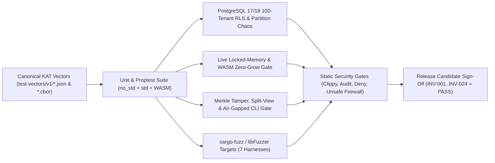

# Specification 10: Test Vectors, Verification Harnesses & CI Release Gates

> **Document ID**: `RSV-SPEC-10`
> **Project**: RusticStack Core (`ZK-Vault` — `https://github.com/KelpHect/ZK-Vault`)
> **Status**: Normative (`v1.0.0-normative`)
> **Target Toolchain**: Rust 2024 Edition (MSRV `1.94.0`)
> **License**: Dual `MIT OR Apache-2.0`

---

## 1. Verification Architecture & Determinism Principles

RusticStack Core enforces a **zero-trust verification posture**: every cryptographic primitive, wire format, database isolation policy, memory lock guarantee, and audit proof defined in Specifications 01–09 MUST be verified by **automated, deterministic, reproducible tests**.

Three verification principles govern all autonomous build agents and human maintainers:
1. **Cross-Target Bit-Exact Parity**: Every Known Answer Test (KAT) in `test-vectors/v1/` MUST produce byte-identical outputs across native Rust (`x86_64-unknown-linux-gnu`, `aarch64-apple-darwin`, `x86_64-pc-windows-msvc`) AND `wasm32-unknown-unknown` (`rsv-wasm`).
2. **Negative-First Security Testing**: Every formal invariant (`INV-001`..`INV-024`) is considered *unverified* until an automated negative test attempts to violate it (e.g., omitting `WHERE tenant_id`, flipping 1 bit in AAD, attempting `DRPubK` escrow on `root_quorum_only`, poisoning a VSS share, deleting 1 audit row, scanning post-`Drop` memory) and observes deterministic rejection.
3. **Hermetic CI Reproducibility**: All verification suites execute cleanly with pinned container images (PostgreSQL 17 & 18, `swtpm`, headless Chromium for `wasm-pack`) and deterministic seeds (`PROPTEST_CASES`, test-only `cfg(feature = "kat-deterministic")`).

### 1.1 Verification Pipeline Overview



---

## 2. Deterministic Known Answer Test (KAT) Specifications

All canonical KAT suites reside under `test-vectors/v1/` in dual representation:
- **Human-auditable JSON** (`*.kat.json`) with lowercase hexadecimal encodings (`hex`) and RFC 3339 timestamps.
- **Canonical CBOR binary fixtures** (`*.kat.cbor`) encoded per RFC 8949 Core Deterministic Encoding (shortest integers, canonical map key ordering, no indefinite-length items) for byte-level wire interoperability verification.

### 2.1 `CS-01` (`0x0001`) HPKE & AES-256-GCM Envelope + AAD Mutation KAT Schema

**Fixture Path**: `test-vectors/v1/cs01_hpke_aesgcm.kat.json` & `cs01_hpke_aesgcm.kat.cbor`
**Covers**: `INV-001`, `INV-002`, `INV-003`

```json
{
  "schema_version": 1,
  "suite_id": "0x0001",
  "suite_name": "CS-01-X25519-HPKE-AES256GCM",
  "vectors": [
    {
      "id": "CS01-HPKE-001",
      "description": "Item DEK wrap under Collection Key (CK) with canonical CBOR AAD",
      "kem_id": "0x0020",
      "kdf_id": "0x0001",
      "aead_id": "0x0002",
      "recipient_sk_hex": "<32-byte X25519 secret scalar hex>",
      "recipient_pk_hex": "<32-byte X25519 public key hex>",
      "ephemeral_seed_hex": "<32-byte deterministic KAT seed hex>",
      "aad_fields": {
        "domain": "rsv.env.v1",
        "tenant_id": "0194f2a0-1111-7000-8000-000000000001",
        "object_id": "0194f2a0-2222-7000-8000-000000000002",
        "parent_id": "0194f2a0-3333-7000-8000-000000000003",
        "epoch_or_version": 1,
        "cipher_suite_id": 1
      },
      "expected_canonical_aad_cbor_hex": "<deterministic RFC 8949 CBOR bytes>",
      "plaintext_hex": "<32-byte DEK or item CBOR payload>",
      "expected_enc_hex": "<32-byte HPKE encapped key>",
      "expected_ciphertext_and_tag_hex": "<len(pt)+16 bytes>",
      "negative_aad_mutations": [
        { "mutate_field": "tenant_id", "new_value": "0194f2a0-1111-7000-8000-000000000099", "expected_error": "AeadAuthenticationFailed" },
        { "mutate_field": "object_id", "new_value": "0194f2a0-2222-7000-8000-000000000099", "expected_error": "AeadAuthenticationFailed" },
        { "mutate_field": "parent_id", "new_value": "0194f2a0-3333-7000-8000-000000000099", "expected_error": "AeadAuthenticationFailed" },
        { "mutate_field": "epoch_or_version", "new_value": 2, "expected_error": "AeadAuthenticationFailed" },
        { "mutate_field": "cipher_suite_id", "new_value": 2, "expected_error": "AeadAuthenticationFailed" },
        { "mutate_field": "domain", "new_value": "rsv.edge.v1", "expected_error": "AeadAuthenticationFailed" }
      ]
    }
  ]
}
```

**Required Test Assertions**:
- Canonical CBOR serialization of `aad_fields` matches `expected_canonical_aad_cbor_hex` bit-for-bit.
- Deterministic seal reproduces `expected_enc_hex` and `expected_ciphertext_and_tag_hex`.
- Every entry in `negative_aad_mutations` MUST fail with `CryptoError::AeadAuthenticationFailed`.
- Flipping bit 0, middle bit, or final tag bit of `expected_ciphertext_and_tag_hex` MUST return `CryptoError::AeadAuthenticationFailed`.
- Live CSPRNG check: generating `100,000` live envelopes produces `100,000` distinct 96-bit nonces (`INV-003`).

---

### 2.2 `CS-02` (`0x0002`) Post-Quantum Hybrid X-Wing & Dual-Signature KAT Schema

**Fixture Path**: `test-vectors/v1/cs02_xwing_mldsa.kat.json` & `cs02_xwing_mldsa.kat.cbor`
**Covers**: `INV-004`, `INV-002`

Per `draft-connolly-cfrg-xwing-kem`, the X-Wing combiner is strictly:
$$ss = \text{SHA3-256}\big(ss_{\text{ML-KEM-768}} \parallel ss_{\text{X25519}} \parallel ct_{\text{X25519}} \parallel pk_{\text{X25519}} \parallel \texttt{0x5c2e2f2f5e5c}\big)$$

```json
{
  "schema_version": 1,
  "suite_id": "0x0002",
  "suite_name": "CS-02-XWING-MLKEM768-X25519-MLDSA65-ED25519",
  "xwing_label_hex": "5c2e2f2f5e5c",
  "kem_vectors": [
    {
      "id": "CS02-XWING-001",
      "seed_hex": "<32-byte X-Wing keygen seed>",
      "encap_rand_hex": "<64-byte deterministic encap randomness (32 ML-KEM + 32 X25519)>",
      "expected_pk_hex": "<1216-byte pk: 1184 ML-KEM-768 ek || 32 X25519 pk>",
      "expected_ct_hex": "<1120-byte ct: 1088 ML-KEM-768 ct || 32 X25519 ct>",
      "expected_ss_hex": "<32-byte SHA3-256 combined shared secret>",
      "expected_envelope_ct_hex": "<AES-256-GCM wrapped payload under HKDF(ss, AAD)>"
    }
  ],
  "hybrid_sig_vectors": [
    {
      "id": "CS02-HYBSIG-001",
      "domain_context": "rsv.sig.edge.v1",
      "ed25519_sk_seed_hex": "<32-byte UIK Ed25519 seed>",
      "mldsa65_sk_seed_hex": "<32-byte UIK ML-DSA-65 seed>",
      "message_hex": "<canonical message bytes>",
      "expected_ed25519_sig_hex": "<64-byte RFC 8032 Ed25519 signature>",
      "expected_mldsa65_sig_hex": "<3309-byte FIPS 204 ML-DSA-65 signature>",
      "negative_cases": [
        { "case": "flip_1_bit_ed25519_sig", "expected_error": "HybridSignatureInvalid" },
        { "case": "flip_1_bit_mldsa65_sig", "expected_error": "HybridSignatureInvalid" },
        { "case": "swap_domain_context", "expected_error": "HybridSignatureInvalid" },
        { "case": "non_canonical_ed25519_S_gte_L", "expected_error": "HybridSignatureInvalid" }
      ]
    }
  ]
}
```

**Required Test Assertions**:
- `CS02-XWING-*` MUST incorporate verbatim official test vectors from `draft-connolly-cfrg-xwing-kem` asserting exact `1216`-byte public key, `1120`-byte ciphertext, and `32`-byte shared secret.
- Hybrid signature verification MUST reject if *either* `Ed25519` (`verify_strict`) *or* `ML-DSA-65` fails.

---

### 2.3 Master Unlock Key (`MUK`) Argon2id + WebAuthn PRF KAT Schema

**Fixture Path**: `test-vectors/v1/kdf_argon2id_muk.kat.json`
**Covers**: `INV-001`, `INV-002`

```json
{
  "schema_version": 1,
  "algorithm": "Argon2id-v19-XOR-HKDF-PRF",
  "vectors": [
    {
      "id": "KDF-MUK-001-PASSWORD-ONLY",
      "passphrase_utf8": "correct-horse-battery-staple-enterprise-2026!",
      "tenant_id": "0194f2a0-1111-7000-8000-000000000001",
      "user_salt_hex": "<16-byte random salt>",
      "derived_domain_salt_hex": "<SHA-256('rsv.kdf.muk.v1' || tenant_id || user_salt)[0..16]>",
      "params": {
        "m_cost_kib": 65536,
        "t_cost": 3,
        "p_cost": 1,
        "output_len": 32
      },
      "webauthn_prf_output_hex": null,
      "expected_muk_hex": "<32-byte derived MUK>"
    },
    {
      "id": "KDF-MUK-002-PASSWORD-XOR-PRF",
      "passphrase_utf8": "correct-horse-battery-staple-enterprise-2026!",
      "tenant_id": "0194f2a0-1111-7000-8000-000000000001",
      "user_salt_hex": "<16-byte random salt>",
      "params": { "m_cost_kib": 65536, "t_cost": 3, "p_cost": 1, "output_len": 32 },
      "webauthn_prf_output_hex": "<32-byte WebAuthn PRF evaluator output>",
      "expected_muk_hex": "<Argon2id(pass, salt) XOR HKDF-SHA256(prf, tenant_id, 'rsv.prf.muk.v1')>"
    },
    {
      "id": "KDF-MUK-003-WEAK-PARAMS-REJECT",
      "description": "Parameter downgrade below security floor (m < 65536 KiB or t < 3) MUST be rejected",
      "params": { "m_cost_kib": 16384, "t_cost": 1, "p_cost": 1, "output_len": 32 },
      "expected_error": "KdfParametersBelowPolicyFloor"
    }
  ]
}
```

---

### 2.4 Feldman VSS (3-of-5 over Ristretto255, 2×128-bit `ORPK_SEED`) KAT Schema

**Fixture Path**: `test-vectors/v1/vss_feldman_ristretto255.kat.json` & `.cbor`
**Covers**: `INV-015`, `INV-016`

Because `ORPK_SEED` is 256 bits (`32` bytes) and Ristretto255 scalar order $\ell \approx 2^{252.6}$ cannot losslessly encode arbitrary 256-bit integers in one scalar, `rsv-vss` splits `ORPK_SEED` into two exact little-endian 128-bit chunks (`chunk_lo = ORPK_SEED[0..16]`, `chunk_hi = ORPK_SEED[16..32]`), each shared via `vsss-rs` 6.0 Feldman VSS over Ristretto255.

```json
{
  "schema_version": 1,
  "curve": "Ristretto255",
  "chunking": "2x128bit-le",
  "vectors": [
    {
      "id": "VSS-3OF5-001",
      "threshold_t": 3,
      "total_shares_n": 5,
      "orpk_seed_hex": "00112233445566778899aabbccddeeffdeadbeefcafebabe0123456789abcdef",
      "deterministic_rng_seed_hex": "<32-byte test-only RNG seed>",
      "commitments_lo_hex": ["<32-byte Ristretto255 C_lo,0>", "<C_lo,1>", "<C_lo,2>"],
      "commitments_hi_hex": ["<32-byte Ristretto255 C_hi,0>", "<C_hi,1>", "<C_hi,2>"],
      "shares": [
        { "index": 1, "y_lo_hex": "<32-byte canonical scalar>", "y_hi_hex": "<32-byte canonical scalar>" },
        { "index": 2, "y_lo_hex": "<32-byte canonical scalar>", "y_hi_hex": "<32-byte canonical scalar>" },
        { "index": 3, "y_lo_hex": "<32-byte canonical scalar>", "y_hi_hex": "<32-byte canonical scalar>" },
        { "index": 4, "y_lo_hex": "<32-byte canonical scalar>", "y_hi_hex": "<32-byte canonical scalar>" },
        { "index": 5, "y_lo_hex": "<32-byte canonical scalar>", "y_hi_hex": "<32-byte canonical scalar>" }
      ],
      "expected_orpubk_fingerprint_hex": "<32-byte SHA-256 fingerprint of expanded ORPubK>",
      "verification_matrix": {
        "valid_subsets_all_10": [[1,2,3],[1,2,4],[1,2,5],[1,3,4],[1,3,5],[1,4,5],[2,3,4],[2,3,5],[2,4,5],[3,4,5]],
        "sub_quorum_rejected": [[1], [1,2], [4,5]],
        "duplicate_index_rejected": [[1,1,2]],
        "tamper_cases": [
          { "share_index": 3, "mutate": "xor_y_lo_byte0_0x01", "expected_error": "InvalidShareCommitment" },
          { "share_index": 4, "mutate": "xor_y_hi_byte15_0x80", "expected_error": "InvalidShareCommitment" },
          { "share_index": 2, "mutate": "swap_index_to_5", "expected_error": "InvalidShareCommitment" },
          { "share_index": 1, "mutate": "non_canonical_commitment_point", "expected_error": "InvalidCommitmentEncoding" }
        ]
      }
    }
  ]
}
```

---

### 2.5 Blinded HMAC-SHA256 Audit Tag (`TBK`) KAT Schema

**Fixture Path**: `test-vectors/v1/audit_blinded_hmac.kat.json`
**Covers**: `INV-017`

```json
{
  "schema_version": 1,
  "algorithm": "HMAC-SHA256",
  "domain_prefix": "rsv:audit:blind:v1",
  "vectors": [
    {
      "id": "BLIND-HMAC-001",
      "tbk_hex": "<32-byte Tenant Blinding Key (TBK)>",
      "tenant_id": "0194f2a0-1111-7000-8000-000000000001",
      "field_domain": "actor_blind_id",
      "canonical_value_utf8": "user:0194f2a0-aaaa-7000-8000-000000000010",
      "expected_tag_hex": "<32-byte HMAC-SHA256 output>"
    },
    {
      "id": "BLIND-HMAC-002-DOMAIN-SEPARATION",
      "description": "Identical canonical_value under target_blind_id MUST produce distinct tag",
      "field_domain": "target_blind_id",
      "canonical_value_utf8": "user:0194f2a0-aaaa-7000-8000-000000000010",
      "must_not_equal_vector": "BLIND-HMAC-001"
    },
    {
      "id": "BLIND-HMAC-003-TENANT-SEPARATION",
      "description": "Identical TBK+domain+value under different tenant_id MUST produce distinct tag",
      "tenant_id": "0194f2a0-1111-7000-8000-000000000002",
      "field_domain": "actor_blind_id",
      "canonical_value_utf8": "user:0194f2a0-aaaa-7000-8000-000000000010",
      "must_not_equal_vector": "BLIND-HMAC-001"
    }
  ]
}
```

---

### 2.6 RFC 9162 Merkle Hashing, Proofs & C2SP `tlog-tiles` KAT Schema

**Fixture Path**: `test-vectors/v1/audit_rfc9162_merkle_tiles.kat.json` & `.cbor`
**Covers**: `INV-018`

```json
{
  "schema_version": 1,
  "spec": "RFC9162+C2SP-tlog-tiles-v1",
  "tile_height": 8,
  "tile_width": 256,
  "leaf_prefix_hex": "00",
  "node_prefix_hex": "01",
  "vectors": [
    {
      "id": "MERKLE-EMPTY-TREE",
      "tree_size": 0,
      "expected_root_hex": "e3b0c44298fc1c149afbf4c8996fb92427ae41e4649b934ca495991b7852b855"
    },
    {
      "id": "MERKLE-8-LEAVES-RFC9162",
      "tree_size": 8,
      "leaves_cbor_hex": ["<leaf 0>", "<leaf 1>", "<leaf 2>", "<leaf 3>", "<leaf 4>", "<leaf 5>", "<leaf 6>", "<leaf 7>"],
      "expected_leaf_hashes_hex": ["<SHA256(0x00 || leaf0)>", "..."],
      "expected_root_hex": "<32-byte RFC 9162 MTH>",
      "inclusion_proofs": [
        { "leaf_index": 0, "tree_size": 8, "audit_path_hex": ["<h1>", "<h23>", "<h47>"], "expected_valid": true },
        { "leaf_index": 5, "tree_size": 8, "audit_path_hex": ["<h4>", "<h67>", "<h03>"], "expected_valid": true },
        { "leaf_index": 5, "tree_size": 8, "mutate_path_idx": 1, "expected_valid": false }
      ],
      "consistency_proofs": [
        { "first_size": 3, "second_size": 8, "proof_hashes_hex": ["..."], "expected_valid": true },
        { "first_size": 5, "second_size": 8, "proof_hashes_hex": ["..."], "expected_valid": true },
        { "first_size": 5, "second_size": 8, "tampered_first_root": true, "expected_valid": false }
      ],
      "tlog_tile_paths": [
        { "path": "tile/0/000.p/8", "expected_bytes_len": 256, "expected_sha256_hex": "<tile digest>" }
      ]
    },
    {
      "id": "MERKLE-300-LEAVES-MULTITILE",
      "description": "Crosses height-8 tile boundary (256 leaves -> full tile 0/000 + partial tile 0/001.p/44 + level-1 tile 1/000.p/2)",
      "tree_size": 300,
      "expected_tile_paths": ["tile/0/000", "tile/0/001.p/44", "tile/1/000.p/2"]
    }
  ]
}
```

---

### 2.7 Chrome Native Messaging Sub-1MiB Framing KAT Schema

**Fixture Path**: `test-vectors/v1/nm_host_chunk_framing.kat.json`
**Covers**: `INV-021` (per `schemas/ipc-native-messaging.schema.json`)

```json
{
  "schema_version": 1,
  "max_frame_payload_bytes": 786432,
  "chrome_hard_limit_bytes": 1048576,
  "vectors": [
    {
      "id": "NM-FRAME-0B",
      "logical_msg_bytes": 0,
      "expected_chunk_count": 1,
      "max_observed_wire_frame_bytes": 128
    },
    {
      "id": "NM-FRAME-EXACT-768KIB",
      "logical_msg_bytes": 786432,
      "note": "Including framing envelope metadata, splits cleanly into 2 frames both <= 786432 bytes",
      "expected_chunk_count": 2,
      "assert_every_frame_payload_lte": 786432
    },
    {
      "id": "NM-FRAME-3P2MIB-ATTACHMENT",
      "logical_msg_bytes": 3355443,
      "expected_chunk_count": 5,
      "assert_every_frame_payload_lte": 786432,
      "reassembled_sha256_matches_input": true
    },
    {
      "id": "NM-FRAME-REJECT-OVERSIZE",
      "wire_header_le_u32": 786433,
      "expected_error": "FrameExceedsMaxChunkSize"
    },
    {
      "id": "NM-FRAME-REJECT-EXCEED-TOTAL-CAP",
      "declared_total_bytes": 16777217,
      "expected_error": "MessageExceedsMaxReassemblyCap"
    },
    {
      "id": "NM-FRAME-REJECT-TRUNCATED-EOF",
      "wire_header_le_u32": 4096,
      "actual_bytes_provided": 1024,
      "expected_error": "UnexpectedEof"
    }
  ]
}
```

---

## 3. Concrete Security Verification Harnesses

### 3.1 Cross-Tenant RLS & Hash-Partition Chaos Harness (`INV-006`, `INV-007`)

**Crate Location**: `crates/rsv-server/tests/rls_chaos_harness.rs`
**Database Requirement**: Live PostgreSQL 17 and PostgreSQL 18 instances running `schemas/postgresql-schema.sql` under non-superuser application role `rsv_app` (`NOSUPERUSER NOBYPASSRLS`) via PgBouncer transaction-pooling parity tests.

**Execution Protocol**:
1. **Tenant Population**: Provision `100` distinct tenants (`T_000`..`T_099`) spanning all 64 hash partitions (`MODULUS 64`). Each tenant seeds `5` users, `3` teams, `4` collections, `25` `vault_items`, `50` `vault_item_revisions`, `40` `key_graph_edges`, and `30` `audit_events` (`15,700+` total rows).
2. **Concurrent Chaos Phase**: Spawn `100` concurrent Tokio tasks (one per tenant, `1,000` randomized read/write/delete iterations each across a shared `sqlx::PgPool` of size `16` to aggressively stress transaction-local GUC reset across pooled connection reuse).
   - **Assertion A (Strict Isolation)**: Every row returned to task `i` MUST satisfy `row.tenant_id == T_i`. Zero cross-tenant rows across `100,000` operations.
3. **Deliberate Buggy Query Probe (Defense-in-Depth Proof)**:
   - Open `TenantScopedTx` for `T_007`, then intentionally execute raw SQL queries **omitting `WHERE tenant_id = ...`**:
     ```sql
     SELECT id, tenant_id FROM vault.vault_items;
     SELECT id, tenant_id FROM vault.key_graph_edges;
     SELECT id, tenant_id FROM vault.audit_events;
     ```
   - **Assertion B**: PostgreSQL `FORCE ROW LEVEL SECURITY` MUST return ONLY rows belonging to `T_007` (strictly `0` rows from the other `99` tenants).
4. **Unset / Poisoned Context Probe**:
   - Acquire a raw pooled connection immediately after a committed `TenantScopedTx` (verifying `set_config(..., true)` transaction-local teardown).
   - Execute `SELECT count(*) FROM vault.vault_items;` -> **Assertion C**: MUST return `0`.
   - Execute `INSERT INTO vault.vault_items (...)` with valid `T_007` UUID -> **Assertion D**: MUST fail with PostgreSQL SQLSTATE `42501` (`insufficient_privilege` / RLS violation).
   - Execute cross-tenant `INSERT` inside `T_007` transaction with `tenant_id = T_008` -> **Assertion E**: MUST fail with SQLSTATE `42501`.
5. **Hash-Partition Pruning Plan Gate (`INV-007`)**:
   - Run `EXPLAIN (ANALYZE, FORMAT JSON)` over every production query in `rsv-server` touching the 5 hash-partitioned tables (`key_graph_edges`, `vault_items`, `vault_item_revisions`, `audit_events`, `audit_merkle_tiles`).
   - **Assertion F**: Parse JSON plan tree and assert:
     - `Subplans Removed == 63` (for parameterized `Append` nodes) OR exactly `1` child partition relation (`*_pXX`) touched (static pruning);
     - Access node uses `"Index Scan"` or `"Index Only Scan"` with non-empty `"Index Cond"` containing `tenant_id`;
     - Zero `"Seq Scan"` nodes across partitions.

---

### 3.2 Live Memory Dump, Swap & WASM Fixed-Arena Negative Test (`INV-011`, `INV-024`)

#### Part A: Native Locked Memory Verification (`crates/rsv-mem/tests/locked_memory_negative.rs`)

**Linux Execution Protocol**:
1. Invoke process hardening (`rsv_mem::harden_process()`).
2. Assert `libc::prctl(libc::PR_GET_DUMPABLE) == 0` (`INV-011`).
3. Allocate `LockedSecretBox<[u8; 64]>` populated with a unique runtime-computed 64-byte canary `C` (derived by XORing static pattern with `0xA5` at runtime so `C` never appears in `.rodata`), capturing its virtual address `addr`.
4. Parse `/proc/self/smaps` for the VMA covering `addr`:
   - **Assertion 1**: `VmLck:` is `>= 4 kB` (`mlock` active).
   - **Assertion 2**: `VmFlags:` contains `dd` (`VM_DONTDUMP`, confirming `MADV_DONTDUMP` active).
5. **Guard-Page Fault Verification (Subprocess)**:
   - Spawn a child test binary allocating a `LockedSecretBox`, reading `(addr - 1)` (leading guard page) and `(addr + page_size)` (trailing guard page) in separate invocations.
   - **Assertion 3**: Both invocations terminate strictly via `SIGSEGV` (Linux/macOS) or `STATUS_ACCESS_VIOLATION` (`0xC0000005`, Windows).
6. **Post-`Drop` Zeroization Verification**:
   - Using a `#[cfg(test)]` inspection hook that triggers `Drop` zeroization prior to `munmap`, inspect all `64` bytes of the backing page -> **Assertion 4**: every byte equals `0x00`.
   - Scan readable anonymous heap VMAs via `/proc/self/mem` -> **Assertion 5**: strictly `0` occurrences of canary `C` survive after `Drop`.

**Windows Execution Protocol**:
- Assert `VirtualLock` succeeds, `SetProcessMitigationPolicy` + owner-only process DACL denies `PROCESS_VM_READ` from a distinct non-elevated test token, `CryptProtectMemory` round-trips cleanly, guard pages raise `0xC0000005`, and post-`Drop` bytes are `0x00`.

**macOS Execution Protocol**:
- Assert `getrlimit(RLIMIT_CORE).rlim_cur == 0`, `mlock` succeeds, guard pages trigger `SIGSEGV`/`SIGBUS`, and post-`Drop` bytes are `0x00`.

#### Part B: WASM Fixed-Arena Zero-Growth Binary Gate (`crates/rsv-wasm/tests/wasm_arena_gate.rs`)

1. Build release artifact: `cargo build -p rsv-wasm --target wasm32-unknown-unknown --release`.
2. Inspect compiled `.wasm` via `wasmparser`:
   - **Assertion 1 (Static Bounds)**: In `MemorySection`, `memory.maximum == Some(memory.initial)` (e.g., `256` pages = `16 MiB`).
   - **Assertion 2 (Zero `memory.grow`)**: Across all function bodies in `CodeSection`, `count(Operator::MemoryGrow { .. }) == 0`.
3. Run `wasm-pack test --headless --chrome`:
   - Exhaust fixed arena capacity -> assert deterministic `WasmError::ArenaExhausted` (zero panic, zero linear memory resize).
   - Call `lock_vault()` -> assert all outstanding `KeyHandle(u32)` handles fail with `WasmError::InvalidOrRevokedHandle` (`INV-022`) and internal arena secret slots read strictly `0x00`.

---

### 3.3 Merkle Tamper, Split-View & Air-Gapped Compliance Chaos Harness (`INV-018`, `INV-019`)

**Crate Location**: `crates/rsv-compliance-cli/tests/merkle_tamper_chaos.rs`

**Setup**:
1. Generate `512` signed, `TBK`-blinded audit events (crossing `2` full height-8 C2SP `tlog-tiles`), each carrying an `X-RSV-Audit-Envelope` sealed to `CPubK` (`CS-02`), alongside a 3-of-5 Feldman VSS ceremony for `ORPK_SEED`.
2. Export events, tiles, and witness-cosigned checkpoints (`size = 200`, `size = 512`) to an offline bundle directory.
3. Execute `rsv-compliance-cli` inside a **network-isolated sandbox** (`unshare -rn` on Linux CI; verified also by zero network crates in `rsv-compliance-cli/Cargo.toml`).

**Deterministic Chaos Cases**:

| Case ID | Injected Tampering | Expected CLI Exit Code | Expected Machine-Readable Diagnostic |
|---|---|---|---|
| `CHAOS-AUDIT-01` | Valid unmodified bundle + `CPK` + 3-of-5 VSS shares | `0` | `OK_VERIFIED_AND_DECRYPTED (events=512)` |
| `CHAOS-AUDIT-02` | Mutate 1 bit at byte 42 of `audit_events[257]` | `10` | `E_MERKLE_LEAF_MISMATCH (seq=257)` (`AUDIT_COMMITMENT_INVALID`) |
| `CHAOS-AUDIT-03` | Delete row `audit_events[128]` and compact indexes | `11` | `E_MERKLE_ROOT_MISMATCH` (`AUDIT_COMMITMENT_INVALID`) |
| `CHAOS-AUDIT-04` | Swap `audit_events[10]` and `audit_events[11]` | `10` | `E_MERKLE_LEAF_MISMATCH (seq=10)` |
| `CHAOS-AUDIT-05` | Fork tree after `size = 200` (present divergent `checkpoint_512_fork` vs witnessed `checkpoint_200`) | `12` | `E_MERKLE_SPLIT_VIEW_DETECTED (old=200, new=512)` |
| `CHAOS-AUDIT-06` | Corrupt witness cosignature on `checkpoint_512` | `13` | `E_CHECKPOINT_WITNESS_SIG_INVALID` |
| `CHAOS-AUDIT-07` | Transplant `X-RSV-Audit-Envelope` from `event[5]` into `event[6]` (AAD mismatch) | `14` | `E_ENVELOPE_AAD_AUTH_FAILED (seq=6)` |
| `CHAOS-AUDIT-08` | Supply 2 valid + 1 bit-flipped VSS share during `ORPK_SEED` recovery | `15` | `E_VSS_SHARE_COMMITMENT_INVALID (share_index=3)` |

---

### 3.4 Property-Based (`proptest`) & Coverage-Guided Fuzzing (`cargo-fuzz`) Targets

#### Property-Based Suites (`PROPTEST_CASES=2048` in CI)

| Crate | Property Test Module | Invariants Verified |
|---|---|---|
| `rsv-crypto` | `prop_aead_roundtrip_and_aad` | Arbitrary plaintexts (`0..64 KiB`) + AAD round-trip under `CS-01` & `CS-02`; mutating any AAD field or ciphertext byte ALWAYS fails (`INV-002`, `INV-004`). |
| `rsv-vss` | `prop_feldman_arbitrary_quorum` | For all `2 <= t <= n <= 32` and random 256-bit `ORPK_SEED`: every share verifies independently; any random `t`-subset reconstructs exact `ORPK_SEED`; any `(t-1)`-subset fails (`INV-015`, `INV-016`). |
| `rsv-graph` | `prop_dag_acyclicity_and_revocation` | Random edge sets never admit cycles (`GRAPH_CYCLE_REJECTED`) or illegal tier jumps; revocation + epoch increment strictly blocks old-epoch keys (`INV-008`, `INV-009`). |
| `rsv-audit` | `prop_rfc9162_inclusion_consistency` | For random tree sizes `1 <= n1 <= n2 <= 1024`, all generated inclusion & consistency proofs verify and C2SP tile serialization matches direct MTH (`INV-018`). |
| `rsv-daemon` | `prop_nm_chunk_roundtrip` | Arbitrary payloads (`0..4 MiB`) segment into frames strictly `<= 786,432` bytes and reassemble identically (`INV-021`). |

#### Coverage-Guided Fuzz Targets (`fuzz/fuzz_targets/*.rs` via `cargo-fuzz` + `libFuzzer` + ASAN)

| Fuzz Target | Entrypoint Under Test | Crash / OOM Budget |
|---|---|---|
| `fuzz_cbor_envelope` | `rsv_types::Envelope::from_cbor_bytes` & `rsv_crypto::unseal` | `0` panics, `-rss_limit_mb=512`, `>= 10M` execs/nightly |
| `fuzz_xwing_decaps` | `rsv_crypto::xwing::decapsulate` on arbitrary/truncated 1120-byte inputs | `0` panics, constant-time implicit rejection |
| `fuzz_graph_dag_cycle` | `rsv_graph::KeyGraph::load_and_validate_edges` | `0` panics, `0` stack overflows on 10k-edge cyclic graphs |
| `fuzz_vss_verifier` | `rsv_vss::verify_share` & `reconstruct` on arbitrary scalars/Ristretto points | `0` panics, clean rejection of non-canonical bytes |
| `fuzz_merkle_proof_verifier` | `rsv_audit::verify_inclusion_proof`, `verify_consistency_proof`, `parse_checkpoint` | `0` panics, overflow-safe for `tree_size = u64::MAX` |
| `fuzz_nm_chunk_reassembler` | `rsv_daemon::nm_framing::ChunkReassembler::push_frame` | `0` panics, strictly bounded under `16 MiB` / `8` streams |
| `fuzz_origin_matcher` | `rsv_types::origin::OriginPolicy::matches_autofill` | `0` panics on malformed URLs, nested Punycode, null bytes, IPv6 |

---

### 3.5 Protocol, Escrow, Hardware Enclave, IPC, Autofill & WASM Handle Suites

- **Hybrid Escrow Separation (`INV-005`)**: `crates/rsv-graph/tests/escrow_policy.rs` & `crates/rsv-server/tests/escrow_policy.rs` assert `ESCROW_POLICY_VIOLATION` when attempting to attach a `DRPubK` or individual Admin `UPK` edge to any `root_quorum_only` collection, while allowing `DRPubK` on `standard` collections.
- **Hardware Enclave Tier-1/Tier-2 (`INV-013`)**: `crates/rsv-enclave/tests/enclave_provider.rs` runs against Linux `swtpm` (TPM 2.0 simulator in CI), macOS Apple Silicon SE harness, and Windows CNG runner; asserts NIST P-256 `HDIK`/`HDSK` generation, export failure, and explicit `HardwareTrustTier::SoftwareFallback` attestation tagging (`DEVICE_ATTESTATION_FAILED` when tenant mandates Tier-1).
- **IPC Peer Credential Rejection (`INV-014`)**: `crates/rsv-daemon/tests/ipc_peercred.rs` spawns an unauthorized peer process/UID and confirms immediate socket close prior to RPC parsing.
- **Request Signing & Replay (`INV-020`)**: `crates/rsv-server/tests/request_auth_security.rs` asserts exact canonical errors (`INVALID_SIGNATURE`, `TENANT_MISMATCH`, `MISSING_AUDIT_ENVELOPE`, `VERSION_CONFLICT`, `STALE_KEY_EPOCH`) on header tampering, stale timestamps (`> 300s`), revoked devices, and replayed `Idempotency-Key`.
- **WASM Handle Boundary (`INV-022`)**: `crates/rsv-wasm/tests/handle_table.rs` verifies packed `(index, generation)` ABA immunity, TTL eviction, and `.d.ts` inspection confirming zero raw key exports.
- **Origin-Bound Autofill Matrix (`INV-023`)**: Tests `https://vault.example.com` vs `http://vault.example.com` (REJECT), `https://xn--pple-43d.com` vs `https://apple.com` (REJECT), `data:` / `javascript:` URIs (REJECT), cross-origin `<iframe>` (REJECT), missing user gesture (REJECT), exact `https://app.example.com` with gesture (ALLOW).

---

## 4. Cross-Cutting Zero-Knowledge & Telemetry Verification

### 4.1 Wire & Database Zero-Knowledge Canary Audit (`INV-001`)

End-to-end test `tests/e2e_zk_canary.rs` executes the full lifecycle (tenant creation -> 3-of-5 VSS ceremony -> user enrollment -> team/collection creation -> item create/update/share/revoke -> audit query) with unique ASCII canary strings:
- Master passphrase: `RSV_CANARY_PASS_9f8e7d6c`
- Item title: `RSV_CANARY_TITLE_4a3b2c1d`
- Item secret value: `RSV_CANARY_SECRET_7c6b5a49`
- Actor email: `canary.actor.99@example.invalid`

**Assertions**:
1. Inspect every raw HTTP wire byte captured by a local test proxy -> strictly **0 matches** for all 4 canaries (raw UTF-8, hex, and base64).
2. Inspect full `pg_dump --inserts` of all 12 tables in schema `vault` -> strictly **0 matches** for all 4 canaries and **0 matches** for `TBK`.
3. Decrypt exported offline compliance bundle via `rsv-compliance-cli` using `CPK` -> actor and audit metadata recover **only** offline.

### 4.2 Zero Secret Telemetry & Panic Scrubbing Audit (`INV-012`)

Workspace test `tests/telemetry_redaction.rs` installs an in-memory `tracing_subscriber` capture layer and custom panic hook, drives every error branch across all crates using canary keys/secrets, and asserts:
- Every secret wrapper's `Debug` implementation prints `"[REDACTED]"`;
- Strictly **0 canary bytes** appear in `tracing` logs, error `Display` chains, HTTP 4xx/5xx error JSON bodies, or panic hook messages.

---

## 5. Complete Invariant-to-Verification Traceability Matrix

| Invariant ID | Invariant Title | Primary Test / Harness | Blocking CI Gate |
|---|---|---|---|
| `INV-001` | Zero Server Decryption Capability | `tests/e2e_zk_canary.rs` + DDL audit | Gate 4 & 7 |
| `INV-002` | Mandatory AAD Context Binding | `cs01_hpke_aesgcm.kat.json` + `prop_aead_roundtrip_and_aad` | Gate 3 & 4 |
| `INV-003` | Nonce Uniqueness & Non-Reuse | `rsv-crypto` CSPRNG & HPKE sequence-cap tests | Gate 4 |
| `INV-004` | Post-Quantum Hybrid IND-CCA2 (`CS-02`) | `cs02_xwing_mldsa.kat.json` + `fuzz_xwing_decaps` | Gate 3 & 4 |
| `INV-005` | Root Quorum Exclusivity & Hybrid Escrow | `escrow_policy.rs` (`ESCROW_POLICY_VIOLATION`) | Gate 4 & 6 |
| `INV-006` | Zero Cross-Tenant RLS Bleed | `rsv-server/tests/rls_chaos_harness.rs` (PG 17 & 18) | Gate 6 |
| `INV-007` | Hash-Partition Pruning Determinism | `rls_chaos_harness.rs` (`Subplans Removed: 63`, `Index Cond`) | Gate 6 |
| `INV-008` | Blind RBAC DAG Acyclicity & Auth | `prop_dag_acyclicity_and_revocation` + `fuzz_graph_dag_cycle` | Gate 4 |
| `INV-009` | Forward-Secure Key Rotation | `rsv-graph` & `rsv-server` revocation lifecycle suite | Gate 4 & 6 |
| `INV-010` | Strict Unsafe Code Containment | `./scripts/ci/check-unsafe-policy.sh` + `cargo geiger` | Gate 2 |
| `INV-011` | Locked Memory Zeroize-on-Drop | `rsv-mem/tests/locked_memory_negative.rs` (`smaps`, `SIGSEGV`, scan) | Gate 7 |
| `INV-012` | Zero Secret Telemetry & Crash Redaction | `tests/telemetry_redaction.rs` | Gate 4 & 7 |
| `INV-013` | Non-Exportable Hardware Device Keys | `rsv-enclave/tests/enclave_provider.rs` (`swtpm`/SE/CNG) | Gate 7 |
| `INV-014` | Mutual OS IPC Peer Identity Verification | `rsv-daemon/tests/ipc_peercred.rs` | Gate 7 |
| `INV-015` | Feldman VSS Share Verifiability | `vss_feldman_ristretto255.kat.json` + `prop_feldman_arbitrary_quorum` | Gate 3 & 4 |
| `INV-016` | VSS Threshold Secrecy & Reconstruction | Exhaustive $\binom{5}{3}$ KATs + sub-quorum negative suite | Gate 3 & 4 |
| `INV-017` | Zero-Knowledge Blinded Audit Indexing (`TBK`) | `audit_blinded_hmac.kat.json` + DB schema audit | Gate 3 & 4 |
| `INV-018` | RFC 9162 Consistency & Split-View Detection | `audit_rfc9162_merkle_tiles.kat.json` + `merkle_tamper_chaos.rs` | Gate 3 & 7 |
| `INV-019` | Air-Gapped Compliance Decryptability (`CPubK`) | `merkle_tamper_chaos.rs` inside `unshare -rn` sandbox | Gate 7 |
| `INV-020` | Hardware Request Non-Repudiation & Replay | `rsv-server/tests/request_auth_security.rs` | Gate 4 & 6 |
| `INV-021` | Native Messaging Sub-1MiB Framing | `nm_host_chunk_framing.kat.json` + `fuzz_nm_chunk_reassembler` | Gate 3 & 4 |
| `INV-022` | Opaque Key Handle Boundary (WASM) | `rsv-wasm/tests/handle_table.rs` + `.d.ts` API audit | Gate 5 |
| `INV-023` | Origin-Bound Autofill & Anti-Phishing | Extension + `rsv-types` origin matrix + `fuzz_origin_matcher` | Gate 4 & 5 |
| `INV-024` | Fixed WASM Arena Zero-Growth | `wasm_arena_gate.rs` (`wasmparser`: `MemoryGrow == 0`) | Gate 5 |

---

## 6. CI/CD Hard Release Gates

Every Pull Request and Release Candidate MUST pass **all 8 mandatory gates** with exit code `0`.

| Gate | Name | Exact Command(s) | Policy |
|---|---|---|---|
| **Gate 1** | **MSRV (`1.94.0`), Formatting & Clippy** | `cargo +1.94.0 fmt --all -- --check` <br> `cargo +1.94.0 check --workspace --all-targets` <br> `cargo +1.94.0 clippy --workspace --all-targets -- -D warnings` | Hard block |
| **Gate 2** | **Supply Chain, Dependency & `unsafe` Firewall (`INV-010`)** | `cargo audit --deny warnings` <br> `cargo deny check advisories bans licenses sources` <br> `./scripts/ci/check-unsafe-policy.sh` (verifies `#![forbid(unsafe_code)]` on all 10 safe crates, `// SAFETY:` proofs in `rsv-mem`/`rsv-enclave`, zero Tokio/SQL/OS deps in `no_std` crates, zero network deps in `rsv-compliance-cli`) | Hard block |
| **Gate 3** | **KAT Cross-Target Parity (`no_std` + Native + WASM)** | `cargo test --workspace --features kat-deterministic --test '*kat*'` <br> `cargo check -p rsv-types -p rsv-crypto -p rsv-vss -p rsv-graph -p rsv-audit --no-default-features --target wasm32-unknown-unknown` | Hard block |
| **Gate 4** | **Full Unit, Proptest & Canary Telemetry Suite** | `PROPTEST_CASES=2048 cargo test --workspace --lib --bins` <br> `cargo test --test e2e_zk_canary --test telemetry_redaction` | Hard block |
| **Gate 5** | **WASM Build, Fixed-Arena & Browser Gate (`INV-022`, `INV-024`)** | `cargo build -p rsv-wasm --target wasm32-unknown-unknown --release` <br> `cargo test -p rsv-wasm --test wasm_arena_gate` <br> `wasm-pack test --headless --chrome crates/rsv-wasm` | Hard block |
| **Gate 6** | **PostgreSQL 17 & 18 RLS & Partition Pruning Matrix (`INV-006`, `INV-007`)** | Matrix over `postgres:17` and `postgres:18`: <br> `sqlx migrate run` <br> `cargo test -p rsv-server --test rls_chaos_harness -- --nocapture` <br> `cargo test -p rsv-server --test request_auth_security` | Hard block |
| **Gate 7** | **OS Memory, Enclave, IPC & Air-Gapped Merkle Chaos (`INV-011`, `INV-013`, `INV-014`, `INV-018`, `INV-019`)** | `cargo test -p rsv-mem --test locked_memory_negative -- --nocapture` <br> `cargo test -p rsv-enclave --test enclave_provider` <br> `cargo test -p rsv-daemon --test ipc_peercred` <br> `unshare -rn cargo test -p rsv-compliance-cli --test merkle_tamper_chaos` | Hard block |
| **Gate 8** | **Fuzzing Smoke & Nightly Regression** | PR smoke (`60s`/target): `for t in fuzz_cbor_envelope fuzz_xwing_decaps fuzz_graph_dag_cycle fuzz_vss_verifier fuzz_merkle_proof_verifier fuzz_nm_chunk_reassembler fuzz_origin_matcher; do cargo +nightly fuzz run "$t" -- -max_total_time=60 -rss_limit_mb=512; done` <br> Nightly: `>= 10M` execs/target + ASAN/UBSAN | Hard block |
