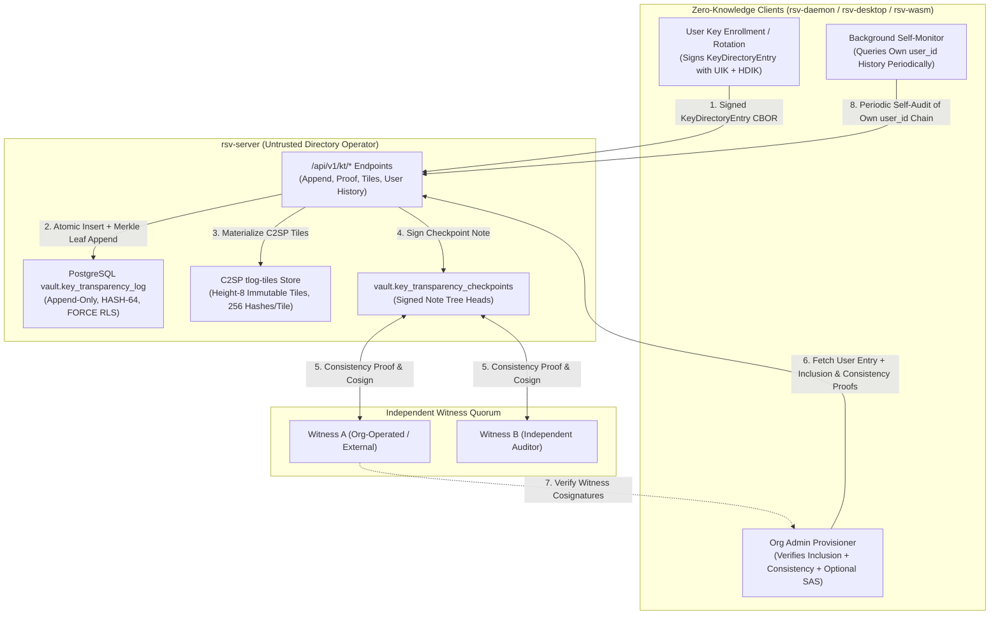
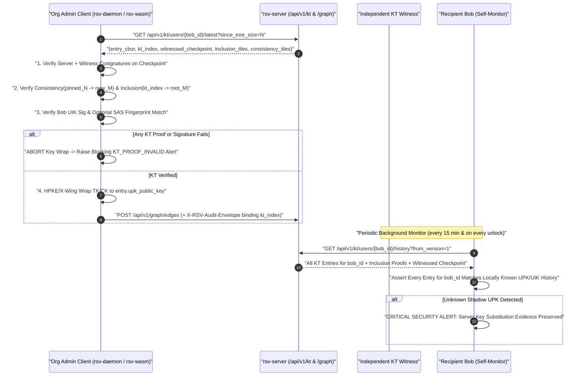
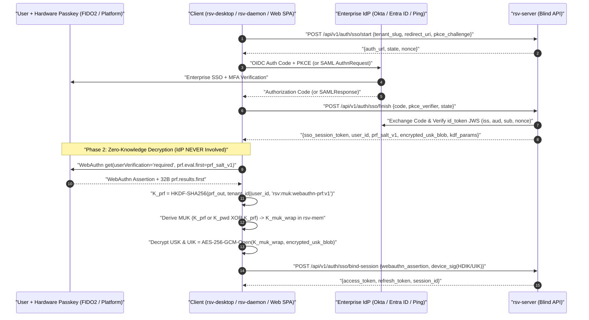
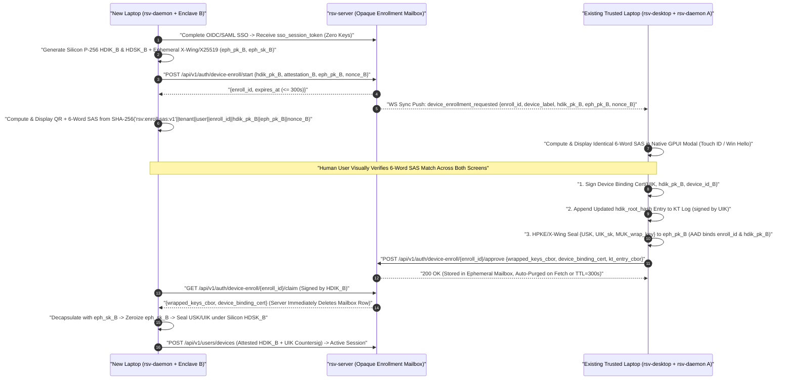
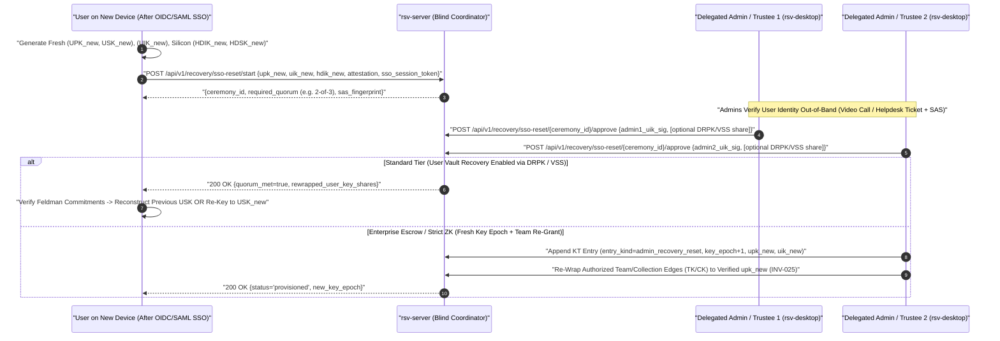
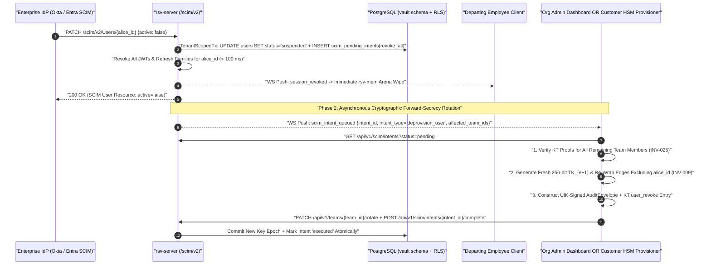

# Specification 11: Key Transparency, Zero-Knowledge Enterprise SSO & Blind SCIM 2.0

| Field | Value |
| :--- | :--- |
| **Document ID** | `RSV-SPEC-11` |
| **Project** | RusticStack Core (`ZK-Vault` — `https://github.com/KelpHect/ZK-Vault`) |
| **Status** | Normative (`v1.0`) |
| **License** | Dual `MIT OR Apache-2.0` |
| **Target Toolchain** | Rust 2024 Edition, MSRV `1.94.0`, PostgreSQL 17/18 |
| **Primary Crates** | `rsv-types`, `rsv-crypto`, `rsv-graph`, `rsv-audit`, `rsv-enclave`, `rsv-daemon`, `rsv-wasm`, `rsv-server`, `rsv-compliance-cli` |
| **Related Specs & ADRs** | [`SPEC-02`](02-CRYPTOGRAPHY-AND-KEY-HIERARCHY.md), [`SPEC-04`](04-BLIND-RBAC-ACCESS-GRAPH.md), [`SPEC-06`](06-ZERO-KNOWLEDGE-AUDIT-LEDGER.md), [`SPEC-08`](08-API-AND-WIRE-PROTOCOLS.md), [`SPEC-09`](09-THREAT-MODEL-AND-FORMAL-INVARIANTS.md), [`ADR-0009`](../adrs/ADR-0009-key-transparency-and-blind-scim-sso.md) |
| **Normative Standards** | IETF `draft-ietf-keytrans-protocol`, RFC 9162, C2SP `tlog-tiles` & `signed-note`, OIDC Core 1.0, RFC 7636 (PKCE), SAML 2.0 Core/Bindings, W3C WebAuthn Level 3 (`prf`), RFC 7643 & RFC 7644 (SCIM 2.0), RFC 8949 (Deterministic CBOR) |

---

## 1. Conformance, Scope & Formal Invariants

The key words **"MUST"**, **"MUST NOT"**, **"REQUIRED"**, **"SHALL"**, **"SHALL NOT"**, **"SHOULD"**, **"SHOULD NOT"**, **"RECOMMENDED"**, **"NOT RECOMMENDED"**, **"MAY"**, and **"OPTIONAL"** in this document are to be interpreted as described in BCP 14 (RFC 2119 and RFC 8174) when, and only when, they appear in all capitals.

Enterprise password managers historically suffer from three structural zero-knowledge failures:

1. **Silent Public Key Substitution (Bitwarden / Vaultwarden Threat)**: When an organization admin adds a user to a shared collection, the client fetches the recipient's public key from the untrusted server (`ADV-01`). Without an append-only, witnessed **Key Transparency (KT)** directory, a compromised server can return an attacker-controlled public key (`UPK_evil`), capture the wrapped Organization/Team/Collection key, and forward a re-encrypted copy to the victim undetected.
2. **SSO Decryption Custody Collapse (Key Connector Trap)**: Enterprise IdPs (Okta, Entra ID, Ping, Google Workspace) authenticate users via OIDC/SAML, but tying SSO directly to a server-side key escrow ("Key Connector") breaks `INV-001`: compromising the IdP or Key Connector yields instant plaintext vault access.
3. **Privileged SCIM Bridge Custody**: Naive SCIM 2.0 directory sync connectors demand organizational encryption keys to automate onboarding/offboarding, turning the SCIM service into a high-value cleartext key custodian.

This specification closes all three gaps by introducing three formal invariants extending `INV-001`..`INV-024` (`SPEC-09`):

### `INV-025` — Auditable Key Transparency Inclusion & Consistency on Every Provisioning Grant
- **Formal Statement**: Every creation or rotation of a user's public identity tuple `(tenant_id, user_id, key_epoch, UPK, UIK, HDIK_root)` MUST append a canonical RFC 8949 CBOR `KeyDirectoryEntry` into `vault.key_transparency_log`, hashed via RFC 9162 (`0x00 || entry_cbor`) into a tenant-scoped C2SP `tlog-tiles` Merkle tree anchored by witnessed checkpoints. Before encapsulating any `TK`, `CK`, or `DEK` to a recipient `UPK`, a client MUST verify: (a) an RFC 9162 inclusion proof for the recipient's active `KeyDirectoryEntry` against a witness-cosigned KT checkpoint, (b) an RFC 9162 consistency proof connecting the client's locally pinned checkpoint to the latest checkpoint, and (c) monotonic `user_kt_version` continuity. Any failure MUST abort key wrapping with `KT_PROOF_INVALID` (or `AUDIT_COMMITMENT_INVALID`).
- **Threat Coverage**: `ADV-01`, `ADV-02`, `ADV-05`
- **Owning Crates**: `rsv-types`, `rsv-crypto`, `rsv-audit`, `rsv-graph`, `rsv-daemon`, `rsv-wasm`, `rsv-server`, `rsv-compliance-cli`
- **Failure Mode**: Malicious server executes silent MITM public key substitution when admins provision teams, collections, or VSS trustees.
- **Verification Method**: Rogue-server `UPK` substitution chaos test, split-view witness rejection test, and client self-monitoring shadow-key detection test (`Playbook 08`).

### `INV-026` — Strict `Authentication != Decryption` Separation for OIDC/SAML SSO
- **Formal Statement**: Identity Providers (OIDC 1.0 / SAML 2.0) MUST be treated strictly as authentication authorities for session establishment (`Authorization` bearer JWT). Neither the IdP nor `rsv-server` SHALL EVER generate, possess, derive, receive, or unwrap `MUK`, `USK`, `UIK` private keys, `TK`, `CK`, or `DEK`. Vault decryption after SSO MUST exclusively derive or transfer key material through one of three zero-knowledge client paths: (1) local WebAuthn Level 3 `prf` + optional Argon2id passphrase, (2) interactive Trusted Device Cross-Signing with SAS verification, or (3) explicit Quorum Admin / Feldman VSS Recovery.
- **Threat Coverage**: `ADV-01`, `ADV-02`, `ADV-05`, Compromised Enterprise IdP
- **Owning Crates**: `rsv-crypto`, `rsv-enclave`, `rsv-daemon`, `rsv-wasm`, `rsv-server`
- **Failure Mode**: IdP account takeover, forged SAML assertion ("Golden SAML"), or compromised IdP token broker directly decrypts enterprise secrets.
- **Verification Method**: Wire-capture assertion confirming zero key material on `/api/v1/auth/sso/*` flows, Golden-SAML negative test asserting encrypted blobs remain cryptographically undecryptable without client key custody.

### `INV-027` — Blind SCIM 2.0 Zero-Key Custody
- **Formal Statement**: SCIM 2.0 endpoints (`/scim/v2/*`) SHALL NEVER hold, derive, unwrap, or accept `USK`, `TK`, `CK`, `DEK`, `ORPK`, or `DRPK`. SCIM mutations MUST ONLY (a) update logical account status (`active=false` -> immediate JWT/WebSocket revocation and read-blocking), and (b) append unsigned, IdP-attested intent rows into `vault.scim_pending_intents`. Cryptographic edge grants and epoch rotations (`epoch += 1`) MUST be executed asynchronously by an authorized Org Admin client or an optional customer-hosted HSM-backed Provisioning Daemon (`rsv-provisioner`) subject to `INV-025` and `INV-018`.
- **Threat Coverage**: `ADV-01`, `ADV-02`, `ADV-05`, Compromised SCIM Bearer Token
- **Owning Crates**: `rsv-server`, `rsv-graph`, `rsv-types`
- **Failure Mode**: Compromised SCIM integration token silently exfiltrates or re-wraps enterprise collection keys.
- **Verification Method**: Static route isolation check (SCIM routes have zero cryptographic key inputs), immediate session-kill latency test (`< 100 ms`), and negative test asserting SCIM bearer tokens receive `403` on all `/api/v1/*` endpoints.

---

## 2. Part A: Auditable Key Transparency Directory (`rsv-kt`)

### 2.1 Architecture: Bridging IETF `draft-ietf-keytrans-protocol` with C2SP `tlog-tiles`

RusticStack Core adapts the verifiable key directory model of IETF **`draft-ietf-keytrans-protocol`** directly onto the existing **RFC 9162 Merkle Hash Tree + C2SP `tlog-tiles` + C2SP `signed-note` Witness** infrastructure defined in `SPEC-06` and `ADR-0005`.

Each tenant $T$ operates an isolated, append-only **Key Transparency Log** identified by C2SP checkpoint origin:

```text
kt_origin(T) = "rusticstack.io/kt/v1/tenant/" || lowercase_uuidv7(tenant_id)
```

Separating the KT tree from the general `vault.audit_events` tree keeps KT log cardinality strictly bounded by $O(\text{users} \times \text{key\_rotations})$ (typically $10^2$–$10^5$ entries even in large enterprises), enabling fast client verification and complete per-user key history monitoring with negligible bandwidth.



### 2.2 Canonical `KeyDirectoryEntry` Wire Format (Deterministic RFC 8949 CBOR)

Every public key mutation for a user (`initial_enroll`, `key_rotation`, `device_hdik_update`, `suite_upgrade`, `user_revoke`, `admin_recovery_reset`) MUST produce an immutable **RFC 8949 Section 4.2 Core Deterministic CBOR** map using integer keys sorted ascending:

```text
KeyDirectoryEntry := {
    1:  schema_version        (uint = 1),
    2:  tenant_id             (bstr, 16 bytes — raw UUIDv7),
    3:  user_id               (bstr, 16 bytes — raw UUIDv7),
    4:  user_kt_version       (uint64 — strictly monotonic per user, starts at 1),
    5:  key_epoch             (uint32 — matches vault.users.key_epoch),
    6:  entry_kind            (uint8: 1=initial_enroll, 2=key_rotation, 3=device_hdik_update,
                                      4=suite_upgrade, 5=admin_recovery_reset, 6=user_revoke),
    7:  cipher_suite_id       (uint16: 0x0001 = CS-01, 0x0002 = CS-02),
    8:  upk_public_key        (bstr — 32B X25519 for CS-01; 1216B X-Wing pk for CS-02),
    9:  uik_public_key        (bstr — 32B Ed25519 for CS-01; 32B Ed25519 || 1952B ML-DSA-65 for CS-02),
    10: hdik_root_hash        (bstr, 32 bytes — SHA-256 over sorted active device HDIK public keys),
    11: prev_entry_hash       (bstr, 32 bytes — 0x00*32 if user_kt_version == 1, else leaf_hash of v-1),
    12: recorded_at_unix_ms   (uint64 — UTC epoch milliseconds),
    13: self_uik_signature    (bstr — current UIK sig over entry_tbs_digest; empty bstr if revoked by admin),
    14: prev_uik_signature    (bstr or null — previous UIK sig chaining rotation v-1 -> v when self-rotated),
    15: endorser_user_id      (bstr, 16 bytes or null — Org Admin / Provisioner user_id for initial/recovery/revoke),
    16: endorser_signature    (bstr or null — endorser UIK sig over entry_tbs_digest)
}
```

#### Exact Domain-Separated Hashing & Signing Construction

1. **To-Be-Signed Digest (`entry_tbs_digest`)**:
   Compute deterministic CBOR over map keys `1..=12` ONLY (`KeyDirectoryEntryBody`), then:
   $$\text{entry\_tbs\_digest} = \text{SHA-256}(\texttt{"rsv:kt:entry:sig:v1"} \parallel \text{CBOR\_Canonical}(\text{keys } 1..12))$$
2. **RFC 9162 Merkle Leaf Hash (`kt_leaf_hash`)**:
   Compute deterministic CBOR over ALL keys `1..=16` (`full_entry_cbor`), then:
   $$\text{kt\_leaf\_hash} = \text{SHA-256}(\texttt{0x00} \parallel \text{full\_entry\_cbor})$$
3. **Interior Merkle Node Hash**:
   $$\text{MTH}(D_n) = \text{SHA-256}(\texttt{0x01} \parallel \text{MTH}(D[0..k]) \parallel \text{MTH}(D[k..n]))$$
   identical to `SPEC-06` and RFC 9162 Section 2.1.
4. **Device Root Commitment (`hdik_root_hash`)**:
   Let $[h_1, h_2, \dots, h_m]$ be the bytewise-sorted list of active device `HDIK` public keys (`SEC1` uncompressed 65-byte NIST P-256 public keys, or empty list for browser-only users). Then:
   $$\text{hdik\_root\_hash} = \text{SHA-256}(\texttt{"rsv:kt:hdik-root:v1"} \parallel \text{BE\_u32}(m) \parallel h_1 \parallel \dots \parallel h_m)$$

#### Signature Continuity Rules (Defeating Server-Forged Key Rotations)
- When `user_kt_version == 1` (`initial_enroll`): `self_uik_signature` MUST verify under `uik_public_key`, AND if tenant manifest sets `require_admin_kt_endorsement == true`, `endorser_signature` MUST verify under an active Org Admin's `UIK` already pinned in the KT log.
- When `entry_kind IN (key_rotation, device_hdik_update, suite_upgrade)`: BOTH `self_uik_signature` (under new `UIK`) AND `prev_uik_signature` (under `v - 1`'s `UIK`) MUST verify. A malicious server CANNOT forge a silent key rotation for an existing user without breaking continuity or fabricating an `admin_recovery_reset` entry (which requires an authorized Org Admin's `UIK` signature and triggers an immediate high-severity alert on the victim's Monitor!).
- When `entry_kind IN (admin_recovery_reset, user_revoke)`: `endorser_signature` MUST verify under an active Org Admin's `UIK` (or `t`-of-`n` VSS ceremony transcript hash) AND is prominently surfaced during background self-monitoring.

### 2.3 Witnessed Checkpoints & Pre-Wrap Verification Algorithm (`INV-025`)

Before ANY client (`rsv-desktop`, `rsv-daemon`, `rsv-wasm`, or `rsv-provisioner`) encapsulates a `TK`, `CK`, `DEK`, or VSS share to a target user's `UPK`, the client MUST execute the following deterministic algorithm inside `rsv-audit` + `rsv-graph`:

1. **Fetch Target Proof Bundle**: Call `GET /api/v1/kt/users/{target_user_id}/latest`, returning:
   - `latest_entry_cbor` (`kt_index`, `user_kt_version`, `full_entry_cbor`)
   - `checkpoint_note` (C2SP `signed-note` with server signature + $\ge W_{\min}$ witness cosignatures per `tenant/manifest.kt_witness_policy`)
   - `inclusion_tiles` (minimal C2SP `tlog-tiles` hashes connecting `kt_index` to `checkpoint.tree_size`)
   - `consistency_tiles` (minimal tiles proving `pinned_checkpoint.root_hash` at `pinned_size` is a strict prefix of `checkpoint.root_hash` at `tree_size`)
2. **Verify Checkpoint Signatures**:
   - Verify `checkpoint.origin == "rusticstack.io/kt/v1/tenant/" || tenant_id`.
   - Verify server Ed25519 (and ML-DSA-65 under `CS-02`) note signature against pinned `tenant/manifest.kt_log_public_keys`.
   - Verify at least `kt_witness_threshold` distinct witness cosignatures against pinned witness public keys in `tenant/manifest.kt_witness_keys`.
3. **Verify Consistency Proof**:
   - If the client has a locally persisted `pinned_checkpoint` (`pinned_size > 0`):
     - Reject immediately if `checkpoint.tree_size < pinned_size` (rollback attack!).
     - If `checkpoint.tree_size == pinned_size`, assert `constant_time_eq(checkpoint.root_hash, pinned_checkpoint.root_hash)` (split-view detection!).
     - If `checkpoint.tree_size > pinned_size`, verify RFC 9162 consistency proof from `pinned_checkpoint` to `checkpoint`.
   - Atomically persist `checkpoint` as the new `pinned_checkpoint` ONLY after verification passes.
4. **Verify Inclusion Proof & Entry Integrity**:
   - Decode `latest_entry_cbor` with strict RFC 8949 canonicality checks (reject non-canonical CBOR).
   - Compute `kt_leaf_hash = SHA-256(0x00 || latest_entry_cbor)` and verify RFC 9162 inclusion proof at `kt_index` against `checkpoint.root_hash`.
   - Assert `entry.tenant_id == current_tenant_id`, `entry.user_id == target_user_id`, `entry.entry_kind != user_revoke`, and `entry.cipher_suite_id` satisfies tenant policy.
   - Verify `self_uik_signature` (and `prev_uik_signature` / `endorser_signature` per Section 2.2).
   - Assert the `UPK` about to be wrapped equals `entry.upk_public_key` byte-for-byte.
5. **Bind KT Reference into Graph Edge AAD**:
   - Record `(kt_index, kt_leaf_hash)` inside the `AuditEnvelope` for `POST /api/v1/graph/edges` so Compliance can cryptographically prove *which* witnessed KT leaf authorized every key grant.



### 2.4 Out-of-Band Short Authentication String (SAS) & QR Safety Numbers

For high-privilege operations — specifically: (a) enrolling a Feldman VSS `ORPK` trustee, (b) promoting a user to `owner`/`admin`, or (c) granting access to `root_quorum_only` collections — clients SHOULD (and when `tenant/manifest.require_sas_for_privileged_grants == true`, MUST) support out-of-band Safety Number verification.

Given a verified `KeyDirectoryEntry`, both users independently compute:

```text
fingerprint_digest = SHA-256(
    "rsv:kt:safety-number:v1"
    || tenant_id (16B)
    || user_id (16B)
    || BE_u32(key_epoch)
    || BE_u16(cipher_suite_id)
    || uik_public_key
    || upk_public_key
)
```

1. **Numeric Safety Number (60 decimal digits)**: Split the first 25 bytes of `fingerprint_digest` into twelve 5-digit blocks (each derived from 20-bit big-endian chunks modulo `100_000` using rejection-free 40-bit chunks per block via HKDF expansion `HKDF-Expand(fingerprint_digest, "rsv:kt:num60:v1", 60)` where each 5-byte big-endian `u40 % 100_000` yields one 5-digit block, formatted as `XXXXX XXXXX ...`, providing ~200 bits of preimage resistance).
2. **Voice-Verifiable 6-Word SAS**: Compute `HKDF-Expand(fingerprint_digest, "rsv:kt:sas-words:v1", 12)` (six 16-bit indices modulo `7776` into the canonical EFF Long Wordlist, yielding `~77.5` bits of entropy — e.g., `cedar-cobalt-falcon-marble-quartz-velvet`).
3. **Scannable QR Payload**: UTF-8 URI `rsv-kt://v1/<tenant_uuid>/<user_uuid>/<key_epoch>/<base64url(fingerprint_digest)>`. Scanning populates a locally signed `VerifiedContactPin` in `rsv-daemon` / encrypted user profile.

### 2.5 Automatic Background Monitor & Gossip Self-Audit

Even if a rogue server (`ADV-01`) tries to append a malicious `UPK` for Alice into the witnessed KT log, **Alice's own devices automatically detect it**:

1. **Trigger Cadence**: Every unlocked `rsv-daemon` and Web SPA Worker executes `kt_self_audit()` on (a) every vault unlock, (b) every `kt_checkpoint_advanced` WebSocket sync event, and (c) every 15 minutes while online.
2. **Execution**:
   - Fetches `GET /api/v1/kt/users/{self_user_id}/history` plus latest witnessed checkpoint and consistency proof from locally pinned `pinned_kt_checkpoint`.
   - Verifies consistency proof against local `pinned_kt_checkpoint` AND witness cosignatures.
   - Verifies inclusion proof for every entry returned for `self_user_id`, and checks that `user_kt_version` forms a gapless chain `1, 2, ..., k` where `entry[v].prev_entry_hash == leaf_hash(entry[v-1])`.
   - Asserts that `entry[k].upk_public_key == local_upk`, `entry[k].uik_public_key == local_uik`, and `entry[k].hdik_root_hash` matches the user's known enrolled devices.
   - **Completeness Verification (No Omitted Shadow Entries)**: The server MUST return a signed `UserLatestPointer` commitment anchored into the KT checkpoint's auxiliary state (or an authenticated verifiable map / prefix-tree root per `draft-ietf-keytrans-protocol` Section 6) binding `(user_id -> latest_kt_index, latest_user_kt_version)` inside the witnessed checkpoint extension line (`rsv-kt-map-root <base64_32B>`). Thus, the server CANNOT hide a shadow `kt_index` from Alice while showing it to Org Admin Bob without creating two conflicting witnessed checkpoints (split-view attack defeated by witnesses!).
3. **Alert Action**: If ANY check fails (unknown `UPK`, unexpected `admin_recovery_reset`, missing version, split-view root), the client enters **KT Tamper Lockdown**, refuses new key-sharing actions, displays a persistent crimson security alert, and exports the conflicting signed proofs as a forensic bundle for `rsv-compliance-cli`.

---

## 3. Part B: Zero-Knowledge Enterprise SSO (OIDC 1.0 / SAML 2.0)

### 3.1 Why `Authentication != Decryption` Defeats the Bitwarden Key Connector Trap

| Architecture | How SSO Unlocks Vault | What Happens if Enterprise IdP Is Compromised ("Golden SAML")? | What Happens if Sync/Vault Server Is Compromised? | Hardware Enclave / Passkey Support |
| :--- | :--- | :--- | :--- | :--- |
| **Bitwarden Key Connector** | Customer deploys a separate server holding users' Master Keys; after SSO, client fetches decryption key using IdP token. | **Total Vault Breach**: Forged SSO token retrieves user's decryption key directly from Key Connector. | Partial (unless Key Connector co-hosted/compromised). | Weak — relies on server key custody rather than endpoint silicon. |
| **RusticStack Core (`INV-026`)** | IdP proves enterprise identity ONLY (issues session JWT). Decryption keys (`MUK`/`USK`) live strictly on client hardware/passkeys or user-verified trusted devices. | **Zero Vault Decryption**: Attacker with forged SAML/OIDC token sees ONLY encrypted ciphertext blobs (`INV-001`, `INV-026`). | **Zero Vault Decryption**: Server never possesses `MUK`/`USK`. | First-class WebAuthn Level 3 `prf`, Apple SE, TPM 2.0, Windows CNG. |

### 3.2 Normative OIDC 1.0 & SAML 2.0 Server Verification Rules

`rsv-server` exposes tenant-scoped SSO configuration (stored in `vault.tenants` signed `root_manifest_cbor` so even `rsv-server` cannot secretly swap an enterprise's IdP issuer to an attacker IdP!):

1. **OIDC Core 1.0**:
   - MUST use Authorization Code Flow with **PKCE `S256` (RFC 7636)**, CSPRNG `state` (256-bit, bound to browser/daemon session cookie/nonce), and CSPRNG `nonce` (256-bit, verified inside `id_token`).
   - Implicit flow (`response_type=token` / `id_token`) and Resource Owner Password Grant are STRICTLY FORBIDDEN.
   - `rsv-server` MUST validate `id_token` JWS signature against the pinned IdP JWKS (`RS256`/`ES256`/`EdDSA`; reject `alg=none` and symmetric `HS*`), exact `iss`, exact `aud == client_id`, `exp`, `iat`, `nonce`, and bind `(iss, sub)` to `vault.users.external_subject`.
2. **SAML 2.0 Web Browser SSO**:
   - MUST verify XML Digital Signature (`RSA-SHA256` or `ECDSA-SHA256`; reject SHA-1) over BOTH the `<Response>` or `<Assertion>` using strict exclusive XML canonicalization (`exc-c14n`), enforcing **zero external entity resolution (XXE disabled)**, single-assertion extraction against the signed DOM subtree ONLY (defeating XML Signature Wrapping / XSW attacks), exact `InResponseTo`, `Recipient`, `Audience`, `NotBefore`, and `NotOnOrAfter` (clock skew `<= 60s`).
   - Assertion IDs MUST be recorded in the replay cache for `NotOnOrAfter + 300s`.
3. **Post-SSO Session Token Scope**:
   - Upon valid OIDC/SAML verification, `rsv-server` issues a **Step-1 Authenticated Session Token** (`scope: "sso_pre_unlock"` or full session after device `HDIK` binding). This token grants access ONLY to fetch the user's own encrypted `encrypted_usk_blob` / `encrypted_muk_recovery_blob` and initiate one of the three zero-knowledge unlock flows below.

### 3.3 Flow 1: OIDC/SAML SSO + WebAuthn Level 3 PRF Passwordless Unlock (Primary)



### 3.4 Flow 2: Trusted Device Cross-Signing Enrollment (New Laptop After SSO)

When a user signs into a **brand-new laptop** via OIDC/SAML and does not carry a portable FIDO2 PRF key (or operates in enterprise biometric-enclave mode), they approve the new device from an already-enrolled `rsv-desktop` / `rsv-daemon` workstation via an end-to-end encrypted, SAS-verified handoff:



**Normative Security Controls for Device Cross-Signing**:
1. **Strict TTL & One-Time Read**: Enrollment mailboxes MUST expire in `<= 300 seconds` and MUST be atomically deleted (`DELETE ... RETURNING`) on first authenticated claim by `HDIK_B`.
2. **MITM SAS Binding**: Even if `rsv-server` replaces `eph_pk_B` with `eph_pk_evil` in the push notification, the 6-word SAS (derived from `tenant_id || user_id || enroll_id || hdik_pk_B || eph_pk_B || nonce_B`) diverges completely between the two screens, causing the human user to abort!
3. **Rate Limiting**: At most 3 failed or abandoned enrollment attempts per user per 15 minutes (`RATE_LIMITED`).

### 3.5 Flow 3: Quorum Admin Approval Fallback (Lost All Devices / No Recovery Kit)

When an SSO-authenticated user has lost **all** enrolled trusted devices, has no portable WebAuthn PRF key, and has lost their offline Recovery Kit:



- **Strict Policy Enforcement**: On `enterprise_escrow` / `root_quorum_only` vaults, a single rogue admin (`ADV-05`) MUST NOT unilaterally recover a user's personal secrets or approve an `admin_recovery_reset` — `rsv-server` enforces `quorum >= tenant/manifest.min_recovery_approvals` (minimum `2`, default `2-of-3` for `DRPK` or `t-of-n` Feldman VSS for `ORPK`), and every approval is logged into both the KT log and the RFC 9162 audit log (`INV-018`, `INV-025`).

---

## 4. Part C: Blind SCIM 2.0 Provisioning (`RFC 7643` / `RFC 7644`)

### 4.1 Zero-Key SCIM Design Principle (`INV-027`)

RusticStack Core exposes RFC 7643 / RFC 7644 compliant SCIM 2.0 endpoints at `/scim/v2/*` scoped per tenant via dedicated SCIM Bearer Tokens (SHA-256 hashed at rest, optionally bound to mTLS client certificate + IP allowlist).

| SCIM 2.0 Endpoint | Supported Operations | Synchronous Server Action (`< 100 ms`) | Cryptographic Intent Queued (`vault.scim_pending_intents`) |
| :--- | :--- | :--- | :--- |
| `POST /scim/v2/Users` | Create user | Inserts `vault.users` row with `status='invited'`, `external_subject=externalId` (zero keys yet). | `invite_user` (informative; user generates own `UPK`/`UIK` on first SSO + enroll). |
| `PATCH /scim/v2/Users/{id}` (`active: false`) | Suspend user | **IMMEDIATELY** sets `users.status='suspended'`, revokes all JWTs & refresh families, terminates `sync/stream` WS (`session_revoked`), blocks all `/api/v1` reads/writes. | `suspend_user` -> requires epoch rotation on all teams/collections where user holds active edges. |
| `DELETE /scim/v2/Users/{id}` | Deprovision user | **IMMEDIATELY** sets `users.status='revoked'`, kills all sessions/devices, marks edges `revoked`. | `deprovision_user` -> requires atomic `TK`/`CK` epoch rotation (`epoch += 1`) for all affected teams/collections + KT `user_revoke` entry. |
| `POST /scim/v2/Groups` | Create group | Creates opaque `vault.teams` shell with `scim_external_id` (zero `TK` until admin/provisioner initializes epoch 1). | `initialize_team` |
| `PATCH /scim/v2/Groups/{id}` (add member) | Add user to team | Validates user & team exist in same tenant (RLS). Does NOT fabricate fake crypto edge! | `grant_team` (`target_user_id`, `target_team_id`) -> awaits KT-verified `TK` wrap. |
| `PATCH /scim/v2/Groups/{id}` (remove member) | Remove user from team | **IMMEDIATELY** blocks logical reads/writes through that team membership on `rsv-server`. | `revoke_team` (`target_user_id`, `target_team_id`) -> requires `TK` epoch rotation (`epoch += 1`) re-wrapped exclusively to remaining members (`INV-009`). |

### 4.2 Two-Phase Revocation & Optional Customer-Hosted HSM Provisioning Daemon



#### Optional Customer-Hosted HSM-Backed Provisioning Daemon (`rsv-provisioner`)
Large enterprises requiring automated `< 5 second` cryptographic onboarding/offboarding without waiting for a human Org Admin to open the dashboard MAY deploy `rsv-provisioner` strictly inside their **own** VPC/on-prem security boundary:

1. **Zero Server Custody**: `rsv-provisioner` NEVER runs inside RusticStack's multi-tenant cloud infrastructure.
2. **HSM Key Isolation**: Its `UIK` and `UPK`/`USK` reside inside a customer HSM (PKCS#11, YubiHSM2, AWS CloudHSM, or TPM 2.0) — private keys never exist in unencrypted disk files.
3. **Least-Privilege Scoped Authority**:
   - `rsv-provisioner` is enrolled as a standard cryptographic node in the Blind RBAC graph with `MANAGE_MEMBERS | ROTATE_KEYS` ONLY on explicitly delegated teams (e.g., `Engineering-Standard`).
   - It MUST NEVER receive database superuser access, `ORPK` shares, `CPK`, or edges into `root_quorum_only` executive/break-glass collections (which remain strictly human-admin / quorum-managed!).
   - Every intent it executes MUST pass `INV-025` (KT proof verification), produce a `provisioner_UIK`-signed `AuditEnvelope` referencing `scim_intent_id`, and emit an RFC 9162 Merkle leaf.
   - Anomalous burst guard: `rsv-provisioner` enforces a configurable local circuit breaker (default max `50` grants or `20` revocations per 5 minutes without human co-sign) to halt compromised-IdP mass-exfiltration attempts.

---

## 5. Normative PostgreSQL `vault` Schema Extensions (`SPEC-05` Alignment)

The following extension tables adhere 100% to `schemas/postgresql-schema.sql`: leading `tenant_id UUID NOT NULL` on all primary keys, foreign keys, and indexes; InitPlan-cached LEAKPROOF `FORCE ROW LEVEL SECURITY`; 64-way `HASH (tenant_id)` partitioning on the append-only KT log; and `vault.prevent_immutable_mutation()` triggers.

```sql
-- =============================================================================
-- Extension Enums (SPEC-11)
-- =============================================================================
CREATE TYPE vault.kt_entry_kind AS ENUM (
    'initial_enroll',
    'key_rotation',
    'device_hdik_update',
    'suite_upgrade',
    'admin_recovery_reset',
    'user_revoke'
);

CREATE TYPE vault.scim_intent_type AS ENUM (
    'invite_user',
    'initialize_team',
    'grant_team',
    'revoke_team',
    'suspend_user',
    'deprovision_user'
);

CREATE TYPE vault.scim_intent_status AS ENUM (
    'pending',
    'in_progress',
    'executed',
    'rejected',
    'superseded'
);

-- =============================================================================
-- Extension Table 13: vault.key_transparency_log (APPEND-ONLY, HASH-64)
-- =============================================================================
CREATE TABLE vault.key_transparency_log (
    tenant_id                 UUID                  NOT NULL,
    kt_index                  BIGINT                NOT NULL,
    user_id                   UUID                  NOT NULL,
    user_kt_version           BIGINT                NOT NULL,
    key_epoch                 INTEGER               NOT NULL,
    entry_kind                vault.kt_entry_kind   NOT NULL,
    cipher_suite              SMALLINT              NOT NULL,
    upk_public_key            BYTEA                 NOT NULL,
    uik_public_key            BYTEA                 NOT NULL,
    hdik_root_hash            BYTEA                 NOT NULL,
    prev_entry_hash           BYTEA                 NOT NULL,
    entry_cbor                BYTEA                 NOT NULL,
    leaf_hash                 BYTEA                 NOT NULL,
    endorser_user_id          UUID,
    recorded_at               TIMESTAMPTZ           NOT NULL DEFAULT now(),

    CONSTRAINT pk_key_transparency_log
        PRIMARY KEY (tenant_id, kt_index),
    CONSTRAINT fk_kt_log_tenant
        FOREIGN KEY (tenant_id)
        REFERENCES vault.tenants (tenant_id),
    CONSTRAINT fk_kt_log_user
        FOREIGN KEY (tenant_id, user_id)
        REFERENCES vault.users (tenant_id, user_id),
    CONSTRAINT uq_kt_log_user_version
        UNIQUE (tenant_id, user_id, user_kt_version),
    CONSTRAINT chk_kt_log_indices
        CHECK (kt_index >= 0 AND user_kt_version >= 1 AND key_epoch >= 1),
    CONSTRAINT chk_kt_log_cipher_suite
        CHECK (cipher_suite IN (1, 2)),
    CONSTRAINT chk_kt_log_hash_lens
        CHECK (
            octet_length(hdik_root_hash) = 32
            AND octet_length(prev_entry_hash) = 32
            AND octet_length(leaf_hash) = 32
        )
) PARTITION BY HASH (tenant_id);

CREATE INDEX idx_kt_log_user_latest
    ON vault.key_transparency_log (tenant_id, user_id, user_kt_version DESC);

-- (Create 64 HASH partitions p00..p63 + TRUNCATE triggers identically to audit_events)
CREATE TRIGGER trg_kt_log_immutable
    BEFORE UPDATE OR DELETE ON vault.key_transparency_log
    FOR EACH ROW
    EXECUTE FUNCTION vault.prevent_immutable_mutation();

-- =============================================================================
-- Extension Table 14: vault.key_transparency_checkpoints (APPEND-ONLY)
-- =============================================================================
CREATE TABLE vault.key_transparency_checkpoints (
    tenant_id                 UUID        NOT NULL,
    tree_size                 BIGINT      NOT NULL,
    origin                    TEXT        NOT NULL,
    root_hash                 BYTEA       NOT NULL,
    map_root_hash             BYTEA       NOT NULL,
    checkpoint_body           TEXT        NOT NULL,
    server_key_id             TEXT        NOT NULL,
    server_signature          BYTEA       NOT NULL,
    witness_cosignatures      JSONB       NOT NULL DEFAULT '[]'::jsonb,
    published_at              TIMESTAMPTZ NOT NULL DEFAULT now(),

    CONSTRAINT pk_kt_checkpoints
        PRIMARY KEY (tenant_id, tree_size),
    CONSTRAINT fk_kt_checkpoints_tenant
        FOREIGN KEY (tenant_id)
        REFERENCES vault.tenants (tenant_id),
    CONSTRAINT chk_kt_checkpoints_lens
        CHECK (
            tree_size >= 0
            AND octet_length(root_hash) = 32
            AND octet_length(map_root_hash) = 32
            AND jsonb_typeof(witness_cosignatures) = 'array'
        )
);

CREATE TRIGGER trg_kt_checkpoints_immutable
    BEFORE UPDATE OR DELETE ON vault.key_transparency_checkpoints
    FOR EACH ROW
    EXECUTE FUNCTION vault.prevent_immutable_mutation();

CREATE TRIGGER trg_kt_checkpoints_no_truncate
    BEFORE TRUNCATE ON vault.key_transparency_checkpoints
    FOR EACH STATEMENT
    EXECUTE FUNCTION vault.prevent_immutable_mutation();

-- =============================================================================
-- Extension Table 15: vault.scim_pending_intents (ZERO-KEY INTENT QUEUE)
-- =============================================================================
CREATE TABLE vault.scim_pending_intents (
    tenant_id                 UUID                     NOT NULL,
    intent_id                 UUID                     NOT NULL,
    intent_type               vault.scim_intent_type   NOT NULL,
    status                    vault.scim_intent_status NOT NULL DEFAULT 'pending',
    idp_source_id             TEXT                     NOT NULL,
    idp_request_id            TEXT                     NOT NULL,
    target_user_id            UUID,
    target_team_id            UUID,
    scim_payload_sha256       BYTEA                    NOT NULL,
    idp_attestation_meta      JSONB                    NOT NULL DEFAULT '{}'::jsonb,
    executed_by_user_id       UUID,
    execution_audit_leaf_idx  BIGINT,
    rejection_reason          TEXT,
    created_at                TIMESTAMPTZ              NOT NULL DEFAULT now(),
    updated_at                TIMESTAMPTZ              NOT NULL DEFAULT now(),
    completed_at              TIMESTAMPTZ,

    CONSTRAINT pk_scim_pending_intents
        PRIMARY KEY (tenant_id, intent_id),
    CONSTRAINT fk_scim_intents_tenant
        FOREIGN KEY (tenant_id)
        REFERENCES vault.tenants (tenant_id),
    CONSTRAINT fk_scim_intents_user
        FOREIGN KEY (tenant_id, target_user_id)
        REFERENCES vault.users (tenant_id, user_id),
    CONSTRAINT fk_scim_intents_team
        FOREIGN KEY (tenant_id, target_team_id)
        REFERENCES vault.teams (tenant_id, team_id),
    CONSTRAINT chk_scim_intents_sha256
        CHECK (octet_length(scim_payload_sha256) = 32),
    CONSTRAINT chk_scim_intents_completed
        CHECK (
            (status IN ('executed', 'rejected', 'superseded') AND completed_at IS NOT NULL)
            OR (status IN ('pending', 'in_progress'))
        )
);

CREATE INDEX idx_scim_intents_pending
    ON vault.scim_pending_intents (tenant_id, status, created_at ASC)
    WHERE status IN ('pending', 'in_progress');

CREATE TRIGGER trg_scim_intents_touch_updated_at
    BEFORE UPDATE ON vault.scim_pending_intents
    FOR EACH ROW
    EXECUTE FUNCTION vault.touch_updated_at();

-- =============================================================================
-- Mandatory RLS + Least-Privilege Grants (Identical Pattern to Core Schema)
-- =============================================================================
ALTER TABLE vault.key_transparency_log ENABLE ROW LEVEL SECURITY;
ALTER TABLE vault.key_transparency_log FORCE ROW LEVEL SECURITY;
CREATE POLICY pol_kt_log_tenant_isolation ON vault.key_transparency_log
    AS PERMISSIVE FOR ALL TO rsv_app, rsv_auditor_ro, rsv_migrator
    USING (tenant_id = (SELECT NULLIF(current_setting('app.current_tenant_id', true), '')::uuid))
    WITH CHECK (tenant_id = (SELECT NULLIF(current_setting('app.current_tenant_id', true), '')::uuid));

ALTER TABLE vault.key_transparency_checkpoints ENABLE ROW LEVEL SECURITY;
ALTER TABLE vault.key_transparency_checkpoints FORCE ROW LEVEL SECURITY;
CREATE POLICY pol_kt_checkpoints_tenant_isolation ON vault.key_transparency_checkpoints
    AS PERMISSIVE FOR ALL TO rsv_app, rsv_auditor_ro, rsv_migrator
    USING (tenant_id = (SELECT NULLIF(current_setting('app.current_tenant_id', true), '')::uuid))
    WITH CHECK (tenant_id = (SELECT NULLIF(current_setting('app.current_tenant_id', true), '')::uuid));

ALTER TABLE vault.scim_pending_intents ENABLE ROW LEVEL SECURITY;
ALTER TABLE vault.scim_pending_intents FORCE ROW LEVEL SECURITY;
CREATE POLICY pol_scim_intents_tenant_isolation ON vault.scim_pending_intents
    AS PERMISSIVE FOR ALL TO rsv_app, rsv_auditor_ro, rsv_migrator
    USING (tenant_id = (SELECT NULLIF(current_setting('app.current_tenant_id', true), '')::uuid))
    WITH CHECK (tenant_id = (SELECT NULLIF(current_setting('app.current_tenant_id', true), '')::uuid));

GRANT SELECT, INSERT ON vault.key_transparency_log, vault.key_transparency_checkpoints TO rsv_app;
GRANT SELECT, INSERT, UPDATE ON vault.scim_pending_intents TO rsv_app;
GRANT SELECT ON vault.key_transparency_log, vault.key_transparency_checkpoints, vault.scim_pending_intents TO rsv_auditor_ro;
```

---

## 6. Normative `/api/v1` & `/scim/v2` Endpoint Additions (`SPEC-08` Extension)

| Method | Path | Auth | `X-RSV-Audit-Envelope` | `Idempotency-Key` | Purpose |
| :--- | :--- | :--- | :---: | :---: | :--- |
| `GET` | `/api/v1/kt/checkpoint` | Bearer + Sig (or Auditor) | No | No | Fetch latest witnessed C2SP `signed-note` KT checkpoint (includes `rsv-kt-map-root`) |
| `GET` | `/api/v1/kt/tile/{level}/{index}` | Bearer + Sig (or Auditor) | No | No | Fetch immutable full C2SP KT tile (`8,192` bytes) |
| `GET` | `/api/v1/kt/tile/{level}/{index}.p/{width}` | Bearer + Sig (or Auditor) | No | No | Fetch partial C2SP KT tile (`width * 32` bytes) |
| `GET` | `/api/v1/kt/users/{user_id}/latest` | Bearer + Sig | No | No | Latest `KeyDirectoryEntry` + inclusion & consistency tiles + map membership proof |
| `GET` | `/api/v1/kt/users/{user_id}/history` | Bearer + Sig | No | No | Complete user KT chain for background self-monitoring & auditor verification |
| `POST` | `/api/v1/kt/entries` | Bearer + Sig | Yes | Yes | Append signed `KeyDirectoryEntry` (key rotation / device update / admin recovery) |
| `POST` | `/api/v1/auth/sso/start` | Public (Tenant-Scoped) | No | Yes | Initiate OIDC (PKCE `S256`) or SAML 2.0 authentication ceremony |
| `POST` | `/api/v1/auth/sso/finish` | Public (Tenant-Scoped) | No | Yes | Verify OIDC `id_token` / SAML assertion; return `sso_session_token` + encrypted blobs |
| `POST` | `/api/v1/auth/device-enroll/start` | `sso_session_token` | No | Yes | Open ephemeral 300s Trusted Device Cross-Signing mailbox |
| `POST` | `/api/v1/auth/device-enroll/{id}/approve` | Bearer + Sig (Trusted Dev) | Yes | Yes | Deposit HPKE/X-Wing wrapped `USK`/`UIK` + `UIK` device binding cert |
| `GET` | `/api/v1/auth/device-enroll/{id}/claim` | `sso_session_token` + `HDIK_B` | No | No | One-time atomic fetch & delete of wrapped enrollment payload |
| `GET` | `/api/v1/scim/intents` | Bearer + Sig (Admin/Prov) | No | No | List pending `vault.scim_pending_intents` awaiting cryptographic execution |
| `POST` | `/api/v1/scim/intents/{id}/complete` | Bearer + Sig (Admin/Prov) | Yes | Yes | Mark intent `executed` atomically alongside graph grant/epoch rotation |
| `GET/POST/PATCH/DELETE` | `/scim/v2/Users[/{id}]`, `/scim/v2/Groups[/{id}]` | Scoped SCIM Bearer / mTLS | N/A (Server-Logged) | Optional | RFC 7643/7644 blind directory sync writing logical revocation + intents only |

### New Canonical Machine Error Codes (Extending `SPEC-08` §8.1)

| Machine Code | HTTP Status | Trigger Condition |
| :--- | :---: | :--- |
| `KT_PROOF_INVALID` | `422 Unprocessable Entity` | KT inclusion proof, consistency proof, witness cosignature threshold, or `UIK` chain signature failed verification. |
| `KT_SPLIT_VIEW_DETECTED` | `409 Conflict` | Client or witness observed two divergent KT root hashes at overlapping `tree_size`; triggers blocking client lockdown. |
| `SSO_ASSERTION_INVALID` | `401 Unauthorized` | OIDC `id_token` JWS/PKCE/nonce check failed or SAML XML signature/audience/replay check failed. |
| `ENROLLMENT_EXPIRED` | `410 Gone` | Trusted device cross-signing mailbox exceeded 300s TTL or was already claimed. |
| `SCIM_SCOPE_VIOLATION` | `403 Forbidden` | SCIM bearer token attempted access outside `/scim/v2/*` or cross-tenant resource mutation. |

---

## 7. Verification & Acceptance Criteria

1. **Rogue-Server `UPK` Substitution Harness (`INV-025`)**: A malicious proxy intercepts `GET /api/v1/users/directory` and swaps Bob's `UPK` with Mallory's `UPK`. Both `rsv-daemon` and `rsv-wasm` MUST refuse to wrap `TK`/`CK` and raise `KT_PROOF_INVALID`.
2. **Shadow-Key Self-Monitor Harness (`INV-025`)**: Injecting an unauthorized `user_kt_version = v + 1` entry into a test KT log MUST trigger a critical self-audit failure on Alice's next `kt_self_audit()` poll.
3. **Golden-SAML / Compromised-IdP Test (`INV-026`)**: Presenting a valid IdP assertion without Alice's WebAuthn PRF secret, trusted-device SAS approval, or VSS quorum MUST yield zero plaintext vault bytes and zero unwrapped key handles.
4. **SCIM Instant Revocation & Zero-Key Test (`INV-027`)**: Executing `PATCH /scim/v2/Users/{id} {"active": false}` MUST terminate Alice's active WebSocket sync stream and reject subsequent `/api/v1/items/{id}` reads within `< 100 ms`, while queueing a `pending` row in `vault.scim_pending_intents` without mutating any cryptographic edge ciphertext.
5. **Multi-Tenant RLS Partition Pruning**: `EXPLAIN (ANALYZE, FORMAT JSON)` against `vault.key_transparency_log` MUST prove `Subplans Removed: 63` and `0` cross-tenant leaked rows under unset `app.current_tenant_id`.
