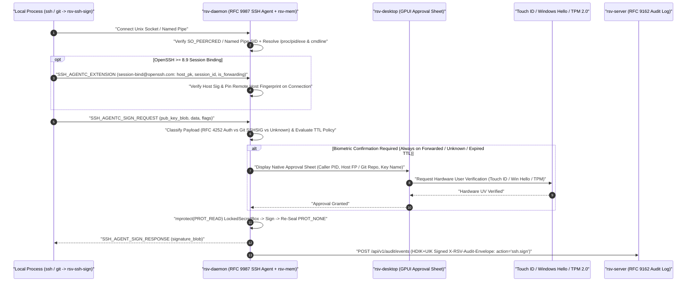
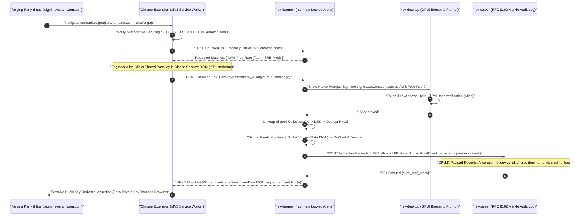
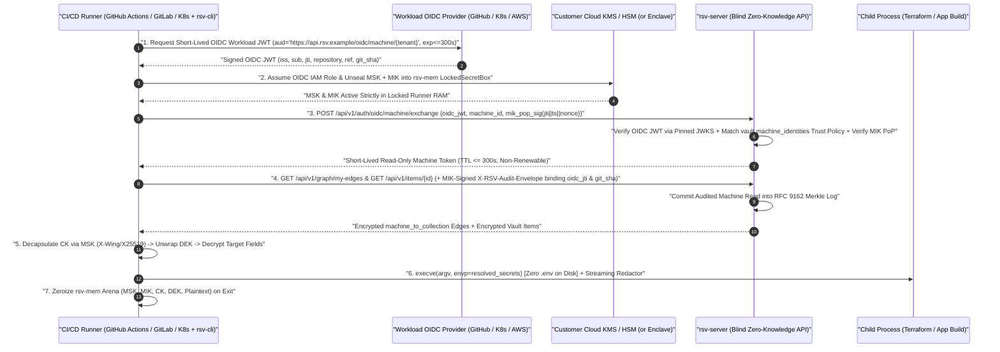

# Specification 12: Developer Secrets — Native SSH Agent, Synced Enterprise Passkeys, CLI & CI/CD OIDC Workload Identity

| Field | Value |
| :--- | :--- |
| **Document ID** | `RSV-SPEC-12` |
| **Project** | RusticStack Core (`ZK-Vault` — `https://github.com/KelpHect/ZK-Vault`) |
| **Status** | Normative (`v1.0`) |
| **License** | Dual `MIT OR Apache-2.0` |
| **Target Toolchain** | Rust 2024 Edition, MSRV `1.94.0`, PostgreSQL 17/18 |
| **Primary Crates** | `rsv-daemon`, `rsv-desktop`, `rsv-cli` (workstation/CI binary), `rsv-mem`, `rsv-enclave`, `rsv-crypto`, `rsv-graph`, `rsv-audit`, `rsv-types`, `rsv-server` |
| **Related Specs & ADRs** | [`SPEC-02`](02-CRYPTOGRAPHY-AND-KEY-HIERARCHY.md), [`SPEC-03`](03-MEMORY-SAFETY-AND-HARDWARE-TRUST.md), [`SPEC-04`](04-BLIND-RBAC-ACCESS-GRAPH.md), [`SPEC-07`](07-OMNI-CLIENT-ARCHITECTURE.md), [`SPEC-08`](08-API-AND-WIRE-PROTOCOLS.md), [`SPEC-11`](11-KEY-TRANSPARENCY-SSO-AND-SCIM.md), [`ADR-0006`](../adrs/ADR-0006-native-messaging-daemon-offload-for-extension.md), [`ADR-0010`](../adrs/ADR-0010-native-ssh-agent-and-synced-passkeys.md) |
| **Normative Standards** | RFC 9987 (SSH Agent Protocol), RFC 8709 (`ssh-ed25519`), RFC 5656 (`ecdsa-sha2-nistp256`), OpenSSH `SSHSIG` & `session-bind@openssh.com`, W3C WebAuthn Level 3, RFC 5234 (ABNF), OIDC Core 1.0, RFC 7519 (JWT), RFC 8949 (Deterministic CBOR) |

---

## 1. Conformance, Scope & Formal Invariants

The key words **"MUST"**, **"MUST NOT"**, **"REQUIRED"**, **"SHALL"**, **"SHALL NOT"**, **"SHOULD"**, **"SHOULD NOT"**, **"RECOMMENDED"**, **"NOT RECOMMENDED"**, **"MAY"**, and **"OPTIONAL"** in this document are to be interpreted as described in BCP 14 (RFC 2119 and RFC 8174) when, and only when, they appear in all capitals.

Modern engineering teams leak credentials primarily through four developer workflows: (1) unencrypted `~/.ssh/id_*` private keys sitting on laptops, (2) shared SaaS/cloud root accounts lacking passkey accountability, (3) plaintext `.env` files accidentally committed to Git or harvested by infostealers, and (4) static long-lived CI/CD service-account tokens (`OP_SERVICE_ACCOUNT_TOKEN`, `BWS_ACCESS_TOKEN`).

This specification eliminates all four exposures under RusticStack Core's zero-knowledge architecture and defines two formal invariants extending `INV-001`..`INV-027`:

### `INV-028` — Hardware/Biometric User-Presence Gating & Zero-Disk SSH Private Key Isolation
- **Formal Statement**: SSH private keys managed by RusticStack Core SHALL NEVER be written in plaintext to disk (`~/.ssh/id_*`, temporary files, or swap). While unlocked, private key bytes MUST reside exclusively inside `rsv-daemon`'s `rsv_mem::LockedSecretBox<T>` (or directly inside Apple Secure Enclave / TPM 2.0 / Windows CNG silicon for hardware-resident NIST P-256 keys). Every `SSH_AGENTC_SIGN_REQUEST` (RFC 9987) MUST authenticate the local OS peer (`SO_PEERCRED` / `LOCAL_PEERTOKEN` / Named Pipe SID), evaluate per-key biometric/TTL policy (forcing fresh interactive hardware User Verification on every forwarded agent request), and emit a hardware-signed (`HDIK` + `UIK`) blinded `AuditEnvelope` committed into the tenant's RFC 9162 Merkle log (`INV-018`).
- **Threat Coverage**: `ADV-03`, `ADV-05`, Lateral SSH Agent Hijacking
- **Owning Crates**: `rsv-daemon`, `rsv-desktop`, `rsv-mem`, `rsv-enclave`, `rsv-audit`
- **Failure Mode**: Local infostealer harvests plaintext SSH keys from `~/.ssh/`, or a compromised remote bastion hijacks a forwarded SSH agent socket silently.
- **Verification Method**: Filesystem forensics test asserting zero private-key files created on disk; `rsv-daemon` SSH agent integration tests asserting unauthorized UID rejection, forwarded-session mandatory biometric prompt, and emitted Merkle `ssh.sign` leaf (`Playbook 08`).

### `INV-029` — Ephemeral Child-Process Memory Injection (`rsv run`) with Zero Plaintext `.env` Persistence
- **Formal Statement**: `rsv-cli` (`rsv run`) resolving `rsv://` secret references MUST obtain decrypted values strictly over authenticated local OS IPC from `rsv-daemon` (workstation mode) or directly into `rsv-mem::LockedSecretBox` (CI OIDC headless mode), pass resolved secrets exclusively via child process `envp` (`execve` / `CreateProcessW`), NEVER write resolved plaintext secrets to any `.env`, swap, or temporary disk file, scrub parent process buffers via `ZeroizeOnDrop` prior to waiting/exiting, and redact accidental echoes of resolved secrets from child `stdout`/`stderr` when output masking is active.
- **Threat Coverage**: `ADV-03`, Accidental Git/CI Log Leakage
- **Owning Crates**: `rsv-cli`, `rsv-daemon`, `rsv-mem`, `rsv-types`
- **Failure Mode**: Plaintext `.env` persists in working tree, `/tmp`, or CI build logs.
- **Verification Method**: `strace`/`procmon` syscall verification test confirming zero `open`/`write` calls containing canary secret bytes; stdout/stderr redactor boundary-chunking test (`Playbook 08`).

---

## 2. Part A: Native Hardware-Gated SSH Agent (`RFC 9987`) Inside `rsv-daemon`

### 2.1 Architecture & OS Transport Endpoints

`rsv-daemon` embeds a native Rust **RFC 9987** SSH Agent listener (`#![forbid(unsafe_code)]` for wire parsing; OS peer-credential extraction delegated to `rsv-daemon`'s audited IPC layer). `rsv-daemon` NEVER spawns `ssh-agent(1)` and NEVER exports private keys into OpenSSH memory.

| Platform | Normative Agent Endpoint | Permissions / ACL | Peer Provenance Extraction |
| :--- | :--- | :--- | :--- |
| **Linux** | `$XDG_RUNTIME_DIR/rusticstack/rsv-agent.sock` | Parent dir `0700`, socket `0600` | `getsockopt(SO_PEERCRED)` -> `(pid, uid, gid)`; reject `uid != daemon_euid`; inspect `/proc/<pid>/exe`, `/proc/<pid>/cmdline`, and ancestor `ppid` chain. |
| **macOS** | `~/Library/Group Containers/<TEAM_ID>.com.rusticstack.vault/agent.sock` (symlinked at `~/.rusticstack/agent.sock` if configured) | Dir `0700`, socket `0600` | `LOCAL_PEERCRED` (`cr_uid == daemon_euid`) + `LOCAL_PEERPID` + `LOCAL_PEERTOKEN` (`proc_pidpath` + code-signing Team ID / Apple binary identifier). |
| **Windows** | `\\.\pipe\openssh-ssh-agent` (system default integration mode) OR `\\.\pipe\rusticstack-ssh-agent-<SID_PREFIX>` (dedicated mode) | `PIPE_REJECT_REMOTE_CLIENTS` + explicit SDDL DACL `D:P(A;;GA;;;<CURRENT_USER_SID>)` | `GetNamedPipeClientProcessId` + `OpenProcess(PROCESS_QUERY_LIMITED_INFORMATION)` + `QueryFullProcessImageNameW` + Win32 Authenticode check. |

### 2.2 Supported Key Algorithms, Silicon Residency & Vault Item Schema

SSH keys are encrypted as standard `vault.vault_items` (wrapped by `DEK -> CK -> TK -> USK`) with CBOR `item_type = "ssh_key_v1"`:

| OpenSSH Algorithm | Key Custody Mode | Vault Sync? | Notes |
| :--- | :--- | :---: | :--- |
| **`ssh-ed25519`** (RFC 8709) | `rsv_mem::LockedSecretBox<Ed25519Key>` | Yes (E2EE) | Primary recommended algorithm for SSH auth & Git `SSHSIG`. |
| **`ecdsa-sha2-nistp256`** (RFC 5656) | `rsv_mem::LockedSecretBox` (synced) OR **Tier-1 Hardware Silicon** (`Apple SE` / `TPM 2.0` / `Windows CNG` non-exportable) | Synced OR Device-Bound | Device-bound P-256 keys NEVER expose private scalars to host RAM (`INV-013`). |
| **`sk-ssh-ed25519@openssh.com`** | FIDO2 / CTAP2 Security Key (`key_handle` + `application` stored in vault) | Handle Synced | Delegates signing directly to physical FIDO2 token with mandatory touch + UV. |
| **OpenSSH Certificates** (`ssh-ed25519-cert-v01@openssh.com`, `ecdsa-sha2-nistp256-cert-v01@openssh.com`) | Paired with backing key above | Yes / Ephemeral | Supports short-lived SSH CA certificates issued per session. |

#### Canonical Encrypted CBOR Payload (`ssh_key_v1`)
```text
SshKeyItemPayload := {
    1:  item_type              ("ssh_key_v1"),
    2:  algorithm              ("ssh-ed25519" | "ecdsa-sha2-nistp256" | "sk-ssh-ed25519@openssh.com"),
    3:  public_key_wire        (bstr — RFC 4253 SSH wire public key blob),
    4:  private_key_material   (bstr or null — raw 32B Ed25519 seed / P-256 scalar; null if silicon/FIDO2 bound),
    5:  hardware_key_ref       (tstr or null — enclave/FIDO2 key handle if non-exportable),
    6:  openssh_certificate    (bstr or null — optional signed OpenSSH cert blob),
    7:  comment                (tstr — human label, e.g. "prod-bastion-ed25519"),
    8:  approval_policy        ({
                                   1: mode ("always_confirm" | "confirm_with_ttl" | "hardware_uv_required"),
                                   2: ttl_seconds (uint32, default 300, max 3600; IGNORED when forwarded),
                                   3: allow_agent_forwarding (bool, default false),
                                   4: allowed_git_namespaces (array<tstr>, e.g. ["git"])
                               }),
    9:  allowed_host_patterns  (array<tstr> — optional host fingerprint / hostname globs)
}
```

### 2.3 RFC 9987 Wire Protocol Handling & Security Restrictions

Every SSH Agent message uses RFC 9987 4-byte big-endian length framing (`max_frame_bytes = 262_144` / 256 KiB; oversized frames immediately disconnect).

| RFC 9987 Message | Code | `rsv-daemon` Behavior |
| :--- | :-: | :--- |
| `SSH_AGENTC_REQUEST_IDENTITIES` | `11` | Returns `SSH_AGENT_IDENTITIES_ANSWER (12)` listing ONLY public keys permitted by the active unlocked user/team agent configuration (`~/.config/rusticstack/ssh-agent.toml` collection filter). If vault is locked, returns `0` identities (or triggers non-blocking unlock prompt if policy enabled). |
| `SSH_AGENTC_SIGN_REQUEST` | `13` | Executes full Caller Provenance + Payload Inspection + Biometric Approval + Signing + Merkle Audit pipeline (Section 2.4). Returns `SSH_AGENT_SIGN_RESPONSE (14)` or `SSH_AGENT_FAILURE (5)` on denial/timeout. |
| `SSH_AGENTC_EXTENSION` | `27` | MUST implement **`session-bind@openssh.com`** (RFC 9987 / OpenSSH protocol): verifies the server's host-key signature over `session_id`, records `(host_key_fingerprint, session_id, is_forwarding)` on the active connection handle, and enforces **mandatory interactive biometric confirmation** whenever `is_forwarding == 1`. Rejects unknown extensions with `SSH_AGENT_EXTENSION_FAILURE (28)`. |
| `SSH_AGENTC_ADD_IDENTITY` / `ADD_ID_CONSTRAINED` / `ADD_SMARTCARD_KEY` | `17`, `25`, `20` | **REJECTED BY DEFAULT (`SSH_AGENT_FAILURE`)**. `rsv-daemon` refuses untrusted runtime key injection (`ssh-add`) so all usable SSH keys remain governed by Blind RBAC collections, revocation epochs, and Merkle audit logs. |
| `SSH_AGENTC_LOCK` | `22` | Immediately triggers `rsv-daemon` full vault lock & `rsv-mem` arena wipe (`<= 50 ms`). |

### 2.4 Payload Classification, Native GPUI Approval Sheet & Git Commit Signing

Before signing `data` inside `SSH_AGENTC_SIGN_REQUEST(key_blob, data, flags)`, `rsv-daemon` MUST inspect `data` and classify the exact cryptographic intent:

1. **SSH Public-Key User Authentication (RFC 4252 §7)**:
   - Parses `string session_id || byte 50 (SSH_MSG_USERAUTH_REQUEST) || string username || string "ssh-connection" || string "publickey" || boolean TRUE || string alg || string key_blob`.
   - Cross-checks `session_id` against any prior `session-bind@openssh.com` extension bound on this socket!
   - Displays in the GPUI sheet: **`SSH Login`**, target `username`, remote server `host_key_fingerprint` (SHA256:...), caller binary (`/usr/bin/ssh`, PID), and a prominent **`FORWARDED REMOTE AGENT`** crimson badge if `is_forwarding == 1` (forcing fresh biometric UV and rejecting completely if `allow_agent_forwarding == false`).
2. **Git Commit / Tag Signing (`SSHSIG`, `gpg.format = ssh`)**:
   - Detects the 6-byte magic header `"SSHSIG"` followed by `string namespace || string reserved || string hash_algorithm || string H(message)`.
   - Validates `namespace == "git"` against `approval_policy.allowed_git_namespaces`.
   - Configures Git cleanly with zero plaintext keys on disk:
     ```ini
     [gpg]
         format = ssh
     [gpg "ssh"]
         program = /usr/local/bin/rsv-ssh-sign
         allowedSignersFile = ~/.ssh/rsv_allowed_signers
     [user]
         signingkey = ssh-ed25519 AAAAC3NzaC1lZDI1NTE5AAAA...
     [commit]
         gpgsign = true
     ```
   - `rsv-ssh-sign` (a thin subcommand/symlink of `rsv-cli`) delegates directly to `rsv-daemon` over the authenticated SSH agent socket and passes repository/commit metadata so the GPUI approval sheet displays **`Git Commit Sign`**, repo path, and branch!
3. **Unclassified / Raw Signature Request**:
   - Any payload matching neither RFC 4252 userauth nor `SSHSIG` MUST NEVER inherit a cached TTL and MUST display a high-risk warning requiring explicit biometric confirmation (or be rejected if tenant policy sets `ssh_agent_reject_unknown_payloads = true`).



---

## 3. Part B: Synced Enterprise Passkeys (FIDO2 / WebAuthn Level 3 Virtual Authenticator)

### 3.1 Root Vault Passkey vs. Synced Enterprise Passkeys

Implementations MUST preserve a strict architectural boundary between two distinct FIDO2 credential classes:

1. **Root Vault Passkey (Hardware Authenticator — External to Vault)**: A physical FIDO2 key (YubiKey 5, SoloKey) or OS platform passkey supporting WebAuthn Level 3 `prf` used to unlock RusticStack Core itself (`SPEC-02`, `SPEC-11`). Its private key NEVER enters the vault.
2. **Synced Enterprise Passkeys (`passkey_v1` Vault Items — Inside Blind RBAC Collections)**: WebAuthn discoverable credentials registered with third-party Relying Parties (`aws.amazon.com`, `dash.cloudflare.com`, `github.com`, `dashboard.stripe.com`), encrypted end-to-end inside `vault.vault_items` so teams can share critical SaaS/infrastructure passkeys with cryptographic revocation and per-human auditability.

### 3.2 Canonical Encrypted Passkey Item Schema (`passkey_v1` CBOR)

Stored strictly inside the `AES-256-GCM` ciphertext payload of `vault.vault_items` (bound to canonical AAD per `INV-002`):

```text
PasskeyItemPayload := {
    1:  item_type             ("passkey_v1"),
    2:  credential_id         (bstr, 32 bytes CSPRNG — unique per credential),
    3:  rp_id                 (tstr — canonical ASCII/Punycode RP ID, e.g. "github.com"),
    4:  rp_name               (tstr — display name, e.g. "GitHub"),
    5:  user_handle           (bstr, 1..64 bytes — WebAuthn user.id),
    6:  user_name             (tstr — e.g. "sre-root@corp.example"),
    7:  user_display_name     (tstr),
    8:  cose_alg              (int: -7 = ES256 P-256 [default], -8 = EdDSA Ed25519, -257 = RS256),
    9:  private_key_pkcs8_der (bstr — raw PKCS#8 v1 DER private key; NEVER leaves rsv-mem/rsv-wasm),
    10: sign_count_policy     ("constant_zero"),
    11: uv_policy             ("require_daemon_biometric" | "require_vault_unlocked"),
    12: backup_eligible       (bool = true  — authenticatorData BE flag 0x08),
    13: backup_state          (bool = true  — authenticatorData BS flag 0x10),
    14: created_at_unix_ms    (uint64),
    15: shared_team_audit     (bool = true — forces synchronous audit envelope before returning assertion)
}
```

**Normative `signCount` & Flags Policy (WebAuthn Level 3 Multi-Device Compliance)**:
- Synced passkeys MUST set authenticatorData flags `UP = 1` (`0x01`), `UV = 1` (`0x04`, ONLY when biometric/PIN UV succeeded in `rsv-daemon`), `BE = 1` (`0x08`), `BS = 1` (`0x10`), and `signCount = 0x00000000` (`constant_zero`). Maintaining a synchronized monotonic counter across multi-user/offline devices creates false-positive cloned-authenticator lockouts at Relying Parties; `BE=1, BS=1, signCount=0` is the W3C WebAuthn Level 3 standard contract for synced credentials.

### 3.3 Chrome Extension MV3 + GPUI Daemon Virtual WebAuthn Mediation

When Chrome Extension operates in **Mode A (Daemon-Backed, `ADR-0006`)**, passkey private keys NEVER enter browser RAM or JavaScript:

1. **Scoped Interception**: The extension injects a minimal `MAIN`-world shim hooking `navigator.credentials.create` and `navigator.credentials.get` ONLY for `publicKey` requests, forwarding structured requests across a private non-tamperable `MessageChannel` to the Isolated-World Content Script -> MV3 Service Worker -> HPKE-encrypted Native Messaging (`rsv-nm-host`) -> `rsv-daemon`.
2. **Hardware Escape Hatch**: Every passkey prompt displayed in the Closed Shadow DOM picker MUST provide an immediate **"Use Hardware Security Key / OS Passkey"** button that seamlessly falls back to the native browser `navigator.credentials` implementation (mandatory so users can always use physical YubiKeys or authenticate to RusticStack Core itself — in fact, the shim MUST explicitly bypass interception on RusticStack Core's own Web SPA origin!).
3. **Strict RP ID & Anti-Phishing Origin Verification (WebAuthn §13.4.9 + `INV-023`)**:
   - The MV3 Service Worker derives the authoritative `tabOrigin` and `frameOrigin` exclusively from privileged Chrome extension APIs (`sender.tab.url`, `sender.url`) — NEVER trusting `window.location` from the page!
   - Enforces `scheme === "https"` (or `http://localhost` for local dev), canonicalizes host via UTS #46 Punycode, and asserts `rpId` is identical to `effectiveDomain` OR a valid registrable domain suffix (`eTLD+1` per Mozilla PSL) of `effectiveDomain`. Public suffixes (`com`, `co.uk`, `github.io`, `amazonaws.com`, `pages.dev`) are STRICTLY REJECTED as `rpId`.
   - Rejects cross-origin `<iframe>` assertions unless the iframe carries explicit WebAuthn Permissions Policy (`publickey-credentials-get`) AND the user confirms a dual-origin consent dialog displaying both `topOrigin` and `frameOrigin`.
   - `rsv-daemon` independently re-validates `rpId` against `origin` before constructing `clientDataJSON` (`{"type":"webauthn.get","challenge":"...","origin":"...","crossOrigin":...}`) and signing `authenticatorData || SHA-256(clientDataJSON)` inside `rsv-mem`.

### 3.4 Shared Team Passkeys with Per-Signature Human Non-Repudiation



Because `shared_team_audit == true` requires `rsv-daemon` to commit the `HDIK_Alice` + `UIK_Alice` signed `AuditEnvelope` (encrypted to `CPubK`) before returning the assertion (or fail-closed when `require_online_audit_for_shared_passkeys == true`), Compliance can prove with mathematical non-repudiation **which exact human engineer and hardware device** authenticated using the team's shared root passkey!

---

## 4. Part C: Developer CLI (`rsv-cli`), Secret References (`rsv://`) & CI/CD OIDC Workload Identity

### 4.1 `rsv-cli` Crate Placement & Zero-Key Workstation Design

`rsv-cli` is the 13th crate in RusticStack Core's 13-crate workspace—a standalone, memory-safe Rust binary (`#![forbid(unsafe_code)]`) interfacing cleanly with `rsv-types` and `rsv-daemon`'s IPC client in workstation mode (plus feature-gated `rsv-crypto`, `rsv-graph`, `rsv-audit`, and `rsv-mem` for headless CI/CD OIDC workload mode):

- **Workstation Interactive Mode**: `rsv-cli` holds **ZERO long-term keys** and NEVER reads raw vault files. It connects to `rsv-daemon` over authenticated OS IPC (`SO_PEERCRED` / `LOCAL_PEERTOKEN` / Named Pipe SID), triggers native GPUI biometric approval per workspace TTL policy, and retrieves only the exact resolved fields required for the invocation.
- **Headless CI/CD OIDC Mode (`rsv ci run`)**: Executes without `rsv-daemon` or GUI; isolates `MSK`, `CK`, `DEK`, and resolved secrets strictly inside `rsv-mem::LockedSecretBox` / `LockedArena`, authenticates via federated OIDC Workload Identity + `MIK` proof-of-possession, and zeroizes all memory immediately after `execve` / child completion.

### 4.2 Normative Secret Reference URI Grammar (`rsv://`, RFC 5234 ABNF)

Teams commit safe template files (e.g., `rsv.env.template` or `deploy.yaml`) containing `rsv://` pointers into Git with zero plaintext secrets:

```abnf
rsv-uri        = "rsv://" collection-ref "/" item-ref "/" field-ref [ "?" query-params ]
collection-ref = uuidv7 / slug-segment
item-ref       = uuidv7 / slug-segment
field-ref      = field-segment *( "." field-segment )

uuidv7         = 8HEXDIG "-" 4HEXDIG "-7" 3HEXDIG "-" ("8"/"9"/"a"/"b") 3HEXDIG "-" 12HEXDIG
slug-segment   = 1*( ALPHA / DIGIT / "-" / "_" )
field-segment  = 1*( ALPHA / DIGIT / "-" / "_" )

query-params   = query-param *( "&" query-param )
query-param    = ( "version=" 1*DIGIT )
               / ( "epoch=" 1*DIGIT )
               / ( "encoding=" ( "raw" / "base64" / "hex" / "json_escape" ) )
```

**Normative Resolution Rules**:
1. **Zero Server Name Leakage**: When `slug-segment` names are used (e.g., `rsv://prod-payments/stripe-live/api_key`), slug-to-UUID resolution MUST occur strictly inside `rsv-daemon`'s (or CI client's) locally decrypted index — plaintext collection, item, or field names MUST NEVER be sent in query parameters to `rsv-server` (`INV-001`).
2. **Production Pinning**: CI/CD pipelines SHOULD use canonical UUIDv7 references (`rsv://0194f2a0-.../0194f2a1-.../db_password?version=4`) to prevent accidental slug ambiguity or silent target rebinding.
3. **Strict Unknown-Field Rejection**: If any referenced item, revision, or field is missing or unauthorized, `rsv run` MUST abort with non-zero exit code `78` (`EX_CONFIG`) BEFORE spawning the child process.

### 4.3 Zero-Disk Execution (`rsv run`) & Streaming Output Redaction (`INV-029`)

```bash
# Safe to commit rsv.env.template to Git:
# DATABASE_URL=rsv://prod-db/postgres-primary/connection_uri
# STRIPE_SECRET_KEY=rsv://prod-payments/stripe-live/secret_key?encoding=raw
rsv run --env-file=rsv.env.template --mask-output -- ./scripts/migrate.sh
```

Normative execution contract for `rsv run`:
1. **Template Parsing & Batch Resolution**: `rsv-cli` parses `rsv.env.template` (and optional process env vars containing `rsv://` values), requests a single batched resolution from `rsv-daemon` (triggering one biometric approval sheet listing exact item titles + child command argv), and emits a single signed `AuditEnvelope` (`action = "cli.run.resolve"`).
2. **Direct Memory-Only `envp` Injection**: `rsv-cli` constructs the child's environment block directly in locked memory, replaces `rsv://` entries with resolved plaintext, and spawns `<command>` via OS process creation (`execve`/`posix_spawn` on Unix; `CreateProcessW` on Windows). Zero temporary `.env` files are ever created on disk.
3. **Parent Scrubbing**: Immediately after spawning the child, `rsv-cli` drops and zeroizes all resolved secret buffers (retaining only the locked Aho-Corasick automaton if `--mask-output` is enabled, which itself lives in `rsv-mem` and zeroizes on child exit).
4. **Streaming Output Redactor (`--mask-output`, Default ON in CI/non-TTY)**:
   - Captures child `stdout` and `stderr` via pipes, runs a constant-memory streaming **Aho-Corasick** matcher with sliding overlap window `max_secret_len - 1` (preventing chunk-boundary evasion when a secret splits across two `read()` calls!).
   - Indexes raw secret values (`len >= 8` bytes) PLUS their canonical `base64`, `base64url`, and `percent-encoded` derivatives.
   - Replaces any match with `<REDACTED:rsv:ENV_VAR_NAME>` before flushing to parent `stdout`/`stderr`.
5. **Ephemeral Virtual File Descriptor Mode (`rsv inject --fd` / `--memfd`)**: For legacy tools requiring a file path (e.g., TLS private key files), `rsv-cli` MAY expose a read-only Linux `memfd_create` (`/proc/self/fd/N`, sealed with `F_SEAL_WRITE | F_SEAL_GROW`) or anonymous OS pipe passed exclusively to the child — still guaranteeing zero persistent filesystem writes (`INV-029`).

### 4.4 Zero-Knowledge CI/CD Machine Identities (OIDC Workload Identity + Blind RBAC)

RusticStack Core eliminates static CI service-account bearer tokens (`OP_SERVICE_ACCOUNT_TOKEN`, `BWS_ACCESS_TOKEN`) by combining **Federated OIDC Workload Identity** with **Blind RBAC leaf nodes (`vault.machine_identities`)**:

1. **Ordinary Blind RBAC Leaf Node**: A Machine Identity `M` has its own asymmetric KEM keypair (`MPK` / `MSK`, `CS-01` X25519 or `CS-02` X-Wing) and signing keypair (`MIK`, Ed25519 / Hybrid). An Org Admin grants `M` access to specific collections by wrapping `CK(collection_id, epoch)` to `MPK` using a **`machine_to_collection`** edge with strict **`permission_mask = 0x01` (READ-ONLY)** (machines cannot grant edges, rotate epochs, or access `root_quorum_only` collections).
2. **Zero Static Credentials — Two Cloud/Enclave Custody Modes for `MSK`/`MIK`**:
   - **Mode 1 (Cloud KMS / HSM-Sealed `MSK`, RECOMMENDED)**: `MSK` and `MIK` are encrypted at rest under a customer Cloud KMS key (AWS KMS, GCP Cloud KMS, Azure Key Vault HSM) whose IAM trust policy requires the exact OIDC workload identity (`repo:acme/payments:ref:refs/heads/main`, K8s namespace/SA). The encrypted `MSK` blob MAY be stored alongside the CI workflow or in `vault.machine_identities.encrypted_msk_kms_ref` (an opaque KMS ciphertext unreadable by `rsv-server`). At runtime, the runner proves its OIDC identity to its own Cloud KMS to unwrap `MSK`/`MIK` inside locked runner RAM (`rsv-mem`).
   - **Mode 2 (Confidential Runner Enclave / Hardware TPM)**: Self-hosted Kubernetes/bare-metal runners or AWS Nitro Enclaves hold `MSK`/`MIK` non-exportably inside local TPM 2.0 / enclave silicon (`rsv-enclave`).
3. **Dual Proof Exchange (`OIDC JWT` + `MIK` Proof-of-Possession)**:
   - Even if an attacker steals a short-lived GitHub Actions OIDC JWT (`exp <= 5 min`), it CANNOT decrypt anything without `MSK` AND cannot even obtain encrypted `vault_items` from `rsv-server` without signing the exchange challenge with `MIK`!



---

## 5. Normative PostgreSQL `vault` Schema Extensions (`SPEC-05` Alignment)

```sql
-- =============================================================================
-- Extension Enum Update & Table 16: vault.machine_identities (SPEC-12)
-- =============================================================================
-- Extend canonical graph edge taxonomy for read-only machine leaf grants:
ALTER TYPE vault.graph_edge_type ADD VALUE IF NOT EXISTS 'machine_to_collection';

CREATE TYPE vault.machine_status AS ENUM (
    'active',
    'suspended',
    'revoked'
);

CREATE TABLE vault.machine_identities (
    tenant_id                 UUID                  NOT NULL,
    machine_id                UUID                  NOT NULL,
    display_name              TEXT                  NOT NULL,
    status                    vault.machine_status  NOT NULL DEFAULT 'active',
    cipher_suite              SMALLINT              NOT NULL DEFAULT 2,
    key_epoch                 INTEGER               NOT NULL DEFAULT 1,
    mik_public_key            BYTEA                 NOT NULL,
    mpk_public_key            BYTEA                 NOT NULL,
    mpk_mik_signature         BYTEA                 NOT NULL,
    oidc_issuer_url           TEXT                  NOT NULL,
    oidc_audience             TEXT                  NOT NULL,
    oidc_subject_pattern      TEXT                  NOT NULL,
    oidc_required_claims      JSONB                 NOT NULL DEFAULT '{}'::jsonb,
    max_token_ttl_seconds     INTEGER               NOT NULL DEFAULT 300,
    created_by_user_id        UUID                  NOT NULL,
    created_at                TIMESTAMPTZ           NOT NULL DEFAULT now(),
    updated_at                TIMESTAMPTZ           NOT NULL DEFAULT now(),
    revoked_at                TIMESTAMPTZ,

    CONSTRAINT pk_machine_identities
        PRIMARY KEY (tenant_id, machine_id),
    CONSTRAINT fk_machine_identities_tenant
        FOREIGN KEY (tenant_id)
        REFERENCES vault.tenants (tenant_id),
    CONSTRAINT fk_machine_identities_creator
        FOREIGN KEY (tenant_id, created_by_user_id)
        REFERENCES vault.users (tenant_id, user_id),
    CONSTRAINT chk_machine_cipher_suite
        CHECK (cipher_suite IN (1, 2)),
    CONSTRAINT chk_machine_epoch
        CHECK (key_epoch >= 1),
    CONSTRAINT chk_machine_issuer_https
        CHECK (oidc_issuer_url ~ '^https://'),
    CONSTRAINT chk_machine_ttl_bounds
        CHECK (max_token_ttl_seconds BETWEEN 30 AND 900),
    CONSTRAINT chk_machine_claims_obj
        CHECK (jsonb_typeof(oidc_required_claims) = 'object'),
    CONSTRAINT chk_machine_key_lens
        CHECK (
            octet_length(mik_public_key) BETWEEN 32 AND 4096
            AND octet_length(mpk_public_key) BETWEEN 32 AND 2048
        )
);

CREATE INDEX idx_machine_identities_tenant_issuer
    ON vault.machine_identities (tenant_id, oidc_issuer_url)
    WHERE status = 'active';

CREATE TRIGGER trg_machine_identities_touch_updated_at
    BEFORE UPDATE ON vault.machine_identities
    FOR EACH ROW
    EXECUTE FUNCTION vault.touch_updated_at();

-- Mandatory FORCE RLS (InitPlan-cached LEAKPROOF predicate)
ALTER TABLE vault.machine_identities ENABLE ROW LEVEL SECURITY;
ALTER TABLE vault.machine_identities FORCE ROW LEVEL SECURITY;

CREATE POLICY pol_machine_identities_tenant_isolation ON vault.machine_identities
    AS PERMISSIVE FOR ALL TO rsv_app, rsv_auditor_ro, rsv_migrator
    USING (tenant_id = (SELECT NULLIF(current_setting('app.current_tenant_id', true), '')::uuid))
    WITH CHECK (tenant_id = (SELECT NULLIF(current_setting('app.current_tenant_id', true), '')::uuid));

GRANT SELECT, INSERT, UPDATE ON vault.machine_identities TO rsv_app;
GRANT SELECT ON vault.machine_identities TO rsv_auditor_ro;
```

**Read-Only Edge Enforcement Rule**: `rsv-server` AND a PostgreSQL check constraint on `vault.key_graph_edges` MUST enforce that every row with `edge_type = 'machine_to_collection'` satisfies `permission_mask = 1` (`READ` ONLY). Attempting to grant `WRITE`, `MANAGE_MEMBERS`, or `ROTATE_KEYS` to a machine identity MUST be rejected with `422 ESCROW_POLICY_VIOLATION`.

---

## 6. Normative `/api/v1` Endpoint Additions (`SPEC-08` Extension)

| Method | Path | Auth | `X-RSV-Audit-Envelope` | `Idempotency-Key` | Purpose |
| :--- | :--- | :--- | :---: | :---: | :--- |
| `POST` | `/api/v1/machines` | Bearer + Sig (Admin) | Yes | Yes | Register Machine Identity (`MPK`, `MIK`, OIDC `iss`/`sub`/`aud`/claims) |
| `GET` | `/api/v1/machines` | Bearer + Sig (Admin) | No | No | List tenant Machine Identities & status |
| `DELETE` | `/api/v1/machines/{machine_id}` | Bearer + Sig (Admin) | Yes | Yes | Revoke Machine Identity immediately (pair with `CK` epoch rotation!) |
| `POST` | `/api/v1/auth/oidc/machine/exchange` | OIDC JWT + `MIK` PoP | No | Yes | Verify OIDC Workload JWT + `MIK` signature; mint `<= 300s` read-only token |
| `POST` | `/api/v1/audit/events` | Bearer + Sig | Yes | Yes | Commit client-originated non-repudiable `ssh.sign` / `passkey.assert` / `cli.run.resolve` Merkle leaves |

---

## 7. Verification & Acceptance Criteria

1. **Zero-Disk SSH Agent Forensics (`INV-028`)**: Create `ssh-ed25519` and `ecdsa-sha2-nistp256` vault items, execute `ssh` authentication and `git commit -S` (`gpg.format = ssh`) via `rsv-daemon`, and assert: (a) zero private-key bytes written anywhere under `$HOME` or `/tmp`, (b) `SSH_AGENTC_ADD_IDENTITY` returns `SSH_AGENT_FAILURE`, (c) `session-bind@openssh.com` with `is_forwarding=1` bypasses cached TTL and mandates interactive approval, and (d) an `ssh.sign` leaf appears in `vault.audit_events`.
2. **Synced Team Passkey Anti-Phishing & Non-Repudiation Matrix**: Run Chromium/Playwright tests against WebAuthn assertions verifying: (a) exact `rpId` & PSL `eTLD+1` enforcement (rejecting `github.io` public suffix and lookalike Punycode hosts), (b) zero PKCS#8 private key bytes inside browser JS heap, and (c) `rsv-compliance-cli` decrypting `passkey.assert` audit envelopes offline to prove exact human `user_id` + `device_id`.
3. **Zero-Disk `rsv run` & Output Redactor Verification (`INV-029`)**: Run `rsv run --env-file=test.env.template --mask-output -- <probe>` under `strace`/syscall monitor asserting zero plaintext `.env` writes, full env injection into child process, scrubbing of canary secrets split across `4 KiB` stdout pipe boundaries (plus base64-encoded variants), and post-exit zeroed parent buffers.
4. **OIDC Workload Identity Negative Suite**: Verify `POST /api/v1/auth/oidc/machine/exchange` rejects: (a) wrong `aud`, (b) mismatched `sub` glob / `repository` claim, (c) expired JWT, (d) valid OIDC JWT with invalid/missing `MIK` PoP signature, and (e) `machine_to_collection` edges with `permission_mask != 0x01`.
