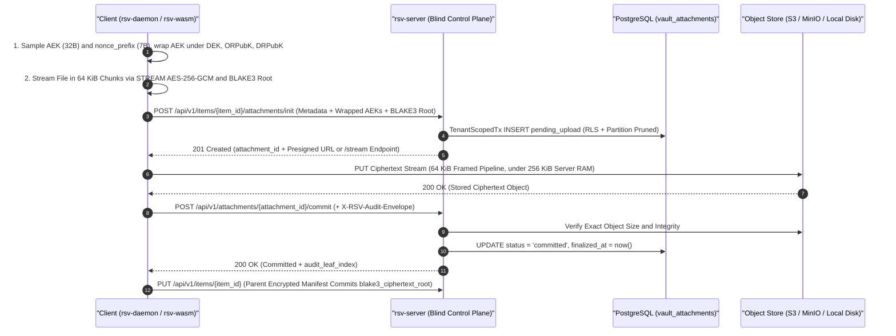
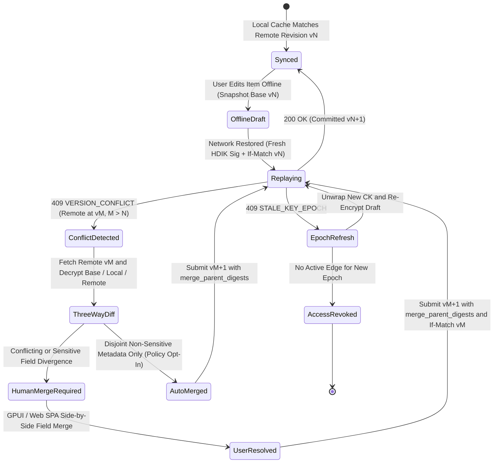

# SPEC-13: Streaming Encrypted Attachments, Offline-First Sync & Lossless Migration

| Field | Value |
| :--- | :--- |
| **Document ID** | `RSV-SPEC-13` |
| **Project** | RusticStack Core (`ZK-Vault` — `https://github.com/KelpHect/ZK-Vault`) |
| **Status** | Normative Draft (`v1.0`) |
| **License** | Dual `MIT OR Apache-2.0` |
| **Target Toolchain** | Rust 2024 Edition, MSRV `1.94.0` |
| **Normative Crates** | `rsv-types`, `rsv-crypto`, `rsv-daemon`, `rsv-wasm`, `rsv-desktop`, `rsv-server`, `rsv-cli` |
| **Related Specs** | `SPEC-02`, `SPEC-03`, `SPEC-05`, `SPEC-06`, `SPEC-07`, `SPEC-08`, `SPEC-09`, `SPEC-14` |
| **Related ADRs** | [`ADR-0011`](../adrs/ADR-0011-stream-chunked-aead-and-fido-cxf.md), [`ADR-0001`](../adrs/ADR-0001-hybrid-escrow-and-feldman-vss.md), [`ADR-0007`](../adrs/ADR-0007-crypto-agility-xwing-post-quantum-hybrid.md) |
| **New Formal Invariants** | `INV-030`, `INV-031` |

---

## 1. Scope & Normative Conventions

This specification defines three production-critical subsystems of RusticStack Core (`ZK-Vault`) that govern large-object confidentiality, disconnected workstation continuity, and zero-lock-in credential portability:

1. **Part A — Streaming Chunked AEAD for Encrypted Attachments (STREAM Construction)**: Constant-memory, authenticated, anti-truncation and anti-reordering chunked encryption (`AES-256-GCM`) for 50–500+ MiB vault attachments, backed by incremental BLAKE3 ciphertext commitments and the multi-tenant `vault.vault_attachments` PostgreSQL extension table.
2. **Part B — Offline-First Encrypted Local Cache & Deterministic Sync**: Hardware-sealed (`HDSK`) zero-plaintext local storage in `rsv-daemon`, monotonic cursor delta synchronization, authenticated offline mutation replay, and lossless 3-way conflict surfacing (`409 VERSION_CONFLICT`).
3. **Part C — Lossless Migration, Interoperability & Offline Emergency Recovery Kit**: Standards-based encrypted FIDO Alliance **CXF v1.0 / CXP** credential interchange, pure-Rust client-side offline importers (Bitwarden, 1Password `.1pux`, KeePassXC `.kdbx` v4, hardened CSV), and 100% locally generated printable Emergency Recovery Kits.

The key words **"MUST"**, **"MUST NOT"**, **"REQUIRED"**, **"SHALL"**, **"SHALL NOT"**, **"SHOULD"**, **"SHOULD NOT"**, **"RECOMMENDED"**, **"NOT RECOMMENDED"**, **"MAY"**, and **"OPTIONAL"** in this document are to be interpreted as described in BCP 14 (RFC 2119 and RFC 8174) when, and only when, they appear in all capitals.

### 1.1 Architectural Guardrail Alignment

Every subsystem specified herein MUST uphold all existing RusticStack Core security invariants:
- **`INV-001` (Zero Server Knowledge)**: `rsv-server` and object storage MUST NEVER receive plaintext attachment bytes, plaintext filenames/MIME types, local cache keys, unencrypted import archives, or Emergency Recovery Kit secrets.
- **`INV-002` (Mandatory AEAD AAD)**: Every attachment chunk, key wrap, and local cache page MUST authenticate a canonical RFC 8949 Section 4.2 CBOR AAD structure.
- **`INV-010` / `INV-012` (`unsafe` Firewall & Core `no_std`)**: The STREAM cipher engine, BLAKE3 commitment verifier, 3-way merge engine, CXF codec, and offline importers residing in `rsv-types` and `rsv-crypto` MUST declare `#![forbid(unsafe_code)]`, MUST remain `no_std + alloc` compatible, and MUST compile cleanly to `wasm32-unknown-unknown`.
- **`INV-024` (WASM Fixed-Arena Memory)**: Streaming encryption/decryption in `rsv-wasm` MUST operate strictly inside pre-allocated 64 KiB fixed chunk slots and MUST NEVER trigger `memory.grow()`.

---

## 2. Part A: Streaming Chunked AEAD for Encrypted Attachments (STREAM Construction)

### 2.1 Why Monolithic `AES-256-GCM` Fails for Large Attachments

Encrypting 50–500 MiB attachments (TLS certificates, PKCS#12 bundles, SSH keys, legal/compliance PDFs, recovery archives) as a single monolithic `AES-256-GCM` `RSV1` envelope (`SPEC-02 §4.1`, capped at 64 MiB) causes four severe security and reliability failures:

1. **WASM & Mobile OOM Violations**: Under `INV-024`, `rsv-wasm` runs inside a statically bounded linear memory arena with `memory.grow()` disabled. Buffering a 250 MiB plaintext + 250 MiB ciphertext simultaneously in RAM immediately crashes Web SPA, Chrome Extension, and memory-constrained mobile/desktop runtimes.
2. **Delayed Authentication (Unverified Buffering DoS)**: Monolithic `AES-256-GCM` places its 128-bit GHASH authentication tag at the end of the entire stream. A receiver MUST either buffer hundreds of megabytes in memory or write unauthenticated attacker-controlled bytes to disk before verifying a single bit—opening disk-exhaustion and parser-exploitation surfaces.
3. **Server Memory Exhaustion**: Proxying monolithic blobs through `rsv-server` breaks the `< 128 MiB` Sovereign Mode memory envelope (`SPEC-14 §2.1`) under concurrent multi-user uploads.
4. **Lack of Resumable / Progressive Verification**: A single flipped bit at byte 499,000,000 invalidates an entire transfer with no chunk-level progress verification or constant-memory bounded pipeline.

RusticStack Core therefore mandates the formally proven **STREAM online authenticated encryption construction** (Hoang, Reyhanitabar, Rogaway, and Vizár, *CRYPTO 2015*, *"Online Authenticated-Encryption and its Nonce-Reuse Misuse-Resistance"*) instantiated over `AES-256-GCM`.

---

### 2.2 Normative STREAM (`AES-256-GCM`) Specification

#### 2.2.1 Attachment Encryption Key (`AEK`) & Multi-Wrap Custody

For every uploaded attachment, the client MUST sample a fresh 256-bit uniform random **Attachment Encryption Key (`AEK`)** from the OS CSPRNG (`getrandom` / `OsRng`). An `AEK` MUST NEVER be reused across distinct `attachment_id` values or re-uploads.

`AEK` MUST be wrapped using canonical `RSV1` envelopes (`SPEC-02 §4.1`) strictly honoring the parent collection's `escrow_tier`:

| Wrap Field | Wrapping Key | Algorithm (`CS-01` / `CS-02`) | `wrapping_key_role` AAD | Escrow Tier Applicability |
| :--- | :--- | :--- | :--- | :--- |
| **`wrapped_aek_item`** | Parent Item `DEK(item_id, item_version)` | `AES-256-GCM` (`RSV1` type `0x01`) | `"dek"` | **Mandatory** on all tiers (`standard`, `enterprise_escrow`, `strict_zk`) |
| **`wrapped_aek_escrow`** | Organization Root `ORPubK(orpk_epoch)` | RFC 9180 HPKE (`X25519` / `X-Wing`, `RSV1` type `0x02`) | `"orpubk"` | **Mandatory** on `standard` and `enterprise_escrow` (`root_quorum_only`); optional/NULL on `strict_zk` |
| **`wrapped_aek_delegated`** | Delegated Recovery `DRPubK(drpk_epoch)` | RFC 9180 HPKE (`X25519` / `X-Wing`, `RSV1` type `0x02`) | `"drpubk"` | **Mandatory** on `standard` ONLY; **STRICTLY `NULL` / FORBIDDEN** on `enterprise_escrow` (`root_quorum_only`) and `strict_zk` |

> **Escrow Tier Terminology Alignment**: Throughout PostgreSQL DDL (`schemas/postgresql-schema.sql`), the policy class `root_quorum_only` (`SPEC-02`, `SPEC-09`) maps 1-to-1 to enum value `vault.escrow_tier = 'enterprise_escrow'` (requiring `ORPubK` quorum wrap and strictly prohibiting `DRPubK` delegated recovery).

**Item Mutation & Re-Wrapping Semantics**:
- Because `DEK(item_id, version)` rotates on every item revision (`SPEC-02 §3.2`), editing non-attachment fields of an item with an existing 400 MiB attachment does NOT require re-uploading ciphertext chunks: the client unwraps the existing `AEK` using `DEK(item_id, v_old)` and emits an updated `wrapped_aek_item` under `DEK(item_id, v_new)` referencing the immutable `attachment_id` and `blake3_ciphertext_root`.
- Conversely, whenever collection revocation (`INV-009`) requires forward-secure attachment re-keying (under `eager_background` or `eager_blocking` re-encryption policy), the client MUST generate a brand-new `attachment_id`, fresh `AEK`, and fresh `nonce_prefix`, re-encrypting the attachment into a new object and marking the superseded attachment `deleted`.

#### 2.2.2 Chunk Geometry & Boundaries

| Parameter | Normative Value / Range | Rule |
| :--- | :--- | :--- |
| **`CHUNK_SIZE_BYTES`** | Default **`65,536` bytes (`64 KiB`)**; valid range `16,384..=1,048,576` | v1 clients MUST emit `65,536` bytes for every non-final chunk. Decryptors MUST read `chunk_size_bytes` from authenticated metadata and MUST reject any value outside `16,384..=1,048,576`. |
| **AEAD Tag Length** | **`16` bytes** (`128`-bit GCM tag) | Every chunk ciphertext length is `plaintext_chunk_len + 16`. A full 64 KiB chunk occupies exactly `65,552` bytes on wire and disk. |
| **Final Chunk Plaintext Length** | `0 <= len <= chunk_size_bytes` | A stream whose plaintext length is an exact multiple of `65,536` (including a 0-byte empty file) MUST end with either the final full chunk marked `final_flag = 0x01` (if length known ahead of time) OR a 0-byte terminal chunk (`16`-byte tag) marked `final_flag = 0x01` (for streaming sources of unknown length). Decryptors MUST accept both unambiguously. |
| **Maximum Attachment Size** | Default tenant cap **`536,870,912` bytes (`512 MiB`)**; hard protocol ceiling **`2,147,483,648` bytes (`2 GiB`)** | Keeps total `chunk_count <= 32,768` at 64 KiB, well below `u32::MAX` (`4,294,967,295`) and far beneath the `AES-256-GCM` $2^{39}-256$ bit single-invocation limit. |

#### 2.2.3 Exact 96-Bit Deterministic Per-Chunk Nonce Construction

Every chunk $i \in [0, N-1]$ MUST construct its 96-bit (12-byte) `AES-256-GCM` nonce deterministically as:

```text
Byte Offset:  0    1    2    3    4    5    6    7    8    9    10   11
            +----+----+----+----+----+----+----+----+----+----+----+----+
            |       nonce_prefix (7 B)         |  chunk_counter    |  F |
            |         CSPRNG random            |   BE u32 (4 B)    | 1B |
            +----+----+----+----+----+----+----+----+----+----+----+----+
```

- **`nonce_prefix` (`[u8; 7]`)**: 7 uniform random bytes sampled from OS CSPRNG once per attachment creation. Stored alongside attachment metadata and verified against the parent item's encrypted manifest.
- **`chunk_counter` (`[u8; 4]`)**: 4-byte **big-endian** unsigned integer (`u32::to_be_bytes(i)`), starting at `0` for the first chunk and incrementing strictly by `+1` for each subsequent chunk. Encryptor MUST abort with `CryptoError::StreamCounterOverflow` if `i == u32::MAX` and additional plaintext remains.
- **`final_flag` (`F`, `1 byte`)**:
  - `0x00` for every intermediate chunk ($0 \le i < N - 1$).
  - `0x01` for the unique terminal chunk ($i = N - 1$).
  - Any other byte value (`0x02..=0xFF`) is INVALID and MUST be rejected.

#### 2.2.4 Per-Chunk Canonical CBOR AAD

Every chunk invocation of `AES-256-GCM` MUST supply an **RFC 8949 Section 4.2 Core Deterministic CBOR** map (integer keys sorted strictly ascending, definite lengths, shortest integer representations, zero floating-point types) as its Associated Authenticated Data (`AAD`):

| CBOR Key | Field Name | CBOR Type | Exact Value / Semantics |
| :---: | :--- | :--- | :--- |
| `1` | `domain` | `tstr` | Literal UTF-8 string `"rsv:attach:v1"` |
| `2` | `tenant_id` | `bstr(16)` | 16-byte raw UUID of the owning tenant |
| `3` | `item_id` | `bstr(16)` | 16-byte raw UUID of the parent vault item |
| `4` | `attachment_id` | `bstr(16)` | 16-byte raw UUID of this attachment |
| `5` | `chunk_counter` | `uint` | Exact 0-based `u32` chunk index matching nonce bytes `7..11` |
| `6` | `final_flag` | `uint` | `0` (`0x00`) for intermediate chunk, `1` (`0x01`) for final chunk |
| `7` | `cipher_suite_id` | `uint` | `0x0001` (`CS-01`) or `0x0002` (`CS-02`) |

#### 2.2.5 Cryptographic Security Guarantees (STREAM Proofs)

The combination of fresh `AEK`, deterministic `(nonce_prefix || BE_u32(i) || final_flag)` nonce, and per-chunk canonical AAD mathematically enforces four non-negotiable integrity properties:

1. **Anti-Reordering**: Swapping ciphertext chunk $i$ with chunk $j$ ($i \neq j$) alters both the nonce `chunk_counter` and AAD key `5`, causing immediate 128-bit GCM tag failure (`CryptoError::AeadAuthenticationFailed`).
2. **Anti-Duplication & Anti-Drop**: Duplicating chunk $i$ at offset $i+1$ or deleting an interior chunk shifts every subsequent chunk's expected counter, causing immediate failure on the very next 64 KiB boundary.
3. **Anti-Truncation & Anti-Extension**: Truncating the stream after any intermediate chunk leaves the decryptor without a `final_flag = 0x01` authentication tag; the decryptor MUST return `CryptoError::StreamPrematureEof` and MUST unlink/zeroize any partially emitted output. Appending bytes after a chunk authenticated with `final_flag = 0x01` MUST trigger `CryptoError::StreamTrailingData`.
4. **Anti-Cross-File / Cross-Tenant Splicing**: Binding `(domain, tenant_id, item_id, attachment_id, cipher_suite_id)` into every chunk's AAD defeats transplanting valid chunks from another attachment, item, or tenant even if an adversary controlled storage keys.

#### 2.2.6 Incremental BLAKE3 Ciphertext Root & Parent Manifest Binding

In addition to per-chunk `AES-256-GCM` tags, every attachment MUST compute an incremental **32-byte `blake3_ciphertext_root`** over the exact ordered ciphertext stream using domain-separated BLAKE3:

```text
blake3_ctx = "rsv:attach:blake3:v1" || tenant_id (16B) || item_id (16B) || attachment_id (16B) || nonce_prefix (7B) || BE_u32(chunk_size_bytes)
blake3_ciphertext_root = BLAKE3(blake3_ctx || chunk_0_ct || chunk_1_ct || ... || chunk_{N-1}_ct)
```

where each `chunk_i_ct` is the exact `plaintext_i_len + 16` byte ciphertext-plus-tag output of chunk $i$.

**Dual Commitment Rule (Defeating Malicious Server Substitution — `ADV-01`)**:
1. **Server Storage Integrity (`vault.vault_attachments.blake3_ciphertext_root`)**: `rsv-server` records `blake3_ciphertext_root` during attachment commit and uses it to verify upload completeness and object-store integrity without decrypting anything.
2. **Client Authenticated Manifest (`vault_item.encrypted_payload`)**: The parent vault item's encrypted CBOR payload (authenticated by `DEK` and signed by author `UIK`) MUST embed an `AttachmentManifestEntry` containing:
   - `attachment_id` (UUIDv7)
   - `encrypted_filename`, `mime_type`, `plaintext_size_bytes` (strictly inside item ciphertext—NEVER sent to `rsv-server`!)
   - `chunk_size_bytes`, `chunk_count`, `ciphertext_size_bytes`
   - `nonce_prefix` (`[u8; 7]`)
   - `blake3_ciphertext_root` (`[u8; 32]`)

Before decrypting chunk `0` (and upon completing the stream), the downloading client MUST verify that the server-returned metadata matches the authenticated parent manifest AND that the computed streaming BLAKE3 digest equals `manifest.blake3_ciphertext_root` in constant time (`subtle::ConstantTimeEq`).

---

### 2.3 Normative PostgreSQL Extension DDL: `vault.vault_attachments`

To maintain 100% parity with `schemas/postgresql-schema.sql` (`SPEC-05`, `INV-006`, `INV-007`), attachments extend the `vault` schema with a 13th table (`vault.vault_attachments`) that enforces leading `tenant_id` primary keys, 64-way `HASH (tenant_id)` partitioning, `FORCE ROW LEVEL SECURITY` with InitPlan-cached `LEAKPROOF` predicates, and escrow policy `CHECK` constraints:

```sql
-- =============================================================================
-- Extension Table 13: vault.vault_attachments (HASH Partitioned, 64 parts)
-- =============================================================================
-- Normative Reference: specs/13-STREAMING-ATTACHMENTS-OFFLINE-SYNC-AND-MIGRATION.md
-- Enforces INV-001, INV-006, INV-007, INV-030.

CREATE TYPE vault.attachment_status AS ENUM (
    'pending_upload',
    'committed',
    'deleted',
    'shredded'
);

CREATE TABLE vault.vault_attachments (
    tenant_id                 UUID                     NOT NULL,
    attachment_id             UUID                     NOT NULL,
    item_id                   UUID                     NOT NULL,
    item_version              BIGINT                   NOT NULL,
    escrow_tier               vault.escrow_tier        NOT NULL,
    cipher_suite              SMALLINT                 NOT NULL,
    chunk_size_bytes          INTEGER                  NOT NULL DEFAULT 65536,
    chunk_count               INTEGER                  NOT NULL,
    ciphertext_size_bytes     BIGINT                   NOT NULL,
    nonce_prefix              BYTEA                    NOT NULL,
    blake3_ciphertext_root    BYTEA                    NOT NULL,
    aad_digest                BYTEA                    NOT NULL,
    wrapped_aek_item          BYTEA                    NOT NULL,
    wrapped_aek_escrow        BYTEA,
    wrapped_aek_delegated     BYTEA,
    orpk_epoch                INTEGER,
    drpk_epoch                INTEGER,
    storage_key               TEXT                     NOT NULL,
    status                    vault.attachment_status  NOT NULL DEFAULT 'pending_upload',
    created_at                TIMESTAMPTZ              NOT NULL DEFAULT now(),
    finalized_at              TIMESTAMPTZ,
    deleted_at                TIMESTAMPTZ,

    CONSTRAINT pk_vault_attachments
        PRIMARY KEY (tenant_id, attachment_id),
    CONSTRAINT fk_vault_attachments_item
        FOREIGN KEY (tenant_id, item_id)
        REFERENCES vault.vault_items (tenant_id, item_id),
    CONSTRAINT chk_vault_attachments_cipher_suite
        CHECK (cipher_suite IN (1, 2)),
    CONSTRAINT chk_vault_attachments_chunk_bounds
        CHECK (
            chunk_size_bytes BETWEEN 16384 AND 1048576
            AND chunk_count >= 1
            AND ciphertext_size_bytes >= (chunk_count::bigint * 16)
            AND ciphertext_size_bytes <= (chunk_count::bigint * (chunk_size_bytes::bigint + 16))
        ),
    CONSTRAINT chk_vault_attachments_crypto_lens
        CHECK (
            octet_length(nonce_prefix) = 7
            AND octet_length(blake3_ciphertext_root) = 32
            AND octet_length(aad_digest) = 32
        ),
    CONSTRAINT chk_vault_attachments_storage_key
        CHECK (storage_key ~ '^[a-zA-Z0-9/_.-]{16,256}$'),
    CONSTRAINT chk_vault_attachments_status_timestamps
        CHECK (
            (status <> 'committed' OR finalized_at IS NOT NULL)
            AND (status NOT IN ('deleted', 'shredded') OR deleted_at IS NOT NULL)
        ),
    CONSTRAINT chk_vault_attachments_escrow_policy
        CHECK (
            (
                escrow_tier = 'standard'
                AND wrapped_aek_escrow IS NOT NULL
                AND orpk_epoch IS NOT NULL AND orpk_epoch >= 1
                AND wrapped_aek_delegated IS NOT NULL
                AND drpk_epoch IS NOT NULL AND drpk_epoch >= 1
            )
            OR (
                escrow_tier = 'enterprise_escrow'
                AND wrapped_aek_escrow IS NOT NULL
                AND orpk_epoch IS NOT NULL AND orpk_epoch >= 1
                AND wrapped_aek_delegated IS NULL
                AND drpk_epoch IS NULL
            )
            OR (
                escrow_tier = 'strict_zk'
                AND wrapped_aek_delegated IS NULL
                AND drpk_epoch IS NULL
                AND (wrapped_aek_escrow IS NULL OR (orpk_epoch IS NOT NULL AND orpk_epoch >= 1))
            )
        )
) PARTITION BY HASH (tenant_id);

CREATE INDEX idx_vault_attachments_item_active
    ON vault.vault_attachments (tenant_id, item_id, created_at DESC)
    WHERE status = 'committed';

CREATE INDEX idx_vault_attachments_orphan_gc
    ON vault.vault_attachments (tenant_id, created_at ASC)
    WHERE status = 'pending_upload';

-- Create 64 deterministic HASH partitions (p00..p63)
DO $$
DECLARE
    v_part_idx  INTEGER;
    v_part_name TEXT;
BEGIN
    FOR v_part_idx IN 0..63 LOOP
        v_part_name := format('vault_attachments_p%s', lpad(v_part_idx::text, 2, '0'));
        EXECUTE format(
            'CREATE TABLE vault.%I PARTITION OF vault.vault_attachments '
            'FOR VALUES WITH (MODULUS 64, REMAINDER %s)',
            v_part_name,
            v_part_idx
        );
    END LOOP;
END
$$;

-- Enforce Dual-Enforced RLS (INV-006)
ALTER TABLE vault.vault_attachments ENABLE ROW LEVEL SECURITY;
ALTER TABLE vault.vault_attachments FORCE ROW LEVEL SECURITY;

CREATE POLICY pol_vault_attachments_tenant_isolation
    ON vault.vault_attachments
    AS PERMISSIVE
    FOR ALL
    TO rsv_app, rsv_auditor_ro, rsv_migrator
    USING (tenant_id = (SELECT NULLIF(current_setting('app.current_tenant_id', true), '')::uuid))
    WITH CHECK (tenant_id = (SELECT NULLIF(current_setting('app.current_tenant_id', true), '')::uuid));

-- Least-Privilege Role Grants (No DELETE/TRUNCATE for rsv_app)
GRANT SELECT, INSERT, UPDATE ON vault.vault_attachments TO rsv_app;
GRANT SELECT ON vault.vault_attachments TO rsv_auditor_ro;
```

---

### 2.4 Constant-Memory Object Storage Upload & Download Protocol

To guarantee that `rsv-server` consumes **`< 256 KiB` RAM per concurrent attachment upload or download** regardless of whether an attachment is 100 KiB or 500 MiB, RusticStack Core specifies two transport modes behind a single API contract:

1. **Direct-to-Object-Store Mode (Enterprise HA / S3 / MinIO)**: `rsv-server` mints short-lived (TTL `<= 15 min`), content-length-bound, SHA-256/S3-multipart pre-signed URLs so ciphertext flows directly between the client and S3/MinIO without traversing `rsv-server` data-plane memory.
2. **Chunked HTTP Streaming Mode (Self-Hosted Sovereign Local Disk)**: `rsv-server` accepts `PUT /api/v1/attachments/{attachment_id}/stream` using an `axum::body::BodyDataStream` drained through a fixed 64 KiB buffer directly into an atomic temporary file (`<data_dir>/attachments/<tenant_prefix>/<attachment_id>.tmp`) while updating an incremental `blake3::Hasher` in O(1) RAM, verifying exact byte count and `blake3_ciphertext_root` before atomic `rename()` + `fsync()`.

#### Normative Attachment API Endpoints (`/api/v1`)

| Method | Path | Audit Header | Purpose |
| :--- | :--- | :---: | :--- |
| `POST` | `/api/v1/items/{item_id}/attachments/init` | Yes | Registers `pending_upload` row (`nonce_prefix`, `chunk_size_bytes`, `chunk_count`, `ciphertext_size_bytes`, `blake3_ciphertext_root`, `wrapped_aek_*`), returns upload mode (`presigned_s3` or `direct_stream`) and upload URL(s). |
| `PUT` | `/api/v1/attachments/{attachment_id}/stream` | No (bound via upload token + `X-RSV-Request-Signature`) | Streams raw encrypted STREAM chunks directly to Sovereign local disk store in bounded `<= 64 KiB` frames; enforces strict `Content-Length == ciphertext_size_bytes`. |
| `POST` | `/api/v1/attachments/{attachment_id}/commit` | Yes | Verifies object existence + exact size (and BLAKE3 root in local-disk mode or S3 ETag/multipart digest), transitions `pending_upload -> committed`, sets `finalized_at`. |
| `GET` | `/api/v1/attachments/{attachment_id}/download` | Yes | Returns short-lived pre-signed GET URL (`presigned_s3`) OR streams `application/octet-stream` with `Accept-Ranges: bytes` (`direct_stream`) plus authenticated DB metadata. |
| `DELETE` | `/api/v1/attachments/{attachment_id}` | Yes | Transitions status to `deleted`, schedules asynchronous object storage unlink after retention window. |



#### Constant-Memory Client Pipeline Contract
- **`rsv-daemon` (Native)**: MUST allocate at most two reusable 64 KiB + 16 B buffers inside `rsv-mem` (read buffer + encrypt/decrypt buffer, total `<= 160 KiB`) and MUST zeroize both buffers on stream drop or error.
- **`rsv-wasm` (Browser)**: MUST expose an incremental chunk handle (`StreamEncryptHandle(u32)` / `StreamDecryptHandle(u32)`) operating on a fixed pre-allocated 64 KiB + 16 B arena slice (`INV-024`), invoked progressively via browser `ReadableStream` / `WritableStream` pipes.
- **Orphan Garbage Collection**: A tenant-isolated background task in `rsv-server` MUST reap `pending_upload` rows older than `24 hours`, unlink any partial temporary objects, and log a redacted operational metric without failing active uploads.

---

## 3. Part B: Offline-First Encrypted Local Cache & Deterministic Sync

Workstations routinely disconnect on flights, trains, air-gapped data-center floors, or transient WAN outages. RusticStack Core clients MUST provide instant offline read access to cached collections and safe offline editing with **zero plaintext leakage at rest** and **zero silent overwrite on conflict**.

### 3.1 Zero-Plaintext Encrypted Local Cache (`rsv-daemon` & Browser Storage)

Conventional desktop vaults that store SQLite metadata columns (titles, URLs, usernames, folder names) in plaintext leak sensitive organizational intelligence to local malware (`ADV-03`) or stolen laptops (`ADV-04` at rest).

#### Native Local Cache (`rsv-daemon`)
1. **Page-Encrypted Embedded Store**: `rsv-daemon` MUST persist its offline cache inside a page-encrypted embedded database (`redb` backed by an encrypted 4 KiB page I/O backend or SQLCipher with `AES-256-GCM` / `AES-256-CBC + HMAC-SHA512`) such that **every single database page on disk is indistinguishable from uniform random bytes** (including B-tree keys, table schemas, collection UUIDs, sync cursors, and queued offline mutations).
2. **Per-Page Authenticated Encryption (Recommended Pure-Rust `redb` Encrypted Pager)**:
   - Page size: `4,096` bytes (`4,068` bytes payload + `12`-byte CSPRNG nonce + `16`-byte `AES-256-GCM` tag per page, or detached nonce/tag metadata pages).
   - Per-page AAD: `CBOR({1: "rsv:cache-page:v1", 2: tenant_id, 3: device_id, 4: cache_epoch, 5: page_number})`, defeating offline page-swapping or rollback tampering of the local cache file.
3. **`CacheKey` Hardware Sealing (`HDSK`)**:
   - On first device bootstrap, `rsv-daemon` samples a fresh 256-bit CSPRNG `CacheKey`.
   - **`CacheKey` Primary Custody**: Sealed strictly under the non-exportable hardware enclave key **`HDSK`** (`rsv-enclave`: Apple Secure Enclave P-256 ECDH-derived key, Linux TPM 2.0 `TPM2_Seal` bound to platform state, or Windows CNG/PCPKSP).
   - **`CacheKey` Unlock Policy**: Unsealing `CacheKey` into `rsv-mem::LockedSecretBox` MUST require active vault unlock (biometric/OS user verification via `HDSK` OR user `MUK` derivation via `HKDF-SHA256(MUK, device_id, "rsv:cache:wrap:v1")` on Tier-2 fallback devices).
   - **Lock & Zeroization**: Upon vault lock, idle timeout, or OS sleep/screen-lock, `rsv-daemon` MUST flush pending encrypted pages, close open read snapshots, zeroize `CacheKey` and the in-memory decrypted search index within `<= 50 ms`, and release all decrypted item DTOs.
4. **In-Memory Search Index**: Full-text / fuzzy search trigrams (over titles, domains, usernames, tags) MUST reside **strictly in locked/ephemeral RAM while unlocked** and MUST NEVER be written unencrypted to disk or OS spotlight/search indexers (macOS `.metadata_never_index` / Windows `FILE_ATTRIBUTE_NOT_CONTENT_INDEXED`).

#### Browser / Web SPA Local Cache (`rsv-wasm`)
- Browser IndexedDB MAY cache ONLY raw server-signed ciphertext envelopes (`RSV1`) plus AEAD-encrypted cursor metadata sealed under a `CacheKey` derived via `HKDF-SHA256(MUK, origin_hash, "rsv:web-cache:v1")`. Plaintext items MUST NEVER be written to `localStorage`, `sessionStorage`, `IndexedDB`, or Service Worker `CacheStorage`.

---

### 3.2 Monotonic Delta Sync Protocol & WebSocket Integration

Client synchronization combines low-latency push invalidations (`GET /api/v1/sync/stream`, `SPEC-08 §7`) with deterministic, idempotent cursor-based delta pulls.

#### Normative Sync Cursor Structure
A sync cursor is an opaque server-issued, unpadded `base64url(deterministic_cbor(...))` token encapsulating:
- `tenant_id` (UUIDv7)
- `stream_seq` (`u64` monotonic per-tenant event sequence)
- `graph_revision` (`u64` monotonic tenant key-graph revision)
- `audit_tree_size` (`u64` latest verified C2SP checkpoint tree size)

#### Sync Endpoint Extension
- **`GET /api/v1/sync/delta?cursor=<opaque>&limit=200`**:
  - Returns ordered opaque delta records since `cursor`: updated `key_graph_edges`, rotated `teams`/`collections` epochs, upserted `vault_items` envelopes, `vault_attachments` metadata deltas, soft-deleted tombstones, latest C2SP `audit_checkpoint`, and `next_cursor` + `has_more: bool`.
  - If `cursor` has fallen behind the server's delta retention horizon (`30 days` default), the server returns `410 Gone` with `details.reason = "cursor_expired"`, triggering a clean snapshot re-sync without discarding queued local offline writes.

#### Offline Revocation & Epoch Hygiene
When a client reconnects after being offline and discovers an `epoch_rotated` event (or observes that a collection's `active_key_epoch` advanced):
1. Client fetches `GET /api/v1/graph/my-edges`, verifies edge signatures (`INV-008`), and checks whether an active wrapped edge exists for the new `key_epoch`.
2. **If Revoked (No Edge for New Epoch)**: `rsv-daemon` MUST immediately evict the collection's cached `CK`, purge cached encrypted items belonging to that collection from the local cache (securely overwriting/compacting pages), mark any queued offline mutations targeting that collection as **`CONFLICT_ACCESS_REVOKED`** (preserving the user's draft locally in an isolated unsynced conflict bucket so non-secret personal notes aren't silently lost, while forbidding submission to the server), and notify the UI.
3. **If Still Authorized (New Edge Present)**: Client unwraps the new `CK(collection_id, new_epoch)`, re-wraps pending offline writes under the new epoch with updated AAD, and proceeds to replay.

---

### 3.3 Offline Write Queue & Authenticated Replay

While offline, mutations (`create`, `update`, `soft_delete`) are persisted inside the encrypted local cache's `pending_mutations` table:

```rust
/// Normative local encrypted outbox record (stored exclusively inside encrypted cache pages)
pub struct OfflineMutationRecord {
    pub mutation_id: Uuid,                 // UUIDv7 local ordering key
    pub idempotency_key: Uuid,             // Preserved across retries (SPEC-08 §4.1)
    pub tenant_id: Uuid,
    pub collection_id: Uuid,
    pub item_id: Uuid,
    pub operation: OfflineOp,              // Create | Update | Delete
    pub base_version: u64,                 // 0 for Create; remote item.version at edit start
    pub base_revision_digest: Option<[u8; 32]>, // SHA-256(base canonical CBOR plaintext)
    pub base_plaintext_snapshot_enc: Vec<u8>,   // Sealed under CacheKey for deterministic 3-way diff
    pub local_draft_plaintext_enc: Vec<u8>,     // Sealed under CacheKey
    pub queued_at_unix_ms: u64,
    pub state: OutboxState,                // Pending | Replaying | Conflict | AccessRevoked
}
```

**Mandatory Replay Rules**:
1. **Fresh Cryptographic Headers on Replay (`INV-005`)**: Clients MUST NEVER pre-sign `X-RSV-Request-Signature` while offline because server timestamp skew tolerance is strictly `±300s`. At replay time, `rsv-daemon` seals the mutation with the current active `CK`, mints a fresh `DEK`, computes a fresh `X-RSV-Audit-Envelope` (`UIK`), signs `X-RSV-Request-Signature` (`HDIK`) with current `ts` and fresh 16B `nonce`, and sends `If-Match: "v<base_version>"` + original `Idempotency-Key`.
2. **Strict Per-Item FIFO Ordering**: Mutations targeting the same `item_id` MUST replay sequentially in `mutation_id` order; a conflict on mutation $k$ halts mutation $k+1$ for that same `item_id` until resolved.
3. **Deterministic Idempotency**: If the network drops after `rsv-server` commits but before the HTTP response reaches the client, retrying with the identical `Idempotency-Key` and identical ciphertext body digest returns the committed response cleanly (`SPEC-08 §4.1`).

---

### 3.4 Deterministic 3-Way Conflict Resolution (Zero Silent Overwrite)

Silent "last-write-wins" (LWW) conflict resolution is **STRICTLY FORBIDDEN** in RusticStack Core: overwriting a newly rotated production database password, TOTP seed, or passkey credential with an older offline laptop edit causes catastrophic lockout and data loss.



#### Normative 3-Way Merge Algorithm

Given canonical CBOR field maps for **`Base`** (revision at offline edit start), **`Local`** (user's offline draft), and **`Remote`** (latest verified server revision `vM`):

1. **Field-Level Classification**: For every canonical item field key $f$:
   - If `Local[f] == Remote[f]`: **Convergent** (keep value).
   - Else if `Local[f] == Base[f]`: **Remote-Only Change** (adopt `Remote[f]`).
   - Else if `Remote[f] == Base[f]`: **Local-Only Change** (adopt `Local[f]`).
   - Else (`Local[f] != Base[f] && Remote[f] != Base[f] && Local[f] != Remote[f]`): **True Conflict**.
2. **Sensitive-Credential Escalation Rule**:
   - Even when changes occur on *different* fields, if `Remote` modified any **High-Risk Secret Field** (`password`, `totp_seed`, `passkey_private_key`, `ssh_private_key`, `api_secret`, `recovery_codes`) AND `Local` also modified any High-Risk Secret Field on the same item, the merge engine MUST classify the item as **`HumanMergeRequired`** (never silently auto-merging coupled secret updates).
   - Purely disjoint edits to non-sensitive metadata (`tags`, `favorite`, `notes` vs `uris`) MAY auto-merge ONLY if tenant policy `auto_merge_disjoint_metadata == true` (default `false` in `enterprise_escrow` / `strict_zk` tiers, configurable in `standard` tier).
3. **Lossless Conflict Persistence & UI Surfacing**:
   - When `HumanMergeRequired` triggers, `rsv-daemon` MUST persist **BOTH** full revisions inside the local encrypted cache as an immutable `ConflictPair` record (`conflict_id`, `item_id`, `base_digest`, `remote_version`, `remote_revision_digest`, `local_draft_digest`, `conflicting_field_paths`), and emit a high-priority conflict notification to `rsv-desktop` (GPUI) and Web SPA.
   - Users MUST be presented with a side-by-side field-level merge inspector showing Base, Local (with device timestamp), and Remote (with verified author handle & timestamp), allowing field-by-field selection OR keeping both as separate items ("Duplicate Local as New Item").
4. **Cryptographic Merge Lineage**:
   - Upon resolution, the newly written item revision (`version = remote_version + 1`) MUST embed inside its authenticated encrypted CBOR metadata:
     ```text
     merge_parent_digests: [remote_revision_digest (32B), local_draft_digest (32B)]
     ```
     and populate `vault.vault_item_revisions.previous_revision_digest = remote_revision_digest` so the server's immutable linear revision chain remains unbroken while clients/auditors preserve provable two-parent merge provenance.

---

## 4. Part C: Lossless Migration, Interoperability & Offline Emergency Recovery Kit

Zero-knowledge security must never become a proprietary data prison. RusticStack Core mandates open, standards-based encrypted portability, lossless offline migration from incumbent password managers, and self-sovereign printable disaster recovery.

### 4.1 FIDO Alliance CXF v1.0 & CXP (Credential Exchange Format / Protocol)

RusticStack Core implements the **FIDO Alliance Credential Exchange Format (CXF v1.0)** and **Credential Exchange Protocol (CXP)** as its **primary canonical import and export interchange standard**, eliminating plaintext CSV intermediaries across ecosystems.

#### Supported Credential Types & Fidelity Mapping

| FIDO CXF Credential Type | RusticStack Canonical Item Mapping | Mandatory Cryptographic & Safety Safeguards |
| :--- | :--- | :--- |
| **`passkey` (FIDO2 / WebAuthn)** | `ItemKind::Passkey` | Preserves `rpId`, `rpName`, `credentialId`, `userHandle`, `userName`, `userDisplayName`, `key` (PKCS#8 DER private key: ECDSA P-256, Ed25519, or RS256), `signCount`, `backupEligible`, `backupState`. Importer MUST validate PKCS#8 structural integrity, derive & verify public key match, and warn user if `signCount > 0` (to avoid RP cloned-authenticator lockout). |
| **`basic-auth` (Login)** | `ItemKind::Login` | Preserves username, password, multiple URIs with match rules, app identifiers (Android `androidapp://`, Apple Associated Domains). |
| **`totp`** | Nested `TotpConfig` on Login or standalone `ItemKind::Totp` | Preserves base32 secret, hash algorithm (`SHA1`/`SHA256`/`SHA512`), digits (`6`/`8`), period (`30`s default), issuer. |
| **`ssh-key`** | `ItemKind::SshKey` | Preserves OpenSSH private key (`Ed25519`, `ECDSA`, `RSA`), public key, key comment, fingerprint, optional key passphrase. |
| **`note`** | `ItemKind::SecureNote` | UTF-8 Markdown/text preserved losslessly; custom sections preserved. |
| **`credit-card` / `identity`** | `ItemKind::Card` / `ItemKind::Identity` | Preserves PAN, CVV, expiration, cardholder, billing address, custom fields. |
| **`file` / `binary`** | `vault.vault_attachments` | Automatically streamed through STREAM (`AES-256-GCM`) into `vault.vault_attachments` with fresh `AEK` + `blake3_ciphertext_root`. |

#### CXF / CXP Wire & Export Security Rules
1. **Encrypted by Default**: Exported CXF payloads MUST be wrapped either via **CXP direct OS-mediated authenticated transfer** (HPKE / ephemeral ECDH channel between exporting and importing credential managers on macOS/iOS/Windows/Linux) OR inside an **encrypted CXF archive** (`Argon2id` `m >= 65536 KiB, t >= 3, p >= 4` + `AES-256-GCM` / HPKE container).
2. **Unencrypted Export Lockdown**: Plaintext CXF/JSON export MUST be **disabled by default** on enterprise tenants (`tenant/manifest.allow_unencrypted_export == false`). Even when permitted (e.g., personal Sovereign vaults), plaintext export MUST require fresh user authentication (`MUK` or WebAuthn UV), display an explicit risk confirmation dialog, and emit a mandatory `X-RSV-Audit-Envelope` event (`action_category = VAULT_EXPORT`).
3. **Zero Unencrypted Temp Files**: CXP transfers MUST execute strictly in `rsv-mem` / `Zeroizing<Vec<u8>>` memory buffers; clients MUST NEVER spill intermediate decrypted CXF JSON to `/tmp` or OS caches.

---

### 4.2 Native Client-Side Offline Importers

All third-party migrations MUST execute **100% client-side inside `rsv-daemon`, `rsv-cli`, or `rsv-wasm` memory**. Raw import files MUST NEVER be uploaded to `rsv-server` for server-side conversion (`INV-001`).

| Source Format | Supported Versions & Crypto | Lossless Mapping Details | Memory & Security Hygiene |
| :--- | :--- | :--- | :--- |
| **Bitwarden JSON & Encrypted Export** | Unencrypted JSON (`items`, `folders`, `collections`) AND **Password-Protected Encrypted Export** (`encrypted: true`, `encType: 2` `AES-256-CBC + HMAC-SHA256`, PBKDF2-SHA256 & Argon2id KDFs). Rejects unsupported account-restricted exports with actionable instructions to export password-protected or CXF. | Preserves `login`, `card`, `identity`, `secureNote`, `sshKey`, FIDO2 `fido2Credentials` (passkeys), TOTP seeds, URI match types, custom fields (hidden/text/boolean/linked), password history, and folder/collection hierarchy. | Constant-time HMAC verification BEFORE AES-CBC decryption (defeating padding oracles); zeroizes derived export key and plaintext JSON tree immediately after chunked encryption into RusticStack envelopes. |
| **1Password `.1pux`** | Standard `.1pux` ZIP archive (`export.attributes`, `export.data` JSON, `files/<document_id>`). | Maps 1Password Vaults -> RusticStack Collections; preserves item categories (`001` Login, `002` Credit Card, `003` Secure Note, `004` Identity, `005` Password, `114` SSH Key, Passkeys), custom sections, concealed fields, OTP URIs, tags, and streams `files/*` attachments directly into STREAM (`vault.vault_attachments`). | Strict ZIP bomb defense (bounded decompression ratio `<= 100:1`, max entry count, path-traversal `..` rejection); streaming file entry reads directly into STREAM chunk buffers. |
| **KeePassXC `.kdbx` v4** | **KDBX 4.0 / 4.1** (and read-only KDBX 3.1). Supports `Argon2d`, `Argon2id`, and `AES-KDF`; optional keyfile (v1/v2 XML/hex/binary); outer ciphers `AES-256-CBC`, `ChaCha20`, `Twofish`; inner stream protection `ChaCha20` / `Salsa20`; GZip decompression. | Verifies outer header SHA-256 + HMAC-SHA256 and per-block HMAC-SHA256 before parsing XML; preserves nested group hierarchy, custom string fields (including protected memory flags), TOTP (`otp` / `TimeOtp-*`), KeePassXC SSH Agent/Passkey attributes, entry history, and embedded `<Binaries>` streamed into STREAM attachments. | Pure-Rust zero-`unsafe` parser; strict XML entity-expansion protection (no DTD/XXE); `Zeroizing` protected value buffers. |
| **Hardened Browser CSV** (Chrome, Firefox, Edge, Safari) | RFC 4180 CSV with auto-detected header profiles (`name,url,username,password,note`, etc.). | Maps logins, URLs, usernames, passwords, and notes with deduplication preview. | **Last-resort warning banner** before import; line-by-line streaming into `Zeroizing<String>` (never loads whole CSV into unzeroized heap); neutralizes spreadsheet formula prefixes (`=`, `+`, `-`, `@`) on display; **mandatory post-import modal** prompting the user to immediately delete/shred the plaintext source `.csv` file with platform-specific guidance. |

---

### 4.3 Printable Offline Emergency Recovery Kit (100% Local In-Memory Generation)

For passwordless WebAuthn PRF users (`SPEC-02 §3.4`), sovereign self-hosters, and executive break-glass personal recovery, clients MUST support generating a **Printable Offline Emergency Recovery Kit** 100% locally in memory.

#### Cryptographic Construction
1. Client samples a fresh 256-bit uniform random **Recovery Secret (`RK`)** from OS CSPRNG (`32` bytes).
2. Client derives the Recovery Kit Wrapping Key (`SPEC-02 §3.3`):
   $$K_{\text{rk}} = \mathsf{HKDF\text{-}SHA256}\big(\mathsf{IKM} = \text{RK},\ \mathsf{salt} = \text{tenant\_id} \parallel \text{user\_id},\ \mathsf{info} = \texttt{"rsv:muk:recovery-kit:v1"}\big)$$
3. Client wraps `MUK` into an `RSV1` symmetric `AES-256-GCM` envelope (`wrapping_key_role = "rk"`, AAD binding `tenant_id`, `user_id`, `recovery_kit_epoch`, `cipher_suite_id`) and uploads ONLY the ciphertext envelope to `vault.users`. **`RK` and `K_rk` MUST NEVER leave the client device over any network interface.**

#### Dual Verifiable Offline Encoding (Human-Readable + Machine-Readable)
The generated kit MUST encode `RK` in TWO redundant, checksum-verified formats:

1. **Human-Readable Recovery Phrase** (operator/user selectable, both verified deterministically by `rsv-crypto`):
   - **Canonical Format A — SLIP-0039 Mnemonic (Recommended Default)**: Encodes the 256-bit `RK` as a **33-word SLIP-0039 single-share mnemonic** (10-bit English wordlist, Reed-Solomon GF(1024) 3-word checksum detecting up to 3 word errors deterministically; supports optional future split into physical paper shares without altering the standard).
   - **Canonical Format B — Bech32m Compact Secret (`BIP-0350`)**: Encodes `RK` with HRP `rsvrk` (`rsvrk1...`, 58 characters including 6-character BCH checksum), formatted in 4-character hyphenated groups for rapid keyboard entry with instant typo localization.
2. **High-Resilience QR Code (ISO/IEC 18004, Error Correction Level `H` — 30% Recovery)**:
   - Payload URI: `rsv-rk://v1?t=<tenant_uuidv7>&u=<user_uuidv7>&s=<percent_encoded_server_url>&k=<bech32m_rk>&e=<recovery_kit_epoch>`
   - Enables camera/scanner recovery on desktop/mobile without manual transcription errors.

#### Required Kit Fields & Local Rendering Hygiene
Every printed/exported Emergency Recovery Kit MUST clearly display:
- Tenant ID (`tenant_id` UUIDv7) & Tenant Slug
- Canonical Server Base URL (`https://...`)
- User Account Identifier (`user_id` UUIDv7 + handle/email) & Recovery Kit Epoch (`v<N>`)
- Issued UTC timestamp & QR Code (`Level H`)
- Full SLIP-0039 33-word mnemonic AND Bech32m `rsvrk1...` compact code
- Explicit physical-custody instructions ("Store in a fireproof safe or safety deposit box. Anyone with this sheet and your server URL can unlock your vault `MUK`.").

**In-Memory Rendering & Zeroization Rules**:
- PDF and self-contained offline HTML rendering MUST execute 100% locally in-memory using pure-Rust PDF/SVG generation (zero headless browser launches, zero remote font/CSS/QR APIs, zero temp files written to `/tmp` or OS download folders unless the user explicitly chooses "Save Encrypted/PDF Copy").
- When printed directly from `rsv-desktop`, the UI MUST display a concise notice regarding OS print-spooler retention and MUST zeroize the in-memory PDF/HTML byte buffer (`Zeroizing<Vec<u8>>`) immediately after the print/save action completes or cancels.

---

## 5. New Formal Security Invariants (`INV-030` & `INV-031`)

These invariants formally extend `SPEC-09 §4` (`INV-001`..`INV-029`) and carry identical release-blocking authority.

---

### `INV-030` — STREAM Chunked AEAD Anti-Truncation, Anti-Reordering & Constant-Memory Integrity
- **Formal Statement**: Every attachment encrypted by RusticStack Core MUST use a fresh 256-bit CSPRNG `AEK` (multi-wrapped under `DEK`, `ORPubK`, and `DRPubK` strictly per `escrow_tier`) with STREAM `AES-256-GCM` over fixed `65,536`-byte plaintext chunks (valid range `16,384..=1,048,576`), deterministic 96-bit nonces `nonce_prefix (7B) || BE_u32(chunk_counter) || final_flag (0x00 | 0x01)`, per-chunk canonical CBOR AAD binding `(domain="rsv:attach:v1", tenant_id, item_id, attachment_id, chunk_counter, final_flag, cipher_suite_id)`, and an incremental 32-byte `blake3_ciphertext_root` committed inside both `vault.vault_attachments` and the parent item's authenticated encrypted manifest. Decryptors MUST reject any chunk reordering, duplication, mid-stream truncation (missing `final_flag = 0x01`), trailing bytes after `final_flag = 0x01`, cross-attachment chunk splicing, or `blake3_ciphertext_root` mismatch. Server and client streaming pipelines MUST operate in bounded O(1) memory (`< 256 KiB` RAM per active stream on `rsv-server`; zero `memory.grow()` in `rsv-wasm`).
- **Threat Coverage**: `ADV-01`, `ADV-02`, `ADV-03`, `ADV-06`
- **Owning Crates**: `rsv-crypto`, `rsv-types`, `rsv-daemon`, `rsv-wasm`, `rsv-server`
- **Failure Mode**: Truncated/reordered/spliced files pass decryption silently, malicious server swaps attachment ciphertexts undetected, or large attachments crash `rsv-server`/`rsv-wasm` via OOM.
- **Verification Method**: Deterministic STREAM KAT suite (`0 B`, `1 B`, `65,536 B`, `65,537 B`, `200 KiB`) + negative mutation harness (truncate last chunk, swap chunks 0 and 1, duplicate chunk 0, append byte after final chunk, splice valid chunk from attachment B into attachment A, flip 1 bit in `blake3_ciphertext_root`) + RSS/WASM fixed-arena streaming benchmark (`<= 256 KiB` server delta on 256 MiB upload).

---

### `INV-031` — Zero-Plaintext Offline Cache Sealing (`HDSK`) & Lossless Deterministic Conflict Surfacing
- **Formal Statement**: All offline local vault cache files persisted by `rsv-daemon` MUST be page-encrypted under a CSPRNG 256-bit `CacheKey` sealed by hardware `HDSK` (or `HKDF(MUK)` on explicitly declared Tier-2 fallback) with per-page authenticated AAD such that zero plaintext vault secrets, item titles, URLs, usernames, or collection names appear on disk. Upon replaying an offline mutation that encounters `409 VERSION_CONFLICT`, clients MUST NEVER silently overwrite either branch: every divergent edit on sensitive fields (or conflicting field edits) MUST preserve both Base, Local, and Remote encrypted states as an explicit `ConflictPair`, surface deterministic field-level human merge, and commit the merged revision linking both parent revision digests (`merge_parent_digests`).
- **Threat Coverage**: `ADV-03`, `ADV-04` (at rest / stolen locked laptop), `ADV-05`
- **Owning Crates**: `rsv-daemon`, `rsv-enclave`, `rsv-mem`, `rsv-desktop`, `rsv-wasm`
- **Failure Mode**: Forensics or local malware recovers vault titles/URLs/credentials from unencrypted local SQLite files, or concurrent offline edits silently clobber newly rotated production passwords/passkeys.
- **Verification Method**: Disk forensic canary suite (populate cache with unique high-entropy canary titles/URLs/passwords, lock & flush, scan raw disk files asserting `0` byte matches) + randomized concurrent offline-edit conflict property tests proving zero lost mutations and valid two-parent merge lineage across `1,000` simulated divergence scenarios.

---

## 6. Conformance Test Vectors & Verification Matrix

| Test Category | Mandatory Verification Assertions |
| :--- | :--- |
| **STREAM KATs (`rsv-crypto`)** | Bit-exact ciphertext + `blake3_ciphertext_root` parity between native Rust (`x86_64`/`aarch64`) and `wasm32-unknown-unknown` for lengths `0`, `1`, `65535`, `65536`, `65537`, `196608` bytes. |
| **STREAM Negative Tamper Suite** | 100% deterministic rejection of: (1) missing final chunk, (2) reordered chunks, (3) duplicated chunk, (4) extra trailing byte after `0x01`, (5) cross-`attachment_id` chunk splice, (6) mutated `tenant_id` in AAD, (7) mutated `blake3_ciphertext_root`. |
| **`vault.vault_attachments` DB Gates** | RLS cross-tenant chaos test (`0` leaked rows) + `EXPLAIN (ANALYZE, FORMAT JSON)` asserting `Subplans Removed: 63` + `CHECK` constraint rejection of `wrapped_aek_delegated IS NOT NULL` when `escrow_tier = 'enterprise_escrow'`. |
| **Offline Cache & Sync Gates** | Forensic raw-file canary scan (`0` hits) + `HDSK` unseal test + offline queue replay with fresh `HDIK` signature + `409 VERSION_CONFLICT` 3-way lossless merge test + offline revocation purge test. |
| **Migration & CXF Round-Trip** | Lossless import/export round-trip for FIDO CXF v1.0 (Passkey + Login + TOTP + SSH Key + Card + Attachment), Bitwarden Encrypted Export (PBKDF2 & Argon2id), 1Password `.1pux` with attachments, KeePassXC `.kdbx` v4 (Argon2id/ChaCha20 & Argon2d/AES-256), and Hardened CSV (`Zeroizing` + formula neutralization). |
| **Emergency Recovery Kit KATs** | Deterministic SLIP-0039 33-word & Bech32m `rsvrk1...` round-trip, 1-word/1-char typo detection, QR URI parse test, and network-isolation check proving zero outbound packets during kit generation. |
