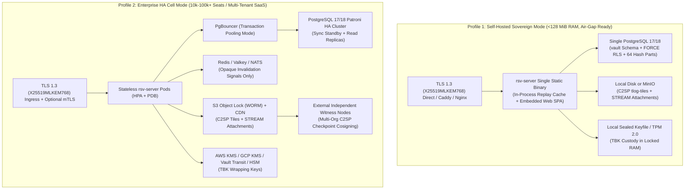
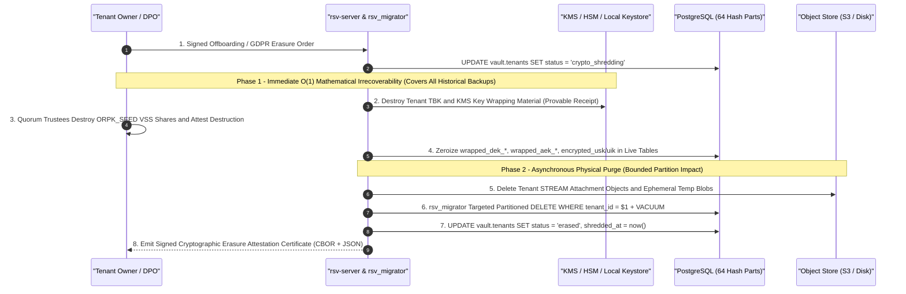

# SPEC-14: Self-Hosted Sovereign Operations, Enterprise HA Cells & Zero-Secret Observability

| Field | Value |
| :--- | :--- |
| **Document ID** | `RSV-SPEC-14` |
| **Project** | RusticStack Core (`ZK-Vault` — `https://github.com/KelpHect/ZK-Vault`) |
| **Status** | Normative Draft (`v1.0`) |
| **License** | Dual `MIT OR Apache-2.0` |
| **Target Toolchain** | Rust 2024 Edition, MSRV `1.94.0` |
| **Normative Crates** | `rsv-server`, `rsv-compliance-cli`, `rsv-cli`, `rsv-types`, `rsv-mem`, `rsv-enclave` |
| **Related Specs** | `SPEC-01`, `SPEC-05`, `SPEC-06`, `SPEC-08`, `SPEC-09`, `SPEC-13` |
| **Related ADRs** | [`ADR-0012`](../adrs/ADR-0012-dual-profile-sovereign-self-hosting.md), [`ADR-0002`](../adrs/ADR-0002-shared-schema-rls-over-schema-per-tenant.md), [`ADR-0005`](../adrs/ADR-0005-rfc9162-c2sp-tiled-merkle-audit-log.md) |
| **New Formal Invariant** | `INV-032` |

---

## 1. Scope & Dual-Profile Sovereign Architecture Philosophy

Enterprise password managers historically suffer from a false dichotomy:
- Heavyweight multi-service commercial platforms are difficult or impossible to self-host without an enterprise Kubernetes team (or prohibit self-hosting outright).
- Lightweight community alternatives achieve tiny footprints by diverging from upstream schemas, dropping enterprise RBAC/audit guarantees, or abandoning PostgreSQL isolation.

RusticStack Core (`ZK-Vault`) eliminates this fork by shipping **one audited, statically linked Rust binary (`rsv-server`)** that executes **100% identical cryptography (`CS-01` / `CS-02` X-Wing), PostgreSQL 17/18 `FORCE RLS` + 64-way HASH partitioning, Feldman VSS recovery, STREAM attachments, and RFC 9162 / C2SP Merkle transparency logs** across two deployment profiles selected purely via declarative runtime configuration (`rsv-server.toml` or `RSV_*` environment variables):

1. **Profile 1 — Self-Hosted Sovereign Mode**: Single static binary (`< 128 MiB` active RAM, `< 45 MiB` idle) + single PostgreSQL 17/18 instance + local disk or MinIO + local keyfile/TPM `TBK` provider + strict zero-phone-home air-gap compliance.
2. **Profile 2 — Enterprise HA Cell Mode**: Horizontally scaled stateless `rsv-server` pods behind TLS 1.3 (`X25519MLKEM768`) Ingress + PgBouncer (transaction pooling) + PostgreSQL 17/18 Patroni HA + immutable S3/CDN C2SP tiles + external independent witnesses + HSM/Cloud KMS + cell-based horizontal sharding (`> 100,000` seats & regional data sovereignty).

The key words **"MUST"**, **"MUST NOT"**, **"REQUIRED"**, **"SHALL"**, **"SHALL NOT"**, **"SHOULD"**, **"SHOULD NOT"**, **"RECOMMENDED"**, **"NOT RECOMMENDED"**, **"MAY"**, and **"OPTIONAL"** in this document are to be interpreted as described in BCP 14 (RFC 2119 and RFC 8174).

---

## 2. Part A: Dual Deployment Profiles from One Binary (`rsv-server`)

All infrastructure integrations inside `rsv-server` MUST sit behind four compile-time trait boundaries (`ObjectStoreBackend`, `KmsTbkProvider`, `SyncEventBus`, `TilePublisher`) so zero security logic ever bifurcates between Sovereign and Enterprise HA deployments:



### 2.1 Profile 1 — Self-Hosted Sovereign Mode ("Vaultwarden Simplicity, Enterprise Cryptography")

#### Normative Resource & Footprint Budgets

| Metric | Normative Ceiling | Notes |
| :--- | :--- | :--- |
| **Static Binary Size** (`x86_64-unknown-linux-musl` / `aarch64-unknown-linux-musl`) | `<= 25 MiB` stripped (incl. embedded Web SPA + `rsv-wasm`) | Compiled with `lto = "thin"`, `strip = true`, `#![forbid(unsafe_code)]` in `rsv-server`. |
| **Idle Resident Memory (RSS)** | **`< 45 MiB`** | Measured after startup, DB pool warm (`max_connections = 8`), and Web SPA asset index load. |
| **Active Load RSS** (100 concurrent clients + 10 active STREAM uploads) | **`< 128 MiB`** | Enforced via bounded `< 256 KiB` attachment streams (`INV-030`) and bounded lock-free replay ring buffer (`<= 8 MiB`). |
| **Required External Services** | **PostgreSQL 17/18 ONLY** | Zero Redis, zero Kafka, zero Elasticsearch, zero external KMS required. In-process `tokio::sync::broadcast` + PostgreSQL `LISTEN/NOTIFY` drives `/api/v1/sync/stream`. |
| **Target Seat Envelope** | `1` to `2,500` active users | Seamless zero-migration upgrade path to Profile 2 by adding PgBouncer/Patroni/S3/KMS config without schema conversion. |

#### Local Sovereign `TBK` Custody (`KmsTbkProvider`)
Because `TBK` (Tenant Blinding Key) MUST NEVER be stored in plaintext inside PostgreSQL (`AGENTS.md §5`, `INV-017`), Sovereign Mode provides two built-in `KmsTbkProvider` implementations:
1. **`tpm2_sealed` (Recommended on bare-metal/VM with TPM 2.0)**: Seals the 256-bit `TBK` master wrapping key (`TBK_KEK`) inside local TPM 2.0 silicon (`rsv-enclave`) bound to boot PCR policy; unsealed into `rsv-mem::LockedSecretBox` at daemon start.
2. **`local_keyfile` / `systemd_credential`**: Loads a 32-byte CSPRNG `TBK_KEK` from a `0400` root/service-owned file or systemd `LoadCredentialEncrypted=tbk_kek` into `rsv-mem::LockedSecretBox`. `rsv-server` MUST refuse to start if the keyfile has group/world permissions (`mode & 0o077 != 0`) or resides inside the PostgreSQL data directory.

#### Normative Reference Hardened Docker Compose (`deploy/sovereign/docker-compose.yml`)

```yaml
services:
  postgres:
    image: postgres:17-alpine
    restart: unless-stopped
    read_only: true
    security_opt:
      - no-new-privileges:true
    cap_drop:
      - ALL
    cap_add:
      - CHOWN
      - DAC_OVERRIDE
      - FOWNER
      - SETGID
      - SETUID
    environment:
      POSTGRES_DB: rsv_vault
      POSTGRES_USER: rsv_migrator
      POSTGRES_PASSWORD_FILE: /run/secrets/pg_migrator_password
    volumes:
      - pg_data:/var/lib/postgresql/data
      - type: tmpfs
        target: /run/postgresql
        tmpfs:
          size: 16m
      - type: tmpfs
        target: /tmp
        tmpfs:
          size: 32m
    secrets:
      - pg_migrator_password
    networks:
      - rsv_internal
    healthcheck:
      test: ["CMD-SHELL", "pg_isready -U rsv_migrator -d rsv_vault"]
      interval: 10s
      timeout: 3s
      retries: 5

  rsv-server:
    image: ghcr.io/kelphect/rsv-server:1.0.0-distroless
    # Built FROM gcr.io/distroless/static-debian12:nonroot (UID/GID 65532:65532)
    restart: unless-stopped
    user: "65532:65532"
    read_only: true
    security_opt:
      - no-new-privileges:true
    cap_drop:
      - ALL
    mem_limit: 128m
    memswap_limit: 128m
    pids_limit: 128
    depends_on:
      postgres:
        condition: service_healthy
    environment:
      RSV_PROFILE: sovereign
      RSV_LISTEN_ADDR: "0.0.0.0:8443"
      RSV_DATABASE_URL_FILE: /run/secrets/rsv_app_db_url
      RSV_KMS_PROVIDER: local_keyfile
      RSV_TBK_KEK_FILE: /run/secrets/rsv_tbk_kek
      RSV_OBJECT_STORE_BACKEND: local_fs
      RSV_DATA_DIR: /var/lib/rsv-server
      RSV_ZERO_PHONE_HOME: "true"
      RSV_OTLP_ENABLED: "false"
      RSV_TLS_CERT_FILE: /run/secrets/tls_cert_pem
      RSV_TLS_KEY_FILE: /run/secrets/tls_key_pem
    volumes:
      - rsv_storage:/var/lib/rsv-server
      - type: tmpfs
        target: /tmp
        tmpfs:
          size: 8m
          mode: 01700
    secrets:
      - rsv_app_db_url
      - rsv_tbk_kek
      - tls_cert_pem
      - tls_key_pem
    ports:
      - "443:8443"
    networks:
      - rsv_internal
      - rsv_edge
    healthcheck:
      test: ["/usr/local/bin/rsv-server", "--healthcheck"]
      interval: 15s
      timeout: 3s
      retries: 3

networks:
  rsv_internal:
    internal: true
  rsv_edge:

volumes:
  pg_data:
  rsv_storage:

secrets:
  pg_migrator_password:
    file: ./secrets/pg_migrator_password
  rsv_app_db_url:
    file: ./secrets/rsv_app_db_url
  rsv_tbk_kek:
    file: ./secrets/rsv_tbk_kek
  tls_cert_pem:
    file: ./secrets/tls_cert.pem
  tls_key_pem:
    file: ./secrets/tls_key.pem
```

#### Normative Reference Hardened `systemd` Unit (`deploy/sovereign/rsv-server.service`)

```ini
[Unit]
Description=RusticStack Core (ZK-Vault) Sovereign Blind Server
Documentation=https://github.com/KelpHect/ZK-Vault
After=network-online.target postgresql.service
Wants=network-online.target
Requires=postgresql.service

[Service]
Type=notify
ExecStart=/usr/local/bin/rsv-server --config /etc/rsv-server/rsv-server.toml
Restart=on-failure
RestartSec=3s

# Strict Identity & Credential Encryption (systemd-creds)
DynamicUser=yes
StateDirectory=rsv-server
StateDirectoryMode=0700
ConfigurationDirectory=rsv-server
ConfigurationDirectoryMode=0750
LoadCredentialEncrypted=tbk_kek:/etc/rsv-server/cred-tbk-kek.cred
LoadCredentialEncrypted=db_url:/etc/rsv-server/cred-db-url.cred

# Kernel & Filesystem Hardening
NoNewPrivileges=true
ProtectSystem=strict
ProtectHome=true
PrivateTmp=true
PrivateDevices=true
ProtectKernelTunables=true
ProtectKernelModules=true
ProtectKernelLogs=true
ProtectControlGroups=true
ProtectClock=true
ProtectHostname=true
ReadWritePaths=/var/lib/rsv-server
MemoryDenyWriteExecute=true
LockPersonality=true
RestrictRealtime=true
RestrictSUIDSGID=true
RestrictNamespaces=true
RestrictAddressFamilies=AF_INET AF_INET6 AF_UNIX
CapabilityBoundingSet=
AmbientCapabilities=
SystemCallArchitectures=native
SystemCallFilter=@system-service
SystemCallFilter=~@privileged @resources @mount @raw-io @reboot @swap @debug
UMask=0077

# Resource Guardrails (Sovereign Footprint)
MemoryMax=128M
MemorySwapMax=0
TasksMax=128
LimitCORE=0
LimitNOFILE=8192

[Install]
WantedBy=multi-user.target
```

#### Strict Zero-Phone-Home & Air-Gap Guarantee (`INV-032`)
1. **Zero Outbound Network Calls by Default**: `rsv-server`, `rsv-daemon`, `rsv-desktop`, and `rsv-cli` MUST initiate **zero** outbound TCP/UDP/DNS connections beyond the explicitly configured PostgreSQL host, configured object store / KMS / witness endpoints (if enabled), and configured client server URL.
2. **Zero Telemetry, Analytics, or Licensing Beacons**: RusticStack Core MUST NOT contain product analytics SDKs, crash-report auto-uploaders, seat-counting license callbacks, or automatic startup version-check HTTP pings.
3. **100% Self-Contained Embedded Web SPA**: All JavaScript bundles, `rsv-wasm` `.wasm` binaries, CSS stylesheets, fonts, and SVG icons MUST be embedded inside `rsv-server` (or local static directory) with zero references to external CDNs, Google Fonts, Gravatar, or third-party scripts. HTTP responses MUST enforce:
   ```http
   Content-Security-Policy: default-src 'none'; script-src 'self' 'wasm-unsafe-eval'; style-src 'self'; font-src 'self'; img-src 'self' data: blob:; connect-src 'self' wss://<configured-origin>; worker-src 'self'; frame-ancestors 'none'; base-uri 'none'; form-action 'none'
   ```
4. **100% Air-Gap Operational Capability**: Complete vault lifecycle (tenant bootstrap, Feldman VSS ceremony, user/device enrollment, STREAM attachments, C2SP audit verification via `rsv-compliance-cli`, and Emergency Recovery Kit generation) MUST execute with zero internet connectivity inside a network-isolated enclave (`unshare -n` / air-gapped VLAN).

---

### 2.2 Profile 2 — Enterprise HA Cell Mode (`10,000+` Seats & Multi-Tenant SaaS)

Enterprise HA Cell Mode deploys the **exact same `rsv-server` binary** with `RSV_PROFILE=enterprise_ha` across horizontally scalable stateless pods:

| Layer | Normative Technology & Configuration | Security & Scaling Purpose |
| :--- | :--- | :--- |
| **Edge Ingress / TLS** | Envoy / HAProxy / NGINX with TLS 1.3 **`X25519MLKEM768`** (`0x11EC`) preferred, HSTS preload, optional per-tenant mTLS (`SPEC-08 §2`). | HNDL quantum resistance on transport; L7 rate limiting & DDoS absorption. |
| **Stateless API Tier** | Kubernetes Deployment (`>= 3` replicas across 3 AZs), HPA on CPU/request-queue latency, `PodDisruptionBudget (minAvailable: 2)`, `readOnlyRootFilesystem: true`, `runAsNonRoot: true`, `seccompProfile: RuntimeDefault`. | Zero local state; instant horizontal scale-out & zero-downtime rolling upgrades. |
| **Connection Pooling** | **PgBouncer in `pool_mode = transaction`** (`server_reset_query_always = 0`, `max_client_conn >= 5000`, `default_pool_size = 50–100`). | Safe multiplexing because `TenantScopedTx` strictly uses transaction-local `set_config('app.current_tenant_id', $1, true)` (`INV-006`). |
| **Database HA Tier** | **PostgreSQL 17/18 + Patroni** (1 primary + 1 synchronous standby with `synchronous_commit = remote_apply` + optional async read replicas for `rsv_auditor_ro`). | Zero RPO failover across AZs; 64-way `HASH (tenant_id)` partitioning bounds B-tree depth and autovacuum concurrency (`INV-007`). |
| **Cross-Pod Sync Bus** | Redis / Valkey Cluster (TLS + ACL) or NATS JetStream publishing ONLY opaque invalidation tuples `(tenant_id, event_type, resource_uuid, key_epoch, stream_seq)`. | Sub-second WebSocket fanout across pods with zero secrets in pub/sub RAM. |
| **Object & Tile Store** | S3-compatible storage with **S3 Object Lock (WORM / Compliance Mode)** for C2SP `tlog-tiles` + CDN (`Cache-Control: public, max-age=31536000, immutable`) + encrypted bucket for STREAM attachments (direct pre-signed PUT/GET). | Immutable audit tiles; zero attachment data-plane load on `rsv-server` pods. |
| **External Witnesses** | `>= 2` independent third-party / multi-org C2SP Witness nodes cosigning `vault.audit_checkpoints` over RFC 9162 consistency proofs (`SPEC-06`). | Cryptographically defeats split-view or silent server rollback attacks (`INV-018`). |
| **Enterprise KMS / HSM** | `AWS KMS`, `GCP Cloud KMS`, `Azure Key Vault HSM`, `HashiCorp Vault Transit`, or PKCS#11 HSM wrapping per-tenant `TBK` keys (unwrapped only inside pod `rsv-mem::LockedSecretBox` with TTL rotation). | Hardware-rooted `TBK` custody & instant cryptographic revocation during offboarding. |

#### Cell-Based Horizontal Sharding (`> 100,000` Seats & Jurisdictional Residency)
To scale past 100,000 seats and satisfy hard regional residency mandates (EU GDPR / Frankfurt, Switzerland / Zurich, US GovCloud, APAC / Tokyo), operators deploy independent **Cells** (`eu-central-cell-01`, `us-east-cell-01`, `ch-sovereign-cell-01`):
- **Cell Boundary**: Each Cell is a completely isolated failure, cryptographic, and jurisdictional unit housing up to `50,000–100,000` active seats with its own PostgreSQL 17/18 Patroni cluster, regional KMS key ring, regional S3 buckets, and distinct C2SP audit log origin (`rusticstack.io/audit/v1/<cell_id>/tenant/<tenant_id>`).
- **Global Tenant Cell Router**: A thin, stateless, read-only directory maps `(tenant_slug | tenant_id) -> { cell_id, api_base_url, cell_routing_signature }` using a signed routing record verified by clients on login. **Zero vault ciphertexts, keys, or audit events ever replicate across Cell boundaries.**
- **Blast Radius & Canary Upgrades**: Schema migrations and `rsv-server` releases roll out cell-by-cell (`canary-cell` -> `cell-01` -> `cell-02`), capping any operational fault to a single cell.

---

## 3. Part B: Backup, PITR, Single-Tenant Export & Provable GDPR Crypto-Shredding

### 3.1 Automated PostgreSQL WAL Archiving, PITR & Merkle Rollback Detection

1. **Continuous WAL Archiving & PITR (`pgBackRest`)**:
   - Production deployments MUST run automated continuous WAL archiving + scheduled full/differential base backups using **`pgBackRest`** with repository-level encryption (`repo1-cipher-type=aes-256-cbc`), SHA-256 manifest verification, and dual repository targets (local/primary S3 + cross-region/offsite immutable archive).
   - Target recovery objectives: **RPO `< 60 seconds`** (continuous WAL push with `archive_timeout = 60s`), **RTO `< 15 minutes`**.
   - Backup encryption adds defense-in-depth over database metadata, while vault confidentiality remains independently protected by end-to-end client encryption (`INV-001`).

2. **Cryptographic PITR Safeguard — Merkle Checkpoint Pinning Verification**:
   - Conventional PITR cannot distinguish an authorized disaster recovery from a malicious operator rolling back the database by 2 hours to erase incriminating audit rows (`ADV-01` / `ADV-02`).
   - Following **every** PostgreSQL restore or PITR operation, operators MUST run `rsv-compliance-cli verify-restore` before opening `/api/v1` write traffic:
     - Compares every tenant's latest restored `(tree_size, root_hash)` in `vault.audit_checkpoints` against externally cosigned **Witness Checkpoints** and archived signed checkpoints.
     - **Case 1 (`restored_tree_size == witnessed_tree_size` AND `restored_root_hash == witnessed_root_hash`)**: Cryptographically clean point-in-time parity; resume traffic.
     - **Case 2 (`restored_tree_size < witnessed_tree_size`)**: Silent history truncation detected! `rsv-server` MUST refuse to append conflicting leaves at recycled indices (which would shatter RFC 9162 consistency proofs) and MUST raise a `SEV-1` **`RECOVERY_DISCONTINUITY_DETECTED`** state requiring an explicit signed incident continuity record / witness-attested epoch fork marker before resuming writes.

### 3.2 Single-Tenant Logical Portable Export (Zero Vendor Lock-In)

Because RusticStack Core uses a shared multi-tenant PostgreSQL schema (`ADR-0002`), enterprises MUST retain sovereign portability to migrate a single tenant cleanly between Self-Hosted Sovereign Mode and Enterprise HA Cells (or out of a managed SaaS provider) without exposing neighboring tenants.

**Normative `rsv-cli tenant export` / `rsv-compliance-cli` Archive Protocol**:
1. Executes strictly inside a `TenantScopedTx` (`rsv_app` / `rsv_auditor_ro` with `FORCE RLS` enforced, pruning 63/64 hash partitions per partitioned table) at a single repeatable-read snapshot (`BEGIN TRANSACTION ISOLATION LEVEL REPEATABLE READ READ ONLY`).
2. Exports deterministic JSONL/CBOR dumps of all 13 `vault` tables filtered strictly to `tenant_id`:
   `tenants`, `tenant_vss_ceremonies`, `users`, `user_devices`, `teams`, `collections`, `key_graph_edges`, `vault_items`, `vault_item_revisions`, `vault_attachments`, `audit_events`, `audit_merkle_tiles`, `audit_checkpoints`.
3. Bundles all referenced encrypted STREAM attachment ciphertext objects (`vault.vault_attachments.storage_key`) and immutable C2SP `tlog-tiles` files into a compressed deterministic archive (`rsv-tenant-export-<tenant_id>-<utc_ts>.tar.zst`).
4. Emits `EXPORT_MANIFEST.cbor` containing per-file BLAKE3 digests, exact row counts, latest C2SP `audit_checkpoint`, and an operator Ed25519 / ML-DSA-65 signature.
5. **Zero Plaintext Guarantee**: Every exported row and attachment remains end-to-end encrypted (`INV-001`). Importing into a target Sovereign or HA Cell verifies every BLAKE3 digest, validates RFC 9162 Merkle tile continuity, and replays inside a single tenant-scoped transaction.

### 3.3 Provable GDPR Article 17 / Offboarding Crypto-Shredding

Deleting a tenant from a live database does NOT remove encrypted rows from 30-day or 7-year immutable WORM backups and PostgreSQL WAL archives. RusticStack Core enforces a **two-phase provable crypto-shredding lifecycle** (`vault.tenants.status`: `active` -> `suspended` -> `crypto_shredding` -> `erased`):



- **Phase 1 — Immediate O(1) Cryptographic Irrecoverability**: Destroying the tenant's `TBK` in KMS (with cryptographic KMS deletion receipt), revoking/destroying `ORPK` VSS trustee shares, and wiping active key-wrapping envelopes renders every historical `pgBackRest` backup, WAL segment, and S3 snapshot mathematically indistinguishable from uniform random noise immediately—without rewriting immutable WORM media.
- **Phase 2 — Asynchronous Physical Purge**: A controlled `rsv_migrator` job executes partition-pruned deletes (`WHERE tenant_id = $1`, touching strictly 1 of 64 hash partitions per table), deletes STREAM attachment objects, triggers `VACUUM` on the affected partition `pXX`, updates `status = 'erased', shredded_at = now()`, and produces a signed **Cryptographic Erasure Attestation Certificate** for GDPR Article 17 / SOC 2 / ISO 27001 evidence.
- **Append-Only Audit Retention Option**: Tenants subject to statutory financial/regulatory retention MAY configure `retain_tombstoned_audit_anchors = true`, preserving strictly the blinded, un-decryptable C2SP Merkle root checkpoints (`vault.audit_checkpoints`) while destroying `TBK` and `CPK` access to personal identifiers.

---

## 4. Part C: Type-Enforced Zero-Secret Observability

Observability pipelines (stdout logs, SIEM forwarders, Prometheus TSDBs, OpenTelemetry collectors) are frequent secondary breach vectors. RusticStack Core enforces **zero-secret, low-cardinality observability at compile time**.

### 4.1 Compile-Time Anti-Leakage Architecture

1. **Mandatory Redaction Types (`rsv-types`)**:
   - All cryptographic keys, passwords, tokens, recovery codes, and unencrypted DTO fields MUST reside inside `secrecy::SecretBox<T>` or `rsv_types::Redacted<T>`.
   - `Redacted<T>` MUST implement `fmt::Debug` and `fmt::Display` to emit the literal string `"[REDACTED]"` unconditionally and MUST NOT implement `serde::Serialize` unless gated behind an explicit `#[cfg(test)]` or audited encrypted-envelope serializer.
   - Custom Rust panic hooks in `rsv-server`, `rsv-daemon`, and `rsv-desktop` MUST scrub panic payloads of arbitrary formatted user/request structs before writing crash diagnostics.
2. **HTTP Middleware Scrubbing (`rsv-server`)**:
   - The Tower/Axum tracing layer MUST NEVER record `Authorization`, `Cookie`, `Set-Cookie`, `X-RSV-Audit-Envelope`, `X-RSV-Request-Signature` (`sig` parameter), raw HTTP request/response bodies, query parameters carrying tokens/emails, or client IP addresses in plaintext unless an operator explicitly enables privacy-hashed client-subnet logging for DDoS forensics.
3. **Structured JSON Logs (`tracing-subscriber`)**:
   - Logs MUST emit structured UTF-8 JSON to `stdout` containing ONLY: `timestamp`, `level`, `target`, `request_id` (UUIDv7), `http_method`, `route_template` (e.g., `/api/v1/items/:item_id` — NEVER raw UUID path values if avoidable, or strictly opaque UUIDv7 only when operationally required), `status_code`, `error_code`, `latency_ms`, and `profile`.
   - Emails, user handles, usernames, display names, vault item titles, URLs, attachment filenames, and cryptographic material are **STRICTLY FORBIDDEN** in any log field at every log level (`ERROR`, `WARN`, `INFO`, `DEBUG`, `TRACE`).
4. **Strict Anti-Cardinality-Explosion Rule (Prometheus)**:
   - Prometheus metric labels MUST NEVER include `tenant_id`, `user_id`, `device_id`, `item_id`, `attachment_id`, `email`, or arbitrary user-supplied strings.
   - Every Prometheus label MUST come from a statically bounded finite Rust `enum` (`route_template`, `method`, `status_class`, `error_code`, `cipher_suite`, `profile`, `partition_id` in `0..64`, `escrow_tier`).

### 4.2 Normative Golden Signals, Prometheus Metrics & Alerting SLOs

| Metric Name | Type | Bounded Labels | Alerting SLO / Condition | Severity |
| :--- | :--- | :--- | :--- | :---: |
| **`rsv_http_request_duration_seconds`** | Histogram | `route_template`, `method`, `status_class` | API `p99 > 250 ms` for `5m` (control plane) or `5xx ratio > 0.5%` for `2m` | `SEV-2` / `SEV-1` |
| **`rsv_db_tx_duration_seconds`** | Histogram | `operation`, `partition_id` (`00..63`) | DB transaction `p99 > 100 ms` for `5m` | `SEV-2` |
| **`rsv_db_partition_pruning_violations_total`** | Counter | `table_name` | **`> 0` immediately** (any production/canary `EXPLAIN` plan scanning `> 1` of 64 hash partitions!) | **`SEV-1`** |
| **`rsv_rls_context_rejections_total`** | Counter | `reason` (`missing_guc`, `tenant_mismatch`) | **`> 0` for `missing_guc`** (bug in `TenantScopedTx`!) or spike `> 10/min` for `tenant_mismatch` | **`SEV-1`** |
| **`rsv_pgbouncer_pool_wait_seconds`** | Histogram | `pool_name` | `p95 > 50 ms` or active/max saturation `> 85%` for `3m` | `SEV-2` |
| **`rsv_audit_checkpoint_lag_seconds`** | Gauge | `profile` | Lag `> 60s` (HA) or `> 300s` (Sovereign) between latest `audit_events` row and signed `audit_checkpoints` | `SEV-2` |
| **`rsv_audit_witness_cosign_failures_total`** | Counter | `witness_alias`, `reason` | All witnesses failing for `> 5m` OR **any `consistency_proof_rejected`** (immediate `SEV-1`!) | **`SEV-1`** |
| **`rsv_auth_device_attestation_failures_total`** | Counter | `platform`, `reason` | Anomaly spike `> 5x` baseline over `10m` (potential credential stuffing / spoofed enclave attack) | `SEV-2` |
| **`rsv_attachment_stream_active`** | Gauge | `direction` (`upload`, `download`), `backend` | Concurrent streams nearing configured cap OR per-stream RSS exceeding `256 KiB` budget | `SEV-2` |
| **`rsv_attachment_integrity_failures_total`** | Counter | `reason` (`blake3_mismatch`, `size_mismatch`) | `> 0` on committed object read (storage corruption or tampering) | **`SEV-1`** |

#### Automated RLS Partition Pruning Regression Detector
`rsv-server` (and scheduled SRE canary probes) MUST run a lightweight periodic diagnostic check (`SELECT` plan probe against a synthetic canary tenant via `EXPLAIN (FORMAT JSON)` on all 6 HASH-64 partitioned tables: `key_graph_edges`, `vault_items`, `vault_item_revisions`, `vault_attachments`, `audit_events`, `audit_merkle_tiles`). If any query plan fails to prune 63 of 64 partitions (`Subplans Removed < 63` or multi-partition `Append` scan), the probe MUST increment `rsv_db_partition_pruning_violations_total` and fire a `SEV-1` page immediately.

#### OpenTelemetry (OTLP) Policy
- OpenTelemetry distributed tracing (`tracing-opentelemetry`, W3C `traceparent` propagation) is supported via `RSV_OTLP_ENABLED=true` and `RSV_OTLP_ENDPOINT` for Enterprise HA deployments.
- In Self-Hosted Sovereign Mode, `RSV_OTLP_ENABLED` MUST default to **`false`** so zero outbound collector traffic occurs unless explicitly configured by the operator (`INV-032`).

---

## 5. Part D: Authoritative Architecture Comparison Matrix

The following engineering matrix compares **RusticStack Core (`ZK-Vault`)** against four widely deployed password/secret management architectures using verifiable technical properties as of `2026`. Each system reflects distinct engineering trade-offs (for example, KeePassXC's ultra-simple standalone file portability, Vaultwarden's minimal SQLite homelab setup, 1Password's mature commercial UX ecosystem, and Bitwarden's broad multi-platform adoption).

| # | Engineering Axis | RusticStack Core (`ZK-Vault`) | Bitwarden Enterprise | Vaultwarden (Community) | 1Password Enterprise | KeePassXC |
| :-: | :--- | :--- | :--- | :--- | :--- | :--- |
| **1** | **Core Language & Memory Safety** | **100% Rust (2024 Ed., MSRV 1.94)** across server, crypto, daemon, GPUI desktop, WASM & CLI; `#![forbid(unsafe_code)]` on 10/12 crates. | C# / .NET server; TypeScript/Angular/Electron clients; Rust crypto migration (`bitwarden-sdk`) ongoing. | Rust server (`Rocket`/`Diesel`), paired with upstream Bitwarden TypeScript/Electron clients. | Rust cryptographic core (`1Password 8`); Electron/TypeScript desktop shell; proprietary closed cloud backend. | C++ / Qt 5/6 native desktop application (`Botan` / `Argon2` crypto libraries). |
| **2** | **Cipher Suite & Crypto Agility** | Explicit versioned `RSV1` envelopes with mandatory canonical CBOR AAD (`INV-002`): `CS-01` (`AES-256-GCM`, RFC 9180 HPKE `X25519`, `Ed25519`) & `CS-02` PQ hybrid. | `AES-256-CBC + HMAC-SHA256`, `RSA-2048` OAEP for sharing/org keys, PBKDF2-SHA256 / Argon2id KDF. | Protocol-compatible with Bitwarden clients (`AES-256-CBC + HMAC`, `RSA-2048`). | Two-Secret Key Derivation (Password + 128-bit Secret Key), SRP-6a auth, `AES-256-GCM`, `RSA-2048` / `X25519` vaults. | KDBX 4 (`Argon2d` / `Argon2id` / `AES-KDF`), `AES-256-CBC` / `ChaCha20` / `Twofish`, header & block HMAC-SHA256. |
| **3** | **Post-Quantum Hybrid Readiness** | **Native `CS-02` (`0x0002`)**: **X-Wing** (`X25519 + ML-KEM-768` SHA3-256 combiner), hybrid `Ed25519 + ML-DSA-65`, TLS 1.3 `X25519MLKEM768`. | Classical cryptography (`RSA-2048`, `AES-256-CBC`); no deployed hybrid PQ KEM vault suite. | Mirrors Bitwarden client cryptography (classical `RSA-2048`). | Classical vault cryptography (128-bit Secret Key raises classical brute-force bar; no hybrid ML-KEM vault envelopes). | Classical symmetric KDBX4 ciphers (256-bit symmetric keys retain ~128-bit post-Grover security; no asymmetric PQ sharing). |
| **4** | **Enterprise Key Recovery & Escrow** | **Hybrid Tiered Escrow**: Feldman VSS (`t`-of-`n`, default `3-of-5` over Ristretto255) for `ORPK_SEED` + optional `DRPubK` on `standard` tier; `root_quorum_only` strictly blocks unilateral admin decryption. | Enterprise Account Recovery wraps user key to Org RSA public key held by Org Admins (unilateral admin recovery once enabled). | Basic Bitwarden org key wrapping; no native threshold VSS quorum recovery. | Master Unlock / Account Recovery via Recovery Group (family/admin group key wrap); no public Feldman VSS ceremony. | Offline local file + user-managed keyfile / YubiKey HMAC-SHA1 challenge-response (no enterprise quorum escrow). |
| **5** | **Blind RBAC & Access Graph** | Cryptographic DAG (`User -> Team -> Collection -> Item`) with signed edges, DB + client cycle rejection, epoch rotation (`INV-008`, `INV-009`), blind WASM Org Dashboard. | Organization -> Collection -> Group key sharing (RSA-wrapped org key shared across org; server enforces collection ACLs). | Same Bitwarden org/collection model (server-enforced collection permissions over shared org key). | Per-vault symmetric keys wrapped to group/user keypairs; server-assisted ACL enforcement. | Single-file local database (no multi-user RBAC graph or cryptographic team delegation). |
| **6** | **Desktop Runtime, RAM & Memory Locking** | **Native Rust GPUI (`rsv-desktop`)** + isolated `rsv-daemon` (`< 50 MiB` RSS, 120 FPS); `LockedSecretBox` (`mlock`/`VirtualLock`, guard pages, `MADV_DONTDUMP`, `ZeroizeOnDrop`). | Electron (Chromium + Node.js, typically `250–500 MiB` RAM); V8 GC heap cannot deterministically `mlock`/zeroize JS strings. | Uses official Bitwarden Electron desktop client. | Electron UI + Rust core (`1Password 8`, typically `200–450 MiB` RAM); Rust core handles key custody, UI still renders in Chromium DOM/V8. | **Native C++/Qt** (`~30–80 MiB` RSS), `mlock` / memory protection via Botan/OS primitives, fast offline startup. |
| **7** | **Hardware Enclave / TPM 2.0 Architecture** | **Two-Tier Hardware Trust (`INV-013`)**: non-exportable silicon P-256 `HDIK`/`HDSK` (Apple SE, Linux TPM 2.0 `tss-esapi`, Windows CNG/PCPKSP) cross-signing software `UIK`/X-Wing + hardware device attestation. | OS biometric unlock (Keychain / Windows Hello / Polkit) storing unlock key; no mandatory per-request hardware `HDIK` API signing. | Relies on Bitwarden client OS biometric storage. | Biometric unlock via Touch ID / Windows Hello / Linux Polkit; Secret Key + device auth. | YubiKey challenge-response (HMAC-SHA1) + Windows Hello / macOS Touch ID quick unlock; no cloud device attestation. |
| **8** | **Browser Extension & WASM Isolation** | Chrome MV3 offloading crypto to `rsv-daemon` via chunked Native Messaging (`<= 768 KiB`, `INV-021`); fallback `rsv-wasm` in fixed linear arena (zero `memory.grow()`, opaque `KeyHandle(u32)`). | Chrome/Firefox MV3 extension running JS/WASM inside extension service worker; optional biometric IPC to desktop app. | Uses upstream Bitwarden browser extension. | Browser extension communicating via native messaging with desktop app or standalone JS/WASM runtime. | Browser extension (`KeePassXC-Browser`) using NaCl-encrypted Native Messaging directly to native desktop process (no cloud fallback). |
| **9** | **Multi-Tenant DB Isolation & Scaling** | **PostgreSQL 17/18** shared schema with dual-enforced `TenantScopedTx` + `FORCE ROW LEVEL SECURITY` (`NOBYPASSRLS`) + 64-way `HASH (tenant_id)` partitioning + Cell sharding (`> 100k` seats). | SQL Server / PostgreSQL (enterprise) with application-layer org filtering (no mandatory `FORCE RLS` + 64-way hash partitioning across all tables). | SQLite (default single-node), MySQL/MariaDB, or PostgreSQL; optimized for small self-hosted instances, not multi-tenant SaaS HA cells. | Proprietary multi-tenant cloud database (AWS); architecture not publicly inspectable or self-hostable. | Local `.kdbx` file on user filesystem (synced via user's Syncthing/Nextcloud/cloud drive). |
| **10** | **Audit Log Privacy & Cryptographic Verifiability** | **Zero-Knowledge Verifiable Ledger**: `TBK`-blinded HMAC indexes + `CPubK` offline compliance envelopes + **RFC 9162 Merkle Tree** (`C2SP tlog-tiles`) + external witness cosigning + air-gapped `rsv-compliance-cli`. | Plaintext server-stored event logs (timestamp, actor, item ID, IP) accessible via SIEM/API; no Merkle tree or tamper-evident external witnesses. | Minimal / community event logging; no verifiable transparency log. | Enterprise Events Reporting API (SIEM integration); server-trusted plaintext event metadata without public Merkle transparency log. | No centralized audit ledger (local entry modification timestamps only). |
| **11** | **Key Transparency & Anti-MITM Directory** | Signed user public key bundles anchored into tenant's **C2SP Merkle Transparency Log** + out-of-band Safety Numbers verified before key-graph sharing. | Trust-on-first-use (TOFU) server-served RSA public keys (with manual fingerprint phrase verification available). | Same TOFU + manual fingerprint phrase model as Bitwarden. | Server-distributed vault/user public keys bound by account/group signatures; no public external-witnessed key transparency log. | N/A (single-user or shared-password offline file; no online key directory). |
| **12** | **Streaming Encrypted Attachments** | **STREAM (`AES-256-GCM`)** 64 KiB chunks (`7B prefix \|\| u32 counter \|\| final_flag`), per-chunk CBOR AAD, incremental `BLAKE3` root committed in item manifest, `< 256 KiB` server RAM (`INV-030`). | Monolithic `AES-256-CBC + HMAC` file encryption (`<= 100–500 MiB` client memory/upload buffering limits). | Mirrors Bitwarden monolithic attachment encryption (stored on local disk). | Encrypted Document/File items stored in cloud object storage (`AES-256-GCM`). | Embedded `<Binaries>` inside single KDBX file (entire database rewritten and loaded in RAM on save). |
| **13** | **SSH Agent, CLI & DevOps Secret Integration** | Native `rsv-daemon` SSH Agent + `rsv-cli` secret injection (`env`/process exec) + CI/CD workload identities + air-gapped `rsv-compliance-cli`. | Bitwarden Secrets Manager (separate product), Bitwarden CLI (`bw`), SSH agent support in newer clients. | Compatible with Bitwarden CLI; does not implement full Bitwarden Secrets Manager backend. | Mature **1Password SSH Agent**, Git commit signing, `op` CLI, Connect Server & Service Accounts. | Built-in **KeePassXC SSH Agent** integration (`ssh-agent` / Pageant), `keepassxc-cli` local scripting. |
| **14** | **Passkeys, FIDO CXF/CXP & Offline Sync** | Synced FIDO2 Passkeys, **FIDO Alliance CXF v1.0 / CXP** encrypted import/export, offline Importers (BW/1PUX/KDBX4/CSV), `HDSK`-sealed page-encrypted offline cache + lossless 3-way conflict UI (`INV-031`). | Synced Passkeys; CXF support emerging; offline read cache with server-wins/basic conflict handling; JSON/Encrypted JSON/CSV export. | Supports Bitwarden passkey sync & export formats via upstream clients. | Mature synced Passkeys; active FIDO CXF/CXP contributor; `.1pux` export; offline read cache with conflict handling. | Local Passkey browser integration; KDBX4 + CSV/XML import/export; file-level merge (`Merge from database`) for offline sync conflicts. |
| **15** | **Self-Hosted Footprint & Zero-Phone-Home Sovereignty** | **One binary (`< 45 MiB` idle / `< 128 MiB` active) + single PG 17/18**; scales identically to Enterprise HA Cells; **100% air-gap & zero-phone-home enforced (`INV-032`)**; Dual MIT/Apache-2.0. | Official self-hosting requires Docker multi-container stack (or Unified beta container, typically `1–4+ GiB` RAM + MSSQL/PG); license validation check-ins for paid enterprise features. | **Ultra-lightweight Rust (`~20–50 MiB` RAM + SQLite)**; widely favored for homelabs; AGPL-3.0; no official enterprise SLA/HA cell architecture. | **No official self-hosted server** (SaaS cloud only; proprietary closed source). | **100% local offline sovereign** (zero server required, zero phone-home); GPL-2.0/3.0; no native multi-tenant cloud server. |

---

## 6. New Formal Security Invariant (`INV-032`)

This invariant formally extends `SPEC-09 §4` (`INV-001`..`INV-031`) and is release-blocking.

---

### `INV-032` — Zero-Secret Structured Telemetry & Sovereign Zero-Phone-Home Enforcement
- **Formal Statement**:
  1. **Zero-Secret & Bounded-Cardinality Telemetry**: Across all RusticStack Core binaries (`rsv-server`, `rsv-daemon`, `rsv-desktop`, `rsv-cli`, `rsv-compliance-cli`), zero cryptographic keys, passphrases, bearer/refresh tokens, user emails, usernames, vault item titles/URLs/payloads, or raw `X-RSV-Audit-Envelope` contents MAY appear in any log line (`ERROR`..`TRACE`), panic trace, OpenTelemetry span attribute, or Prometheus metric sample. Prometheus metrics MUST NOT attach unbounded identifiers (`tenant_id`, `user_id`, `item_id`, `device_id`, `email`) as labels.
  2. **Sovereign Zero-Phone-Home Enforcement**: In Profile 1 (`RSV_PROFILE=sovereign`) and in all native clients by default, processes MUST initiate **zero** outbound network packets to any host other than explicitly operator-configured database/API/storage/witness targets, and the embedded Web SPA MUST load 100% of scripts, WASM, CSS, fonts, and images from `'self'` with zero external CDN or telemetry endpoints.
- **Threat Coverage**: `ADV-01`, `ADV-02`, `ADV-03`, `ADV-06`
- **Owning Crates**: `rsv-types`, `rsv-server`, `rsv-daemon`, `rsv-desktop`, `rsv-cli`, `rsv-compliance-cli`
- **Failure Mode**: Secrets leak into centralized log aggregators (ELK/Datadog/Splunk), Prometheus TSDB crashes via `tenant_id` cardinality explosion, or sovereign/air-gapped deployments leak metadata or break when external internet is absent.
- **Verification Method**: Automated Canary Secret Telemetry Redaction Harness (injects unique high-entropy canaries into every request header, key struct, item field, and forced panic; asserts `0` occurrences across captured JSON logs, OTLP spans, and `/metrics` output + asserts Prometheus label allowlist) AND Linux Network-Namespace Air-Gap Boot Test (`unshare -n` / `iptables` DROP all non-loopback egress) proving full end-to-end vault operation + Playwright CSP/zero-external-request check on embedded Web SPA.

---

## 7. Operational Readiness & SRE Verification Gates

No release candidate for `rsv-server` or deployment manifests may pass CI unless ALL six operational gates succeed with exit code `0`:

| Gate ID | Verification Drill | Quantitative Pass Criterion |
| :--- | :--- | :--- |
| **OPS-01** | **Sovereign Air-Gap E2E Boot** | `rsv-server --profile sovereign` + PostgreSQL 17/18 + Web SPA Playwright test inside `unshare -n` network-isolated namespace: `0` outbound DNS/TCP attempts; `0` CSP violations; full login, item CRUD, STREAM attachment, and C2SP audit verify succeed. |
| **OPS-02** | **Sovereign Memory Ceiling Benchmark** | Static `musl` binary RSS measures `< 45 MiB` idle and `< 128 MiB` under 100 concurrent active clients + 10 concurrent 128 MiB STREAM attachment uploads (`< 256 KiB` RSS delta per stream). |
| **OPS-03** | **Zero-Secret Telemetry & Cardinality Gate** | Canary secret scan across `TRACE`-level JSON logs, `/metrics`, OTLP spans, and intentional panic output finds `0` leaked secret bytes and `0` forbidden Prometheus labels (`tenant_id`, `user_id`, `email`, `item_id`). |
| **OPS-04** | **PITR + Merkle Rollback Detection Drill** | Execute `pgBackRest` backup at `tree_size = 500`, write 50 more audited mutations (`tree_size = 550`, cosigned by test witness), restore backup to `tree_size = 500`, run `rsv-compliance-cli verify-restore`: MUST exit non-zero with `RECOVERY_DISCONTINUITY_DETECTED` and block silent log fork. |
| **OPS-05** | **Single-Tenant Portable Export & Re-Import** | Export 1 tenant from a 50-tenant shared DB into `rsv-tenant-export.tar.zst`, verify `0` rows from the other 49 tenants exist in the tarball, import into a clean Sovereign instance, and pass `rsv-compliance-cli` full Merkle + attachment BLAKE3 verification. |
| **OPS-06** | **GDPR Crypto-Shredding Verification** | Snapshot backup prior to shredding, execute Phase 1 (`TBK` + `ORPK` destruction) & Phase 2 (partitioned purge), assert `0` surviving live rows for target tenant across all 13 tables, `0` remaining S3/disk attachment objects, and prove historical snapshot cannot be de-blinded or decrypted. |
