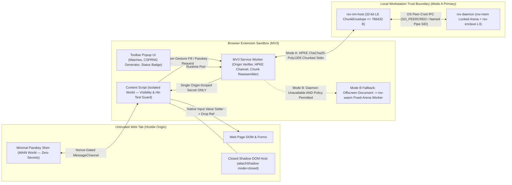
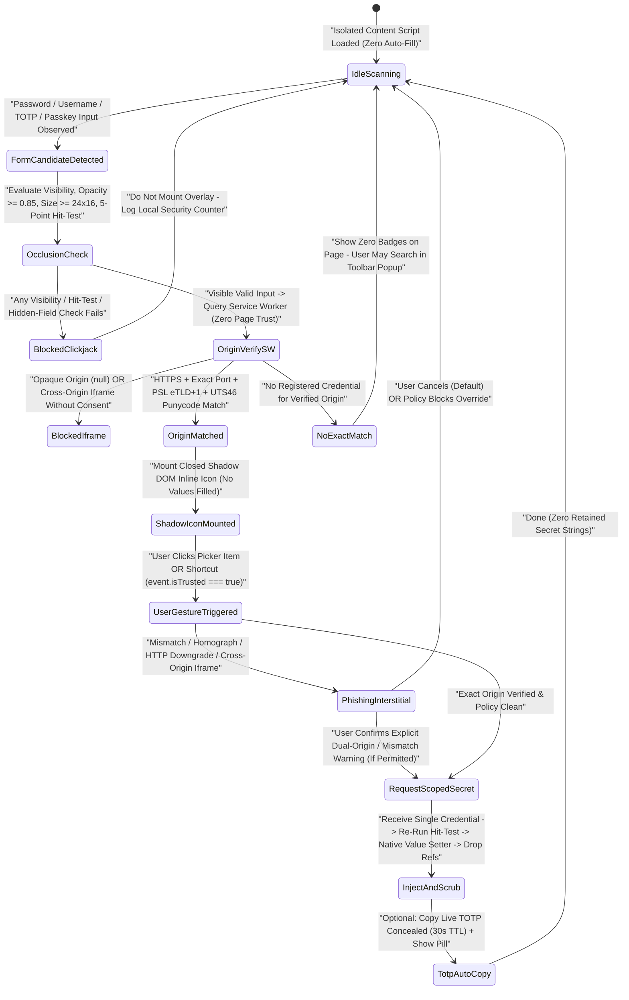
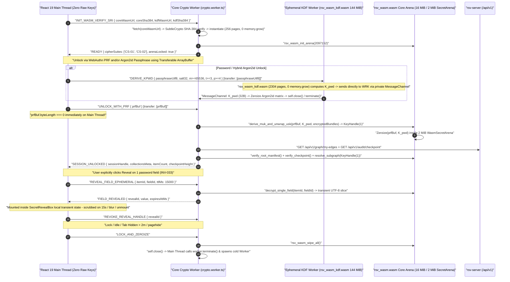
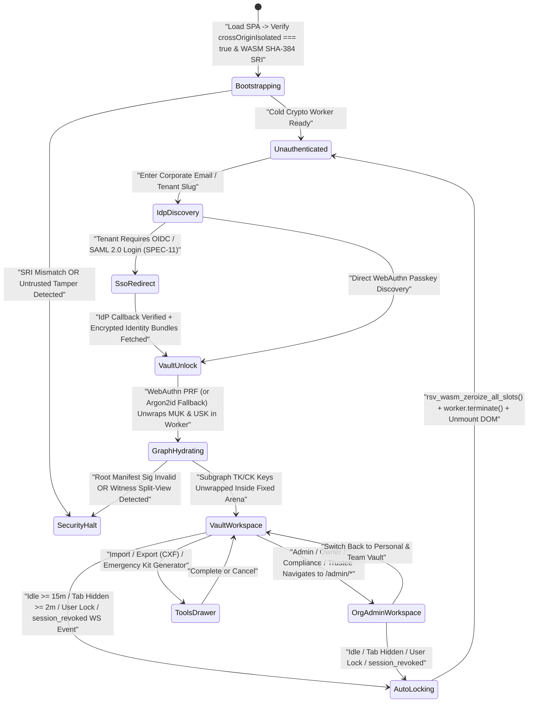
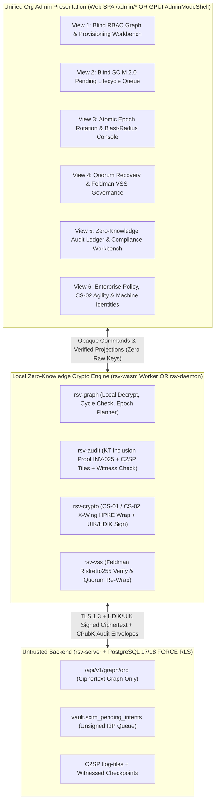

# SPEC-15: Client UI/UX Architecture, Design System & Enterprise Org Admin Dashboard

| Field | Value |
| :--- | :--- |
| **Document ID** | `RSV-SPEC-15` |
| **Project** | RusticStack Core (`ZK-Vault` — `https://github.com/KelpHect/ZK-Vault`) |
| **Status** | Normative (`v1.0.0-normative`) |
| **License** | Dual `MIT OR Apache-2.0` |
| **Target Toolchains** | Rust 2024 Edition (MSRV `1.94.0`, `gpui` / `gpui-ce`), TypeScript `5.8+` (`strict`), React `19`, Vite `6`, Tailwind CSS `v4` |
| **Primary Surfaces** | `rsv-desktop` (GPUI), MV3 Browser Extension (Chrome/Chromium/Firefox/Safari), Zero-Install Web Vault SPA, Thick-Client Org Admin Dashboard |
| **Related Specifications** | `SPEC-01`..`SPEC-14` (`SPEC-04` Blind RBAC, `SPEC-06` Audit Ledger, `SPEC-07` Omni-Client Foundation, `SPEC-08` Wire Protocols, `SPEC-09` Threat Model, `SPEC-11` Identity/SCIM/KT, `SPEC-12` DevOps/SSH/Machine IDs, `SPEC-13` Offline Sync/CXF/Passkeys, `SPEC-14` Enterprise Policy & Attestation) |
| **Related ADRs & Schemas** | `ADR-0001`, `ADR-0003`, `ADR-0004`, `ADR-0005`, `ADR-0006`, `ADR-0007`, `schemas/openapi-v1.yaml`, `schemas/ipc-native-messaging.schema.json`, `schemas/postgresql-schema.sql` |

---

## 1. Scope, Relationship to `SPEC-07` & Formal UI/UX Invariants

The key words **"MUST"**, **"MUST NOT"**, **"REQUIRED"**, **"SHALL"**, **"SHALL NOT"**, **"SHOULD"**, **"SHOULD NOT"**, **"RECOMMENDED"**, **"NOT RECOMMENDED"**, **"MAY"**, and **"OPTIONAL"** in this specification are to be interpreted as described in BCP 14 (RFC 2119 and RFC 8174) when, and only when, they appear in all capitals.

### 1.1 Division of Responsibilities (`SPEC-07` vs. `SPEC-15`)

- **`SPEC-07` (Systems Foundation)** defines process separation (`rsv-daemon` vs. `rsv-desktop`), OS IPC peer authentication, `rsv-mem`/`rsv-enclave` lifecycle, Chrome Native Messaging `ChunkEnvelope` framing (`<= 786,432 B`), and mandatory Web SPA HTTP security headers.
- **`SPEC-15` (This Specification)** defines the complete **Application UI/UX Architecture** across all four user-facing surfaces:
  1. The shared **"Obsidian & Tungsten"** design system, WCAG 2.2 AA visual tokens, 9 universal item schemas, and zero-leak secret presentation hygiene.
  2. **Surface 1 — GPUI Native Desktop App (`rsv-desktop`)**: entity/view trees, async executor bridge, 100,000-item @ 120 FPS virtualization contract, keyboard-first command palette, and 5 dedicated security modals.
  3. **Surface 2 — Chrome / Chromium / Firefox MV3 Browser Extension**: Closed Shadow DOM inline autofill, anti-phishing state machine, synced passkey mediation UX, toolbar popup views, and cross-browser parity matrix.
  4. **Surface 3 — Zero-Install Web Vault SPA**: pinned strict-CSP stack, typed Main Thread <-> `rsv-wasm` Dedicated Web Worker RPC contract, lifecycle state machine, and client-side import/export + Emergency Kit wizards.
  5. **Surface 4 — Thick-Client Enterprise Org Admin Dashboard (10,000+ Seat Control Plane)**: screen-by-screen architecture across 6 zero-knowledge governance views running identically inside the Web SPA (`rsv-wasm`) and GPUI Desktop Admin Mode (`rsv-daemon`).

### 1.2 Formal UI/UX Security Invariants (`INV-033` through `INV-036`)

These invariants extend the formal registry in `SPEC-09` (`INV-001`..`INV-024`) and sibling specifications (`INV-025`..`INV-032`) with top-precedence UI/UX security guarantees:

---

#### `INV-033` — Zero-Plaintext UI Persistence & Ephemeral Render Isolation
- **Formal Statement**: Across `rsv-desktop`, the MV3 Browser Extension, the Zero-Install Web SPA, and the Org Admin Dashboard, all secret field values (passwords, passphrases, TOTP seeds, SSH private keys, API tokens, CVVs, recovery seeds, VSS shares) MUST render masked by default as a fixed 12-glyph mask (`••••••••••••`) independent of true byte length. Secret plaintext MUST NEVER be written to DOM `data-*` attributes, ARIA plain-value nodes when masked, URL parameters, `localStorage`, `sessionStorage`, `IndexedDB` plaintext tables, `chrome.storage.*`, global client state stores, GPUI disk/layout caches, or unmanaged JavaScript closures. Ephemeral reveal buffers MUST wrap plaintext in `Zeroizing<String>` (Rust) or an unmount-scrubbed local transient binding (TypeScript), MUST enforce an automatic re-mask timer (default `15 s`, hard cap `30 s`), and MUST purge immediately on component unmount, navigation, window blur / `visibilitychange`, or vault lock (`<= 50 ms`).
- **Threat Coverage**: `ADV-03`, `ADV-06` (shoulder-surfing, length side-channels, screen-scraping, browser storage forensics, heap lingering).
- **Owning Crates / Surfaces**: `rsv-desktop`, `clients/extension`, `clients/web-spa`, `rsv-wasm`.
- **Failure Mode**: Revealed passwords linger in DOM trees, browser storage, accessibility trees, or GPU glyph caches after lock or blur.
- **Verification Method**: Automated DOM/storage/heap zero-leak scan after reveal + auto-remask/unmount/lock + `rsv-desktop` live memory canary probe (`tests/ui-security/`).

---

#### `INV-034` — Concealed OS Clipboard Hygiene & Timed Auto-Clear
- **Formal Statement**: Every secret copy action MUST attach OS-native clipboard concealment and history-exclusion markers before exposing clipboard bytes:
  - **macOS**: `org.nspasteboard.ConcealedType`, `org.nspasteboard.TransientType`, and `org.nspasteboard.AutoGeneratedType` on `NSPasteboard.general`.
  - **Windows**: `ExcludeClipboardContentFromMonitorProcessing` (marker), `CanIncludeInClipboardHistory = DWORD(0)`, and `CanUploadClipboardDataToCloud = DWORD(0)` alongside `CF_UNICODETEXT`.
  - **Linux (Wayland / X11)**: `x-kde-passwordManagerHint` with UTF-8 value `"secret"` (and NEVER writing to X11 `PRIMARY` selection).
  - **Web SPA / Standalone Extension Fallback**: `navigator.clipboard.writeText` inside an explicit user gesture with active timed overwrite (`""`).
  Every clipboard write MUST start a non-clobbering countdown timer (default `30 s`, configurable `10 s`–`120 s` by tenant policy) and MUST immediately wipe on vault lock or OS sleep, clearing ONLY if the OS clipboard change counter (`changeCount` / `GetClipboardSequenceNumber()`) or constant-time digest still matches the copied secret.
- **Threat Coverage**: `ADV-03` (OS clipboard history managers, cloud clipboard sync, background pasteboard sniffers).
- **Owning Crates / Surfaces**: `rsv-daemon`, `rsv-desktop`, `clients/extension`, `clients/web-spa`.
- **Failure Mode**: Copied enterprise credentials persist indefinitely in Windows Cloud Clipboard, macOS third-party clipboard managers, or X11 `PRIMARY`.
- **Verification Method**: Platform clipboard metadata inspection harness (macOS/Windows/Wayland) + TTL expiry + Non-Clobber negative test.

---

#### `INV-035` — Explicit User-Gesture Autofill & Shadow-DOM Origin Isolation
- **Formal Statement**: The MV3 Browser Extension MUST NEVER populate form fields automatically on `DOMContentLoaded`, `load`, `focus`, or DOM mutation. Every credential fill MUST require a verified trusted user gesture (`event.isTrusted === true` inside the extension popup, `chrome.commands` shortcut, or Closed Shadow DOM picker). The Service Worker MUST resolve authoritative origin via privileged tab/frame APIs (`sender.tab.url`, `sender.url`, `sender.frameId`), MUST enforce `https:` + exact port + Mozilla PSL `eTLD+1` (strict full-hostname on shared hosting suffixes) + UTS #46 Punycode canonicalization, MUST reject cross-origin `<iframe>`s (unless dual-origin popup consent is explicitly confirmed) and opaque `"null"` iframes, MUST abort on occluded/invisible inputs (`opacity < 0.85`, `< 24x16 px`, `< 80%` unclipped area, or 5-point `elementsFromPoint` hit-test failure), MUST mount all injected inline overlays strictly inside `attachShadow({ mode: "closed" })`, and MUST render a high-visibility **Phishing-Mismatch Interstitial** whenever a user attempts to fill an item onto a mismatched, HTTP-downgraded, or homograph origin.
- **Threat Coverage**: `ADV-06` (phishing lookalikes, clickjacking overlays, cross-origin credential-harvesting iframes, DOM scraping).
- **Owning Surfaces**: `clients/extension`.
- **Failure Mode**: Malicious web pages silently harvest passwords, scrape inline account menus, or trick users into filling credentials on homograph domains.
- **Verification Method**: Playwright Hostile-Page Autofill & Clickjacking Security Suite (12 mandatory adversarial page fixtures, zero leaked credentials).

---

#### `INV-036` — Zero-Trust Thick-Client Org Dashboard Graph Integrity
- **Formal Statement**: Every Org Admin Dashboard operation that creates or mutates cryptographic access (`POST /api/v1/graph/edges`, `PATCH /api/v1/teams/{id}/rotate`, `PATCH /api/v1/collections/{id}/rotate`, Blind SCIM 2.0 pending intent execution, VSS escrow ceremony submission, and Machine Identity collection grants) MUST execute strictly client-side inside `rsv-wasm` (Web SPA Worker) or `rsv-daemon` (GPUI Admin Mode). Prior to wrapping ANY key (`TK`, `CK`, `DEK`, or VSS shard) to a recipient `UPK`, the client MUST verify (1) the tenant's signed `root_manifest_cbor`, (2) the recipient's `upk_uik_signature`, and (3) a valid **Key Transparency Inclusion Proof (`INV-025`)** anchored to a witness-verified C2SP checkpoint. The client MUST locally verify DAG acyclicity and `MAX_GRAPH_DEPTH = 4` (`rsv-graph`), enforce `ESCROW_POLICY_VIOLATION` guards (`INV-005`), sign every edge with the admin's `UIK`, build a `CPubK`-sealed `X-RSV-Audit-Envelope`, and sign the request with `HDIK` (or policy-permitted `UIK`) before transmission.
- **Threat Coverage**: `ADV-01`, `ADV-05` (compromised server `UPK` key-substitution, rogue admin escrow bypass, silent unverified SCIM grants).
- **Owning Crates / Surfaces**: `rsv-graph`, `rsv-audit`, `rsv-wasm`, `rsv-daemon`, `rsv-desktop`, `clients/web-spa`.
- **Failure Mode**: Compromised backend substitutes an attacker `UPK` during admin provisioning or SCIM approval, silently capturing `TK`/`CK`.
- **Verification Method**: Adversarial Org Admin E2E suite injecting a rogue `UPK` with missing/invalid KT proof and asserting deterministic client abort with zero network mutation.

---

## 2. Shared Cross-Client Design System & Visual Language ("Obsidian & Tungsten")

All four RusticStack Core surfaces share a single canonical design token package (`packages/design-tokens/tokens.json`) compiled at build time into both Rust constants (for `rsv-desktop` GPUI `Hsla` theme structs) and CSS custom properties (for Tailwind CSS v4 in `clients/web-spa` and `clients/extension`).

**Visual Identity Philosophy — "Obsidian & Tungsten"**:
- Modeled on precision engineering instruments (Zed IDE speed, 1Password visual clarity): ultra-crisp 1px hairlines, restrained monochrome Obsidian surfaces, warm Tungsten gold reserved exclusively for active focus and primary cryptographic actions, Cool Cobalt for interactive data/digits, and semantic cryptographic assurance indicators (`CS-02` PQ Shield, Hardware Enclave `L3` badge, KT Verified checkmark, Witness Cosigned indicator).
- **Zero Gratuitous Chrome**: Every animation MUST complete within `<= 150 ms` (`ease-out`) or be completely suppressed under `prefers-reduced-motion: reduce`.

### 2.1 Semantic Color Tokens & WCAG 2.2 AA Contrast Contract

Every foreground/background pairing MUST maintain a minimum contrast ratio of **`>= 4.5:1`** for normal text (`< 18px`), **`>= 3.0:1`** for large text (`>= 18px` bold or `>= 24px`) and UI component borders/icons, verified automatically in CI.

| Semantic Token | Dark Theme — **Obsidian** (Default) | Light Theme — **Alabaster** (Accessible) | Usage & Minimum Contrast |
| :--- | :--- | :--- | :--- |
| `bg.canvas` | `#0B0D10` | `#F6F7F9` | Root application background, sidebar base |
| `bg.surface` | `#12151B` | `#FFFFFF` | Primary panes (`VirtualizedItemList`, `ItemInspectorPane`, cards) |
| `bg.elevated` | `#191E27` | `#FFFFFF` | Modals, `QuickSwitchPalette`, Closed Shadow DOM overlay, popovers |
| `bg.inset` | `#0E1116` | `#EEF1F5` | Input wells, monospace secret code boxes, DAG canvas grid |
| `bg.hover` | `#1F2632` | `#E6EBF2` | Virtualized row hover, button hover |
| `bg.selected` | `#242D3D` | `#DCE6F7` | Active selected list row, active collection pill |
| `border.subtle` | `#232A36` | `#D7DEE8` | 1px structural pane dividers and card borders |
| `border.strong` | `#394457` | `#9AA7BA` | Input borders, interactive controls (`>= 3.0:1` vs `bg.surface`) |
| `border.focus` | `#E5A93C` | `#B2740A` | 2px keyboard focus ring (WCAG 2.2 Focus Appearance compliant) |
| `text.primary` | `#F1F4F8` | `#11161F` | Titles, primary labels, revealed alpha glyphs (`> 15:1` contrast) |
| `text.secondary` | `#A7B2C3` | `#465366` | Usernames, timestamps, secondary metadata (`> 7.5:1` contrast) |
| `text.muted` | `#7A8699` | `#5B687C` | Section headers, placeholders (`>= 4.6:1` vs `bg.surface`) |
| `accent.tungsten` | `#E5A93C` | `#9A6200` | Primary CTA highlight, active lock/hardware icon, key focus |
| `accent.tungsten_fg` | `#0B0D10` | `#FFFFFF` | Text on `accent.tungsten` button (`> 9.0:1` contrast) |
| `accent.cobalt` | `#58A6FF` | `#0F5CC0` | Interactive links, revealed numeric glyphs, active sync pulse |
| `status.verified` | `#34D399` | `#0A7A50` | `L3` Hardware Enclave, KT Proof Verified, Witness Cosigned, VSS Valid |
| `status.pq_shield` | `#A78BFA` | `#6338C7` | `CS-02` X-Wing Post-Quantum Hybrid cipher suite indicator |
| `status.warning` | `#F59E0B` | `#9A5800` | `L1` WASM mode, TOTP `< 5s`, `STALE_KEY_EPOCH`, overdue VSS check |
| `status.danger` | `#F87171` | `#C81E1E` | Phishing mismatch, `GRAPH_CYCLE_REJECTED`, `ESCROW_POLICY_VIOLATION`, **Hard Security Halt** |
| `secret.digit` | `#6CB6FF` | `#0B56B8` | Numeric digits `0-9` inside explicitly revealed secrets (`>= 5.8:1`) |
| `secret.symbol` | `#F0B44C` | `#9E5300` | Punctuation/symbols inside explicitly revealed secrets (`>= 5.2:1`) |
| `mask.bullet` | `#8C98AB` | `#5B687C` | Fixed 12-dot concealment mask (`••••••••••••`) |

### 2.2 Typography, Secret-Safe Monospace & Spacing Scale

All fonts MUST be statically bundled inside the client binary or local origin assets (ZERO external font CDNs; enforced by `font-src 'self'`).

| Token | Font Stack | Size / Line-Height | Weight | OpenType Features | Usage |
| :--- | :--- | :--- | :---: | :--- | :--- |
| `type.display` | `Inter`, system UI sans | `22px / 28px` | `600` | `cv02, cv03, cv04` | Lock screen title, Hard Security Halt heading |
| `type.h1` | `Inter`, system UI sans | `18px / 24px` | `600` | `cv02, cv03, cv04` | Item inspector title, Org Admin view title |
| `type.h2` | `Inter`, system UI sans | `14px / 20px` | `600` | `tnum` | Modal headings, inspector section headers |
| `type.body` | `Inter`, system UI sans | `13px / 18px` | `400` | `cv02` | List rows, form inputs, table cells |
| `type.body_sm` | `Inter`, system UI sans | `12px / 16px` | `500` | `tnum` | Subtitles, domain hints, badges, timestamps |
| `type.mono_secret` | `JetBrains Mono`, `IBM Plex Mono`, monospace | `14px / 22px` | `500` | **`zero, ss01, tnum`** | Revealed passwords, TOTP codes, recovery seeds, SAS words |
| `type.mono_code` | `JetBrains Mono`, `IBM Plex Mono`, monospace | `12px / 18px` | `400` | **`zero, tnum`** | SSH public keys, `ORPubK` fingerprints, UUIDv7, `rsv://` URIs, C2SP hashes |
| `type.micro_badge` | `Inter`, system UI sans | `11px / 14px` | `600` | `tnum, case` | `CS-02`, `L3`, `v4`, `epoch 7`, `ROOT QUORUM` pills |

**Mandatory Glyph Disambiguation Rule**: `type.mono_secret` MUST enable OpenType slashed-zero (`zero`) and disambiguated glyphs so `0` vs `O`, `1` vs `l` vs `I`, and `` ` `` vs `'` are visually unmistakable whenever a secret is revealed. When revealed, `SecretTextDisplay` MUST syntax-color characters by Unicode class (`alpha` = `text.primary`, `digit` = `secret.digit`, `symbol` = `secret.symbol`) to eliminate manual transcription errors.

**Layout Spacing & Radii**:
- Base unit: `4px` (`space.1 = 4px`, `space.2 = 8px`, `space.3 = 12px`, `space.4 = 16px`, `space.6 = 24px`, `space.8 = 32px`).
- Radii: `radius.sm = 4px` (badges, inputs), `radius.md = 6px` (buttons, list rows), `radius.lg = 10px` (modals, Closed Shadow DOM cards).
- Virtualized list row height: strictly fixed **`56px`** (`VirtualizedItemList`) and **`44px`** (Org Admin member/edge/audit tables) so virtual scroll offset arithmetic is $O(1)$.

### 2.3 Universal Vault Item Type Schemas & Iconography (9 Canonical Types)

Every item payload decrypted from `vault.vault_items.encrypted_payload` conforms to a canonical deterministic CBOR schema (`rsv-types::VaultItemPayload`) tagged by one of 9 `item_type` discriminants. All four surfaces render consistent icons, masked field semantics, and quick actions:

| `item_type` ID | Display Name | Icon Semantic | Metadata Fields (Indexed in Daemon RAM, Never Secret) | Secret Payload Fields (Masked by Default, `INV-033`) | Special UI Behavior |
| :--- | :--- | :--- | :--- | :--- | :--- |
| `login` | **Login** | `KeyRound` | `title`, `username_hint`, `origin_rules[]` (`exact` \| `etld1` \| `host_port`, `allow_insecure_http`), `tags[]`, `linked_passkey_id?` | `password`, `totp_uri?` (secret + algorithm/digits/period), `custom_concealed[]` | Extension autofill eligible; live 30s TOTP countdown ring; strength & HIBP-k-anonymity offline check |
| `passkey` | **Passkey** | `Fingerprint` | `title`, `rp_id`, `rp_name`, `user_display_name`, `credential_id_b64u`, `alg` (`ES256`/`EdDSA`/`RS256`), `scope` (`personal` \| `shared_team`), `created_at` | `passkey_v1` CBOR (`BE=1, BS=1, signCount=0`; private key NEVER revealable in UI; exportable ONLY via policy-gated FIDO CXF `SPEC-13`) | Non-revealable signing-only object; displays Personal vs Shared Team badge + hardware approval indicator |
| `ssh_key` | **SSH Key** | `Terminal` | `title`, `item_type: "ssh_key_v1"`, `algorithm` (`ssh-ed25519` \| `ecdsa-sha2-nistp256` \| `sk-ssh-ed25519@openssh.com`), `public_key_wire` (RFC 4253), `sha256_fingerprint`, `allowed_host_patterns[]`, `approval_policy.mode` (`always_confirm` \| `confirm_with_ttl` [default `ttl_seconds = 300`, max `3600`] \| `hardware_uv_required`), `allow_agent_forwarding` | `private_key_material` (raw 32B Ed25519 seed / P-256 scalar, or `null` if silicon/FIDO2 bound via `hardware_key_ref`), `openssh_certificate?` | Integrates with `rsv-daemon` RFC 9987 SSH Agent (`SPEC-12 §2.2`); copy public key without reveal; raw private key requires explicit step-up confirm to export/reveal |
| `api_credential` | **API / Env Secret** | `Braces` | `title`, `service_name`, `environment` (`prod` \| `staging` \| `dev`), `expires_at?`, `rsv_uri` (`rsv://<col>/<item>/<field>`), `env_var_names[]` | `env_pairs[]` (`key`, `value`, `concealed: bool`), `bearer_or_api_key` | 1-click copy `rsv://` CLI reference (`rsv run`); expiration countdown warning `< 14d`; bulk concealed env-var editor |
| `secure_note` | **Secure Note** | `FileLock2` | `title`, `tags[]`, `preview_redacted` (always `"Encrypted note"` — NEVER leaks first line!) | `markdown_body` | Masked until explicit "Unlock Note View" toggle (auto-remasks on blur/15s idle); rendered via strict static Markdown AST (ZERO raw HTML/JS/external images) |
| `payment_card` | **Payment Card** | `CreditCard` | `title`, `cardholder_name`, `brand`, `last4` (strictly 4 trailing digits), `expiry_mm_yy` | `pan_full`, `cvv`, `pin?`, `billing_zip?` | Renders `•••• •••• •••• 4242` by default; CVV & PIN have independent reveal toggles |
| `identity` | **Identity** | `IdCard` | `title`, `full_name_hint`, `org_label`, `email_hint` | `gov_id_number?`, `tax_id?`, `address_fields`, `phone`, `passport_number?` | Strictly opt-in manual fill only; sensitive ID fields masked individually |
| `recovery_seed` | **Recovery Seed** | `ShieldAlert` | `title`, `seed_format` (`bip39_12` \| `bip39_24` \| `slip0039_33` \| `hex_256` \| `feldman_vss_shard`), `fingerprint_or_derivation_path`, `vss_ceremony_id?` | `mnemonic_words[]` / `raw_seed_hex` / `vss_shard_cbor` | **Elevated Reveal Friction**: requires confirmation click + re-prompts hardware verification if last auth `> 5m`; renders numbered word grid with 15s auto-hide; VSS shards offer direct "Run Non-Reconstructive Health Check" button |
| `encrypted_attachment` | **Encrypted File** | `Paperclip` | `title`, `filename`, `byte_size`, `mime_type`, `blake3_ciphertext_root`, `chunk_count` (`vault.vault_attachments`) | STREAM 64 KiB chunked `AES-256-GCM` stream (`INV-030`, per-chunk AAD `"rsv:attach:v1"`, `StreamDecryptHandle`) | Constant-memory streaming decryption (NEVER buffers full 50–500 MiB file in RAM or WASM arena); inline safe preview strictly for bounded PNG/JPEG/UTF-8 text revoked on unmount; explicit "Save Decrypted Copy" warns of OS disk persistence |

### 2.4 Universal Secret Hygiene & Anti-Exfiltration Rules (`INV-033`, `INV-034`)

Every client surface MUST implement the following four hygiene controls without deviation:

1. **Length-Hiding Default Mask**: Every concealed field renders identically as `••••••••••••` (12 bullets) whether the underlying secret is 6 bytes or 256 bytes, preventing visual length estimation.
2. **Ephemeral Reveal & Auto-Remask**:
   - Clicking **Reveal** (or pressing `Cmd/Ctrl+R`) fetches ONLY that single `(item_id, field_id)` from `rsv-daemon` / `rsv-wasm` with `ttl_ms = 15_000` (configurable max `30_000`).
   - An inline 2px Tungsten progress bar shrinks continuously across the field width showing remaining reveal time (`15s -> 0s`).
   - Any of the following events MUST immediately zeroize the plaintext buffer, restore `••••••••••••`, and flush the rendered text node / GPUI glyph cache: (a) countdown reaches `0`, (b) user clicks Hide / presses `Esc`, (c) user navigates to another item/view, (d) window loses focus (`window_did_resign_key` / `visibilitychange === 'hidden'`), (e) vault locks.
3. **Concealed Clipboard with Non-Clobber Auto-Clear (`INV-034`)**:
   - Clicking **Copy** triggers `copy_secret_to_clipboard(item_id, field_id, ttl_ms)` directly inside `rsv-daemon` (native desktop & Mode A extension) so plaintext never even enters `rsv-desktop` or Chrome JS heap!
   - A floating bottom-right toast displays `"Password copied (concealed) — clearing in 28s"` with a **`Clear Now`** button.
   - Upon TTL expiry or vault lock, the clipboard is cleared ONLY if `changeCount` (macOS), `GetClipboardSequenceNumber()` (Windows), Wayland `wl_data_source` ownership, or constant-time digest match confirms the user has not copied something else in the interim.
4. **Screen-Capture & Compositor Protection**:
   - **macOS (`rsv-desktop`)**: `NSWindow.sharingType = .none` enabled by default on all unlocked windows.
   - **Windows (`rsv-desktop`)**: `SetWindowDisplayAffinity(hwnd, WDA_EXCLUDEFROMCAPTURE)` enabled by default on all unlocked windows.
   - **Linux (`rsv-desktop`)**: On minimize, workspace switch, or lock, paint an immediate solid Obsidian (`#0B0D10`) frame before yielding to Wayland/X11 compositor so thumbnail previews never snapshot revealed content.
   - If an enterprise administrator disables screen-capture exclusion for screen-sharing/accessibility diagnostics via tenant policy, the titlebar MUST display a persistent amber pill: `Capture Exclusion Off (Policy)`.

---

## 3. Surface 1: GPUI Native Desktop App (`rsv-desktop`)

### 3.1 Process Boundary, Entity Architecture & Async Tokio Bridge

Per `SPEC-07 §4` and `ADR-0003`, `rsv-desktop` enforces `#![forbid(unsafe_code)]`, holds **zero long-term cryptographic keys**, and MUST have **zero Cargo dependency** on `rsv-crypto`, `rsv-mem`, `rsv-enclave`, or `rsv-vss`.

- **IPC & Tokio Bridge**:
  - A dedicated multi-threaded `tokio` runtime (`rsv-ipc-worker`, 2 worker threads) owns the authenticated OS IPC connection (`UDS` / `Named Pipe`) to `rsv-daemon` (or the in-process actor channel in portable mode).
  - The GPUI main UI thread NEVER performs blocking I/O, disk reads, or cryptography. All calls to `Arc<dyn VaultController>` execute on the Tokio pool and emit typed `VaultUiEvent` values over a bounded `async_channel` (capacity `256`) drained on GPUI's `ForegroundExecutor` via `cx.spawn(...)`.
  - All `gpui::*` types (`Entity`, `Window`, `App`, `Render`, `IntoElement`, `uniform_list`, `FocusHandle`) MUST stay strictly inside `crates/rsv-desktop/src/ui_gpui/`. Presentation state (`DesktopPresenter`, reveal deadline map, 3-way conflict diff state, keyboard action dispatcher) lives in toolkit-agnostic `crates/rsv-desktop/src/presenter/`.
- **Strict Lock-Time Subtree Unmount**:
  - When `WorkspaceState.lock_status` transitions to `Locked`, `WorkspaceRoot` MUST drop `Option<Entity<MainShell>>` and `Option<Entity<AdminModeShell>>` completely, zeroizing every transient `Zeroizing<String>` reveal buffer and calling the GPUI text-system glyph-atlas reset hook before painting `LockOverlay`.

### 3.2 Complete GPUI Entity & View Hierarchy

```mermaid
flowchart TD
    ROOT["WorkspaceRoot (Entity: WorkspaceState)"]
    CHROME["TitlebarChrome (Tenant, CS-02, L3/L2, Sync, Mode Switch, Lock)"]
    LOCK["LockOverlay (Opaque Full-Window Shield — Biometric / PRF / Passphrase)"]
    MAIN["MainShell (3-Pane Split Layout — Unmounted When Locked)"]
    ADMIN["AdminModeShell (6-View Org Admin Console — Daemon Backed)"]
    MODALS["ModalLayer (Exclusive Focus-Trapped Overlay Stack)"]
    TOAST["ToastLayer (Clipboard Countdown, Sync & Rotation Notices)"]

    SIDEBAR["CollectionSidebar (Entity: SidebarModel — Vaults, Types, Epochs)"]
    LIST["VirtualizedItemList (Entity: ItemListModel — 100k Rows @ 120 FPS)"]
    INSP["ItemInspectorPane (Entity: InspectorModel — Fields, TOTP, Revisions)"]
    FOOTER["StatusFooter (Checkpoint Height, Offline Queue, Daemon Health)"]

    M_PALETTE["QuickSwitchPalette (Cmd/Ctrl+K & Global Cmd/Ctrl+Shift+Space)"]
    M_SSH["SshApprovalModal (Hardware-Gated SSH Agent Signing Sheet)"]
    M_CONFLICT["ConflictMergeModal (3-Way Offline Diff Resolver — SPEC-13)"]
    M_PAIR["DevicePairingModal (QR + 6-Word SAS & Browser SAS — SPEC-11/07)"]
    M_VSS["VssCeremonyModal (Feldman VSS Quorum & Non-Reconstructive Health Check)"]
    M_HALT["SecurityHaltModal (Non-Dismissible Witness Split-View / Tamper Stop)"]

    ROOT --> CHROME
    ROOT --> LOCK
    ROOT --> MAIN
    ROOT --> ADMIN
    ROOT --> MODALS
    ROOT --> TOAST

    MAIN --> SIDEBAR
    MAIN --> LIST
    MAIN --> INSP
    MAIN --> FOOTER

    MODALS --> M_PALETTE
    MODALS --> M_SSH
    MODALS --> M_CONFLICT
    MODALS --> M_PAIR
    MODALS --> M_VSS
    MODALS --> M_HALT
```



### 3.3 Virtualized List & 100,000-Item @ 120 FPS Performance Contract

Enterprise users in 10,000-seat organizations routinely hold access to `10,000`–`100,000+` shared credentials across engineering, staging, and SaaS collections. `rsv-desktop` MUST maintain locked **120 FPS** scrolling and instant search without allocating 100k GPUI view nodes or storing secrets in UI RAM:

1. **Daemon-Side Locked Metadata Search Index (`rsv-daemon`)**:
   - Upon unlock, `rsv-daemon` populates an in-RAM, zeroized-on-lock `MetadataSearchIndex` containing ONLY non-secret searchable metadata per item: `(item_id, collection_id, item_type, title, username_hint, normalized_hosts, tags, favorite, updated_at, has_totp, has_passkey)`.
   - Search queries execute inside `rsv-daemon` using a deterministic, allocation-free fuzzy scorer (`nucleo-matcher` / Smith-Waterman), returning `(query_generation: u64, total_matches: usize, initial_window: Vec<ItemSummaryDto>)` over OS IPC.
2. **GPUI `uniform_list` Windowed Virtualization (`rsv-desktop`)**:
   - `VirtualizedItemList` renders using GPUI's `uniform_list` with fixed row height **`56px`** (`total_matches` virtual rows).
   - `ItemListModel` maintains a sliding LRU slice cache of at most **`256` `ItemSummaryDto` rows** (`~32 KiB` RAM) keyed by visible viewport range `start_idx..end_idx` with a `64`-row prefetch halo fetched asynchronously via `VaultController::fetch_item_slice(query_generation, offset, limit)`.
   - Zero secret bytes exist in `ItemSummaryDto` or `ItemListModel`.
   - When scrolling at 120 Hz, rows outside the prefetched window paint an instantaneous lightweight skeleton frame (`< 0.2 ms`) and swap cleanly upon slice arrival (`< 2 ms` over local UDS/Named Pipe) with zero main-thread blocking.

| Performance Metric | Mandatory Target (`100,000` Decrypted Metadata Rows) | Measurement Method |
| :--- | :--- | :--- |
| **GPUI Render Frame Budget** | **`< 4.0 ms` p99** (locked **120 FPS** within `8.33 ms` vsync) | GPUI frame profiler during continuous 100k-row scroll |
| **Fuzzy Search Keystroke-to-Paint** | **`< 12.0 ms` p99** (`< 5 ms` daemon rank + `< 3 ms` IPC + `< 4 ms` paint) | Synthetic 100k-item benchmark harness |
| **Cold App Launch to `LockOverlay`** | **`< 200 ms`** (macOS Metal / Win DX12 / Linux Vulkan) | Process spawn to first presented swapchain frame |
| **Post-Biometric Unlock to Workspace** | **`< 50 ms`** | Enclave unseal return to `MainShell` first frame |
| **Idle Resident Memory (RSS)** | **`< 50 MiB`** (`rsv-desktop`), **`< 80 MiB`** combined (`rsv-desktop` + `rsv-daemon`) | OS `RSS` / Working Set after 60s idle |
| **Lock Trigger to Complete Wipe** | **`<= 50 ms`** (daemon `rsv-mem` zeroize + desktop `MainShell` drop + clipboard wipe) | Automated lock-latency & memory-canary gate |

### 3.4 Keyboard-First Command Palette & Normative Shortcut Matrix

`rsv-desktop` is keyboard-first: every primary workflow MUST be executable without touching a mouse, with clear `border.focus` (`#E5A93C`) focus rings and Vim-compatible navigation.

- **In-App Command Palette (`Cmd+K` / `Ctrl+K`)**: Instant fuzzy jump across items, collections, Org Admin views, generator commands (`> generate passphrase`), lock/sync commands (`> lock now`, `> verify audit checkpoint`), and SSH key listing.
- **Global OS Quick-Access Spotlight (`Cmd+Shift+Space` / `Ctrl+Shift+Space`)**: Registered via OS global hotkey API (`RegisterHotKey` on Windows, Carbon/CGEvent hotkey on macOS, XDG GlobalShortcuts portal on Wayland). Spawns a frameless, always-on-top `560px × 380px` GPUI utility window centered in the active display. Supports instant search -> `Enter` (concealed copy primary secret + auto-hide window), `Shift+Enter` (copy username), `Alt+Enter` (copy TOTP), or `Esc` (immediately dismiss and purge view buffer). If the vault is locked, displays an inline Touch ID / Windows Hello biometric prompt directly inside the popup.

| Action | macOS Shortcut | Windows / Linux Shortcut | Scope & Behavior |
| :--- | :--- | :--- | :--- |
| **Global Quick-Access Popup** | `Cmd+Shift+Space` | `Ctrl+Shift+Space` | OS-global frameless quick picker (works over any app) |
| **Command Palette** | `Cmd+K` | `Ctrl+K` | Fuzzy items + commands + Admin view jump |
| **Focus Search Input** | `Cmd+F` or `/` | `Ctrl+F` or `/` | Focuses `VirtualizedItemList` search box |
| **List Navigate Up / Down** | `Up`/`Down` or `k`/`j` | `Up`/`Down` or `k`/`j` | Moves selection (when not typing in text input) |
| **Pane Focus Left / Right** | `Left`/`Right` or `h`/`l` | `Left`/`Right` or `h`/`l` | Moves focus `Sidebar <-> List <-> Inspector` |
| **Copy Primary Secret (Concealed)** | `Cmd+C` | `Ctrl+C` | Copies password / API key / PAN (`INV-034`, 30s TTL) |
| **Copy Username / Identifier** | `Cmd+Shift+C` | `Ctrl+Shift+C` | Copies username or SSH public key |
| **Copy Live TOTP Code (Concealed)** | `Cmd+Shift+T` | `Ctrl+Shift+T` | Copies current 6/8-digit TOTP code (`INV-034`, 30s TTL) |
| **Temporary Reveal Active Secret** | `Cmd+R` | `Ctrl+R` | Reveals focused field for `15s` with countdown bar (`INV-033`) |
| **New Vault Item** | `Cmd+N` | `Ctrl+N` | Opens item type chooser (`login`, `ssh_key`, `api_credential`, etc.) |
| **Edit Selected Item** | `Cmd+E` | `Ctrl+E` | Enters item editor mode (requires `WRITE` `permission_mask`) |
| **Toggle Org Admin Mode** | `Cmd+Shift+A` | `Ctrl+Shift+A` | Switches between `MainShell` and `AdminModeShell` (role-gated) |
| **Instant Lock Vault** | `Cmd+L` | `Ctrl+L` | Immediately triggers `LockVault` IPC (`<= 50 ms` total wipe) |
| **Force Sync Now** | `Cmd+Shift+S` | `Ctrl+Shift+S` | Pulls graph edges, collection deltas, and C2SP checkpoint |
| **Dismiss Modal / Re-Mask All** | `Esc` | `Esc` | Immediately re-masks all revealed fields or closes topmost modal |

### 3.5 Dedicated Native Security Modals

#### 3.5.1 Hardware-Gated SSH Agent Approval Sheet (`SshApprovalModal`, `SPEC-12`)
When an external process (e.g., `ssh`, `git`, `rsync`, `terraform`) requests an SSH signature over `rsv-daemon`'s `SSH_AUTH_SOCK` / Windows Named Pipe SSH Agent:
- `rsv-daemon` pauses the signing request and emits `VaultUiEvent::SshApprovalRequired(SshApprovalPrompt)` to `rsv-desktop` (raising an OS-foreground modal window even if `rsv-desktop` was minimized to tray).
- **Mandatory Displayed Context** (verified from OS kernel peer credentials inside `rsv-daemon`, never self-reported by caller):
  - **Calling Process**: Binary name, full canonical executable path (e.g., `/usr/bin/ssh`), PID, parent process chain (`zsh (pid 4120) -> git (pid 8841) -> ssh (pid 8842)`), and code-signature / Authenticode publisher badge.
  - **Target Key**: Vault item title, collection name, algorithm (`ssh-ed25519` / `ecdsa-sha2-nistp256` / `sk-ssh-ed25519@openssh.com`), and `SHA256:...` fingerprint.
  - **Session Binding**: Target hostname/username (when parsed from `session-bind@openssh.com` extension) and signature request type (`publickey` auth vs `git-commit` `sshsig`).
- **Actions & Auto-Deny Safety**:
  - **Deny (`Esc` — Default Safe Action)**: Rejects signing immediately; logs denied attempt locally.
  - **Approve Once (Touch ID / Windows Hello / TPM Confirm)**: Requires live OS biometric/enclave presence check whenever `approval_policy.mode == "hardware_uv_required"` (or silicon/FIDO2 bound); signs single challenge and writes `CPubK` audit event (`ssh.sign`).
  - **Approve for TTL (Default `300s`)**: Visible ONLY when item `approval_policy.mode == "confirm_with_ttl"` (`ttl_seconds` default `300`, max `3600`) AND the request is NOT a forwarded SSH agent session (`session-bind@openssh.com` `is_forwarding == 1` ALWAYS ignores TTL caching and forces fresh live biometric UV per `SPEC-12 §2.2`); hidden/disabled for `always_confirm` and `hardware_uv_required` production keys; caches approval strictly scoped to `(calling_binary_path, ssh_key_id)` and immediately invalidated on vault lock.
  - **30-Second Timeout Ring**: Automatically denies the SSH request if unattended for 30 seconds.

#### 3.5.2 3-Way Offline Conflict Merge Diff Viewer (`ConflictMergeModal`, `SPEC-13`, `INV-031`)
Triggered automatically whenever an offline queued edit returns `409 VERSION_CONFLICT` upon reconnect and deterministic field-level 3-way diff `(Base, Local, Remote)` escalates conflicting or coupled high-risk secret edits (`password`, `totp_seed`, `passkey_private_key`, `ssh_private_key`, `api_secret`) to `HumanMergeRequired` (persisted losslessly as a `ConflictPair` in encrypted local cache):
- **Zero Silent Overwrite Rule**: RusticStack Core MUST NEVER apply "last-write-wins" silently to conflicting vault edits.
- **3-Column Diff Layout**:
  - Column 1: **Base Ancestor (`vN`)** — common encrypted snapshot cached before offline edit.
  - Column 2: **Your Offline Edit (Local Draft)** — changes highlighted in Tungsten tint.
  - Column 3: **Latest Server Revision (`vN+k`, modified by `<Actor>` at `<UTC Timestamp>`)** — remote changes highlighted in Cobalt tint.
- **Masked Secret Diffing**: Changed secret fields display `"Secret modified (SHA-256 prefix 8f3a… vs c19e…)"` while remaining masked (`••••••••••••`) until the user explicitly clicks **Compare Revealed (15s)** on that specific row (`INV-033`).
- **Resolution Controls**: Per-field selector (`Use Local` | `Use Remote` | `Custom Edit`) plus bulk action **`Keep Both (Save My Draft as New Copy)`**. Committing generates a fresh 256-bit `DEK`, records `merge_parent_digests: [remote_digest, local_digest]`, binds `expected_version = N+k` (`If-Match: "v<N+k>"`), signs a new `AuditEnvelope`, and replays with a fresh `Idempotency-Key`. If access to the target collection was revoked while offline (`CONFLICT_ACCESS_REVOKED`), the modal notifies the user and offers local encrypted draft export or discard while immediately purging the revoked collection cache.

#### 3.5.3 Trusted Device QR + 6-Word SAS Pairing Wizard (`DevicePairingModal`, `SPEC-11` & `SPEC-07`)
Supports two distinct local cryptographic pairing flows with unmistakable visual distinction:
1. **New Device Provisioning (`SPEC-11`)**: Existing hardware-attested device (`L3`) displays or scans a short-lived 300s QR code (`/api/v1/auth/device-enroll/*`) containing `(ephemeral_x25519_pk, pairing_session_id, tenant_id)`. Both devices derive an identical **6-Word EFF Short Authentication String** (e.g., `copper-velvet-orbit-granite-tulip-anchor`) + 6-digit checksum via domain `"rsv:enroll:sas:v1"`. The user MUST visually verify all 6 words match and click **Confirm Matching Words** + hardware biometric approval before the existing device HPKE-seals the `MUK` transfer bundle to the new device (separate from 60-digit `"rsv:kt:num60:v1"` / 6-word `"rsv:kt:sas-words:v1"` / `rsv-kt://v1/...` Key Transparency peer safety numbers displayed in user identity drawers).
2. **Browser Extension Native Messaging Pairing (`SPEC-07 §5.2.2`)**: Triggered when an unpaired `ext_longterm_pk` connects via `rsv-nm-host`. Displays browser name/profile label, canonical Extension ID, and the **6-digit decimal + 4-word SAS** computed from `HKDF-Expand(transcript_hash, "RSV-IPC-SAS-v1", 16)`. Clicking **Approve Browser Pairing** pins `ext_longterm_pk` in `rsv-daemon`'s authenticated trust store.

#### 3.5.4 Feldman VSS Executive Recovery & Shard Health-Check Wizard (`VssCeremonyModal`)
Accessible to `trustee` and `owner` roles directly inside `rsv-desktop`:
- **Non-Reconstructive Shard Health Check (`INV-015`)**: Custodian clicks **"Verify My Custodian Shard"**. `rsv-daemon` unwraps the custodian's encrypted share inside `rsv-mem`, evaluates $y_{\text{lo},i} \cdot B = \sum_{j=0}^{t-1} i^j \cdot C_{\text{lo},j}$ and $y_{\text{hi},i} \cdot B = \sum_{j=0}^{t-1} i^j \cdot C_{\text{hi},j}$ over Ristretto255 against the tenant's published `tenant_vss_ceremonies` commitments, zeroizes the share immediately, and displays a green verified badge (`Share #3 Valid Against Ristretto255 Commitments — ORPK_SEED Not Reconstructed`).
- **Live `t`-of-`n` Quorum Recovery Ceremony (`INV-016`)**: Displays ceremony UUID, requester identity + verified KT fingerprint, reason code (`device_loss` / `passkey_loss` / `enterprise_audit_recovery`), live quorum progress gauge (**`2 / 3 Verified Custodian Shares Collected`**), and per-custodian status rows. Custodians inspect the requester's out-of-band Safety Number before clicking **Approve & Re-Wrap My Share** (re-encapsulating strictly to the requester's ephemeral recovery `UPK` under `HDIK` + `UIK` signature).

#### 3.5.5 Live Passkey & TOTP Inspector Widgets
- **TOTP Widget**: Renders a `28px` radial countdown ring synchronized to `rsv-daemon`'s monotonic clock (`30s` period; transitions from `accent.tungsten` -> `status.warning` when `< 5s` remain), displaying current code in `type.mono_secret` spaced into readable groups (`492 817`) + click-to-copy concealed (`INV-034`). Hovering/focusing shows a muted next-code preview when `< 5s` remain so users never submit an expiring token mid-paste.
- **Passkey Inspector Card**: Displays `rp_id`, user display name, algorithm (`EdDSA`/`ES256`), creation timestamp, last-used timestamp, and a clear scope badge (**`Personal Passkey`** vs **`Shared Team Passkey — Collection: <Name>`**). Raw passkey private keys are NEVER revealed in the UI.

---

## 4. Surface 2: Chrome / Chromium / Firefox MV3 Browser Extension

### 4.1 MV3 Dual-Mode Runtime & Closed Shadow DOM Architecture



**Normative MV3 Invariants**:
- **Zero Persistent Keys in Service Worker**: Because MV3 Service Workers suspend after ~30 seconds of idle, NO vault keys or decrypted item lists may be stored in Service Worker globals or `chrome.storage.*`. In Mode A, `rsv-daemon` holds all unlocked keys in `rsv-mem`; on Service Worker wake, it transparently reconnects to `rsv-nm-host` and negotiates a fresh ephemeral X25519 session authenticated by the pinned `ext_longterm_pk`.
- **Sub-1 MiB Chunking (`INV-021`)**: Every Native Messaging message MUST use `ChunkEnvelope` (`max_chunk_bytes = 786432`) per `schemas/ipc-native-messaging.schema.json`.

### 4.2 Autofill Detection, Origin Matching & Anti-Phishing State Machine (`INV-035`)



#### Normative Autofill Detection & Multi-Step Login Rules

1. **Field Classification Heuristics**:
   - Content scripts identify candidate forms using deterministic signal priority: (a) explicit HTML `autocomplete` attributes (`username`, `current-password`, `new-password`, `one-time-code`, `webauthn`), (b) `<input type="password">` visibility, (c) sibling `<input type="email|text|tel">` preceding a password field within the same `<form>` or shadow-free visual container, (d) multi-step SSO forms (e.g., Google, Okta, Entra ID, AWS) presenting a standalone username/email step prior to a password step.
   - **Multi-Step Flow Continuity**: When a user selects a credential during Step 1 (username-only screen), the Service Worker caches ONLY `(tabId, frameId, origin, selected_item_id, expires_at = now + 120s)` — NEVER caching the password string! When Step 2 renders the password field on the same verified origin, the Closed Shadow DOM picker highlights that exact `selected_item_id` as the top 1-click suggestion (still requiring an explicit trusted user gesture `event.isTrusted === true` to fetch and inject the password!).
2. **Authoritative Origin Verification (`INV-035`)**:
   - Performed strictly inside the Service Worker using `sender.tab.url` and `sender.url` (ignoring page-reported `location.href`).
   - **HTTPS Enforcement**: `http:` blocked by default except loopback (`http://localhost`, `http://127.0.0.1`, `http://[::1]`) or an item explicitly flagged `allow_insecure_http = true`, which ALWAYS triggers the HTTP-downgrade warning banner inside the picker.
   - **PSL `eTLD+1` & Shared Hosting Suffix Protection**: Embedded Mozilla Public Suffix List rejects cross-tenant sharing across public/private shared suffixes (`github.io`, `pages.dev`, `appspot.com`, `s3.amazonaws.com`, `vercel.app`, `netlify.app`, `herokuapp.com`, `azurewebsites.net`).
   - **Exact Port & Subdomain Policy**: Port mismatch (`:8443` vs `:443`) MUST NOT auto-match unless explicitly configured; tenant policy MAY enforce strict exact-host matching across corporate subdomains (`prod.corp.com` vs `dev.corp.com`).
   - **UTS #46 Punycode & Homograph Detection**: Non-ASCII or mixed-script hostnames canonicalize to `xn--...` and automatically display a high-visibility Punycode warning badge alongside the rendered domain.
3. **Anti-Clickjacking & Occlusion Defense**:
   - Both before mounting the Closed Shadow DOM icon AND synchronously microseconds before injecting values into the `<input>`, the content script MUST verify: `isConnected === true`, `!disabled`, `!readOnly`, every ancestor has `display !== "none"`, `visibility === "visible"`, `parseFloat(opacity) >= 0.85`, bounding box `width >= 24 && height >= 16`, unclipped viewport intersection `>= 80%`, and 5-point `document.elementsFromPoint(x, y)` center + >= 3 corners resolve to the target `<input>` or its associated same-origin `<label>`.
   - Auxiliary fields with `type="hidden"`, `aria-hidden="true"`, or off-screen coordinates MUST NEVER be filled.
4. **Phishing-Mismatch Interstitial (`INV-035`)**:
   - Triggered if the user manually selects an item from the toolbar popup whose registered origins do not match the current tab's verified origin, OR if a Punycode homograph / HTTP downgrade / cross-origin SSO iframe is detected.
   - Renders a crimson-bordered danger card showing:
     - **Stored Credential Origin**: `https://sso.acme-corp.com`
     - **Current Active Page Origin**: `https://sso.acme-c0rp.com` *(or Punycode `xn--...`)*
     - **Risk Explanation**: `"Domain mismatch detected. Filling credentials here may expose your account to phishing."`
   - Default focused button is **`Cancel Fill (Recommended)`**. A secondary **`Fill Anyway`** button is shown ONLY if `tenant/manifest.block_origin_mismatch_override == false`; when `true`, override is hard-disabled.
5. **TOTP Auto-Copy on Autofill**:
   - When filling a `login` item with a configured `totp_uri`, the extension requests a single live TOTP code, writes it via concealed clipboard (`INV-034`, delegated to `rsv-daemon` in Mode A), and displays a 4-second Closed Shadow DOM pill (`"2FA code copied (clears in 30s)"`).

### 4.3 Synced Passkey Mediation UX (`navigator.credentials.create/get`)

When passkey mediation is enabled by the user and tenant policy (`SPEC-12 §3`):

1. **Zero-Secret Main-World Interception & Self-Origin Bypass**: A minimal `MAIN`-world script intercepts `navigator.credentials.create` and `navigator.credentials.get` when `options.publicKey` is present, forwarding ONLY the public WebAuthn options (`rp.id`, `challenge`, `allowCredentials`, `user.name`) over a per-document randomized `MessageChannel` to the Isolated World content script -> Service Worker. The interceptor MUST unconditionally bypass RusticStack's own Web Vault SPA origin so hardware WebAuthn PRF unlock of the vault itself is never intercepted.
2. **Closed Shadow DOM Passkey Picker Overlay**:
   - Verifies `rp.id` is a valid registrable domain suffix of the authoritative tab origin (`sender.tab.url`) per WebAuthn Level 3 rules and rejects public suffixes (`github.io`, `co.uk`, `amazonaws.com`) to prevent cross-origin RP spoofing.
   - Displays matching synced `passkey_v1` (`BE=1, BS=1, signCount=0`) credentials with clear visual badges:
     - **`Personal Passkey`** (Cobalt badge) vs **`Shared Team Passkey · <Collection Name>`** (Tungsten badge with team icon).
     - **`L3_HARDWARE_ENCLAVE`** badge when backed by `rsv-daemon` + `rsv-enclave`.
   - Always displays an unmistakable secondary action: **`Use Security Key / OS Passkey Instead`** — immediately delegating cleanly back to the browser's original `navigator.credentials` implementation so physical YubiKeys, Touch ID, and Windows Hello platform passkeys remain 100% accessible.
3. **Shared Team Passkey Audit Non-Repudiation**:
   - Selecting a **Shared Team Passkey** triggers live user-verification confirmation in `rsv-daemon` (Touch ID / Windows Hello / TPM) and submits an `HDIK`-signed, `CPubK`-sealed `AuditEnvelope` (`passkey.assert` with `rp_id` and `item_id`), giving enterprise security teams cryptographic attribution for every shared-account login!

### 4.4 Extension Toolbar Popup Views & Cryptographic Generator

Fixed popup geometry: **`360px × 540px`** (responsive up to `420px`), dark-first Obsidian theme, full keyboard navigation (`Tab`, `Up`/`Down`, `Enter`, `Esc`).

- **Persistent Top Assurance Header**:
  - Displays a live **Connection & Security Mode Badge** mapped strictly to `SPEC-03` attestation tiers:
    - **`L3_HARDWARE_ENCLAVE [L3]`** (`status.verified` green shield — connected to `rsv-daemon` with Apple SE / TPM 2.0 / CNG NIST P-256 `HDIK`/`HDSK`).
    - **`L2_WEBAUTHN_ROAMING [L2]`** (`accent.cobalt` blue shield — FIDO2/CTAP2 WebAuthn PRF hardware factor backing `rsv-daemon` or isolated `rsv-wasm` Dual Fixed-Memory Workers without local silicon `HDSK`).
    - **`L1_SOFTWARE_LOCKED_MEM [L1]`** (`status.warning` amber shield — software-only `rsv-mem` locked RAM or password-only standalone `rsv-wasm` fallback; tooltip explains reduced hardware isolation vs `L3_HARDWARE_ENCLAVE`).
    - **`Pairing Required`** (displays 6-digit + 4-word SAS prompt to match against `rsv-desktop`).
    - **`Vault Locked`** (displays one-click **Unlock with Touch ID / Windows Hello** in Mode A or **Unlock with Passkey PRF** in Mode B).
- **View 1 — Tab Matches & Search**:
  - Top section pinned to **"Matches for `<current_verified_host>`"** (or explicit `"No exact matches for <host>"` state).
  - Global fuzzy search box (debounced `50 ms`, routed to `rsv-daemon` or `rsv-wasm` Worker).
  - Each row shows item icon, title, username hint, Personal/Team badge, and 1-click hover/keyboard actions: **Fill**, **Copy Password** (`INV-034`), **Copy TOTP**, **Open in Desktop/Web**.
- **View 2 — Cryptographic Password & Passphrase Generator**:
  - **Strict Entropy Rule**: ALL generated passwords and passphrases MUST be generated exclusively inside `rsv-daemon` (`OsRng`) or `rsv-wasm` (`getrandom` backed by `crypto.getRandomValues`). Calling `Math.random()` anywhere in `clients/extension` or `clients/web-spa` is a build-breaking CI violation!
  - Modes:
    - **Random Characters**: length slider `12`–`128` (default `24`), toggles for uppercase, lowercase, digits, symbols, and **"Avoid ambiguous glyphs (`0/O, 1/l/I`)"**, live Shannon/min-entropy display (`157 bits · Post-Quantum Safe`), character-class colorized preview.
    - **Diceware Passphrase**: `4`–`10` words (default `6`, `~77.5 bits`) sampled uniformly via rejection sampling from bundled EFF Large Wordlist (`7,776` words), custom separator (`-`, `.`, `_`, space), capitalize & inject digit toggles.
  - Actions: **Regenerate (`R`)**, **Copy Concealed (`C`)**, **Fill & Save to Vault** (writes new `login` item directly into selected collection with `AuditEnvelope`).
- **View 3 — Quick Lock & Extension Security Status**:
  - Active tenant name, cipher suite (`CS-02` X-Wing), last verified C2SP audit checkpoint height, Passkey Mediation toggle, Auto-Copy TOTP toggle, and **`Lock Vault Now`** button.

### 4.5 Cross-Browser Compatibility Matrix

| Browser Family | Extension Packaging | Native Daemon Transport (Mode A) | Standalone Fallback (Mode B) | Passkey Mediation & Manifest Specifics |
| :--- | :--- | :--- | :--- | :--- |
| **Chrome / Edge / Brave / Arc** | Manifest V3 (`service_worker`) | `chrome.runtime.connectNative("com.rusticstack.vault")` -> `rsv-nm-host` (`allowed_origins` pinned) | `chrome.offscreen.createDocument(WORKERS)` -> `rsv-wasm` Worker | Full `scripting.registerContentScripts(world: "MAIN")` support; `ChunkEnvelope <= 786,432 B` |
| **Firefox (Desktop 128+)** | Manifest V3 (`background.scripts` event page) | `browser.runtime.connectNative("com.rusticstack.vault")` -> `rsv-nm-host` (`allowed_extensions` pinned with signed Gecko Add-on ID) | Dedicated `Worker` spawned inside MV3 background event page (with `chrome.idle` zeroize hook) | Uses `browser.*` Promise WebExtension polyfill (`webextension-polyfill`); identical HPKE + SAS pairing and `768 KiB` chunk cap |
| **Safari (macOS 15+)** | Safari Web Extension (bundled inside `rsv-desktop.app`) | `browser.runtime.sendNativeMessage` -> Swift `SafariWebExtensionHandler` -> App Group XPC / UDS (`LOCAL_PEERTOKEN` + `SecCodeCopyGuestWithAttributes`) -> `rsv-daemon` | Not required (macOS App Extension always co-ships with `rsv-desktop`/`rsv-daemon`) | Enforces identical HPKE X25519 + SAS channel and `<= 786,432 B` chunk framing across XPC bridge; iOS/macOS AutoFill Credential Provider extension handles native OS passkeys |

---

## 5. Surface 3: Zero-Install Web Vault SPA

### 5.1 Pinned Frontend Stack & Zero-External-Origin Supply-Chain Contract

The Zero-Install Web Vault SPA (`clients/web-spa/`) serves users on unmanaged workstations and hosts the browser-based **Org Admin Dashboard**.

| Layer | Pinned Technology | Normative Rules |
| :--- | :--- | :--- |
| **UI Runtime** | **React `19.x`** + **TypeScript `5.8+`** | `strict: true`, `noUncheckedIndexedAccess: true`, `exactOptionalPropertyTypes: true`, zero `any` in security/RPC modules |
| **Bundler & Styling** | **Vite `6.x`** + **Tailwind CSS `v4`** | Static CSS output only (no runtime `<style>` injection); deterministic reproducible build with SHA-384 SRI manifest generation |
| **Virtualization** | **`@tanstack/react-virtual`** | Mandatory for all vault lists, directory tables, RBAC trees, and audit streams (fixed row heights `56px` / `44px`) |
| **Cryptographic Core** | **`rsv-wasm`** (`wasm32-unknown-unknown`) | **Dual Fixed-Memory Worker Split (`SPEC-03 §6.2`, `ADR-0008`, `INV-024`)**: persistent `rsv_wasm.wasm` core worker (`16 MiB` / `256` pages, `2 MiB` `WasmSecretArena`) + ephemeral `rsv_wasm_kdf.wasm` Argon2id worker (`144 MiB` / `2304` pages for `m >= 65536 KiB` up to `128 MiB`, terminated immediately after Worker-to-Worker `MessageChannel` `K_pwd` handoff); **zero `memory.grow()` opcodes** in both binaries |
| **Zero External Origins** | **100% Self-Hosted First-Party Assets** | ZERO Google Fonts, ZERO external CDNs, ZERO third-party telemetry/analytics, ZERO external favicon fetches (use deterministic local domain monogram SVGs so vault URLs never leak to third-party servers!) |
| **HTTP Security Headers** | Per `SPEC-07 §6.1` | `CSP` (`default-src 'none'; script-src 'self' 'wasm-unsafe-eval'; require-trusted-types-for 'script'; trusted-types rsv-spa`), `COOP: same-origin`, `COEP: require-corp`, `CORP: same-origin`, `HSTS`, `Referrer-Policy: no-referrer` |

### 5.2 Main Thread <-> Dedicated Crypto Web Worker (`rsv-wasm`) Typed RPC Contract

To satisfy `INV-022` (Opaque `KeyHandle` boundary), `INV-024` (Dual Fixed-Memory WASM Worker Split), and `INV-033` (Zero-Plaintext UI Persistence), the Web SPA enforces a hard architectural wall between the **Untrusted Presentation Thread (React 19)**, the **Persistent Core Crypto Worker (`rsv_wasm.wasm`, `16 MiB` / `256` pages, `2 MiB` `WasmSecretArena`)**, and the **Ephemeral Argon2id KDF Worker (`rsv_wasm_kdf.wasm`, `144 MiB` / `2304` pages, terminated immediately post-derivation)**:



#### Normative TypeScript Worker RPC Contract (`clients/web-spa/src/worker/protocol.ts`)

```ts
/** Opaque branded handle referencing a key slot inside rsv-wasm's fixed arena (INV-022). */
export type KeyHandle = number & { readonly __brand: "RsvKeyHandle" };
export type RevealHandle = string & { readonly __brand: "RsvRevealHandle" };

export type WorkerRequest =
  | { readonly id: string; readonly type: "INIT_WASM_VERIFY_SRI"; readonly wasmUrl: string; readonly expectedSha384: string }
  | { readonly id: string; readonly type: "UNLOCK_WITH_PRF"; readonly tenantId: string; readonly prfBuffer: ArrayBuffer; readonly encryptedBundlesCbor: ArrayBuffer }
  | { readonly id: string; readonly type: "UNLOCK_WITH_PASSPHRASE"; readonly tenantId: string; readonly passphraseUtf8: ArrayBuffer; readonly kdfParams: KdfParamsDto; readonly encryptedBundlesCbor: ArrayBuffer }
  | { readonly id: string; readonly type: "QUERY_ITEMS_SLICE"; readonly collectionId: string | null; readonly query: string; readonly offset: number; readonly limit: number }
  | { readonly id: string; readonly type: "GET_ITEM_METADATA"; readonly itemId: string }
  | { readonly id: string; readonly type: "REVEAL_FIELD_EPHEMERAL"; readonly itemId: string; readonly fieldId: string; readonly ttlMs: number }
  | { readonly id: string; readonly type: "REVOKE_REVEAL_HANDLE"; readonly revealId: RevealHandle }
  | { readonly id: string; readonly type: "GENERATE_SECRET"; readonly spec: GeneratorSpecDto }
  | { readonly id: string; readonly type: "MUTATE_ITEM"; readonly cmd: ItemMutationDto }
  | { readonly id: string; readonly type: "ORG_HYDRATE_GRAPH" }
  | { readonly id: string; readonly type: "ORG_VERIFY_KT_AND_SIGN_EDGE"; readonly intent: ProvisionEdgeIntentDto }
  | { readonly id: string; readonly type: "ORG_PLAN_AND_EXECUTE_ROTATION"; readonly plan: RotationPlanDto }
  | { readonly id: string; readonly type: "VSS_VERIFY_LOCAL_SHARD"; readonly ceremonyId: string }
  | { readonly id: string; readonly type: "AUDIT_VERIFY_CHECKPOINT_AND_TILES"; readonly leafIndex?: number }
  | { readonly id: string; readonly type: "LOCK_AND_ZEROIZE"; readonly reason: LockReason };

export type WorkerResponse =
  | { readonly id: string; readonly ok: true; readonly type: "READY"; readonly arenaBytes: number; readonly crossOriginIsolated: boolean }
  | { readonly id: string; readonly ok: true; readonly type: "SESSION_UNLOCKED"; readonly sessionHandle: KeyHandle; readonly role: TenantUserRole; readonly cipherSuite: "CS-01" | "CS-02"; readonly checkpointTreeSize: number }
  | { readonly id: string; readonly ok: true; readonly type: "ITEMS_SLICE"; readonly totalMatches: number; readonly rows: readonly ItemSummaryDto[] }
  | { readonly id: string; readonly ok: true; readonly type: "FIELD_REVEALED"; readonly revealId: RevealHandle; readonly ephemeralValue: string; readonly expiresAtMs: number }
  | { readonly id: string; readonly ok: true; readonly type: "ORG_GRAPH_HYDRATED"; readonly summary: OrgGraphProjectionDto }
  | { readonly id: string; readonly ok: true; readonly type: "LOCKED_ZEROIZED" }
  | { readonly id: string; readonly ok: false; readonly code: CanonicalErrorCode; readonly message: string; readonly retryable: boolean; readonly details?: Record<string, unknown> };
```

**Mandatory UI Thread Memory Hygiene Rules (`INV-033`)**:
1. Passphrase UTF-8 bytes and WebAuthn PRF `ArrayBuffer`s MUST be transferred via `[buffer]` transferables so the main thread's buffer immediately detaches to `byteLength === 0`.
2. `FIELD_REVEALED.ephemeralValue` MUST NEVER be placed into React Context, Zustand/Redux stores, URL hash/query params, DOM `data-*` attributes, or error telemetry. It MUST reside solely inside a leaf `<EphemeralSecretField />` component whose `useEffect` cleanup and `visibilitychange` listener immediately replace the string state with `""` and send `REVOKE_REVEAL_HANDLE`.
3. On lock, idle timeout (`15 min` default), hidden tab timeout (`2 min` default), `pagehide`, or `beforeunload`, the main thread sends `LOCK_AND_ZEROIZE`, awaits `LOCKED_ZEROIZED` (bounded `50 ms`), calls `worker.terminate()` to force the browser engine to reclaim the Worker isolate, unmounts the entire authenticated React tree, and instantiates a fresh cold Worker for the Lock Screen.

### 5.3 Complete Web SPA Screen Map & Session State Machine



### 5.4 Client-Side Zero-Knowledge Import/Export & Emergency Kit Generator (`SPEC-13`)

All three portability workflows execute **100% client-side** inside the `rsv-wasm` Worker (or `rsv-daemon` in `rsv-desktop`):

1. **Zero-Knowledge Import Wizard**:
   - Supported Formats: **FIDO CXF/CXP v1.0** (Credential Exchange Format — including synced passkeys), **Bitwarden JSON** (unencrypted or password-protected export), **1Password `.1pux`**, **KeePassXC `.kdbx` v4** (decrypts `.kdbx` with Argon2/ChaCha20/AES + optional keyfile strictly inside `rsv-wasm`), and generic CSV with interactive column mapper.
   - **Pre-Upload Dry-Run Preview**: Displays parsed item counts by type, duplicate detection against existing collection items, and target collection picker (`escrow_tier` indicator shown).
   - **Client-Side Sealing**: Generates a fresh 256-bit `DEK` per imported item inside `rsv-wasm`, encrypts with canonical AAD (`INV-002`), dual-wraps recovery keys per collection escrow policy, and uploads encrypted batches (`25` items/batch) with signed `AuditEnvelope` (`vault.import_batch`). Raw import files NEVER leave the browser.
2. **Policy-Gated Export Wizard**:
   - Disabled automatically when `tenant/manifest.allow_cxf_export == false` (displays clear lock explanation: `"Exports disabled by tenant security policy"`).
   - Requires live WebAuthn/biometric step-up confirmation and writes an immutable `CPubK` `AuditEnvelope` (`vault.export`) BEFORE releasing encrypted **FIDO CXF v1.0** or encrypted RusticStack archive bytes as an in-memory `Blob` URL immediately revoked (`URL.revokeObjectURL`) once download starts. Plaintext CSV export is disabled by default for enterprise tenants.
3. **Local Emergency Recovery Kit PDF Generator**:
   - Generates a print-ready A4/US-Letter PDF completely offline using a deterministic client-side vector PDF emitter inside the Worker (ZERO server upload, ZERO external fonts).
   - Contents (`SPEC-13`): Tenant Name & UUIDv7, User Handle, API Base URL, Tenant Root Manifest SHA-256 Fingerprint, **ISO/IEC 18004 Level-H QR code (`rsv-rk://v1?...`)**, **SLIP-0039 33-word RS1024 mnemonic grid** + **Bech32m (`rsvrk1...`)** formatted recovery key blocks (rendered in `JetBrains Mono` slashed-zero), blank lined box labeled **"Write Master Passphrase By Hand (Never Typed Here)"**, and explicit cryptographic notice: `"Generated locally inside isolated client memory. RusticStack servers cannot read or recover this document."`

---

## 6. Surface 4: Thick-Client Enterprise Org Admin Dashboard (10,000+ Seat Control Plane)

### 6.1 Unified Dual-Host Execution Architecture & Role Access Matrix

The Enterprise Org Admin Dashboard is architected as a **zero-knowledge thick client** with identical cryptographic guarantees across two runtime hosts:
- **Host A — Web SPA Admin Module (`/admin/*`)**: React 19 UI dispatching all graph decryption, KT proof verification, edge HPKE/X-Wing wrapping, rotation planning, VSS commitment checks, and C2SP tile verification to the `rsv-wasm` Dedicated Web Worker.
- **Host B — GPUI Desktop Admin Mode (`rsv-desktop`, `Cmd/Ctrl+Shift+A`)**: Native 120 FPS GPUI `AdminModeShell` dispatching the exact same operations to `rsv-daemon` + `rsv-enclave` (`L3_HARDWARE_ENCLAVE` recommended for `owner` and `trustee` ceremonies).



**Opaque Subgraph Honesty Rule**: When `GET /api/v1/graph/org` returns teams or collections for which the logged-in admin does NOT possess a valid cryptographic edge (`USK -> TK -> CK`), the UI MUST render those nodes transparently as **`[Encrypted Team · 0194f2… — No Decryption Path]`** showing only structural metadata (edge count, epoch number, escrow tier) — proving zero-knowledge isolation directly inside the admin UI!

#### Role-Gated Admin Console Matrix (`vault.tenant_user_role`)

| Org Admin View | `owner` | `admin` | `compliance_officer` | `trustee` | `member` |
| :--- | :---: | :---: | :---: | :---: | :---: |
| **View 1: Blind RBAC Graph & Provisioning** | Full (Authorized Subgraph) | Full (Authorized Subgraph) | Read-Only Structural | Hidden | Hidden |
| **View 2: Blind SCIM 2.0 Pending Queue** | Approve / Reject | Approve / Reject (Authorized Scope) | Read-Only Audit | Hidden | Hidden |
| **View 3: Atomic Epoch Rotation Console** | Full | Full (Authorized Scope) | Read-Only History | Hidden | Hidden |
| **View 4: Quorum Recovery & Feldman VSS** | Initiate / Coordinate / `DRPK` | `DRPK` (`standard` tier only) | Audit Ceremony Transcripts | Shard Health Check & Quorum Share Signing | Hidden |
| **View 5: Audit Ledger & Compliance** | Blinded View + `TBK` Epoch Rotate | Blinded View | **Full Unblinded Forensic View (`CPK` HSM / CLI Bundle)** | Blinded View (Ceremony Proofs) | Own Device Activity Only |
| **View 6: Policy, `CS-02` Agility & Machine IDs** | Full Policy + `CS-02` Cutover | Machine IDs + SSO/SCIM | Read-Only Policy Compliance | Read-Only Escrow Policy | Hidden |

---

### 6.2 View 1: Blind RBAC Graph & Provisioning Workbench

Designed to remain fluid at **10,000+ users, 1,000+ teams, and 5,000+ collections**.

- **Three-Zone Split Workbench**:
  1. **Left Pane — Virtualized Directory & Hierarchy Tree (`300px`)**: Tabs for `Teams`, `Collections`, and `Users (10,000+)` backed by virtualized `44px` rows and instant client-side fuzzy filtering over locally decrypted names. Each collection row shows its `escrow_tier` shield (`Standard`, `Root Quorum Only`, `Strict ZK`) and active `epoch` pill (`e7`).
  2. **Center Pane — Interactive DAG Topology Visualizer**:
     - Renders focused subgraphs (`User -> Team -> Team [depth <= 4] -> Collection`) using a stratified layered layout (Canvas/WebGL2 in Web SPA; direct GPU path primitives in GPUI).
     - Clicking any node highlights all upstream ancestors and downstream descendants (including diamond DAG convergence paths).
     - Hovering any edge displays `edge_type`, `source_epoch -> target_epoch`, `permission_mask` (`R / W / M / K`), `cipher_suite` (`CS-01` vs `CS-02`), and grantor `UIK` verification checkmark.
     - **Real-Time Client Cycle & Depth Guard**: Dragging or selecting a candidate `team_to_team` link evaluates `rsv-graph` locally in `< 2 ms`. If a cycle or depth `> MAX_GRAPH_DEPTH (4)` would result, the candidate edge immediately highlights in `status.danger` crimson with the exact cycle path (`Platform -> SRE -> Prod -> Platform`) and disables submission before any HTTP request is made.
  3. **Right Pane — Provisioning & Bulk Assignment Drawer (`380px`)**:
     - Supports single-user grants, team-to-collection grants, and **Bulk CSV / Group Assignment** (paste emails or select IdP group, choose target Team/Collection, pick `permission_mask` bits `READ | WRITE | MANAGE_MEMBERS | ROTATE_KEYS`).
     - **Mandatory Cryptographic Pre-Flight & Execution Modal (`INV-036`)**:
       - Step 1: Fetch public identity bundles (`GET /api/v1/users/directory`).
       - Step 2: Verify every recipient's `upk_uik_signature` AND **Key Transparency Inclusion Proof (`INV-025`)** against the witnessed C2SP checkpoint (`rsv-audit::key_transparency::verify_kt_grant_bundle` yielding a type-state `VerifiedKtRecipient` token required by `rsv-graph`). Displays per-recipient green **`KT Verified (Leaf #14,820)`** tick. If **ANY** recipient fails KT verification, the batch halts immediately with a crimson **`KEY TRANSPARENCY VERIFICATION FAILED — POSSIBLE KEY SUBSTITUTION`** alert and refuses to wrap `TK`/`CK`!
       - Step 3: Client unwraps `TK`/`CK` locally, HPKE / X-Wing seals every edge with canonical `wrap_aad`, signs with Admin `UIK`, builds `CPubK` `AuditEnvelope`, prompts hardware `HDIK` / Touch ID / WebAuthn confirmation, and streams `POST /api/v1/graph/edges` with live progress bar (`34 / 50 edges committed`).

---

### 6.3 View 2: Blind SCIM 2.0 Pending Lifecycle Queue (`vault.scim_pending_intents`)

Bridges enterprise Identity Providers (Okta, Microsoft Entra ID, Ping Identity, JumpCloud) with strict zero-knowledge cryptography (`SPEC-11`):

- **Why Pending Intents Exist (Inline Architectural Banner)**: SCIM 2.0 connectors write unsigned membership/offboarding intents into `vault.scim_pending_intents` because `rsv-server` holds zero `TK`/`CK` keys (`INV-001`). An authorized human Org Admin (or dedicated hardware-attested Provisioning Workstation) cryptographically verifies and signs them.
- **Virtualized Pending Queue Table**:
  - Columns: Checkbox (bulk select), Intent Type Pill (`PROVISION_MEMBER`, `ADD_TO_TEAM`, `REMOVE_FROM_TEAM`, `DEPROVISION_USER`), Target User (handle + **KT Enrollment Status**), Target Team / Collection (locally decrypted title!), IdP Correlation ID, Received Time & SLA countdown badge (`Pending 14m` / `Overdue > 4h`).
  - Filter bar: `All Pending`, `Deprovisioning / High Priority` (pinned to top!), `Team Grants`, `Ready to Execute (KT Verified)`, `Blocked (Awaiting User First Login / Key Enrollment)`.
- **Cryptographic Diff Inspector Panel**:
  - Selecting one or multiple intents runs `rsv-graph` locally to render a deterministic **Cryptographic Execution Plan**:
    - **New Edges to Seal**: e.g., `12 user_to_team edges under CS-02 X-Wing` (all 12 KT proofs green).
    - **Edges to Revoke**: e.g., `3 active team memberships for departed@corp.example`.
    - **Automatic Epoch Rotations Required**: Lists every impacted team (`Engineering TK e4 -> e5`, `SRE TK e9 -> e10`) and downstream collection (`Prod K8s CK e12 -> e13`), exact surviving member re-wrap count (`184 edges`), and whether `eager_background` DEK re-encryption will launch.
- **1-Click Execution Flow**:
  - Live updates arrive via WebSocket `scim_intent_queued` events and hydrate from `GET /api/v1/scim/intents`.
  - Button: **`Verify KT & Cryptographically Execute (N Intents)`**.
  - Runs fresh KT inclusion verification (`INV-025`, `INV-036`), prompts hardware `HDIK` biometric/WebAuthn signature, executes atomic edge insertions and `PATCH /api/v1/teams/{id}/rotate` batches via `POST /api/v1/scim/intents/{intent_id}/execute`, and records every resolved intent's `audit_leaf_index`.
  - Secondary action: **`Reject Intent`** (requires brief justification stored inside `CPubK` `AuditEnvelope`).

---

### 6.4 View 3: Atomic Epoch Rotation & Blast-Radius Console

Provides deterministic visibility and control over member offboarding, incident key rotation, and forward secrecy (`SPEC-04 §3.3`):

- **Blast-Radius Graph Calculator**:
  - Admin selects a departing user, compromised device, or specific Team/Collection.
  - `rsv-graph` traverses the entire locally decrypted subgraph to display exact blast radius BEFORE committing:
    - Affected Teams (`TK` epoch bumps) & Affected Collections (`CK` epoch bumps).
    - Surviving Members requiring re-wrapped edges (`O(M + C)`).
    - Total Vault Items under affected collections, grouped by `reencryption_policy`:
      - **`lazy_forward`**: Sub-second commit; new/edited writes strictly require `epoch + 1` (`STALE_KEY_EPOCH` gate).
      - **`eager_background`**: Sub-second epoch commit + automated client worker sweep rotating every item to a fresh CSPRNG `DEK'` under `CK(epoch + 1)`.
      - **`eager_blocking`**: Single atomic transaction rotating `TK`, `CK`, and all `DEK'`s (capped at `<= 500` items; UI automatically disables `eager_blocking` with tooltip if collection exceeds 500 items).
    - **Mandatory Escrow Continuity Check**: Confirms fresh `escrow_to_team` / `escrow_to_collection` edges will be sealed to tenant `ORPubK` (`orpk_epoch`), guaranteeing zero `ESCROW_POLICY_VIOLATION` rejections.
- **External Credential Rotation Advisory (`SPEC-04 §3.3.1`)**:
  - Displays a prominent Tungsten advisory panel reminding operators that rotating vault `DEK`s secures future confidentiality against DB snapshots, while external secrets previously read by a departing insider (e.g., AWS IAM keys, DB passwords) SHOULD also be rotated upstream, with a 1-click **"Export Affected Item Titles Checklist (Local CSV)"** button.
- **Live Execution & Concurrent Conflict Recovery**:
  - Streams live progress (`Generating TK(e+1) -> Re-wrapping 210 surviving UPKs -> Signing UIK edges -> Atomic DB Commit -> Eager DEK Sweep 420/1,200`).
  - If a concurrent admin rotated the same team/collection first (`409 STALE_KEY_EPOCH`), the console automatically reloads the fresh `RotationContext`, highlights the concurrent change (`"Rotated to epoch 8 by admin2@corp.example 12s ago"`), and prompts a single re-confirm click.
  - Eager background sweeps persist an encrypted checkpoint cursor so if the admin closes the browser mid-sweep, resuming restarts cleanly from the exact next un-rotated item.

---

### 6.5 View 4: Quorum Recovery & Feldman VSS Governance

Central control plane for catastrophic disaster recovery (`ORPubK` / `ORPK_SEED`), routine delegated recovery (`DRPK`), and continuous cryptographic shard health (`SPEC-02`, `ADR-0001`):

- **Tenant Root Recovery Anchor Card**:
  - Displays verified `ORPubK` SHA-256 fingerprint, `orpk_epoch`, Feldman VSS parameters (`Ristretto255 · 2x128-bit · Threshold t=3 of n=5`), `root_manifest_signature` verified badge, and active `tenant_vss_ceremonies` epoch.
- **Executive Custodian Roster & Non-Reconstructive Shard Health Panel**:
  - Lists all `n` trustees (`share_index 1..n`), custodian handle + KT status, attestation tier (`L3` strongly recommended), last cryptographic self-verification timestamp, and Health Status pill:
    - `Verified Valid` (`status.verified` — passed Feldman check within 90 days)
    - `Check Due` (`status.warning` — `> 90 days` since last health check)
    - `Commitment Mismatch` (`status.danger` — immediate share refresh required!)
  - **"Trigger Shard Health Check"** sends notifications to all `n` trustees; trustees verify locally via `rsv-vss` without ever combining shares (`INV-015`).
- **Interactive Feldman VSS Ceremony Coordinator**:
  - Supports initiating and tracking all four `vault.vss_ceremony_type` workflows:
    1. **`initial_dkg`**: Tenant bootstrap generating `ORPK_SEED`, splitting into `t`-of-`n` Ristretto255 shares, sealing each share to its custodian's KT-verified `UPK`, and publishing commitments.
    2. **`share_refresh`**: Proactive polynomial resharing (adds zero-constant random polynomial) renewing all shares without changing `ORPubK` or re-encrypting vault items.
    3. **`trustee_rotation`**: Replaces a departing executive custodian and issues fresh commitments (`orpk_epoch` continuity preserved).
    4. **`quorum_recovery`**: Live recovery workflow with `t`-of-`n` progress bar (`2 / 3 Verified Custodian Contributions`), per-share Feldman verification checkmarks, and hard `QUORUM_THRESHOLD_UNMET` gate prohibiting premature release.
- **Delegated Recovery (`DRPK`) Audit Queue & Tier Enforcement Panel**:
  - Shows active/historical single-user lockout recoveries for **`standard`** tier collections.
  - Explicitly renders an immutable policy lock card for **`enterprise_escrow` (`root_quorum_only`)** and **`strict_zk`** collections: **`DRPK DISABLED BY CRYPTOGRAPHIC POLICY (INV-005)`** — confirming visually and structurally that NO single admin can unwrap `root_quorum_only` vaults without `t`-of-`n` executive quorum. Every executed `DRPK` recovery displays its linked `audit_leaf_index` and requester justification.

---

### 6.6 View 5: Zero-Knowledge Audit Ledger & Compliance Workbench

Visualizes RusticStack Core's strict separation of duties (`SPEC-06`, `ADR-0005`, `INV-017`, `INV-018`, `INV-019`):

- **Top Transparency & Witness Integrity Ribbon**:
  - **C2SP `tlog-tiles` Checkpoint Card**: Live `tree_size` (e.g., `1,482,910 leaves`), Base64 root hash, dual signature badges (`Ed25519 ✓` + `ML-DSA-65 ✓`), and monotonic consistency status vs locally pinned checkpoint (`Consistency Proof Verified ✓`).
  - **External Witness Cosignatures**: Individual live badges for each pinned external witness (`Customer Witness ✓`, `Third-Party C2SP Witness ✓`) with cosignature timestamps. Any disagreement immediately triggers the **Hard Security Halt** (`Section 7`).
  - **Key Transparency Monitor Status**: Shows total verified user enrollment/rotation leaves and `0 split-view / equivocation anomalies`.
  - **`TBK` Blind Epoch Control (`owner` only)**: Displays active `blind_epoch` (`Epoch 14 · Rotated 12d ago`) + **"Rotate Blinding Epoch"** button (`INV-017`).
- **Persona-Separated Forensic Stream (Virtualized `44px` Rows)**:
  - **Blinded Operations Mode (Default for `owner` / `admin`)**:
    - Columns: `Leaf #`, `UTC Timestamp`, `Category` (`AUTH`, `VAULT_READ`, `VAULT_WRITE`, `GRAPH_MUTATION`, `KEY_ROTATION`, `VSS_CEREMONY`, `TENANT_POLICY`, `COMPLIANCE_EXPORT`), `Blinded Actor Tag` (`hmac:8a4f…2c91`, filterable within active `blind_epoch` for anomaly triage), `Blinded Resource Tag`, `HDIK Sig ✓`, `RFC 9162 Proof ✓`, and `Compliance Envelope` (`[Sealed to CPubK · CS-02]`).
    - Clicking any row opens the **RFC 9162 Inclusion Proof Drawer**, displaying the exact leaf hash (`SHA-256(0x00 || cbor)`), C2SP tile coordinates (`level/index`), sibling hashes, and live client-side recomputed Merkle root matching the witnessed Checkpoint!
  - **Compliance Officer Forensic Mode (`compliance_officer` role)**:
    - Because `CPK` MUST NEVER reside on `rsv-server` (`INV-019`), unblinded `AuditPayload` inspection is activated exclusively via two zero-trust paths:
      1. **Import Air-Gapped Verified Bundle (RECOMMENDED)**: Drag-and-drop a signed forensic JSON/CBOR bundle produced offline by **`rsv-compliance-cli`** inside an air-gapped HSM enclave; the UI verifies bundle checksums and displays rich filterable/searchable decrypted tables locally in browser/desktop memory (never uploaded to server!).
      2. **Local Hardware HSM Session (Optional, Policy-Gated)**: Connects directly to a local PKCS#11 HSM (GPUI Desktop native) or WebUSB/WebHID Compliance Smartcard/HSM so `CPK` unwraps `compliance_envelope` strictly inside local hardware while `rsv-server` remains 100% blind.
    - **Unblinded Forensic Columns**: Decrypted Actor Name & Email, Device ID & Hardware Attestation Tier (`L3`), Granular Action (`item.decrypt`, `team.revoke_member`, `passkey.assert`), Target Collection & Item UUID/Title, Ticket/Justification Ref (`INC-4821`), verified **`HDIK` Non-Repudiation Badge**, and **`RFC 9162 Inclusion Proof ✓`** badge.
  - **One-Click Air-Gapped Export**: Downloads a complete deterministic archive (`checkpoint.note`, required `tlog-tiles/`, `entries.cbor`, `witness_keys.pub`) ready for immediate offline verification via `rsv-compliance-cli verify --offline`.

---

### 6.7 View 6: Enterprise Policy, Cipher Suite Agility & Machine Identities

- **Section A — Post-Quantum Cipher Suite Agility (`CS-01` -> `CS-02` X-Wing Rollout)**:
  - Displays current tenant policy mode:
    - `CS-01 + CS-02 Dual Mode (Migration Active)` — new writes prefer `CS-02` X-Wing (`X25519 + ML-KEM-768` SHA3-256 combiner + `Ed25519 + ML-DSA-65`).
    - `CS-02 Post-Quantum Mandatory` — rejects `CS-01` writes with `UNSUPPORTED_CIPHER_SUITE`.
    - `CS-02 FIPS-140-3 Profile` — enforces `AES-256-GCM` + `X-Wing`.
  - **Live Client-Readiness Histogram**: Bar breakdown of active devices across the tenant (`9,842 devices on CS-02 X-Wing [98.4%]`, `158 devices on legacy CS-01 [1.6%]` — click to view exact outdated device list & notify owners) plus percentage of graph edges & items upgraded to `CS-02`.
  - **Safety Cutover Gate**: Toggling to `CS-02 Mandatory` requires `owner` hardware signature + displays exact count of legacy clients that will be prompted to upgrade.
- **Section B — Hardware Attestation & Client Security Policy (`SPEC-14`)**:
  - Minimum device attestation selector: `L3_HARDWARE_ENCLAVE` (Apple Secure Enclave / TPM 2.0 required; rejects non-attested devices with `DEVICE_ATTESTATION_FAILED`), `L2_SOFTWARE_LOCAL`, or `L1_WASM_SANDBOX`.
  - Policy switches (stored in signed `root_manifest_cbor`): `allow_standalone_extension_wasm`, `require_screen_capture_exclusion`, `block_origin_mismatch_override`, `allow_cxf_export`, `idle_lock_timeout_sec`, `clipboard_clear_ttl_sec`, `require_mtls_device_certs`.
- **Section C — SSO (OIDC / SAML 2.0) & Blind SCIM 2.0 Configuration (`SPEC-11`)**:
  - OIDC Discovery URL, Client ID, JWKS pinning, SAML 2.0 IdP XML metadata upload, OIDC `nonce` -> `UIK` Key Transparency binding toggle, and SCIM 2.0 endpoint URL + scoped bearer token generator (explicit badge: **`SCIM Token Privilege: Enqueue Unsigned Intents ONLY — Zero Vault Access`**).
- **Section D — CI/CD Workload & Machine Identities (`vault.machine_identities`, `SPEC-12`)**:
  - Virtualized registry of non-human service accounts and OIDC federated workloads (GitHub Actions, GitLab CI, Kubernetes projected ServiceAccount tokens, AWS/GCP workload identity) managed via `/api/v1/machines`.
  - Columns: Workload Name, OIDC Issuer & Claim Predicate (`repo:acme/payments:environment:production`), Machine `UPK`/`MIK` Proof-of-Possession Fingerprint (`CS-02`), Scoped Read-Only Collections (`machine_to_collection` edge strictly enforced at `permission_mask = 0x01 READ` ONLY — write/manage checkboxes disabled with policy badge!), Last Access Leaf Index, Status (`Active` / `Revoked`).
  - **1-Click Machine Revocation**: Immediately revokes the workload identity AND launches the View 3 Atomic `CK` Epoch Rotation flow for all collections the machine identity could previously decrypt.
- **Section E — Tenant Root Manifest Signature Commit**:
  - Modifying any tenant policy in View 6 renders a deterministic diff of `root_manifest_cbor`, prompts `owner` `UIK` + `HDIK` signature + `CPubK` `AuditEnvelope` (`tenant.policy_update`), and increments `manifest_version` atomically.

---

## 7. End-to-End Client State Machine & Canonical Error Handling Matrix

### 7.1 Unified Client Lifecycle & Security-Halt State Machine

```mermaid
stateDiagram-v2
    [*] --> Locked: "Cold Start (Zero Plaintext / Zero Keys)"
    Locked --> Authenticating: "Biometric / WebAuthn PRF / Passphrase"
    Authenticating --> Locked: "Auth Failed / Cancelled / DEVICE_ATTESTATION_FAILED"
    Authenticating --> SyncingOnline: "Keys Unwrapped + Manifest & Checkpoint Verified"
    Authenticating --> OfflineReadOnly: "Network Unavailable + Valid Encrypted Local Cache (SPEC-13)"

    SyncingOnline --> ReadyOnline: "Graph Decrypted + C2SP Checkpoint Consistent"
    ReadyOnline --> OfflineQueued: "Network Lost (Local Edits Queued Encrypted — SPEC-13)"
    OfflineQueued --> Reconciling: "Network Restored -> Replay Queue"
    Reconciling --> ConflictMerge: "409 VERSION_CONFLICT (Launch 3-Way Diff Modal)"
    ConflictMerge --> ReadyOnline: "User Resolves & Commits vN+k+1"
    Reconciling --> ReadyOnline: "Queue Replayed Cleanly (Auto-Rebase on STALE_KEY_EPOCH)"

    ReadyOnline --> DaemonDisconnected: "rsv-desktop / Extension Lost OS IPC to rsv-daemon"
    DaemonDisconnected --> Locked: "Purge UI Immediately; Offer Reconnect or Mode B Fallback"

    SyncingOnline --> SecurityHalt: "Witness Split-View / Root Manifest Tamper / KT Equivocation"
    ReadyOnline --> SecurityHalt: "Witness Split-View / AUDIT_COMMITMENT_INVALID / TENANT_MISMATCH"
    SecurityHalt --> Locked: "Zeroize All Keys Immediately; Require Out-of-Band Security Escalation"

    ReadyOnline --> Locked: "Idle / Sleep / Blur / Manual Lock / session_revoked (<= 50 ms Wipe)"
    OfflineReadOnly --> Locked: "Idle / Sleep / Manual Lock (<= 50 ms Wipe)"
```

### 7.2 Complete Canonical Error & Security Fault Handling Matrix

Every client surface MUST handle all 12 canonical `/api/v1` error codes (`SPEC-08 §8`) plus 7 critical client-side cryptographic/runtime security faults deterministically:

| Error / Fault Code | Severity | Wipe Keys? | Exact UI Presentation | Mandatory Automated / User Remediation |
| :--- | :---: | :---: | :--- | :--- |
| **`WITNESS_SPLIT_VIEW_DETECTED`** | **CRITICAL HALT** | **YES (Immediate)** | **Non-Dismissible Full-Screen Red Security Halt Modal** displaying diverging checkpoints, witness signatures, and forensic bundle export button. | Immediately zeroize all keys, block ALL vault writes/provisioning, freeze local cache, and instruct user to export diagnostic proof to Security Operations. |
| **`KT_INCLUSION_PROOF_FAILED`** (`INV-025`, `INV-036`) | **CRITICAL BLOCK** | No (Aborts Op) | Crimson modal alert inside Provisioning / SCIM / VSS flow naming the exact unverified `user_id` and mismatched `UPK` fingerprint. | Strictly REFUSE to wrap `TK`/`CK`/VSS share to that `UPK`; require out-of-band Safety Number verification or Security Ops investigation. |
| **`WASM_SRI_MISMATCH`** | **CRITICAL HALT** | **YES** | Pre-boot full-screen Integrity Halt before rendering any login/passphrase form. | Refuse to instantiate `rsv-wasm` or collect credentials; display expected vs observed SHA-384 digest. |
| **`TENANT_MISMATCH`** (`403`) | **CRITICAL HALT** | **YES (Immediate)** | Full-screen Session Isolation Alert (`Cross-tenant boundary anomaly detected`). | Zeroize keys, discard session tokens, close WebSocket stream, force clean re-authentication. |
| **`AUDIT_COMMITMENT_INVALID`** (`422`) | **HIGH** | No | Blocking error dialog with `request_id` and `"Audit integrity verification rejected by server"`. | Abort mutation; recompute deterministic CBOR `AuditEnvelope` once; if persistent, halt mutations and prompt diagnostic report. |
| **`MISSING_AUDIT_ENVELOPE`** (`400`) | **HIGH (Client Bug)** | No | Developer/client integrity error banner (never silently retry without audit envelope!). | Construct signed `CPubK` `AuditEnvelope` via `rsv-audit`; fail closed if `CPubK` is missing from verified manifest. |
| **`INVALID_SIGNATURE`** (`401`) | **HIGH** | Conditional | If clock skew `> 300s`: amber banner `"System clock out of sync by Xs"`. If refresh-token reuse detected: immediate session termination modal. | Check `GET /api/v1/health.server_time`; re-sign once with fresh `ts`+`nonce`; on second failure or token-reuse signal, immediately wipe keys and force re-login. |
| **`DEVICE_ATTESTATION_FAILED`** (`401`/`422`) | **HIGH** | **YES** | Dedicated Device Trust Diagnostic screen showing attestation tier (`L3` required vs observed) and device revocation status. | Wipe unlocked session; guide user through hardware device re-enrollment (`DevicePairingModal`) or IT admin approval. |
| **`STALE_KEY_EPOCH`** (`409`) | **RECOVERABLE** | No | Subtle spinner `"Refreshing updated collection keys..."` on standard item saves; explicit Conflict Summary banner on Org Admin concurrent rotations. | Fetch `GET /api/v1/graph/my-edges`, verify new `CK`/`TK` edge + KT proof, re-wrap with updated epoch in AAD, mint fresh `Idempotency-Key`, and auto-retry (or re-confirm in Admin Rotation Console). |
| **`VERSION_CONFLICT`** (`409`) | **INTERACTIVE** | No | Immediately launches **`ConflictMergeModal`** (3-way side-by-side masked diff, `SPEC-13`). | Never silently overwrite; wait for user field-level merge or "Keep Both", then retry with fresh `If-Match` & `Idempotency-Key`. |
| **`GRAPH_CYCLE_REJECTED`** (`422`) | **VALIDATION** | No | Inline crimson highlight on DAG canvas showing offending cycle or `depth > 4` path. | Prevented proactively client-side in `rsv-graph`; if returned by server due to concurrent edit, refresh `/api/v1/graph/org` and re-highlight updated topology. |
| **`ESCROW_POLICY_VIOLATION`** (`422`) | **VALIDATION** | No | Inline crimson policy badge explaining exact violation (e.g., `DRPK forbidden on root_quorum_only` or insufficient `t`-of-`n` threshold). | Refresh `GET /api/v1/tenant/manifest`; block offending `DRPubK` wrap or prompt compliant VSS threshold. |
| **`UNSUPPORTED_CIPHER_SUITE`** (`400`) | **UPGRADE** | No | Banner `"Organization requires Post-Quantum CS-02 (X-Wing)"` with client upgrade CTA. | Refresh `tenant/manifest`, switch to permitted suite (`CS-02`), or block mutations until client binary updates. |
| **`QUORUM_THRESHOLD_UNMET`** (`412`) | **PENDING** | No | Live progress gauge in `VssCeremonyModal` (`2 / 3 verified custodian shares — waiting for 1 more`). | Subscribe to `recovery_ceremony_updated` WS event; enable Reconstruction button strictly when `collected_shares >= threshold_m`. |
| **`RATE_LIMITED`** (`429`) | **TRANSIENT** | No | Subtle non-blocking toast `"Sync paused — retrying in Ns"` honoring `retry_after_ms`. | Exponential jitter backoff honoring `Retry-After`; never tight-loop. |
| **`DAEMON_DISCONNECTED`** | **SECURITY LOCK** | **YES (UI Purge)** | Instant opaque lock shield in `rsv-desktop`; Extension header switches to `Daemon Disconnected` (or prompts policy-gated Mode B fallback). | Immediately purge all UI metadata/reveals; attempt authenticated OS IPC reconnect with backoff; require fresh unlock if daemon restarted. |
| **`IPC_FRAME_TOO_LARGE`** | **PROTOCOL** | No | Non-fatal error toast in Extension (`"Response exceeded chunk safety ceiling"`). | Enforce `<= 786,432 B` `ChunkEnvelope` slicing (`INV-021`); never crash Chrome native messaging port. |
| **`ORIGIN_PHISHING_MISMATCH`** (`INV-035`) | **USER GATE** | No | High-contrast crimson **Phishing-Mismatch Interstitial** comparing expected vs current (Punycode) origin. | Default focus on `Cancel Fill`; block override completely when `tenant/manifest.block_origin_mismatch_override == true`. |
| **`OFFLINE_QUEUE_ACTIVE`** (`SPEC-13`) | **STATUS** | No | Persistent calm Cobalt footer pill `"Offline · N encrypted changes queued"`. | Allow full local decrypted reads and encrypted queued writes; display `ConflictMergeModal` on reconnect if any item diverged. |

---

## 8. Accessibility, Performance & Automated Verification Matrix

Every UI release candidate MUST pass all automated gates below prior to promotion:

| Verification Gate | Covered Invariants | Automated Test Method & Pass Threshold |
| :--- | :--- | :--- |
| **WCAG 2.2 AA & Keyboard-Only Gate** | Design System (§2) | Automated `axe-core` audit across all Web SPA & Org Admin views (`0` critical/serious violations, `>= 4.5:1` text contrast) + full keyboard-only E2E journey (`Tab`/`Cmd+K`/`Esc`) |
| **GPUI 100k-Row @ 120 FPS Benchmark** | §3.3, `ADR-0003` | Headless/GPU benchmark loading `100,000` synthetic metadata items into `rsv-daemon` + `rsv-desktop`: p99 frame paint `< 4.0 ms`, fuzzy search `< 12 ms`, idle RSS `< 80 MiB`, lock-to-wipe `<= 50 ms` |
| **Zero-Plaintext UI & Storage Negative Audit** | `INV-033`, `INV-012` | Automated Playwright + `rsv-desktop` memory probe injecting unique canary password, triggering Reveal -> wait `15.5 s` (or unmount/blur/lock), and asserting `0` canary matches in DOM text, DOM `data-*`, ARIA attributes, `localStorage`, `sessionStorage`, `IndexedDB`, `chrome.storage`, and `rsv-desktop` process RAM |
| **Concealed Clipboard & Non-Clobber Audit** | `INV-034` | Platform tests on macOS, Windows, and Linux verifying concealed pasteboard flags, automatic wipe at `TTL`, immediate wipe on lock, and preservation of a user's subsequent non-vault copy |
| **Hostile-Page Autofill & Clickjacking Suite** | `INV-035`, `INV-023` | Playwright Chromium/Firefox suite testing 12 hostile pages (load autofill trap, cross-origin iframe, opaque `"null"` iframe, `opacity: 0.01`, `1x1` input, `clip-path`, Punycode homograph `xn--`, `attacker.github.io` vs `victim.github.io`, `http://` downgrade, hidden auxiliary field, prototype pollution, `isTrusted: false` synthetic click) — **`0` credentials leaked**, Closed Shadow DOM unqueryable by page JS |
| **WASM Worker Transfer & Zero-Grow Gate** | `INV-022`, `INV-024` | Playwright check asserting `window.crossOriginIsolated === true`, `0` CSP violations, `prfBuf.byteLength === 0` post-transfer, zero external network origins, and `wasmparser` confirming `0` `memory.grow` instructions in `rsv_wasm_bg.wasm` |
| **Org Admin Zero-Trust KT & Governance Suite** | `INV-036`, `INV-005`, `INV-015`, `INV-018`, `INV-025` | Mock-server adversarial E2E tests verifying: (1) tampered `UPK` lacking KT proof halts provisioning & SCIM approval with `0` wrapped edges emitted, (2) cyclic team edge blocked locally pre-request, (3) `DRPK` disabled on `enterprise_escrow` (`root_quorum_only`), (4) Feldman single-bit tampered shard rejected visually, (5) simulated witness split-view triggers non-dismissible **Hard Security Halt** and wipes keys |
